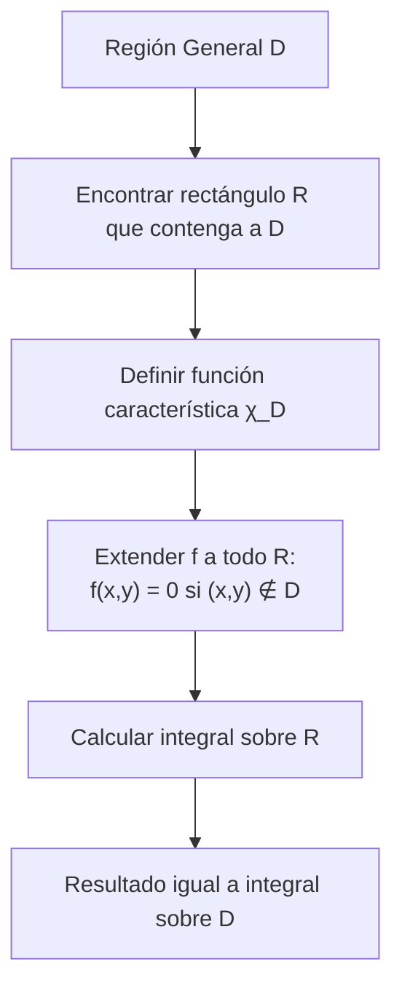
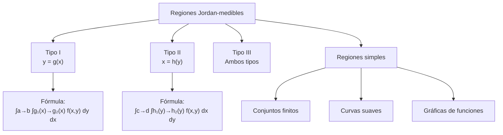

# Matemáticas para Ciencias Aplicadas III - Integral de Riemann

## 1.2 La integral sobre regiones más generales.

---

### Introducción

La extensión de la integral de Riemann a regiones más generales que rectángulos es fundamental para aplicaciones prácticas en física, ingeniería y otras ciencias. Esta guía cubre los conceptos, métodos y aplicaciones de la integración sobre regiones generales.

### 1. Definición de Regiones Jordan-medibles

Una región acotada $D \subset \mathbb{R}^2$ es **Jordan-medible** si su frontera $\partial D$ tiene medida cero. Los discos, los polígonos y las regiones limitadas por un número finito de curvas suaves lo son.

**Caracterización:** D es Jordan-medible si y sólo si la función característica:

$$ χ_D(x) = \begin{cases} 1 & \text{si } x \in D \\ 0 & \text{si } x \notin D \end{cases} $$

es integrable sobre algún rectángulo $R$ que contenga a $D.$ En ese caso el **área** (o contenido) de $D$ es $\iint_R \chi_D \, dA.$

### 2. Integral sobre Regiones Generales

Si $D$ es Jordan-medible y $f$ es acotada, definimos

$$\iint_D f(x,y) \, dA = \iint_R f(x,y) \cdot χ_D(x,y) \, dA$$

donde $R$ es un rectángulo que contiene a $D.$ El resultado no depende del rectángulo elegido, porque $f\chi_D$ vale cero fuera de $D.$ Si $f$ es continua en $D,$ el producto $f\chi_D$ solo puede ser discontinuo en $\partial D,$ que tiene medida cero, así que la integral existe.



### 3. Tipos de Regiones

#### 3.1 Regiones de Tipo I

Regiones entre las gráficas de dos funciones continuas de $x:$

$$D = \{(x,y) \mid a \leq x \leq b, g_1(x) \leq y \leq g_2(x)\}$$

**Fórmula de integración:**

$$\iint_D f(x,y) \, dA = \int_a^b \left( \int_{g_1(x)}^{g_2(x)} f(x,y) \, dy \right) dx$$

#### 3.2 Regiones de Tipo II

Regiones entre las gráficas de dos funciones continuas de $y:$

$$D = \{(x,y) \mid c \leq y \leq d, h_1(y) \leq x \leq h_2(y)\}$$

**Fórmula de integración:**

$$\iint_D f(x,y) \, dA = \int_c^d \left( \int_{h_1(y)}^{h_2(y)} f(x,y) \, dx \right) dy$$

#### 3.3 Regiones de Tipo III

Regiones que son a la vez de Tipo I y de Tipo II, como los discos, los rectángulos y los triángulos. Las regiones más complicadas se dividen en piezas de estos tipos y se usa la aditividad.

### 4. Cambio de Orden de Integración

Para regiones que son tanto de Tipo I como de Tipo II, podemos cambiar el orden de integración. Los nuevos límites se obtienen **dibujando la región** y despejando las curvas frontera en términos de la otra variable:

$$\int_a^b \int_{g_1(x)}^{g_2(x)} f(x,y) \, dy \, dx = \int_c^d \int_{h_1(y)}^{h_2(y)} f(x,y) \, dx \, dy$$

### 5. Propiedades de la Integral sobre Regiones Generales

Todas las propiedades de la integral sobre rectángulos se mantienen:

- Linealidad
- Monotonía
- Aditividad: si $D = D_1 \cup D_2$ y $D_1 \cap D_2$ tiene área cero, $\iint_D f = \iint_{D_1} f + \iint_{D_2} f.$
- Desigualdad triangular
- Teorema del valor medio, si $D$ además es conexa: $\iint_D f = f(c)\,\text{Área}(D)$ para algún $c \in D.$

### 6. Ejemplos Resueltos

#### Ejemplo 1: Región triangular

Calcular $\iint_D (x + y) \, dA$ donde D es el triángulo con vértices (0,0), (1,0) y (0,1).

**Solución:**
La región puede describirse como:

$$D = \{(x,y) \mid 0 \leq x \leq 1, 0 \leq y \leq 1-x\}$$

$$\iint_D (x + y) \, dA = \int_0^1 \int_0^{1-x} (x + y) \, dy \, dx$$

$$= \int_0^1 \left[ xy + \frac{y^2}{2} \right]_0^{1-x} dx$$

$$= \int_0^1 \left( x(1-x) + \frac{(1-x)^2}{2} \right) dx = \int_0^1 \left( \frac{1}{2} - \frac{x^2}{2} \right) dx = \frac{1}{2} - \frac{1}{6} = \frac{1}{3}$$

#### Ejemplo 2: Cambio de orden de integración

Calcular $\int_0^1 \int_{x^2}^{\sqrt{x}} f(x,y) \, dy \, dx$ cambiando el orden de integración.

**Solución:**
La región es:

$$D = \{(x,y) \mid 0 \leq x \leq 1, x^2 \leq y \leq \sqrt{x}\}$$

Las curvas $y = x^2$ y $y = \sqrt{x}$ se cortan en $(0, 0)$ y $(1, 1).$ Despejando $x$ en cada una, $x = \sqrt{y}$ y $x = y^2;$ para $0 < y < 1,$ $y^2 < \sqrt{y}.$ Como región Tipo II:

$$D = \{(x,y) \mid 0 \leq y \leq 1, y^2 \leq x \leq \sqrt{y}\}$$

Por tanto:

$$\int_0^1 \int_{x^2}^{\sqrt{x}} f(x,y) \, dy \, dx = \int_0^1 \int_{y^2}^{\sqrt{y}} f(x,y) \, dx \, dy$$

Con $f = 1$ ambas dan el área de la región: $\int_0^1 (\sqrt{x} - x^2) \, dx = \frac{2}{3} - \frac{1}{3} = \frac{1}{3}.$

#### Ejemplo 3: Un orden es imposible y el otro es fácil

Calcular $\int_0^1 \int_x^1 \frac{\sin y}{y} \, dy \, dx.$ La función $\frac{\sin y}{y}$ no tiene primitiva elemental. La región es $0 \leq x \leq y \leq 1,$ que como Tipo II es $0 \leq y \leq 1,$ $0 \leq x \leq y:$

$$\int_0^1 \int_0^y \frac{\sin y}{y} \, dx \, dy = \int_0^1 \sin y \, dy = 1 - \cos 1 \approx 0.4597$$

### 7. Implementación Computacional

```python
import numpy as np
from scipy.integrate import quad, dblquad

# Integral sobre región general (Tipo I) como integral iterada
def integral_tipo_I(f, a, b, g1, g2):
    """
    Calcula ∫∫_D f(x,y) dA para región Tipo I
    D = {(x,y) | a ≤ x ≤ b, g1(x) ≤ y ≤ g2(x)}
    """
    def integrando_interno(x):
        # Para x fijo, integramos respecto a y (integral simple: quad)
        return quad(lambda y: f(x, y), g1(x), g2(x))[0]

    # Integramos el resultado respecto a x
    return quad(integrando_interno, a, b)[0]

# Región Tipo II (ejercicio 5): c ≤ y ≤ d, h1(y) ≤ x ≤ h2(y)
def integral_tipo_II(f, c, d, h1, h2):
    return quad(lambda y: quad(lambda x: f(x, y), h1(y), h2(y))[0], c, d)[0]

# Ejemplo: ∫∫_D (x+y) dA donde D es el triángulo con vértices (0,0), (1,0), (0,1)
def f(x, y):
    return x + y

def g1(x):
    return 0  # Límite inferior en y

def g2(x):
    return 1 - x  # Límite superior en y

resultado = integral_tipo_I(f, 0, 1, g1, g2)
print(f"Resultado: {resultado}")   # 1/3

# Usando scipy directamente (el integrando recibe (y, x))
resultado_scipy, error = dblquad(lambda y, x: x + y, 0, 1, g1, g2)
print(f"Resultado con scipy: {resultado_scipy}")

# El mismo triángulo como región Tipo II: 0 ≤ y ≤ 1, 0 ≤ x ≤ 1 - y
print("Tipo II:", integral_tipo_II(f, 0, 1, lambda y: 0, lambda y: 1 - y))

# Ejemplo 3: sin(y)/y, en el orden fácil
print("Ejemplo 3:", integral_tipo_II(lambda x, y: np.sin(y) / y, 0, 1, lambda y: 0, lambda y: y),
      "≈", 1 - np.cos(1))
```

### 8. Ejercicios Propuestos

#### Ejercicio 1

Calcular $\iint_D xy \, dA$ donde $D$ está acotada por $y = x^2$ e $y = x.$

#### Ejercicio 2

Calcular $\iint_D e^{x/y} \, dA$ donde $D$ está acotada por $y^2 = x,$ $x = 0$ y $y = 1.$

#### Ejercicio 3

Cambiar el orden de integración y calcular:

$$\int_0^1 \int_{y}^{1} e^{x^2} \, dx \, dy$$

#### Ejercicio 4

Calcular el área de la región limitada por las parábolas $y = x^2 - 4x + 3$ e $y = -x^2 + 2x + 3.$

#### Ejercicio 5

Implementar en Python una función para integrar sobre regiones Tipo II.

#### Ejercicio 6

Calcular $\iint_D \frac{y}{x^2 + y^2} \, dA$ donde $D$ es la región en el primer cuadrante entre los círculos $x^2 + y^2 = 1$ y $x^2 + y^2 = 4.$ Sugerencia: usa coordenadas polares, que se justifican en el tema 1.5.

#### Soluciones

1. Las curvas se cortan en $x = 0$ y $x = 1,$ con $x^2 \leq x:$ $\int_0^1 \int_{x^2}^{x} xy \, dy \, dx = \int_0^1 \frac{x^3 - x^5}{2} \, dx = \frac{1}{2}\left(\frac{1}{4} - \frac{1}{6}\right) = \frac{1}{24}.$
2. Como Tipo II, $0 \leq y \leq 1$ y $0 \leq x \leq y^2:$ $\int_0^1 \int_0^{y^2} e^{x/y} \, dx \, dy = \int_0^1 y\left(e^{y} - 1\right) dy = 1 - \frac{1}{2} = \frac{1}{2}.$
3. La región es $0 \leq y \leq x \leq 1:$ $\int_0^1 \int_0^x e^{x^2} \, dy \, dx = \int_0^1 x e^{x^2} \, dx = \frac{e - 1}{2}.$
4. Se cortan en $x = 0$ y $x = 3:$ $\int_0^3 \left[(-x^2 + 2x + 3) - (x^2 - 4x + 3)\right] dx = \int_0^3 (6x - 2x^2) \, dx = 27 - 18 = 9.$
5. Ver `integral_tipo_II` en la sección 7.
6. En polares $\frac{y}{x^2 + y^2} = \frac{\sin\theta}{r}$ y $dA = r \, dr \, d\theta:$ $\int_0^{\pi/2} \int_1^2 \sin\theta \, dr \, d\theta = 1 \cdot 1 = 1.$

### 9. Diagrama Conceptual: Clasificación de Regiones



### 10. Aplicaciones Prácticas

#### 10.1 Cálculo de áreas

El área de una región D está dada por:

$$A(D) = \iint_D 1 \, dA$$

#### 10.2 Centros de masa

Para una lámina con densidad ρ(x,y):

$$M = \iint_D ρ(x,y) \, dA$$

$$\bar{x} = \frac{1}{M} \iint_D x ρ(x,y) \, dA, \quad \bar{y} = \frac{1}{M} \iint_D y ρ(x,y) \, dA$$

#### 10.3 Momentos de inercia

$$I_x = \iint_D y^2 ρ(x,y) \, dA, \quad I_y = \iint_D x^2 ρ(x,y) \, dA$$

### 11. Consejos para Resolución de Problemas

1. **Dibujar la región** de integración
2. **Determinar el tipo** de región (I, II, III)
3. **Establecer los límites** de integración correctamente
4. **Considerar cambiar el orden** de integración si simplifica el cálculo
5. **Verificar la respuesta** mediante diferentes métodos

### 12. Referencias y Bibliografía

1. **Apostol, T. M.** - "Calculus, Vol. 2" - Capítulo 12
2. **Marsden, J. E. & Tromba, A. J.** - "Vector Calculus" - Capítulo 5
3. **Stewart, J.** - "Cálculo de varias variables" - Capítulo 15
4. **Larson, R. & Edwards, B. H.** - "Cálculo" - Capítulo 14
