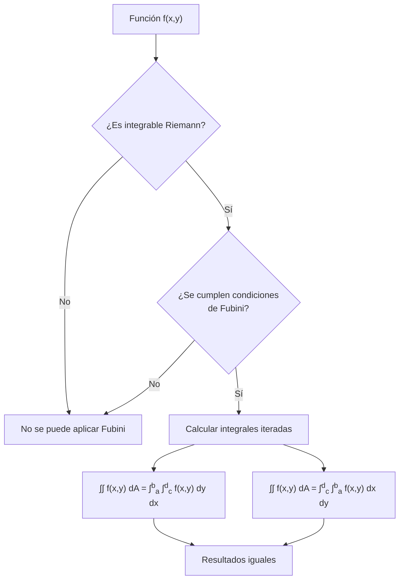
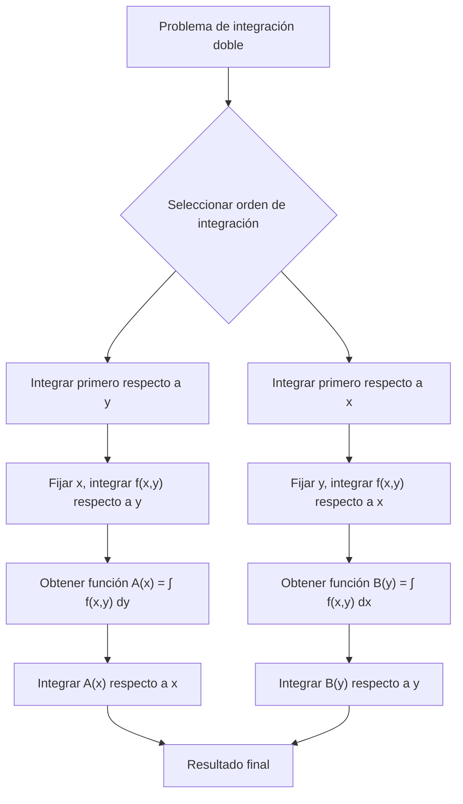

# Matemáticas para Ciencias Aplicadas III - Integral de Riemann

## 1.3 Integral iterada y el teorema de Fubini.

---

### Introducción

El teorema de Fubini es uno de los resultados más importantes del cálculo multivariable, ya que permite calcular integrales múltiples mediante integración iterada. Esta técnica transforma problemas complejos de integración múltiple en problemas más simples de integración unidimensional.

### 1. Definición de Integral Iterada

Para una función $f: [a,b] \times [c,d] \rightarrow \mathbb{R},$ definimos las **integrales iteradas**:

**Integral iterada con integración primero respecto a y:**

$$A(x) = \int_c^d f(x,y) \, dy \quad \text{y luego} \quad \int_a^b A(x) \, dx = \int_a^b \left( \int_c^d f(x,y) \, dy \right) dx$$

**Integral iterada con integración primero respecto a x:**

$$B(y) = \int_a^b f(x,y) \, dx \quad \text{y luego} \quad \int_c^d B(y) \, dy = \int_c^d \left( \int_a^b f(x,y) \, dx \right) dy$$

### 2. Teorema de Fubini para Rectángulos

#### 2.1 Enunciado formal

Sea $f: R = [a,b] \times [c,d] \rightarrow \mathbb{R}$ integrable Riemann. Si para cada $x \in [a, b]$ existe $A(x) = \int_c^d f(x,y) \, dy,$ entonces $A$ es integrable en $[a, b]$ y

$$\iint_R f(x,y) \, dA = \int_a^b \left( \int_c^d f(x,y) \, dy \right) dx$$

Del mismo modo, si para cada $y$ existe $B(y) = \int_a^b f(x,y) \, dx,$ la integral doble también es igual a $\int_c^d B(y) \, dy.$

**Idea de la demostración.** Para una partición $P = P_x \times P_y,$ en cada franja vertical se cumple $\sum_j m_{ij}\Delta y_j \leq A(x) \leq \sum_j M_{ij}\Delta y_j.$ Sumando sobre las franjas, $L(f, P) \leq L(A, P_x) \leq U(A, P_x) \leq U(f, P).$ Como $L(f, P)$ y $U(f, P)$ se acercan a $\iint_R f,$ también lo hace la integral de $A.$

#### 2.2 Caso particular más usado

Si $f$ es continua en $R,$ todas las hipótesis se cumplen: ambas integrales iteradas existen y son iguales a la integral doble,

$$\iint_R f(x,y) \, dA = \int_a^b \left( \int_c^d f(x,y) \, dy \right) dx = \int_c^d \left( \int_a^b f(x,y) \, dx \right) dy$$

#### 2.3 Cuando las hipótesis fallan

Para $f(x, y) = \frac{x^2 - y^2}{(x^2 + y^2)^2}$ en $[0,1] \times [0,1],$ que no es acotada cerca del origen,

$$\int_0^1 \int_0^1 f \, dy \, dx = \frac{\pi}{4}, \qquad \int_0^1 \int_0^1 f \, dx \, dy = -\frac{\pi}{4}$$

Las dos integrales iteradas existen pero son distintas. Fubini no se contradice: $f$ no es integrable en el cuadrado.

### 3. Teorema de Fubini para Regiones Generales

#### 3.1 Regiones de Tipo I

Para $D = \{(x,y) \mid a \leq x \leq b, g_1(x) \leq y \leq g_2(x)\}:$

$$\iint_D f(x,y) \, dA = \int_a^b \left( \int_{g_1(x)}^{g_2(x)} f(x,y) \, dy \right) dx$$

#### 3.2 Regiones de Tipo II

Para $D = \{(x,y) \mid c \leq y \leq d, h_1(y) \leq x \leq h_2(y)\}:$

$$\iint_D f(x,y) \, dA = \int_c^d \left( \int_{h_1(y)}^{h_2(y)} f(x,y) \, dx \right) dy$$

### 4. Condiciones de Aplicabilidad

El teorema de Fubini se puede aplicar cuando se cumplen **a la vez** estas dos condiciones:

1. $f$ es integrable en $R,$ por ejemplo porque es continua, o porque es acotada y sus discontinuidades forman un conjunto de medida cero.
2. Las integrales interiores existen. Esto es automático si $f$ es continua.

Que las integrales iteradas existan **no basta** por sí solo, como muestra el ejemplo de la sección 2.3.



### 5. Ejemplos Resueltos

#### Ejemplo 1: Integral sobre rectángulo

Calcular $\iint_R (x^2 + y^2) \, dA$ donde $R = [0,2] \times [1,3].$

**Solución:**

$$\int_1^3 \int_0^2 (x^2 + y^2) \, dx \, dy = \int_1^3 \left[ \frac{x^3}{3} + xy^2 \right]_0^2 dy$$

$$= \int_1^3 \left( \frac{8}{3} + 2y^2 \right) dy = \left[ \frac{8}{3}y + \frac{2}{3}y^3 \right]_1^3$$

$$= \left( 8 + 18 \right) - \left( \frac{8}{3} + \frac{2}{3} \right) = 26 - \frac{10}{3} = \frac{68}{3}$$

En el otro orden: $\int_0^2 \int_1^3 (x^2 + y^2) \, dy \, dx = \int_0^2 \left(2x^2 + \frac{26}{3}\right) dx = \frac{16}{3} + \frac{52}{3} = \frac{68}{3}.$

#### Ejemplo 2: Cambio de orden de integración

Calcular $\int_0^1 \int_x^1 e^{y^2} \, dy \, dx$

**Solución:**
$e^{y^2}$ no tiene primitiva elemental, así que el orden dado no se puede calcular a mano. La región es $0 \leq x \leq 1,$ $x \leq y \leq 1,$ el triángulo bajo la diagonal vista desde el eje $y.$ Cambiando el orden:
$0 \leq y \leq 1,$ $0 \leq x \leq y.$

$$\int_0^1 \int_0^y e^{y^2} \, dx \, dy = \int_0^1 y e^{y^2} \, dy = \frac{1}{2} \left[ e^{y^2} \right]_0^1 = \frac{e - 1}{2}$$

### 6. Implementación Computacional

```python
import numpy as np
from scipy.integrate import dblquad, nquad

# Implementación del teorema de Fubini para rectángulos
def fubini_rectangulo(f, a, b, c, d, orden='xy'):
    """
    Calcula la integral doble usando Fubini
    f: función a integrar
    a, b: límites en x
    c, d: límites en y
    orden: 'xy' para integrar primero respecto a y, luego x
           'yx' para integrar primero respecto a x, luego y
    """
    if orden == 'xy':
        # ∫a→b ∫c→d f(x,y) dy dx
        resultado, error = dblquad(lambda y, x: f(x, y), a, b, c, d)
    else:
        # ∫c→d ∫a→b f(x,y) dx dy
        resultado, error = dblquad(lambda x, y: f(x, y), c, d, a, b)

    return resultado, error

# Ejemplo: f(x,y) = x² + y² sobre [0,2]×[1,3]
def f(x, y):
    return x**2 + y**2

# Integración en ambos órdenes
resultado_xy, error_xy = fubini_rectangulo(f, 0, 2, 1, 3, 'xy')
resultado_yx, error_yx = fubini_rectangulo(f, 0, 2, 1, 3, 'yx')

print(f"∫0→2 ∫1→3 (x²+y²) dy dx = {resultado_xy}")
print(f"∫1→3 ∫0→2 (x²+y²) dx dy = {resultado_yx}")

# Verificación con solución analítica
solucion_analitica = 68/3
print(f"Solución analítica: {solucion_analitica}")
print(f"Diferencia: {abs(resultado_xy - solucion_analitica)}")

# Contraejemplo de la sección 2.3: las iteradas difieren
from scipy.integrate import quad
g = lambda x, y: (x**2 - y**2) / (x**2 + y**2)**2
# Integrales interiores calculadas de forma exacta: ∫0→1 g dy = 1/(1+x²), ∫0→1 g dx = -1/(1+y²)
print("dy dx:", quad(lambda x: 1 / (1 + x**2), 0, 1)[0], " dx dy:", quad(lambda y: -1 / (1 + y**2), 0, 1)[0])
```

### 7. Casos Especiales y Consideraciones

#### 7.1 Funciones separables

Si $f(x,y) = g(x)h(y),$ entonces:

$$\iint_R f(x,y) \, dA = \left( \int_a^b g(x) \, dx \right) \left( \int_c^d h(y) \, dy \right)$$

#### 7.2 Límites variables

Cuando los límites de integración dependen de variables:

$$\int_a^b \int_{g_1(x)}^{g_2(x)} f(x,y) \, dy \, dx$$

#### 7.3 Integrales impropias

El teorema de Fubini también se aplica a integrales impropias si $f \geq 0$ (teorema de Tonelli) o si $\iint |f| < \infty.$ Un ejemplo clásico es

$$\iint_{\mathbb{R}^2} e^{-x^2 - y^2} \, dA = \left(\int_{-\infty}^{\infty} e^{-x^2} \, dx\right)^2 = \pi$$

donde el valor $\pi$ se obtiene calculando la integral doble en coordenadas polares; de ahí sale $\int_{-\infty}^{\infty} e^{-x^2} \, dx = \sqrt{\pi}.$

### 8. Ejercicios Propuestos

#### Ejercicio 1

Calcular $\int_0^1 \int_0^2 (x^2y + xy^2) \, dy \, dx$ de dos formas diferentes aplicando Fubini.

#### Ejercicio 2

Evaluar $\iint_D xy \, dA$ donde $D$ está acotada por $y = x^2$ e $y = 2x.$

#### Ejercicio 3

Cambiar el orden de integración y calcular:

$$\int_0^1 \int_{y^2}^1 y \cos(x^2) \, dx \, dy$$

#### Ejercicio 4

Demostrar que si $f(x,y) = g(x)h(y),$ entonces:

$$\iint_R f(x,y) \, dA = \left( \int_a^b g(x) \, dx \right) \left( \int_c^d h(y) \, dy \right)$$

#### Ejercicio 5

Calcular $\int_0^2 \int_{y/2}^1 e^{x^2} \, dx \, dy$ cambiando el orden de integración.

#### Ejercicio 6

Implementar en Python una función que calcule integrales iteradas para regiones de Tipo I y Tipo II.

#### Soluciones

1. Primero en $y:$ $\int_0^1 \left(2x^2 + \frac{8x}{3}\right) dx = \frac{2}{3} + \frac{4}{3} = 2.$ Primero en $x:$ $\int_0^2 \left(\frac{y}{3} + \frac{y^2}{2}\right) dy = \frac{2}{3} + \frac{4}{3} = 2.$
2. Las curvas se cortan en $x = 0$ y $x = 2:$ $\int_0^2 \int_{x^2}^{2x} xy \, dy \, dx = \int_0^2 \frac{4x^3 - x^5}{2} \, dx = \frac{1}{2}\left(16 - \frac{32}{3}\right) = \frac{8}{3}.$
3. La región es $0 \leq x \leq 1,$ $0 \leq y \leq \sqrt{x}:$ $\int_0^1 \cos(x^2) \frac{x}{2} \, dx = \frac{\sin 1}{4}.$
4. $\int_c^d g(x)h(y) \, dy = g(x)\int_c^d h(y) \, dy,$ y la constante $\int_c^d h$ sale de la integral exterior.
5. La región es $0 \leq x \leq 1,$ $0 \leq y \leq 2x:$ $\int_0^1 2x e^{x^2} \, dx = e - 1.$
6. Ver `integral_tipo_I` e `integral_tipo_II` en el tema 1.2.

### 9. Diagrama: Proceso de Integración Iterada



### 10. Aplicaciones del Teorema de Fubini

#### 10.1 Cálculo de volúmenes

El volumen bajo una superficie $z = f(x,y)$ sobre una región $D$ es:

$$V = \iint_D f(x,y) \, dA$$

#### 10.2 Valor promedio

El valor promedio de $f$ sobre $D$ es:

$$f_{\text{prom}} = \frac{1}{\text{Área}(D)} \iint_D f(x,y) \, dA$$

#### 10.3 Probabilidades

En distribuciones conjuntas de probabilidad:

$$P((X,Y) \in D) = \iint_D f(x,y) \, dA$$

### 11. Consejos para la Aplicación del Teorema

1. **Analizar la región** de integración antes de elegir el orden
2. **Considerar la complejidad** de integración en cada variable
3. **Verificar continuidad** de la función en la región
4. **Cambiar el orden** cuando la integral sea difícil en un orden
5. **Utilizar simetrías** para simplificar los cálculos

### 12. Referencias y Bibliografía

1. **Apostol, T. M.** - "Calculus, Vol. 2" - Capítulo 11
2. **Spivak, M.** - "Calculus on Manifolds" - Capítulo 3
3. **Stewart, J.** - "Cálculo de varias variables" - Capítulo 15
4. **Marsden, J. E. & Tromba, A. J.** - "Vector Calculus" - Capítulo 5

_El teorema de Fubini es una herramienta poderosa que conecta la integración múltiple con la integración unidimensional, facilitando el cálculo de integrales en múltiples dimensiones mediante técnicas iterativas._
