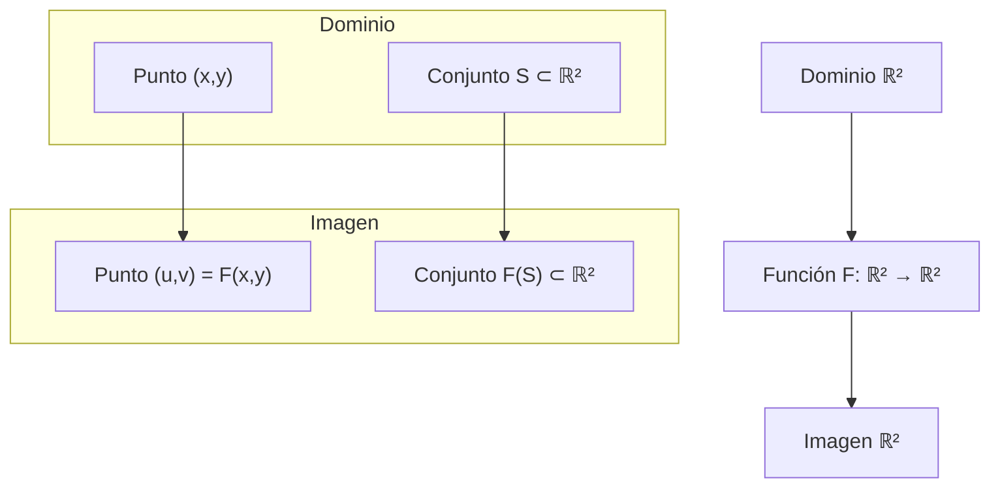
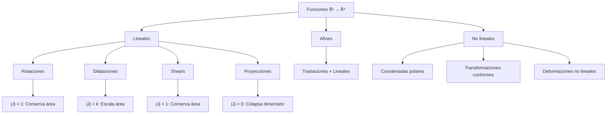

# Matemáticas para Ciencias Aplicadas III - Integral de Riemann

## 1.4 Geometría de las funciones de R2 en R2.

---

### Introducción

Las funciones de ℝ² en ℝ², también conocidas como campos vectoriales en el plano, son fundamentales en matemáticas aplicadas, física e ingeniería. Estas funciones transforman puntos del plano en otros puntos del plano, y su estudio geométrico proporciona intuición sobre comportamientos complejos como flujos, deformaciones y transformaciones.

### 1. Definición Formal

Una función $F: \mathbb{R}^2 \rightarrow \mathbb{R}^2$ se define como:

$$F(x, y) = \begin{pmatrix} u(x, y) \\ v(x, y) \end{pmatrix} = (u(x, y), v(x, y))$$

donde $u, v: \mathbb{R}^2 \rightarrow \mathbb{R}$ son funciones componentes.

### 2. Representación Geométrica

#### 2.1 Como campo vectorial

En cada punto $(x, y)$ del plano, asignamos un vector $(u(x, y), v(x, y))$.

#### 2.2 Como transformación

La función transforma puntos $(x, y)$ en nuevos puntos $(u, v)$.



### 3. Propiedades Geométricas Importantes

#### 3.1 Jacobiano y transformación de áreas

La matriz jacobiana de $F$ es:

$$ J_F(x, y) = \begin{pmatrix} \frac{\partial u}{\partial x} & \frac{\partial u}{\partial y} \\\ \frac{\partial v}{\partial x} & \frac{\partial v}{\partial y} \end{pmatrix} $$

El determinante jacobiano $|J_F(x, y)|$ representa el factor de dilatación/contracción de áreas:

$$ \text{Área}(F(R)) \approx \iint_R |J_F(x, y)|  dA $$

#### 3.2 Puntos fijos
Puntos $(x, y)$ tales que $F(x, y) = (x, y)$

#### 3.3 Curvas integrales
Curvas tangentes al campo vectorial en cada punto

### 4. Clasificación de Funciones ℝ² → ℝ²

#### 4.1 Transformaciones lineales

$$ F(x, y) = \begin{pmatrix} a & b \\ c & d \end{pmatrix} \begin{pmatrix} x \\ y \end{pmatrix} = (ax + by, cx + dy) $$

#### 4.2 Transformaciones afines

$$F(x, y) = (ax + by + e, cx + dy + f)$$

#### 4.3 Transformaciones no lineales
Ejemplo: coordenadas polares a cartesianas:

$$F(r, \theta) = (r \cos \theta, r \sin \theta)$$

### 5. Ejemplos de Transformaciones Geométricas

#### 5.1 Rotación

$$F(x, y) = (x \cos \theta - y \sin \theta, x \sin \theta + y \cos \theta)$$

$$J_F = \begin{pmatrix} \cos \theta & -\sin \theta \\ \sin \theta & \cos \theta \end{pmatrix}, \quad |J_F| = 1$$

#### 5.2 Dilatación/Contracción

$$F(x, y) = (kx, ly)$$

$$J_F = \begin{pmatrix} k & 0 \\ 0 & l \end{pmatrix}, \quad |J_F| = kl$$

#### 5.3 Transformación de corte

$$F(x, y) = (x + ky, y)$$

$$J_F = \begin{pmatrix} 1 & k \\ 0 & 1 \end{pmatrix}, \quad |J_F| = 1$$

### 6. Implementación Computacional

```python
import numpy as np
import matplotlib.pyplot as plt
from matplotlib.patches import Rectangle, Circle

class TransformacionR2aR2:
    def __init__(self, funcion, jacobiano=None):
        self.funcion = funcion
        self.jacobiano = jacobiano

    def aplicar(self, puntos):
        """Aplica la transformación a un conjunto de puntos"""
        return np.array([self.funcion(x, y) for x, y in puntos])

    def visualizar_transformacion(self, dominio, titulo=""):
        """Visualiza el efecto de la transformación"""
        fig, (ax1, ax2) = plt.subplots(1, 2, figsize=(12, 5))

        # Dominio
        x, y = dominio
        puntos = np.array(np.meshgrid(x, y)).T.reshape(-1, 2)
        ax1.scatter(puntos[:, 0], puntos[:, 1], alpha=0.6, color='blue')
        ax1.set_title('Dominio')
        ax1.set_xlabel('x')
        ax1.set_ylabel('y')
        ax1.grid(True)
        ax1.axis('equal')

        # Imagen
        imagen = self.aplicar(puntos)
        ax2.scatter(imagen[:, 0], imagen[:, 1], alpha=0.6, color='red')
        ax2.set_title('Imagen - ' + titulo)
        ax2.set_xlabel('u')
        ax2.set_ylabel('v')
        ax2.grid(True)
        ax2.axis('equal')

        plt.tight_layout()
        plt.show()

    def calcular_jacobiano(self, x, y, h=1e-5):
        """Calcula numéricamente el jacobiano si no está definido analíticamente"""
        if self.jacobiano:
            return self.jacobiano(x, y)

        # Derivadas parciales numéricas
        f = self.funcion

        du_dx = (f(x + h, y)[0] - f(x, y)[0]) / h
        du_dy = (f(x, y + h)[0] - f(x, y)[0]) / h
        dv_dx = (f(x + h, y)[1] - f(x, y)[1]) / h
        dv_dy = (f(x, y + h)[1] - f(x, y)[1]) / h

        return np.array([[du_dx, du_dy], [dv_dx, dv_dy]])

# Ejemplo: Transformación de rotación
def rotacion(theta):
    def funcion(x, y):
        return (x * np.cos(theta) - y * np.sin(theta),
                x * np.sin(theta) + y * np.cos(theta))

    def jacobiano(x, y):
        return np.array([[np.cos(theta), -np.sin(theta)],
                         [np.sin(theta), np.cos(theta)]])

    return TransformacionR2aR2(funcion, jacobiano)

# Crear y visualizar transformación
rot = rotacion(np.pi/4)  # Rotación de 45 grados
x = np.linspace(-2, 2, 5)
y = np.linspace(-2, 2, 5)
X, Y = np.meshgrid(x, y)
puntos = np.vstack([X.ravel(), Y.ravel()]).T

rot.visualizar_transformacion((x, y), "Rotación 45°")
```

### 7. Teorema de la Función Inversa

Si $F: \mathbb{R}^2 \rightarrow \mathbb{R}^2$ es continuamente diferenciable y $|J_F(a, b)| \neq 0$ en un punto $(a, b)$, entonces existe una vecindad alrededor de $(a, b)$ donde $F$ es invertible.

### 8. Aplicación al Cambio de Variables

Para integrales dobles, si $F: (x, y) \mapsto (u, v)$ es una transformación invertible:

$$\iint_{F(R)} g(u, v)  du  dv = \iint_R g(F(x, y)) |J_F(x, y)|  dx  dy$$

### 9. Ejercicios Propuestos

#### Ejercicio 1
Para la transformación $F(x, y) = (x^2 - y^2, 2xy)$:
a) Calcule la matriz jacobiana
b) Determine dónde es localmente invertible
c) Encuentre los puntos fijos

#### Ejercicio 2
Demuestre que la transformación a coordenadas polares $F(r, \theta) = (r \cos \theta, r \sin \theta)$ tiene determinante jacobiano $|J_F| = r$.

#### Ejercicio 3
Para la transformación lineal $F(x, y) = (2x + y, x - 3y)$:
a) Encuentre la imagen del cuadrado unitario
b) Calcule el área de la imagen
c) Verifique usando el determinante jacobiano

#### Ejercicio 4
Implemente en Python una función que visualice el campo vectorial de $F(x, y) = (-y, x)$ (rotación pura).

#### Ejercicio 5
Estudie la transformación $F(x, y) = (x + \sin y, y + \cos x)$:
a) Encuentre puntos donde el jacobiano sea singular
b) Visualice el efecto sobre una malla rectangular

#### Ejercicio 6
Para la transformación $F(x, y) = (e^x \cos y, e^x \sin y)$ (coordenadas exponenciales complejas):
a) Calcule el jacobiano
b) Determine dónde es localmente invertible

### 10. Diagrama: Clasificación de Transformaciones



### 11. Aplicaciones en Ciencias Aplicadas

#### 11.1 Mecánica de fluidos
Campos de velocidad: $F(x, y, t) = (u(x, y, t), v(x, y, t))$

#### 11.2 Procesamiento de imágenes
Transformaciones geométricas para corrección de distorsión

#### 11.3 Mecánica de sólidos
Deformaciones: $F(\text{posición original}) = \text{posición deformada}$

#### 11.4 Sistemas dinámicos
Flujos: $\phi_t: (x_0, y_0) \mapsto (x(t), y(t))$

### 12. Consejos para el Estudio

1. **Visualizar siempre** que sea posible usando software o dibujos
2. **Entender el significado geométrico** del determinante jacobiano
3. **Practicar con diferentes tipos** de transformaciones
4. **Relacionar con aplicaciones físicas** para ganar intuición
5. **Verificar resultados** con métodos analíticos y numéricos

### 13. Referencias y Bibliografía

1. **Marsden, J. E. & Tromba, A. J.** - "Vector Calculus" - Capítulos 3 y 4
2. **Apostol, T. M.** - "Calculus, Vol. 2" - Capítulo 9
3. **Do Carmo, M. P.** - "Differential Geometry of Curves and Surfaces" - Capítulo 2
4. **Hubbard, J. H. & Hubbard, B. B.** - "Vector Calculus, Linear Algebra, and Differential Forms"
