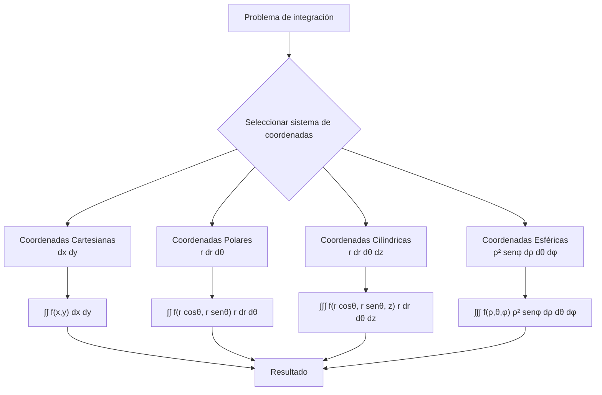
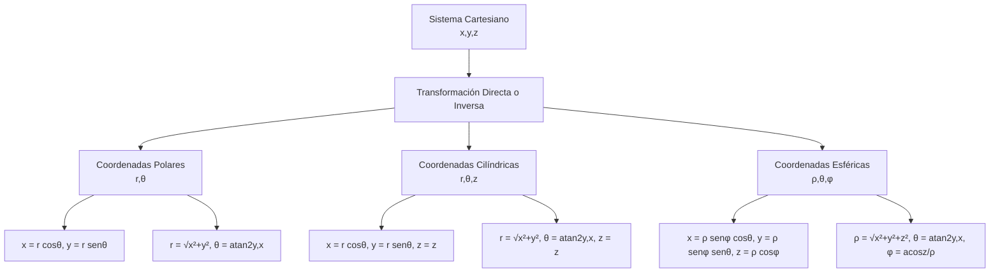

# Matemáticas para Ciencias Aplicadas III - Integral de Riemann

## 1.5 Teorema del cambio de variable.

---

### Introducción

El teorema del cambio de variable es una de las herramientas más poderosas del cálculo multivariable, que generaliza la técnica de sustitución a integrales múltiples. Permite transformar integrales complejas en otras más simples mediante un cambio de coordenadas adecuado.

### 1. Formulación del Teorema

#### 1.1 Enunciado formal

Sea $T: D^* \subset \mathbb{R}^n \rightarrow D \subset \mathbb{R}^n$ una transformación continuamente diferenciable y biyectiva. Si $f: D \rightarrow \mathbb{R}$ es integrable, entonces:

$$\int_D f(\mathbf{x})  d\mathbf{x} = \int_{D^*} f(T(\mathbf{u})) |J_T(\mathbf{u})|  d\mathbf{u}$$

donde $J_T(\mathbf{u})$ es el determinante jacobiano de la transformación $T$.

#### 1.2 Determinante Jacobiano

Para $T: (u,v) \rightarrow (x(u,v), y(u,v))$:

$$ J_T(u,v) = \frac{\partial(x,y)}{\partial(u,v)} = \begin{vmatrix} \frac{\partial x}{\partial u} & \frac{\partial x}{\partial v} \\\ \frac{\partial y}{\partial u} & \frac{\partial y}{\partial v} \end{vmatrix} $$

### 2. Transformaciones Comunes

#### 2.1 Coordenadas Polares

$$T(r,\theta) = (r\cos\theta, r\sin\theta)$$

$$J_T(r,\theta) = \begin{vmatrix} \cos\theta & -r\sin\theta \\\ \sin\theta & r\cos\theta \end{vmatrix} = r$$

#### 2.2 Coordenadas Cilíndricas

$$T(r,\theta,z) = (r\cos\theta, r\sin\theta, z)$$

$$J_T(r,\theta,z) = r$$

#### 2.3 Coordenadas Esféricas

$$T(\rho,\theta,\phi) = (\rho\sin\phi\cos\theta, \rho\sin\phi\sin\theta, \rho\cos\phi)$$

$$J_T(\rho,\theta,\phi) = \rho^2 \sin\phi$$



### 3. Procedimiento para Cambio de Variable

1. **Identificar** la transformación adecuada $T$
2. **Calcular** el determinante jacobiano $|J_T|$
3. **Determinar** los nuevos límites de integración
4. **Reescribir** la función integrando en las nuevas variables
5. **Evaluar** la integral resultante

### 4. Ejemplos Resueltos

#### Ejemplo 1: Coordenadas polares
Calcular $\iint_D e^{-x^2-y^2}  dA$ donde $D$ es el disco $x^2 + y^2 \leq 9$.

**Solución:**
Usando coordenadas polares: $x = r\cos\theta$, $y = r\sin\theta$, $dA = r  dr  d\theta$

$$\iint_D e^{-x^2-y^2}  dA = \int_0^{2\pi} \int_0^3 e^{-r^2} r  dr  d\theta$$
$$= \int_0^{2\pi} d\theta \cdot \int_0^3 r e^{-r^2}  dr = 2\pi \left[ -\frac{1}{2}e^{-r^2} \right]_0^3 = \pi(1 - e^{-9})$$

#### Ejemplo 2: Transformación lineal
Calcular $\iint_R (x + y)  dA$ donde $R$ es el paralelogramo con vértices $(0,0)$, $(2,1)$, $(1,2)$, $(3,3)$.

**Solución:**
Usamos la transformación: $u = x - y$, $v = x + y$
El jacobiano es: $J = \frac{\partial(x,y)}{\partial(u,v)} = \frac{1}{2}$

$$\iint_R (x + y)  dA = \iint_{R^*} v \cdot \frac{1}{2}  du  dv = \frac{1}{2} \int_{-1}^{1} \int_{1}^{3} v  dv  du = 4$$

### 5. Implementación Computacional

```python
import numpy as np
import sympy as sp
from scipy.integrate import nquad

class CambioVariable:
    def __init__(self, transformacion, inversa=None):
        self.transformacion = transformacion
        self.inversa = inversa

    def jacobiano(self, variables):
        """Calcula el determinante jacobiano simbólicamente"""
        x, y = sp.symbols('x y')
        u, v = sp.symbols('u v')

        # Transformación: (u,v) -> (x(u,v), y(u,v))
        x_expr, y_expr = self.transformacion(u, v)

        # Matriz jacobiana
        J = sp.Matrix([[sp.diff(x_expr, u), sp.diff(x_expr, v)],
                       [sp.diff(y_expr, u), sp.diff(y_expr, v)]])

        return sp.det(J)

    def integrar(self, f, limites_uv, limites_xy=None):
        """Realiza la integración con cambio de variable"""
        u, v = sp.symbols('u v')
        x_expr, y_expr = self.transformacion(u, v)
        J = self.jacobiano((u, v))

        # Función en nuevas variables
        f_uv = f(x_expr, y_expr) * sp.Abs(J)

        # Convertir a función numérica
        f_num = sp.lambdify((u, v), f_uv, 'numpy')

        # Realizar integración
        resultado, error = nquad(f_num, limites_uv)
        return resultado, error

# Ejemplo: Coordenadas polares
def transformacion_polar(u, v):
    r, theta = u, v
    return r * sp.cos(theta), r * sp.sin(theta)

# Función a integrar: e^(-x²-y²)
def f(x, y):
    return sp.exp(-x**2 - y**2)

# Crear objeto de cambio de variable
cambio = CambioVariable(transformacion_polar)

# Límites en coordenadas polares: r ∈ [0, 3], θ ∈ [0, 2π]
limites_uv = [[0, 3], [0, 2*np.pi]]

resultado, error = cambio.integrar(f, limites_uv)
print(f"Resultado: {resultado}, Error: {error}")
print(f"Valor teórico: {np.pi * (1 - np.exp(-9))}")
```

### 6. Aplicaciones del Teorema

#### 6.1 Cálculo de áreas y volúmenes
El teorema permite calcular áreas y volúmenes en sistemas de coordenadas más adecuados a la simetría del problema.

#### 6.2 Probabilidades y estadística
En la integración de funciones de densidad de probabilidad multivariadas.

#### 6.3 Física matemática
En la resolución de ecuaciones diferenciales parciales y problemas de potencial.

#### 6.4 Procesamiento de imágenes
En transformaciones geométricas y corrección de distorsiones.

### 7. Ejercicios Propuestos

#### Ejercicio 1
Calcular $\iint_D \sqrt{x^2 + y^2}  dA$ donde $D$ es la región anular $1 \leq x^2 + y^2 \leq 4$ usando coordenadas polares.

#### Ejercicio 2
Usar la transformación $u = x + y$, $v = x - y$ para calcular:
$$\iint_R (x^2 + y^2)  dA$$
donde $R$ es el rectángulo con vértices $(1,1)$, $(2,2)$, $(3,1)$, $(4,2)$.

#### Ejercicio 3
Calcular el volumen del elipsoide $\frac{x^2}{a^2} + \frac{y^2}{b^2} + \frac{z^2}{c^2} \leq 1$ usando una transformación adecuada.

#### Ejercicio 4
Demostrar que para coordenadas esféricas, el determinante jacobiano es $\rho^2 \sin\phi$.

#### Ejercicio 5
Implementar en Python una clase que maneje cambios de variables en 3D (coordenadas esféricas y cilíndricas).

#### Ejercicio 6
Calcular $\iiint_V z  dV$ donde $V$ está acotada por $x^2 + y^2 + z^2 \leq 1$ y $z \geq 0$ usando coordenadas esféricas.

### 8. Diagrama: Relación entre Sistemas de Coordenadas



### 9. Teorema de Cambio de Variable Generalizado

Para transformaciones $T: \mathbb{R}^n \rightarrow \mathbb{R}^n$:

$$\int_{T(D)} f(\mathbf{x})  d\mathbf{x} = \int_D f(T(\mathbf{u})) |J_T(\mathbf{u})|  d\mathbf{u}$$

donde $|J_T(\mathbf{u})|$ es el valor absoluto del determinante jacobiano.

### 10. Condiciones de Aplicabilidad

El teorema requiere que:
1. $T$ sea continuamente diferenciable $(C^1)$
2. $T$ sea inyectiva en el interior de $D$
3. $|J_T(\mathbf{u})| \neq 0$ en el interior de $D$
4. $f$ sea integrable en $T(D)$

### 11. Consejos para la Aplicación

1. **Identificar la simetría** del problema para elegir el sistema de coordenadas adecuado
2. **Verificar que la transformación** sea invertible en la región de integración
3. **Calcular cuidadosamente** el determinante jacobiano
4. **Determinar correctamente** los nuevos límites de integración
5. **Comprobar el resultado** mediante diferentes métodos cuando sea posible

### 12. Referencias y Bibliografía

1. **Apostol, T. M.** - "Calculus, Vol. 2" - Capítulo 10
2. **Marsden, J. E. & Tromba, A. J.** - "Vector Calculus" - Capítulo 5
3. **Spivak, M.** - "Calculus on Manifolds" - Capítulo 3
4. **Stewart, J.** - "Cálculo de varias variables" - Capítulo 15


*El teorema del cambio de variable es una herramienta fundamental que amplía enormemente nuestra capacidad para resolver problemas de integración complejos, permitiendo adaptar el sistema de coordenadas a la geometría específica de cada problema.*
