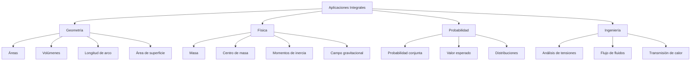
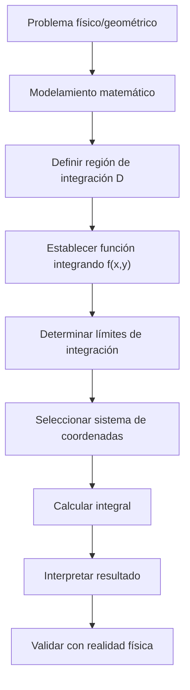

# Matemáticas para Ciencias Aplicadas III - Integral de Riemann

## 1.6 Aplicaciones.

---

### Introducción

La integral de Riemann múltiple tiene aplicaciones fundamentales en diversas áreas de las ciencias aplicadas. Esta guía explora las principales aplicaciones físicas y geométricas, proporcionando las herramientas matemáticas necesarias para resolver problemas del mundo real.

### 1. Cálculo de Áreas y Volúmenes

#### 1.1 Área de regiones planas

El área de una región $D \subset \mathbb{R}^2$ está dada por:

$$A(D) = \iint_D dA$$

**Ejemplo:** Área entre curvas $y = x^2$ e $y = \sqrt{x}$:

$$A = \int_0^1 \int_{x^2}^{\sqrt{x}} dy  dx = \int_0^1 (\sqrt{x} - x^2)  dx = \frac{1}{3}$$

#### 1.2 Volumen de sólidos

El volumen bajo una superficie $z = f(x,y) \geq 0$ sobre una región $D$ es:

$$V = \iint_D f(x,y)  dA$$

**Ejemplo:** Volumen bajo $z = 4 - x^2 - y^2$ sobre $x^2 + y^2 \leq 1$:

$$V = \int_0^{2\pi} \int_0^1 (4 - r^2) r  dr  d\theta = \frac{7\pi}{2}$$

### 2. Aplicaciones en Física

#### 2.1 Masa total

Para una lámina con densidad $\rho(x,y)$:

$$M = \iint_D \rho(x,y)  dA$$

#### 2.2 Centro de masa

$$\bar{x} = \frac{1}{M} \iint_D x \rho(x,y)  dA, \quad \bar{y} = \frac{1}{M} \iint_D y \rho(x,y)  dA$$

#### 2.3 Momentos de inercia

$$I_x = \iint_D y^2 \rho(x,y)  dA, \quad I_y = \iint_D x^2 \rho(x,y)  dA$$

$$I_z = \iint_D (x^2 + y^2) \rho(x,y)  dA$$

### 3. Valor Promedio de una Función

El valor promedio de $f$ sobre una región $D$ es:

$$f_{\text{prom}} = \frac{1}{\text{Área}(D)} \iint_D f(x,y)  dA$$

### 4. Aplicaciones en Probabilidad

Para una función de densidad conjunta $f(x,y) \geq 0$ con $\iint_{\mathbb{R}^2} f(x,y)  dA = 1$:

$$P((X,Y) \in D) = \iint_D f(x,y)  dA$$



### 5. Implementación Computacional

```python
import numpy as np
from scipy.integrate import dblquad, nquad

class AplicacionesIntegrales:
    @staticmethod
    def area_region(limites_x, limites_y):
        """Calcula el área de una región rectangular"""
        area, error = dblquad(lambda y, x: 1,
                             limites_x[0], limites_x[1],
                             lambda x: limites_y[0], lambda x: limites_y[1])
        return area

    @staticmethod
    def volumen_superficie(f, limites_x, limites_y):
        """Calcula el volumen bajo una superficie z = f(x,y)"""
        volumen, error = dblquad(f,
                                limites_x[0], limites_x[1],
                                lambda x: limites_y[0], lambda x: limites_y[1])
        return volumen

    @staticmethod
    def centro_masa(densidad, limites_x, limites_y):
        """Calcula el centro de masa de una lámina"""
        # Masa total
        M, _ = dblquad(densidad,
                      limites_x[0], limites_x[1],
                      lambda x: limites_y[0], lambda x: limites_y[1])

        # Coordenadas del centro de masa
        def integrando_x(x, y):
            return x * densidad(x, y)

        def integrando_y(x, y):
            return y * densidad(x, y)

        M_x, _ = dblquad(integrando_x,
                        limites_x[0], limites_x[1],
                        lambda x: limites_y[0], lambda x: limites_y[1])

        M_y, _ = dblquad(integrando_y,
                        limites_x[0], limites_x[1],
                        lambda x: limites_y[0], lambda x: limites_y[1])

        return M_x/M, M_y/M

    @staticmethod
    def momento_inercia(densidad, limites_x, limites_y, eje='z'):
        """Calcula momentos de inercia"""
        if eje.lower() == 'x':
            def integrando(x, y):
                return y**2 * densidad(x, y)
        elif eje.lower() == 'y':
            def integrando(x, y):
                return x**2 * densidad(x, y)
        else:  # eje z
            def integrando(x, y):
                return (x**2 + y**2) * densidad(x, y)

        I, _ = dblquad(integrando,
                      limites_x[0], limites_x[1],
                      lambda x: limites_y[0], lambda x: limites_y[1])
        return I

# Ejemplo de uso
def densidad_ejemplo(x, y):
    return x + y  # Densidad lineal

# Calcular propiedades para una región [0,1]x[0,1]
app = AplicacionesIntegrales()
masa = app.volumen_superficie(densidad_ejemplo, [0, 1], [0, 1])
centro = app.centro_masa(densidad_ejemplo, [0, 1], [0, 1])
inercia_z = app.momento_inercia(densidad_ejemplo, [0, 1], [0, 1], 'z')

print(f"Masa: {masa:.4f}")
print(f"Centro de masa: ({centro[0]:.4f}, {centro[1]:.4f})")
print(f"Momento de inercia I_z: {inercia_z:.4f}")
```

### 6. Aplicaciones en Ingeniería

#### 6.1 Cálculo de flujo de fluidos

$$\Phi = \iint_S \mathbf{v} \cdot \mathbf{n}  dS$$

#### 6.2 Transmisión de calor

$$Q = -k \iint_S \nabla T \cdot \mathbf{n}  dS$$

#### 6.3 Análisis de tensiones

$$\sigma_{\text{prom}} = \frac{1}{A} \iint_A \sigma(x,y)  dA$$

### 7. Ejercicios Propuestos

#### Ejercicio 1

Calcular el área de la región limitada por las parábolas $y = x^2$ e $y = 2x - x^2$.

#### Ejercicio 2

Encontrar el volumen del sólido acotado por el paraboloide $z = x^2 + y^2$ y el plano $z = 4$.

#### Ejercicio 3

Una lámina triangular con vértices $(0,0)$, $(1,0)$, $(0,2)$ tiene densidad $\rho(x,y) = xy$. Calcular:
a) Masa total
b) Centro de masa
c) Momento de inercia respecto al eje x

#### Ejercicio 4

La temperatura en una placa circular de radio 2 está dada por $T(x,y) = 100 - x^2 - y^2$. Calcular la temperatura promedio.

#### Ejercicio 5

Implementar en Python una función que calcule el área de una región polar $r_1(\theta) \leq r \leq r_2(\theta)$.

#### Ejercicio 6

La función de densidad conjunta de dos variables aleatorias es $f(x,y) = kxy$ para $0 \leq x \leq 1$, $0 \leq y \leq 1$. Calcular:
a) La constante $k$
b) $P(X + Y \leq 1)$

### 8. Diagrama: Proceso de Aplicación



### 9. Aplicaciones Avanzadas

#### 9.1 Integrales de línea y superficie

$$\int_C f  ds = \int_a^b f(\mathbf{r}(t)) \|\mathbf{r}'(t)\|  dt$$

#### 9.2 Teoremas integrales

- Teorema de Green: $\oint_C \mathbf{F} \cdot d\mathbf{r} = \iint_D \left( \frac{\partial Q}{\partial x} - \frac{\partial P}{\partial y} \right) dA$
- Teorema de la divergencia
- Teorema de Stokes

#### 9.3 Aplicaciones en electromagnetismo

$$\Phi_E = \iint_S \mathbf{E} \cdot d\mathbf{A}$$

### 10. Consejos para Resolución de Problemas

1. **Dibujar siempre** la región de integración
2. **Identificar simetrías** para simplificar los cálculos
3. **Elegir el sistema de coordenadas** apropiado
4. **Verificar unidades** en aplicaciones físicas
5. **Utilizar software** para validar resultados complejos

### 11. Implementación de Ejemplo Completo

```python
# Cálculo del volumen de un paraboloide
def paraboloide(x, y):
    return 4 - x**2 - y**2

# Límites para el círculo x² + y² ≤ 4
def limite_inferior(x):
    return -np.sqrt(4 - x**2)

def limite_superior(x):
    return np.sqrt(4 - x**2)

volumen, error = dblquad(paraboloide, -2, 2, limite_inferior, limite_superior)
print(f"Volumen del paraboloide: {volumen:.4f}")

# Solución analítica usando coordenadas polares
volumen_analitico = 8 * np.pi
print(f"Volumen analítico: {volumen_analitico:.4f}")
print(f"Error: {abs(volumen - volumen_analitico):.6f}")
```

### 12. Referencias y Bibliografía

1. **Apostol, T. M.** - "Calculus, Vol. 2" - Capítulos 10-12
2. **Marsden, J. E. & Tromba, A. J.** - "Vector Calculus" - Capítulos 5-7
3. **Stewart, J.** - "Cálculo de varias variables" - Capítulos 15-17
4. **Arfken, G. B. & Weber, H. J.** - "Mathematical Methods for Physicists"
