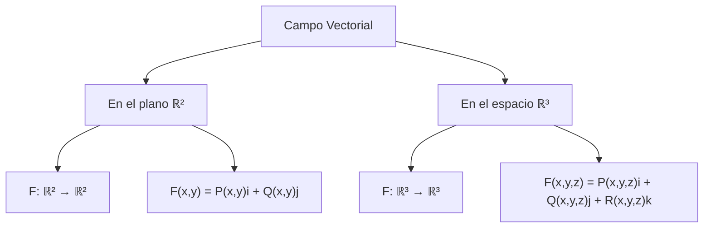
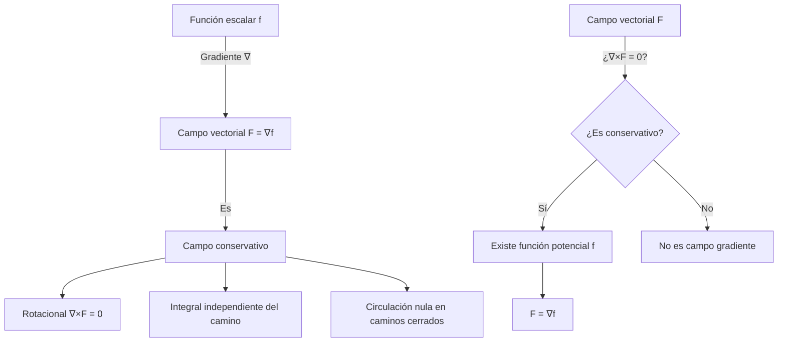

# Matemáticas para Ciencias Aplicadas III - Funciones con valores vectoriales

## 2.1 Campos vectoriales. Campos gradientes.

---

### Introducción

Los campos vectoriales son funciones que asignan a cada punto en el espacio un vector, mientras que los campos gradientes son un tipo especial de campo vectorial que deriva de una función escalar. Estos conceptos son fundamentales en física e ingeniería para modelar fenómenos como campos electromagnéticos, flujo de fluidos y potenciales gravitacionales.

### 1. Campos Vectoriales

#### 1.1 Definición

Un **campo vectorial** en una región $U \subset \mathbb{R}^n$ es una función $\mathbf{F}: U \to \mathbb{R}^n$ que asigna a cada punto $(x_1, \ldots, x_n)$ un vector $\mathbf{F}(x_1, \ldots, x_n),$ que se dibuja con origen en ese punto.

En ℝ³:

$$ \mathbf{F}(x, y, z) = P(x, y, z)\mathbf{i} + Q(x, y, z)\mathbf{j} + R(x, y, z)\mathbf{k} $$

Donde P, Q y R son funciones escalares llamadas **componentes** del campo vectorial.

#### 1.2 Representación



#### 1.3 Ejemplos de Campos Vectoriales

**Ejemplo 1:** Campo gravitacional

$$ \mathbf{F}(x, y, z) = -G\frac{m}{r^3}(x\mathbf{i} + y\mathbf{j} + z\mathbf{k}) $$

donde $r = \sqrt{x^2 + y^2 + z^2}$ y $G$ es la constante gravitacional. Es la fuerza por unidad de masa que produce una masa $m$ en el origen: apunta hacia el origen y su magnitud $\frac{Gm}{r^2}$ decrece con el cuadrado de la distancia. Es un **campo central** de la forma $f(r)\,\mathbf{r}.$

**Ejemplo 2:** Campo de velocidades de un fluido

$$ \mathbf{v}(x, y) = -y\mathbf{i} + x\mathbf{j} $$

Es la velocidad de un disco que gira con velocidad angular $1$ alrededor del origen: cada vector es perpendicular al vector de posición y su magnitud es la distancia al origen.

#### 1.3.1 Líneas de flujo

Una **línea de flujo** o curva integral de $\mathbf{F}$ es una curva $\mathbf{c}(t)$ con $\mathbf{c}'(t) = \mathbf{F}(\mathbf{c}(t)).$ Es la trayectoria de una partícula que se mueve con la velocidad que indica el campo. Para $\mathbf{v} = (-y, x),$ la curva $\mathbf{c}(t) = (\cos t, \sin t)$ cumple $\mathbf{c}'(t) = (-\sin t, \cos t) = \mathbf{v}(\mathbf{c}(t)):$ las líneas de flujo son circunferencias.

#### 1.4 Visualización con Python

```python
import numpy as np
import matplotlib.pyplot as plt

# Crear una malla de puntos
x = np.linspace(-2, 2, 10)
y = np.linspace(-2, 2, 10)
X, Y = np.meshgrid(x, y)

# Definir un campo vectorial: F(x,y) = (-y, x)
U = -Y
V = X

# Visualizar
plt.quiver(X, Y, U, V)
plt.title('Campo vectorial: F(x,y) = (-y, x)')
plt.xlabel('x')
plt.ylabel('y')
plt.grid(True)
plt.axis('equal')
plt.show()
```

### 2. Campos Gradientes

#### 2.1 Definición

Un **campo gradiente** es un campo vectorial que puede expresarse como el gradiente de una función escalar. Si f es una función escalar diferenciable, entonces:

$$ \nabla f = \frac{\partial f}{\partial x}\mathbf{i} + \frac{\partial f}{\partial y} \mathbf{j} + \frac{\partial f}{\partial z}\mathbf{k} $$

El campo vectorial $\mathbf{F} = \nabla f$ se denomina **campo gradiente** o **campo conservativo**, y $f$ se llama **función potencial** de $\mathbf{F}.$ En física se suele usar el potencial $V = -f,$ de modo que $\mathbf{F} = -\nabla V.$

El gradiente apunta en la dirección de máximo crecimiento de $f$ y es **perpendicular a las curvas de nivel** $f = c.$ Por eso un campo gradiente cruza siempre las curvas de nivel en ángulo recto.

#### 2.2 Propiedades de los Campos Gradientes

1. **Circulación nula en caminos cerrados**: $\oint_C \mathbf{F} \cdot d\mathbf{r} = 0$ para toda curva cerrada $C.$
2. **Independencia del camino**: $\int_C \mathbf{F} \cdot d\mathbf{r} = f(B) - f(A)$ para toda curva $C$ de $A$ a $B.$
3. **Rotacional nulo**: $\nabla \times \mathbf{F} = \mathbf{0};$ en el plano, $\frac{\partial P}{\partial y} = \frac{\partial Q}{\partial x}.$ Es una condición **necesaria**, porque las derivadas cruzadas de $f$ coinciden. Es **suficiente** si el dominio es simplemente conexo, por ejemplo todo $\mathbb{R}^2$ o una región convexa.

**Contraejemplo en un dominio con un agujero.** $\mathbf{F} = \left(\frac{-y}{x^2 + y^2}, \frac{x}{x^2 + y^2}\right)$ en $\mathbb{R}^2 \setminus \{0\}$ cumple $\frac{\partial P}{\partial y} = \frac{\partial Q}{\partial x},$ pero su circulación sobre la circunferencia unitaria es $2\pi \neq 0,$ así que no es un campo gradiente en todo su dominio. El tema 4.3 retoma este ejemplo.

#### 2.3 Ejemplo de Campo Gradiente

**Ejemplo:** Dada la función potencial f(x,y) = x²y + y³

$$ \nabla f = \frac{\partial f}{\partial x}\mathbf{i} + \frac{\partial f}{\partial y}\mathbf{j} = 2xy\mathbf{i} + (x^2 + 3y^2)\mathbf{j} $$

El campo vectorial $\mathbf{F}(x,y) = 2xy\mathbf{i} + (x^2 + 3y^2)\mathbf{j}$ es un campo gradiente.

#### 2.3.1 Cómo encontrar una función potencial

Para el campo anterior, sin conocer $f:$

1. Se integra $P$ respecto a $x:$ $f(x, y) = \int 2xy \, dx = x^2 y + g(y),$ donde la constante de integración puede depender de $y.$
2. Se deriva respecto a $y$ y se iguala con $Q:$ $x^2 + g'(y) = x^2 + 3y^2,$ de donde $g'(y) = 3y^2$ y $g(y) = y^3 + C.$
3. Resultado: $f(x, y) = x^2 y + y^3 + C.$

Si en el paso 2 apareciera $x$ en la ecuación de $g'(y),$ el campo no sería gradiente.

#### 2.4 Verificación con Python

```python
import sympy as sp

# Verificar si un campo es gradiente
x, y = sp.symbols('x y')
P = 2*x*y
Q = x**2 + 3*y**2

# Condición: ∂P/∂y = ∂Q/∂x
dP_dy = sp.diff(P, y)
dQ_dx = sp.diff(Q, x)

print(f"∂P/∂y = {dP_dy}")
print(f"∂Q/∂x = {dQ_dx}")
print(f"¿Es campo gradiente? {sp.simplify(dP_dy - dQ_dx) == 0}")

# Construir la función potencial con el método de la sección 2.3.1
f = sp.integrate(P, x)                       # x**2*y + g(y)
g_prima = sp.simplify(Q - sp.diff(f, y))     # debe depender solo de y
f = f + sp.integrate(g_prima, y)
print("Función potencial:", f)               # x**2*y + y**3
```

### 3. Teorema Fundamental para Integrales de Línea

Si $\mathbf{F} = \nabla f$ es un campo gradiente continuo y $C$ es cualquier curva suave por pedazos desde $A$ hasta $B,$ entonces

$$ \int_C \mathbf{F} \cdot d\mathbf{r} = f(B) - f(A) $$

**Demostración.** Si $\mathbf{r}(t),$ $a \leq t \leq b,$ parametriza $C,$ por la regla de la cadena $\frac{d}{dt}f(\mathbf{r}(t)) = \nabla f(\mathbf{r}(t)) \cdot \mathbf{r}'(t).$ Entonces $\int_C \mathbf{F} \cdot d\mathbf{r} = \int_a^b \frac{d}{dt}f(\mathbf{r}(t)) \, dt = f(\mathbf{r}(b)) - f(\mathbf{r}(a)).$

#### 3.1 Aplicación

Calcular $\int_C \mathbf{F} \cdot d\mathbf{r}$ donde $\mathbf{F}(x,y) = 2xy\mathbf{i} + (x^2 + 3y^2)\mathbf{j}$ a lo largo de la curva $y = x^2$ desde $(0,0)$ hasta $(1,1).$

**Solución:** Como $\mathbf{F} = \nabla f$ con $f(x,y) = x^2y + y^3,$ entonces

$$ \int_C \mathbf{F} \cdot d\mathbf{r} = f(1,1) - f(0,0) = (1^2 \cdot 1 + 1^3) - 0 = 2 $$

Comprobación directa con $\mathbf{r}(t) = (t, t^2):$ $\int_0^1 \left[2t \cdot t^2 \cdot 1 + (t^2 + 3t^4) \cdot 2t\right] dt = \int_0^1 (4t^3 + 6t^5) \, dt = 1 + 1 = 2.$

### 4. Ejercicios Propuestos

#### 4.1 Ejercicio 1

Determinar si los siguientes campos vectoriales son gradientes:
a) $\mathbf{F}(x,y) = (3x^2y + y^3)\mathbf{i} + (x^3 + 3xy^2)\mathbf{j}$
b) $\mathbf{F}(x,y) = (2x\cos y)\mathbf{i} - (x^2\sin y)\mathbf{j}$

#### 4.2 Ejercicio 2

Encontrar una función potencial para el campo vectorial $\mathbf{F}(x,y,z) = (2xy + z^3)\mathbf{i} + (x^2 + 2yz)\mathbf{j} + (3xz^2 + y^2)\mathbf{k}.$

#### 4.3 Ejercicio 3

Calcular la integral de línea $\int_C \mathbf{F} \cdot d\mathbf{r}$ donde $\mathbf{F}(x,y) = (ye^x + \sin y)\mathbf{i} + (e^x + x\cos y)\mathbf{j}$ y $C$ es la curva parametrizada por $\mathbf{r}(t) = (t^3, 2t),$ $0 \leq t \leq 1.$

#### 4.4 Ejercicio 4

Visualizar el campo vectorial $\mathbf{F}(x,y) = \left(\frac{x}{(x^2+y^2)^{3/2}}, \frac{y}{(x^2+y^2)^{3/2}}\right)$ y determinar si es conservativo.

#### 4.5 Soluciones

1. a) $\frac{\partial P}{\partial y} = 3x^2 + 3y^2 = \frac{\partial Q}{\partial x},$ así que sí; $f = x^3y + xy^3.$ b) $\frac{\partial P}{\partial y} = -2x\sin y = \frac{\partial Q}{\partial x},$ así que sí; $f = x^2\cos y.$
2. $f(x, y, z) = x^2y + xz^3 + y^2z.$ Se comprueba $f_x = 2xy + z^3,$ $f_y = x^2 + 2yz$ y $f_z = 3xz^2 + y^2.$
3. $\mathbf{F} = \nabla f$ con $f = ye^x + x\sin y.$ La curva va de $(0, 0)$ a $(1, 2),$ así que la integral vale $f(1, 2) - f(0, 0) = 2e + \sin 2.$
4. Es conservativo en $\mathbb{R}^2 \setminus \{0\}:$ $\mathbf{F} = \nabla f$ con $f = -\frac{1}{\sqrt{x^2 + y^2}}.$ Los vectores apuntan hacia afuera del origen y se hacen muy grandes cerca de él.

### 5. Diagrama Conceptual



### 6. Aplicaciones en Física

1. **Campo gravitatorio**: $\mathbf{F} = -\nabla V,$ donde $V = -\frac{Gm}{r}$ es el potencial gravitatorio.
2. **Campo electrostático**: $\mathbf{E} = -\nabla V,$ donde $V$ es el potencial eléctrico.
3. **Mecánica de fluidos**: Un flujo **potencial** tiene velocidad $\mathbf{v} = \nabla\phi;$ es el modelo de un fluido sin vorticidad.
4. **Conservación de la energía**: Si una fuerza es $\mathbf{F} = -\nabla V,$ el trabajo de $A$ a $B$ es $V(A) - V(B),$ y la suma de energía cinética y potencial se conserva.

### 7. Recursos Adicionales

- [Khan Academy: Campos vectoriales](https://es.khanacademy.org/math/multivariable-calculus)
- [3Blue1Brown: Visualizando campos vectoriales](https://www.3blue1brown.com/topics/vector-calculus)
- [MIT OpenCourseWare: Cálculo multivariable](https://ocw.mit.edu/courses/mathematics/)

### 8. Referencias

1. Stewart, J. (2015). _Cálculo de varias variables_. Cengage Learning.
2. Marsden, J. E., & Tromba, A. J. (2012). _Vector Calculus_. W. H. Freeman.
3. Apostol, T. M. (2017). _Calculus, Vol. 2_. Reverté.
