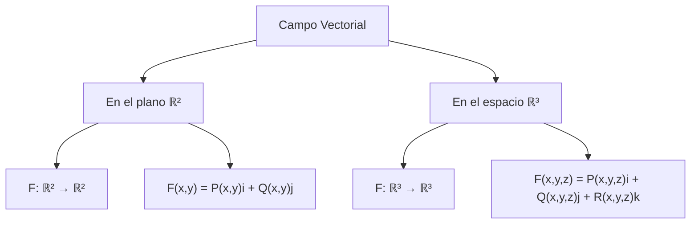
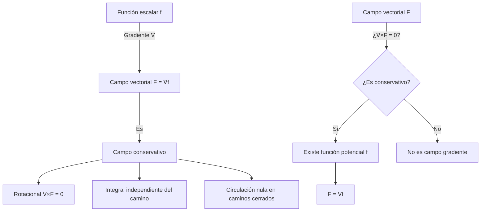

# Matemáticas para Ciencias Aplicadas III - Funciones con valores vectoriales

## 2.1 Campos vectoriales. Campos gradientes.

---

### Introducción

Los campos vectoriales son funciones que asignan a cada punto en el espacio un vector, mientras que los campos gradientes son un tipo especial de campo vectorial que deriva de una función escalar. Estos conceptos son fundamentales en física e ingeniería para modelar fenómenos como campos electromagnéticos, flujo de fluidos y potenciales gravitacionales.

### 1. Campos Vectoriales

#### 1.1 Definición

Un **campo vectorial** en ℝⁿ es una función 𝐅 que asigna a cada punto (x₁, x₂, ..., xₙ) un vector 𝐅(x₁, x₂, ..., xₙ).

En ℝ³:

$$ \mathbf{F}(x, y, z) = P(x, y, z)\mathbf{i} + Q(x, y, z)\mathbf{j} + R(x, y, z)\mathbf{k} $$

Donde P, Q y R son funciones escalares llamadas **componentes** del campo vectorial.

#### 1.2 Representación



#### 1.3 Ejemplos de Campos Vectoriales

**Ejemplo 1:** Campo gravitacional

$$ \mathbf{F}(x, y, z) = -G\frac{m}{r^3}(x\mathbf{i} + y\mathbf{j} + z\mathbf{k}) $$

donde $r = \sqrt{x^2 + y^2 + z^2}$ y G es la constante gravitacional.

**Ejemplo 2:** Campo de velocidades de un fluido

$$ \mathbf{v}(x, y) = -y\mathbf{i} + x\mathbf{j} $$

#### 1.4 Visualización con Python

```python
import numpy as np
import matplotlib.pyplot as plt

# Crear una malla de puntos
x = np.linspace(-2, 2, 10)
y = np.linspace(-2, 2, 10)
X, Y = np.meshgrid(x, y)

# Definir un campo vectorial: F(x,y) = (-y, x)
U = -Y
V = X

# Visualizar
plt.quiver(X, Y, U, V)
plt.title('Campo vectorial: F(x,y) = (-y, x)')
plt.xlabel('x')
plt.ylabel('y')
plt.grid(True)
plt.axis('equal')
plt.show()
```

### 2. Campos Gradientes

#### 2.1 Definición

Un **campo gradiente** es un campo vectorial que puede expresarse como el gradiente de una función escalar. Si f es una función escalar diferenciable, entonces:

$$ \nabla f = \frac{\partial f}{\partial x}\mathbf{i} + \frac{\partial f}{\partial y} \mathbf{j} + \frac{\partial f}{\partial z}\mathbf{k} $$

El campo vectorial **F** = ∇f se denomina **campo gradiente** o **campo conservativo**, y f se llama **función potencial** de **F**.

#### 2.2 Propiedades de los Campos Gradientes

1. **Circulación nula en caminos cerrados**: ∮ₐ 𝐅 · d𝐫 = 0
2. **Independencia del camino**: ∫ᴬᴮ 𝐅 · d𝐫 = f(B) - f(A)
3. **Rotacional nulo**: ∇ × 𝐅 = 0 (condición necesaria)

#### 2.3 Ejemplo de Campo Gradiente

**Ejemplo:** Dada la función potencial f(x,y) = x²y + y³

$$ \nabla f = \frac{\partial f}{\partial x}\mathbf{i} + \frac{\partial f}{\partial y}\mathbf{j} = 2xy\mathbf{i} + (x^2 + 3y^2)\mathbf{j} $$

El campo vectorial 𝐅(x,y) = 2xy𝐢 + (x² + 3y²)𝐣 es un campo gradiente.

#### 2.4 Verificación con Python

```python
import sympy as sp

# Verificar si un campo es gradiente
x, y = sp.symbols('x y')
P = 2*x*y
Q = x**2 + 3*y**2

# Condición: ∂P/∂y = ∂Q/∂x
dP_dy = sp.diff(P, y)
dQ_dx = sp.diff(Q, x)

print(f"∂P/∂y = {dP_dy}")
print(f"∂Q/∂x = {dQ_dx}")
print(f"¿Es campo gradiente? {sp.simplify(dP_dy - dQ_dx) == 0}")
```

### 3. Teorema Fundamental para Integrales de Línea

Si 𝐅 = ∇f es un campo gradiente y C es cualquier curva suave desde A hasta B, entonces:

$$ \int_C \mathbf{F} \cdot d\mathbf{r} = f(B) - f(A) $$

#### 3.1 Aplicación

Calcular ∫ₐ 𝐅 · d𝐫 donde 𝐅(x,y) = 2xy𝐢 + (x² + 3y²)𝐣 a lo largo de la curva y = x² desde (0,0) hasta (1,1).

**Solución:** Como 𝐅 = ∇f con f(x,y) = x²y + y³, entonces:

$$ \int_C \mathbf{F} \cdot d\mathbf{r} = f(1,1) - f(0,0) = (1^2 \cdot 1 + 1^3) - 0 = 2 $$

### 4. Ejercicios Propuestos

#### 4.1 Ejercicio 1

Determinar si los siguientes campos vectoriales son gradientes:
a) 𝐅(x,y) = (3x²y + y³)𝐢 + (x³ + 3xy²)𝐣  
b) 𝐅(x,y) = (2xcos y)𝐢 + (-x²sen y)𝐣

#### 4.2 Ejercicio 2

Encontrar una función potencial para el campo vectorial 𝐅(x,y,z) = (2xy + z³)𝐢 + (x² + 2yz)𝐣 + (3xz² + y²)𝐤

#### 4.3 Ejercicio 3

Calcular la integral de línea ∫ₐ 𝐅 · d𝐫 donde:
𝐅(x,y) = (yeˣ + sen y)𝐢 + (eˣ + xcos y)𝐣  
y C es la curva parametrizada por 𝐫(t) = (t³, 2t), 0 ≤ t ≤ 1

#### 4.4 Ejercicio 4

Visualizar el campo vectorial 𝐅(x,y) = (x/(x²+y²)^{3/2}, y/(x²+y²)^{3/2}) y determinar si es conservativo.

### 5. Diagrama Conceptual



### 6. Aplicaciones en Física

1. **Campo gravitatorio**: 𝐅 = -∇V, donde V es el potencial gravitatorio
2. **Campo electrostático**: 𝐄 = -∇V, donde V es el potencial eléctrico
3. **Mecánica de fluidos**: Campos de velocidades conservativos

### 7. Recursos Adicionales

- [Khan Academy: Campos vectoriales](https://es.khanacademy.org/math/multivariable-calculus)
- [3Blue1Brown: Visualizando campos vectoriales](https://www.3blue1brown.com/topics/vector-calculus)
- [MIT OpenCourseWare: Cálculo multivariable](https://ocw.mit.edu/courses/mathematics/)

### 8. Referencias

1. Stewart, J. (2015). _Cálculo de varias variables_. Cengage Learning.
2. Marsden, J. E., & Tromba, A. J. (2012). _Vector Calculus_. W. H. Freeman.
3. Apostol, T. M. (2017). _Calculus, Vol. 2_. Reverté.
