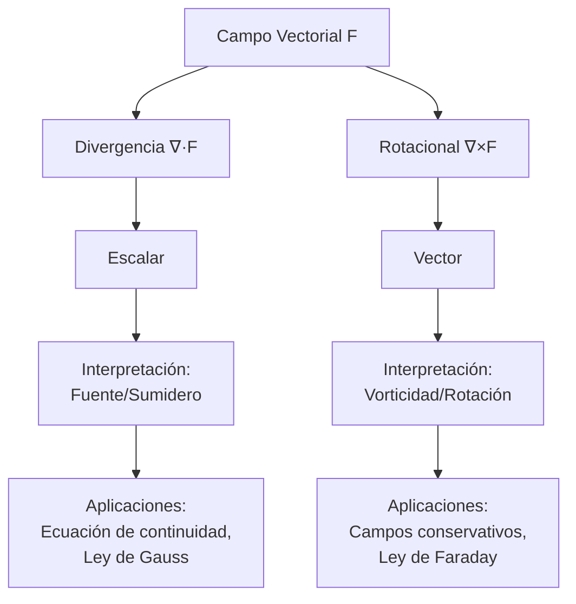

# Matemáticas para Ciencias Aplicadas III - Funciones con valores vectoriales

## 2.2 Divergencia y rotacional. Interpretación física.

---

### Introducción

La divergencia y el rotacional son dos operadores diferenciales fundamentales en el cálculo vectorial que miden propiedades esenciales de los campos vectoriales. Estas operaciones tienen profundas interpretaciones físicas en diversos campos como la electromagnetismo, la mecánica de fluidos y la termodinámica.

### 1. Operador Nabla (∇)

#### 1.1 Definición

El operador nabla es un operador diferencial vectorial definido como:

$$
\nabla = \frac{\partial}{\partial x}\mathbf{i} + \frac{\partial}{\partial y}\mathbf{j} + \frac{\partial}{\partial z}\mathbf{k}
$$

Este operador se utiliza para definir tanto la divergencia como el rotacional.

### 2. Divergencia de un Campo Vectorial

#### 2.1 Definición Matemática

Para un campo vectorial **F** = P**i** + Q**j** + R**k**, la divergencia se define como:

$$
\text{div } \mathbf{F} = \nabla \cdot \mathbf{F} = \frac{\partial P}{\partial x} + \frac{\partial Q}{\partial y} + \frac{\partial R}{\partial z}
$$

#### 2.2 Interpretación Física

La divergencia mide la tendencia de un campo vectorial a originarse o converger en un punto dado:

- **Divergencia positiva**: El punto actúa como una "fuente" del campo
- **Divergencia negativa**: El punto actúa como un "sumidero" del campo
- **Divergencia cero**: El campo no tiene fuentes ni sumideros en ese punto

#### 2.3 Ejemplo de Cálculo

Dado el campo vectorial **F**(x,y,z) = x²**i** + xy**j** + z²**k**:

$$
\nabla \cdot \mathbf{F} = \frac{\partial}{\partial x}(x^2) + \frac{\partial}{\partial y}(xy) + \frac{\partial}{\partial z}(z^2) = 2x + x + 2z = 3x + 2z
$$

#### 2.4 Código Python para Calcular Divergencia

```python
import sympy as sp

# Calcular divergencia de un campo vectorial
x, y, z = sp.symbols('x y z')
P = x**2
Q = x*y
R = z**2

div_F = sp.diff(P, x) + sp.diff(Q, y) + sp.diff(R, z)
print(f"Divergencia de F: {div_F}")
```

### 3. Rotacional de un Campo Vectorial

#### 3.1 Definición Matemática

Para un campo vectorial **F** = P**i** + Q**j** + R**k**, el rotacional se define como:

$$
\text{rot } \mathbf{F} = \nabla \times \mathbf{F} = \begin{vmatrix}
\mathbf{i} & \mathbf{j} & \mathbf{k} \\
\frac{\partial}{\partial x} & \frac{\partial}{\partial y} & \frac{\partial}{\partial z} \\
P & Q & R
\end{vmatrix}
$$

$$
\nabla \times \mathbf{F} = \left( \frac{\partial R}{\partial y} - \frac{\partial Q}{\partial z} \right)\mathbf{i} - \left( \frac{\partial R}{\partial x} - \frac{\partial P}{\partial z} \right)\mathbf{j} + \left( \frac{\partial Q}{\partial x} - \frac{\partial P}{\partial y} \right)\mathbf{k}
$$

#### 3.2 Interpretación Física

El rotacional mide la tendencia de un campo vectorial a rotar alrededor de un punto:

- **Rotacional distinto de cero**: Indica presencia de "vorticidad" o rotación
- **Rotacional cero**: El campo es irrotacional (conservativo si el dominio es simplemente conexo)

#### 3.3 Ejemplo de Cálculo

Dado el campo vectorial **F**(x,y,z) = yz**i** + xz**j** + xy**k**:

$$
\nabla \times \mathbf{F} = \left( \frac{\partial (xy)}{\partial y} - \frac{\partial (xz)}{\partial z} \right)\mathbf{i} - \left( \frac{\partial (xy)}{\partial x} - \frac{\partial (yz)}{\partial z} \right)\mathbf{j} + \left( \frac{\partial (xz)}{\partial x} - \frac{\partial (yz)}{\partial y} \right)\mathbf{k}
$$

$$
= (x - x)\mathbf{i} - (y - y)\mathbf{j} + (z - z)\mathbf{k} = \mathbf{0}
$$

#### 3.4 Código Python para Calcular Rotacional

```python
import sympy as sp

# Calcular rotacional de un campo vectorial
x, y, z = sp.symbols('x y z')
P = y*z
Q = x*z
R = x*y

rot_F = sp.Matrix([sp.diff(R, y) - sp.diff(Q, z),
                   sp.diff(P, z) - sp.diff(R, x),
                   sp.diff(Q, x) - sp.diff(P, y)])

print(f"Rotacional de F: {rot_F}")
```

### 4. Diagrama Conceptual de Operaciones Vectoriales



### 5. Teoremas Fundamentales

#### 5.1 Teorema de la Divergencia (Teorema de Gauss)

Relaciona el flujo through una superficie cerrada con la integral de volumen de la divergencia:

$$
\oiint_S \mathbf{F} \cdot d\mathbf{S} = \iiint_V (\nabla \cdot \mathbf{F}) dV
$$

#### 5.2 Teorema de Stokes

Relaciona la circulación around una curva cerrada con el flujo del rotacional through una superficie:

$$
\oint_C \mathbf{F} \cdot d\mathbf{r} = \iint_S (\nabla \times \mathbf{F}) \cdot d\mathbf{S}
$$

### 6. Aplicaciones Físicas

#### 6.1 En Mecánica de Fluidos

- **Divergencia**: Relacionada con la compresibilidad del fluido
- **Rotacional**: Relacionado con la vorticidad del flujo

#### 6.2 En Electromagnetismo

- **Ley de Gauss**: ∇ · **E** = ρ/ε₀
- **Ley de Gauss para el magnetismo**: ∇ · **B** = 0
- **Ley de Faraday**: ∇ × **E** = -∂**B**/∂t
- **Ley de Ampère-Maxwell**: ∇ × **B** = μ₀**J** + μ₀ε₀∂**E**/∂t

#### 6.3 Visualización de Campos

```python
import numpy as np
import matplotlib.pyplot as plt

# Crear malla de puntos
x = np.linspace(-2, 2, 10)
y = np.linspace(-2, 2, 10)
X, Y = np.meshgrid(x, y)

# Campo vectorial: F = (-y, x) - tiene rotacional no nulo
U = -Y
V = X

# Visualizar
plt.figure(figsize=(8, 6))
plt.quiver(X, Y, U, V)
plt.title('Campo vectorial con rotacional: F(x,y) = (-y, x)')
plt.xlabel('x')
plt.ylabel('y')
plt.grid(True)
plt.axis('equal')
plt.show()
```

### 7. Ejercicios Propuestos

#### 7.1 Ejercicio 1

Calcular la divergencia y el rotacional del campo vectorial:
**F**(x,y,z) = (x² + yz)**i** + (y² + zx)**j** + (z² + xy)**k**

#### 7.2 Ejercicio 2

Verificar el teorema de la divergencia para el campo **F**(x,y,z) = x**i** + y**j** + z**k**
sobre la esfera x² + y² + z² = 1.

#### 7.3 Ejercicio 3

Demostrar que cualquier campo gradiente **F** = ∇φ tiene rotacional nulo.

#### 7.4 Ejercicio 4

Para el campo de velocidades de un fluido **v**(x,y) = (x² - y²)**i** + (2xy)**j**:
a) Calcular la divergencia e interpretar físicamente
b) Calcular el rotacional e interpretar físicamente
c) ¿Es este campo conservativo?

#### 7.5 Ejercicio 5

Un campo eléctrico está dado por **E**(x,y,z) = (x/(x²+y²+z²)^{3/2}, y/(x²+y²+z²)^{3/2}, z/(x²+y²+z²)^{3/2}).
Calcular ∇ · **E** y ∇ × **E**.

### 8. Propiedades Importantes

1. **Divergencia del rotacional**: ∇ · (∇ × **F**) = 0
2. **Rotacional del gradiente**: ∇ × (∇φ) = **0**
3. **Divergencia del gradiente**: ∇ · (∇φ) = ∇²φ (Laplaciano)

### 9. Referencias

1. Marsden, J. E., & Tromba, A. J. (2012). _Vector Calculus_. W. H. Freeman.
2. Arfken, G. B., Weber, H. J., & Harris, F. E. (2013). _Mathematical Methods for Physicists_. Academic Press.
3. Schey, H. M. (2005). _Div, Grad, Curl, and All That_. W. W. Norton & Company.
4. Griffiths, D. J. (2017). _Introduction to Electrodynamics_. Cambridge University Press.

### 10. Recursos Adicionales

- [Khan Academy: Divergencia y rotacional](https://www.khanacademy.org/math/multivariable-calculus)
- [3Blue1Brown: Visualizando divergencia y rotacional](https://www.3blue1brown.com/topics/vector-calculus)
- [MIT OpenCourseWare: Cálculo multivariable](https://ocw.mit.edu/courses/mathematics/)
