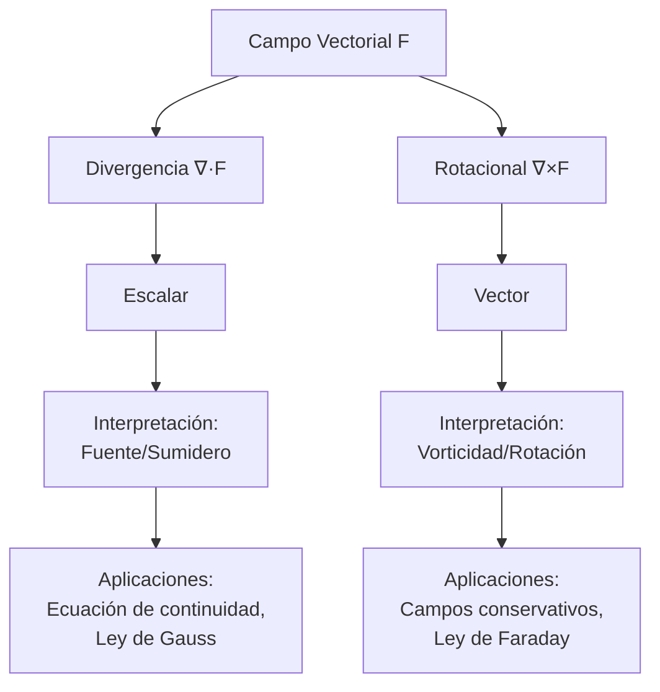

# Matemáticas para Ciencias Aplicadas III - Funciones con valores vectoriales

## 2.2 Divergencia y rotacional. Interpretación física.

---

### Introducción

La divergencia y el rotacional son dos operadores diferenciales fundamentales en el cálculo vectorial que miden propiedades esenciales de los campos vectoriales. Estas operaciones tienen profundas interpretaciones físicas en diversos campos como el electromagnetismo, la mecánica de fluidos y la termodinámica.

### 1. Operador Nabla (∇)

#### 1.1 Definición

El operador nabla es un operador diferencial vectorial definido como:

$$
\nabla = \frac{\partial}{\partial x}\mathbf{i} + \frac{\partial}{\partial y}\mathbf{j} + \frac{\partial}{\partial z}\mathbf{k}
$$

Este operador se utiliza para definir tanto la divergencia como el rotacional.

### 2. Divergencia de un Campo Vectorial

#### 2.1 Definición Matemática

Para un campo vectorial $\mathbf{F} = P\mathbf{i} + Q\mathbf{j} + R\mathbf{k},$ la divergencia se define como

$$
\text{div } \mathbf{F} = \nabla \cdot \mathbf{F} = \frac{\partial P}{\partial x} + \frac{\partial Q}{\partial y} + \frac{\partial R}{\partial z}
$$

#### 2.2 Interpretación Física

La divergencia mide la tendencia de un campo vectorial a originarse o converger en un punto dado:

- **Divergencia positiva**: El punto actúa como una "fuente" del campo
- **Divergencia negativa**: El punto actúa como un "sumidero" del campo
- **Divergencia cero**: El campo no tiene fuentes ni sumideros en ese punto

Con más precisión, la divergencia es el **flujo saliente por unidad de volumen**:

$$
(\nabla \cdot \mathbf{F})(p) = \lim_{V \to p} \frac{1}{\operatorname{vol}(V)} \oiint_{\partial V} \mathbf{F} \cdot \mathbf{n} \, dS
$$

donde $V$ es una región pequeña que se contrae al punto $p.$ Si $\mathbf{F}$ es la velocidad de un fluido, $\nabla \cdot \mathbf{F} > 0$ significa que en $p$ sale más fluido del que entra, como si se expandiera.

**Ejemplos en el plano**, donde $\nabla \cdot \mathbf{F} = \frac{\partial P}{\partial x} + \frac{\partial Q}{\partial y}:$

- $\mathbf{F} = (x, y):$ divergencia $2,$ los vectores se alejan del origen.
- $\mathbf{F} = (-y, x):$ divergencia $0,$ el fluido solo gira.

#### 2.3 Ejemplo de Cálculo

Dado el campo vectorial $\mathbf{F}(x,y,z) = x^2\mathbf{i} + xy\mathbf{j} + z^2\mathbf{k}:$

$$
\nabla \cdot \mathbf{F} = \frac{\partial}{\partial x}(x^2) + \frac{\partial}{\partial y}(xy) + \frac{\partial}{\partial z}(z^2) = 2x + x + 2z = 3x + 2z
$$

#### 2.4 Código Python para Calcular Divergencia

```python
import sympy as sp

# Calcular divergencia de un campo vectorial
x, y, z = sp.symbols('x y z')
P = x**2
Q = x*y
R = z**2

div_F = sp.diff(P, x) + sp.diff(Q, y) + sp.diff(R, z)
print(f"Divergencia de F: {div_F}")
```

### 3. Rotacional de un Campo Vectorial

#### 3.1 Definición Matemática

Para un campo vectorial $\mathbf{F} = P\mathbf{i} + Q\mathbf{j} + R\mathbf{k},$ el rotacional se define como

$$
\text{rot } \mathbf{F} = \nabla \times \mathbf{F} = \begin{vmatrix}
\mathbf{i} & \mathbf{j} & \mathbf{k} \\
\frac{\partial}{\partial x} & \frac{\partial}{\partial y} & \frac{\partial}{\partial z} \\
P & Q & R
\end{vmatrix}
$$

$$
\nabla \times \mathbf{F} = \left( \frac{\partial R}{\partial y} - \frac{\partial Q}{\partial z} \right)\mathbf{i} - \left( \frac{\partial R}{\partial x} - \frac{\partial P}{\partial z} \right)\mathbf{j} + \left( \frac{\partial Q}{\partial x} - \frac{\partial P}{\partial y} \right)\mathbf{k}
$$

#### 3.2 Interpretación Física

El rotacional mide la tendencia de un campo vectorial a rotar alrededor de un punto:

- **Rotacional distinto de cero**: Indica presencia de vorticidad o rotación
- **Rotacional cero**: El campo es irrotacional (conservativo si el dominio es simplemente conexo)

La dirección de $\nabla \times \mathbf{F}$ es el eje alrededor del cual gira una pequeña rueda de paletas colocada en el fluido, según la regla de la mano derecha, y su magnitud es el doble de la velocidad angular de la rueda. Por ejemplo, la rotación rígida $\mathbf{v} = \boldsymbol{\omega} \times \mathbf{r}$ con velocidad angular constante $\boldsymbol{\omega}$ tiene $\nabla \times \mathbf{v} = 2\boldsymbol{\omega}.$

**En el plano** se usa el **rotacional escalar** $\frac{\partial Q}{\partial x} - \frac{\partial P}{\partial y},$ que es la componente $\mathbf{k}$ del rotacional de $(P, Q, 0).$ Para $\mathbf{F} = (-y, x)$ vale $1 - (-1) = 2.$

Un campo puede tener rotacional cero aunque sus líneas de flujo sean curvas, y rotacional no nulo con líneas rectas: $\mathbf{F} = (y, 0)$ tiene líneas de flujo horizontales y rotacional escalar $-1,$ porque la velocidad cambia de una capa a otra y hace girar la rueda.

#### 3.3 Ejemplo de Cálculo

Dado el campo vectorial $\mathbf{F}(x,y,z) = yz\mathbf{i} + xz\mathbf{j} + xy\mathbf{k}:$

$$
\nabla \times \mathbf{F} = \left( \frac{\partial (xy)}{\partial y} - \frac{\partial (xz)}{\partial z} \right)\mathbf{i} - \left( \frac{\partial (xy)}{\partial x} - \frac{\partial (yz)}{\partial z} \right)\mathbf{j} + \left( \frac{\partial (xz)}{\partial x} - \frac{\partial (yz)}{\partial y} \right)\mathbf{k}
$$

$$
= (x - x)\mathbf{i} - (y - y)\mathbf{j} + (z - z)\mathbf{k} = \mathbf{0}
$$

El campo es irrotacional en todo $\mathbb{R}^3;$ de hecho, $\mathbf{F} = \nabla(xyz).$

#### 3.4 Código Python para Calcular Rotacional

```python
import sympy as sp

# Calcular rotacional de un campo vectorial
x, y, z = sp.symbols('x y z')
P = y*z
Q = x*z
R = x*y

rot_F = sp.Matrix([sp.diff(R, y) - sp.diff(Q, z),
                   sp.diff(P, z) - sp.diff(R, x),
                   sp.diff(Q, x) - sp.diff(P, y)])

print(f"Rotacional de F: {rot_F}")
```

### 4. Diagrama Conceptual de Operaciones Vectoriales



### 5. Teoremas Fundamentales

#### 5.1 Teorema de la Divergencia (Teorema de Gauss)

Relaciona el flujo a través de una superficie cerrada con la integral de volumen de la divergencia:

$$
\oiint_S \mathbf{F} \cdot d\mathbf{S} = \iiint_V (\nabla \cdot \mathbf{F}) \, dV
$$

#### 5.2 Teorema de Stokes

Relaciona la circulación alrededor de una curva cerrada con el flujo del rotacional a través de una superficie que la tiene por borde:

$$
\oint_C \mathbf{F} \cdot d\mathbf{r} = \iint_S (\nabla \times \mathbf{F}) \cdot d\mathbf{S}
$$

### 6. Aplicaciones Físicas

#### 6.1 En Mecánica de Fluidos

- **Divergencia**: Relacionada con la compresibilidad del fluido. La **ecuación de continuidad** $\frac{\partial \rho}{\partial t} + \nabla \cdot (\rho\mathbf{v}) = 0$ expresa la conservación de la masa; para un fluido incompresible se reduce a $\nabla \cdot \mathbf{v} = 0.$
- **Rotacional**: Relacionado con la vorticidad del flujo, $\boldsymbol{\omega} = \nabla \times \mathbf{v}.$

#### 6.2 En Electromagnetismo

- **Ley de Gauss**: $\nabla \cdot \mathbf{E} = \frac{\rho}{\varepsilon_0}$
- **Ley de Gauss para el magnetismo**: $\nabla \cdot \mathbf{B} = 0$
- **Ley de Faraday**: $\nabla \times \mathbf{E} = -\frac{\partial \mathbf{B}}{\partial t}$
- **Ley de Ampère-Maxwell**: $\nabla \times \mathbf{B} = \mu_0\mathbf{J} + \mu_0\varepsilon_0\frac{\partial \mathbf{E}}{\partial t}$

#### 6.3 Visualización de Campos

```python
import numpy as np
import matplotlib.pyplot as plt

# Crear malla de puntos
x = np.linspace(-2, 2, 10)
y = np.linspace(-2, 2, 10)
X, Y = np.meshgrid(x, y)

# Campo vectorial: F = (-y, x) - tiene rotacional no nulo
U = -Y
V = X

# Visualizar
plt.figure(figsize=(8, 6))
plt.quiver(X, Y, U, V)
plt.title('Campo vectorial con rotacional: F(x,y) = (-y, x)')
plt.xlabel('x')
plt.ylabel('y')
plt.grid(True)
plt.axis('equal')
plt.show()
```

### 7. Ejercicios Propuestos

#### 7.1 Ejercicio 1

Calcular la divergencia y el rotacional del campo vectorial $\mathbf{F}(x,y,z) = (x^2 + yz)\mathbf{i} + (y^2 + zx)\mathbf{j} + (z^2 + xy)\mathbf{k}.$

#### 7.2 Ejercicio 2

Verificar el teorema de la divergencia para el campo $\mathbf{F}(x,y,z) = x\mathbf{i} + y\mathbf{j} + z\mathbf{k}$
sobre la esfera $x^2 + y^2 + z^2 = 1.$

#### 7.3 Ejercicio 3

Demostrar que cualquier campo gradiente $\mathbf{F} = \nabla\varphi,$ con $\varphi$ de clase $C^2,$ tiene rotacional nulo.

#### 7.4 Ejercicio 4

Para el campo de velocidades de un fluido $\mathbf{v}(x,y) = (x^2 - y^2)\mathbf{i} + 2xy\,\mathbf{j}:$
a) Calcular la divergencia e interpretar físicamente
b) Calcular el rotacional e interpretar físicamente
c) ¿Es este campo conservativo?

#### 7.5 Ejercicio 5

Un campo eléctrico está dado por $\mathbf{E} = \frac{\mathbf{r}}{\|\mathbf{r}\|^3},$ con $\mathbf{r} = (x, y, z) \neq \mathbf{0}.$
Calcular $\nabla \cdot \mathbf{E}$ y $\nabla \times \mathbf{E}.$

#### 7.6 Soluciones

1. $\nabla \cdot \mathbf{F} = 2x + 2y + 2z.$ Para el rotacional, $(x - x,\ y - y,\ z - z) = \mathbf{0}:$ el campo es el gradiente de $\frac{x^3 + y^3 + z^3}{3} + xyz.$
2. $\nabla \cdot \mathbf{F} = 3,$ así que $\iiint_V 3 \, dV = 3 \cdot \frac{4\pi}{3} = 4\pi.$ En la esfera, $\mathbf{n} = (x, y, z)$ y $\mathbf{F} \cdot \mathbf{n} = 1,$ así que el flujo es el área $4\pi.$
3. La componente $\mathbf{i}$ de $\nabla \times \nabla\varphi$ es $\varphi_{zy} - \varphi_{yz} = 0$ por la igualdad de las derivadas cruzadas (teorema de Schwarz); las otras dos son análogas.
4. a) $\nabla \cdot \mathbf{v} = 2x + 2x = 4x:$ el fluido se expande donde $x > 0$ y se comprime donde $x < 0.$ b) Rotacional escalar $2y - (-2y) = 4y:$ gira en sentido antihorario donde $y > 0.$ c) No es conservativo, porque el rotacional no es cero.
5. Para $\mathbf{r} \neq \mathbf{0},$ $\nabla \cdot \mathbf{E} = 0$ y $\nabla \times \mathbf{E} = \mathbf{0}.$ Sin embargo, el flujo a través de cualquier esfera centrada en el origen es $4\pi:$ toda la fuente está concentrada en el origen, donde el campo no está definido.

### 8. Propiedades Importantes

1. **Divergencia del rotacional**: $\nabla \cdot (\nabla \times \mathbf{F}) = 0$
2. **Rotacional del gradiente**: $\nabla \times (\nabla\varphi) = \mathbf{0}$
3. **Divergencia del gradiente**: $\nabla \cdot (\nabla\varphi) = \nabla^2\varphi = \varphi_{xx} + \varphi_{yy} + \varphi_{zz},$ el **laplaciano**
4. **Reglas del producto**: $\nabla \cdot (f\mathbf{F}) = \nabla f \cdot \mathbf{F} + f\,\nabla \cdot \mathbf{F}$ y $\nabla \times (f\mathbf{F}) = \nabla f \times \mathbf{F} + f\,\nabla \times \mathbf{F}$

Las identidades 1 y 2 suponen campos de clase $C^2.$

### 9. Referencias

1. Marsden, J. E., & Tromba, A. J. (2012). _Vector Calculus_. W. H. Freeman.
2. Arfken, G. B., Weber, H. J., & Harris, F. E. (2013). _Mathematical Methods for Physicists_. Academic Press.
3. Schey, H. M. (2005). _Div, Grad, Curl, and All That_. W. W. Norton & Company.
4. Griffiths, D. J. (2017). _Introduction to Electrodynamics_. Cambridge University Press.

### 10. Recursos Adicionales

- [Khan Academy: Divergencia y rotacional](https://www.khanacademy.org/math/multivariable-calculus)
- [3Blue1Brown: Visualizando divergencia y rotacional](https://www.3blue1brown.com/topics/vector-calculus)
- [MIT OpenCourseWare: Cálculo multivariable](https://ocw.mit.edu/courses/mathematics/)
