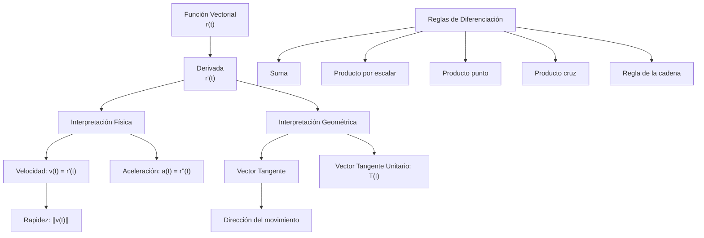

# Matemáticas para Ciencias Aplicadas III - Funciones con valores vectoriales

## 2.3 Diferenciación.

---

### Introducción

La diferenciación de funciones vectoriales es fundamental en matemáticas aplicadas, física e ingeniería. Permite estudiar el comportamiento de curvas y superficies, velocidades, aceleraciones y muchos otros conceptos importantes.

### 1. Funciones Vectoriales

#### 1.1 Definición

Una **función vectorial** es una función que asigna a cada número real en su dominio un vector:

$$ \mathbf{r}(t) = f(t)\mathbf{i} + g(t)\mathbf{j} + h(t)\mathbf{k} $$

o en notación compacta:

$$ \mathbf{r}(t) = \langle f(t), g(t), h(t) \rangle $$

#### 1.2 Dominio y Rango

- **Dominio**: Conjunto de valores reales de t para los cuales la función está definida
- **Rango**: Conjunto de todos los vectores posibles **r**(t)

### 2. Límites y Continuidad

#### 2.1 Límite de una Función Vectorial

$$
\lim_{t \to a} \mathbf{r}(t) = \langle \lim_{t \to a} f(t), \lim_{t \to a} g(t), \lim_{t \to a} h(t) \rangle
$$

#### 2.2 Continuidad

Una función vectorial **r**(t) es continua en t = a si:

$$
\lim_{t \to a} \mathbf{r}(t) = \mathbf{r}(a)
$$

### 3. Derivada de una Función Vectorial

#### 3.1 Definición

La derivada de una función vectorial **r**(t) se define como:

$$
\mathbf{r}'(t) = \lim_{h \to 0} \frac{\mathbf{r}(t + h) - \mathbf{r}(t)}{h}
$$

Si **r**(t) = ⟨f(t), g(t), h(t)⟩, entonces:

$$
\mathbf{r}'(t) = \langle f'(t), g'(t), h'(t) \rangle
$$

#### 3.2 Interpretación Geométrica

La derivada **r**'(t) representa:

- El **vector tangente** a la curva en el punto **r**(t)
- La **velocidad** si **r**(t) describe la posición de una partícula
- La dirección del movimiento

#### 3.3 Código Python para Visualizar

```python
import numpy as np
import matplotlib.pyplot as plt
from sympy import symbols, diff, Matrix, lambdify

t = symbols('t')
# Definir función vectorial
r = Matrix([t**2, t**3, 2*t])

# Calcular derivada
r_prime = diff(r, t)

print(f"Función original: {r}")
print(f"Derivada: {r_prime}")

# Convertir a funciones numéricas
r_func = lambdify(t, r, 'numpy')
r_prime_func = lambdify(t, r_prime, 'numpy')

# Evaluar en un punto
t_val = 1.0
print(f"r(1) = {r_func(t_val)}")
print(f"r'(1) = {r_prime_func(t_val)}")
```

### 4. Reglas de Diferenciación

#### 4.1 Reglas Básicas

1. **Regla de la suma**:

   $$
   \frac{d}{dt}[\mathbf{u}(t) + \mathbf{v}(t)] = \mathbf{u}'(t) + \mathbf{v}'(t)
   $$

2. **Regla del producto por escalar**:

   $$
   \frac{d}{dt}[c\mathbf{u}(t)] = c\mathbf{u}'(t)
   $$

3. **Regla del producto punto**:

   $$
   \frac{d}{dt}[\mathbf{u}(t) \cdot \mathbf{v}(t)] = \mathbf{u}'(t) \cdot \mathbf{v}(t) + \mathbf{u}(t) \cdot \mathbf{v}'(t)
   $$

4. **Regla del producto cruz**:

   $$
   \frac{d}{dt}[\mathbf{u}(t) \times \mathbf{v}(t)] = \mathbf{u}'(t) \times \mathbf{v}(t) + \mathbf{u}(t) \times \mathbf{v}'(t)
   $$

5. **Regla de la cadena**:
   $$
   \frac{d}{dt}[\mathbf{u}(f(t))] = f'(t)\mathbf{u}'(f(t))
   $$

### 5. Aplicaciones Físicas

#### 5.1 Cinemática de Partículas

Si **r**(t) describe la posición de una partícula:

- **Velocidad**: **v**(t) = **r**'(t)
- **Aceleración**: **a**(t) = **v**'(t) = **r**''(t)
- **Rapidez**: ‖**v**(t)‖

#### 5.2 Ejemplo: Movimiento Parabólico

$$
\mathbf{r}(t) = (v_0 \cos \theta)t\mathbf{i} + \left[(v_0 \sin \theta)t - \frac{1}{2}gt^2\right]\mathbf{j}
$$

$$
\mathbf{v}(t) = v_0 \cos \theta\mathbf{i} + (v_0 \sin \theta - gt)\mathbf{j}
$$

$$
\mathbf{a}(t) = -g\mathbf{j}
$$

### 6. Vector Tangente Unitario

#### 6.1 Definición

$$
\mathbf{T}(t) = \frac{\mathbf{r}'(t)}{\|\mathbf{r}'(t)\|}
$$

#### 6.2 Propiedades

- ‖**T**(t)‖ = 1 (vector unitario)
- Es tangente a la curva
- Indica la dirección del movimiento

### 7. Diagrama Conceptual de la Diferenciación Vectorial



### 8. Ejemplos Resueltos

#### 8.1 Ejemplo 1: Derivada de Función Vectorial

Dada **r**(t) = ⟨t², sen(t), eᵗ⟩, encontrar **r**'(t)

**Solución**:

$$
\mathbf{r}'(t) = \langle 2t, \cos(t), e^t \rangle
$$

#### 8.2 Ejemplo 2: Vector Tangente Unitario

Para **r**(t) = ⟨3cos(t), 3sen(t), 4t⟩, encontrar **T**(t)

**Solución**:

$$
\mathbf{r}'(t) = \langle -3\sin(t), 3\cos(t), 4 \rangle
$$

$$
\|\mathbf{r}'(t)\| = \sqrt{9\sin^2(t) + 9\cos^2(t) + 16} = \sqrt{9 + 16} = 5
$$

$$
\mathbf{T}(t) = \langle -\frac{3}{5}\sin(t), \frac{3}{5}\cos(t), \frac{4}{5} \rangle
$$

### 9. Ejercicios Propuestos

#### 9.1 Ejercicio 1

Para cada función vectorial, encontrar **r**'(t) y **r**''(t):
a) **r**(t) = ⟨t³ - 1, 2t² + 3, t⁴⟩  
b) **r**(t) = ⟨eᵗ cos(t), ln(t+1), tan(t)⟩  
c) **r**(t) = ⟨1/(t+1), √t, sen(2t)⟩

#### 9.2 Ejercicio 2

Dada **r**(t) = ⟨3cos(2t), 3sen(2t), 4t⟩:
a) Encontrar el vector velocidad **v**(t)  
b) Encontrar el vector aceleración **a**(t)  
c) Calcular la rapidez  
d) Encontrar el vector tangente unitario **T**(t)

#### 9.3 Ejercicio 3

Demostrar que si ‖**r**(t)‖ es constante, entonces **r**(t) · **r**'(t) = 0

#### 9.4 Ejercicio 4

Para **r**(t) = ⟨t, t², t³⟩:
a) Encontrar la ecuación de la recta tangente en t = 1  
b) Calcular **r**'(t) × **r**''(t)

#### 9.5 Ejercicio 5

Un proyectil se lanza con velocidad inicial **v**₀ = ⟨20, 30, 40⟩ m/s desde **r**₀ = ⟨0, 0, 10⟩ m. Si la aceleración es **a**(t) = ⟨0, 0, -9.8⟩ m/s²:
a) Encontrar **r**(t)  
b) Calcular el tiempo de vuelo  
c) Determinar el alcance máximo

### 10. Aplicaciones con Python

```python
import numpy as np
import matplotlib.pyplot as plt
from mpl_toolkits.mplot3d import Axes3D

# Visualización de función vectorial y su derivada
t = np.linspace(0, 2*np.pi, 100)
r = np.array([np.cos(t), np.sin(t), t])  # hélice circular
r_prime = np.array([-np.sin(t), np.cos(t), np.ones_like(t)])

fig = plt.figure(figsize=(10, 8))
ax = fig.add_subplot(111, projection='3d')

# Curva original
ax.plot(r[0], r[1], r[2], 'b-', label='r(t) = (cos t, sin t, t)')

# Vectores tangentes (cada 10 puntos)
for i in range(0, 100, 10):
    ax.quiver(r[0][i], r[1][i], r[2][i],
              r_prime[0][i], r_prime[1][i], r_prime[2][i],
              length=0.2, color='red', normalize=True)

ax.set_xlabel('X')
ax.set_ylabel('Y')
ax.set_zlabel('Z')
ax.legend()
plt.title('Función vectorial y sus vectores tangentes')
plt.show()
```

### 11. Referencias

1. Stewart, J. (2015). _Cálculo de varias variables_. Cengage Learning.
2. Marsden, J. E., & Tromba, A. J. (2012). _Vector Calculus_. W. H. Freeman.
3. Larson, R., & Edwards, B. H. (2017). _Cálculo_. McGraw-Hill.
4. Thomas, G. B., Weir, M. D., & Hass, J. (2014). _Cálculo de varias variables_. Pearson.

### 12. Recursos Adicionales

- [Khan Academy: Cálculo vectorial](https://www.khanacademy.org/math/multivariable-calculus)
- [MIT OpenCourseWare: Cálculo multivariable](https://ocw.mit.edu/courses/mathematics/)
- [3Blue1Brown: Visualizando cálculo vectorial](https://www.3blue1brown.com/topics/vector-calculus)
