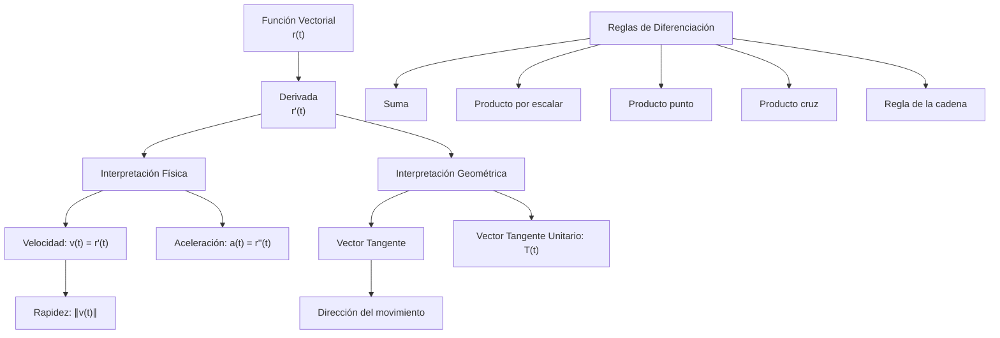

# Matemáticas para Ciencias Aplicadas III - Funciones con valores vectoriales

## 2.3 Diferenciación.

---

### Introducción

La diferenciación de funciones vectoriales es fundamental en matemáticas aplicadas, física e ingeniería. Permite estudiar el comportamiento de curvas y superficies, velocidades, aceleraciones y muchos otros conceptos importantes.

Las secciones 1 a 8 tratan funciones de **una** variable con valores vectoriales, $\mathbf{r}: \mathbb{R} \to \mathbb{R}^3,$ que describen curvas. La sección 9 trata el caso general $\mathbf{F}: \mathbb{R}^n \to \mathbb{R}^m,$ que incluye los campos vectoriales del tema 2.1, y su derivada, la matriz jacobiana.

### 1. Funciones Vectoriales

#### 1.1 Definición

Una **función vectorial** es una función que asigna a cada número real en su dominio un vector:

$$ \mathbf{r}(t) = f(t)\mathbf{i} + g(t)\mathbf{j} + h(t)\mathbf{k} $$

o en notación compacta:

$$ \mathbf{r}(t) = \langle f(t), g(t), h(t) \rangle $$

#### 1.2 Dominio y Rango

- **Dominio**: Conjunto de valores reales de $t$ para los cuales están definidas las tres componentes
- **Rango**: Conjunto de todos los vectores $\mathbf{r}(t);$ sus puntos finales forman la **curva** descrita por $\mathbf{r}$

### 2. Límites y Continuidad

#### 2.1 Límite de una Función Vectorial

$$
\lim_{t \to a} \mathbf{r}(t) = \langle \lim_{t \to a} f(t), \lim_{t \to a} g(t), \lim_{t \to a} h(t) \rangle
$$

#### 2.2 Continuidad

Una función vectorial $\mathbf{r}(t)$ es continua en $t = a$ si se cumple lo siguiente, lo cual equivale a que cada componente sea continua en $a:$

$$
\lim_{t \to a} \mathbf{r}(t) = \mathbf{r}(a)
$$

### 3. Derivada de una Función Vectorial

#### 3.1 Definición

La derivada de una función vectorial $\mathbf{r}(t)$ se define como

$$
\mathbf{r}'(t) = \lim_{h \to 0} \frac{\mathbf{r}(t + h) - \mathbf{r}(t)}{h}
$$

Si $\mathbf{r}(t) = \langle f(t), g(t), h(t) \rangle,$ el límite se calcula componente a componente y

$$
\mathbf{r}'(t) = \langle f'(t), g'(t), h'(t) \rangle
$$

#### 3.2 Interpretación Geométrica

La derivada $\mathbf{r}'(t)$ representa:

- El **vector tangente** a la curva en el punto $\mathbf{r}(t),$ siempre que $\mathbf{r}'(t) \neq \mathbf{0}$
- La **velocidad** si $\mathbf{r}(t)$ describe la posición de una partícula
- La dirección del movimiento

El cociente $\frac{\mathbf{r}(t + h) - \mathbf{r}(t)}{h}$ es un vector secante; al hacer $h \to 0$ se vuelve tangente. La **recta tangente** en $t_0$ es $\mathbf{l}(s) = \mathbf{r}(t_0) + s\,\mathbf{r}'(t_0).$

#### 3.3 Código Python para Visualizar

```python
import numpy as np
import matplotlib.pyplot as plt
from sympy import symbols, diff, Matrix, lambdify

t = symbols('t')
# Definir función vectorial
r = Matrix([t**2, t**3, 2*t])

# Calcular derivada
r_prime = diff(r, t)

print(f"Función original: {r}")
print(f"Derivada: {r_prime}")

# Convertir a funciones numéricas
r_func = lambdify(t, r, 'numpy')
r_prime_func = lambdify(t, r_prime, 'numpy')

# Evaluar en un punto
t_val = 1.0
print(f"r(1) = {r_func(t_val)}")
print(f"r'(1) = {r_prime_func(t_val)}")
```

### 4. Reglas de Diferenciación

#### 4.1 Reglas Básicas

1. **Regla de la suma**:

   $$
   \frac{d}{dt}[\mathbf{u}(t) + \mathbf{v}(t)] = \mathbf{u}'(t) + \mathbf{v}'(t)
   $$

2. **Regla del producto por escalar**:

   $$
   \frac{d}{dt}[c\mathbf{u}(t)] = c\mathbf{u}'(t)
   $$

3. **Regla del producto punto**:

   $$
   \frac{d}{dt}[\mathbf{u}(t) \cdot \mathbf{v}(t)] = \mathbf{u}'(t) \cdot \mathbf{v}(t) + \mathbf{u}(t) \cdot \mathbf{v}'(t)
   $$

4. **Regla del producto cruz**:

   $$
   \frac{d}{dt}[\mathbf{u}(t) \times \mathbf{v}(t)] = \mathbf{u}'(t) \times \mathbf{v}(t) + \mathbf{u}(t) \times \mathbf{v}'(t)
   $$

   Hay que respetar el orden de los factores, porque el producto cruz no es conmutativo.

5. **Regla de la cadena**:

   $$
   \frac{d}{dt}[\mathbf{u}(f(t))] = f'(t)\mathbf{u}'(f(t))
   $$

### 5. Aplicaciones Físicas

#### 5.1 Cinemática de Partículas

Si $\mathbf{r}(t)$ describe la posición de una partícula:

- **Velocidad**: $\mathbf{v}(t) = \mathbf{r}'(t)$
- **Aceleración**: $\mathbf{a}(t) = \mathbf{v}'(t) = \mathbf{r}''(t)$
- **Rapidez**: $\|\mathbf{v}(t)\|$

**Ejemplo: movimiento circular uniforme.** $\mathbf{r}(t) = (R\cos\omega t, R\sin\omega t)$ tiene $\mathbf{v} = R\omega(-\sin\omega t, \cos\omega t)$ y $\mathbf{a} = -\omega^2\mathbf{r}(t).$ La rapidez $R\omega$ es constante, pero la aceleración no es cero: apunta al centro (aceleración centrípeta) y mide $R\omega^2.$

#### 5.2 Ejemplo: Movimiento Parabólico

$$
\mathbf{r}(t) = (v_0 \cos \theta)t\mathbf{i} + \left[(v_0 \sin \theta)t - \frac{1}{2}gt^2\right]\mathbf{j}
$$

$$
\mathbf{v}(t) = v_0 \cos \theta\mathbf{i} + (v_0 \sin \theta - gt)\mathbf{j}
$$

$$
\mathbf{a}(t) = -g\mathbf{j}
$$

### 6. Vector Tangente Unitario

#### 6.1 Definición

$$
\mathbf{T}(t) = \frac{\mathbf{r}'(t)}{\|\mathbf{r}'(t)\|}
$$

#### 6.2 Propiedades

- $\|\mathbf{T}(t)\| = 1$ (vector unitario)
- Es tangente a la curva
- Indica la dirección del movimiento
- $\mathbf{T}'(t) \perp \mathbf{T}(t),$ porque $\mathbf{T} \cdot \mathbf{T} = 1$ y, al derivar, $2\mathbf{T} \cdot \mathbf{T}' = 0.$ Esta observación lleva al vector normal y a la curvatura.

### 7. Diagrama Conceptual de la Diferenciación Vectorial



### 8. Ejemplos Resueltos

#### 8.1 Ejemplo 1: Derivada de Función Vectorial

Dada $\mathbf{r}(t) = \langle t^2, \sin t, e^t \rangle,$ encontrar $\mathbf{r}'(t).$

**Solución**:

$$
\mathbf{r}'(t) = \langle 2t, \cos(t), e^t \rangle
$$

#### 8.2 Ejemplo 2: Vector Tangente Unitario

Para $\mathbf{r}(t) = \langle 3\cos t, 3\sin t, 4t \rangle,$ encontrar $\mathbf{T}(t).$

**Solución**:

$$
\mathbf{r}'(t) = \langle -3\sin(t), 3\cos(t), 4 \rangle
$$

$$
\|\mathbf{r}'(t)\| = \sqrt{9\sin^2(t) + 9\cos^2(t) + 16} = \sqrt{9 + 16} = 5
$$

$$
\mathbf{T}(t) = \langle -\frac{3}{5}\sin(t), \frac{3}{5}\cos(t), \frac{4}{5} \rangle
$$

### 9. Diferenciación de Funciones de $\mathbb{R}^n$ en $\mathbb{R}^m$

#### 9.1 Matriz de derivadas

Sea $\mathbf{F} = (F_1, \ldots, F_m): U \subset \mathbb{R}^n \to \mathbb{R}^m.$ Su **matriz de derivadas** o **matriz jacobiana** en $\mathbf{x}_0$ es la matriz $m \times n$ de derivadas parciales

$$
D\mathbf{F}(\mathbf{x}_0) = \begin{pmatrix} \frac{\partial F_1}{\partial x_1} & \cdots & \frac{\partial F_1}{\partial x_n} \\ \vdots & \ddots & \vdots \\ \frac{\partial F_m}{\partial x_1} & \cdots & \frac{\partial F_m}{\partial x_n} \end{pmatrix}
$$

La fila $i$ es el gradiente de $F_i;$ la columna $j$ es la derivada de $\mathbf{F}$ en la dirección $\mathbf{e}_j.$ Casos particulares: si $n = 1$ es el vector velocidad $\mathbf{r}'(t)$ escrito en columna; si $m = 1$ es el gradiente escrito en fila.

#### 9.2 Diferenciabilidad

$\mathbf{F}$ es **diferenciable** en $\mathbf{x}_0$ si

$$
\lim_{\mathbf{h} \to \mathbf{0}} \frac{\|\mathbf{F}(\mathbf{x}_0 + \mathbf{h}) - \mathbf{F}(\mathbf{x}_0) - D\mathbf{F}(\mathbf{x}_0)\mathbf{h}\|}{\|\mathbf{h}\|} = 0
$$

Es decir, cerca de $\mathbf{x}_0$ la función se parece a la transformación lineal $\mathbf{h} \mapsto D\mathbf{F}(\mathbf{x}_0)\mathbf{h}:$ $\mathbf{F}(\mathbf{x}_0 + \mathbf{h}) \approx \mathbf{F}(\mathbf{x}_0) + D\mathbf{F}(\mathbf{x}_0)\mathbf{h}.$

- Si las derivadas parciales existen y son **continuas** cerca de $\mathbf{x}_0,$ $\mathbf{F}$ es diferenciable en $\mathbf{x}_0.$ Se dice entonces que es de clase $C^1.$
- Diferenciable implica continua. Que existan las derivadas parciales **no basta**: $f(x, y) = \frac{xy}{x^2 + y^2}$ con $f(0, 0) = 0$ tiene derivadas parciales en el origen, iguales a $0,$ pero no es continua ahí, porque vale $\frac{1}{2}$ sobre la recta $y = x.$

#### 9.3 Regla de la cadena

Si $\mathbf{g}: \mathbb{R}^n \to \mathbb{R}^m$ es diferenciable en $\mathbf{x}_0$ y $\mathbf{f}: \mathbb{R}^m \to \mathbb{R}^p$ es diferenciable en $\mathbf{g}(\mathbf{x}_0),$ entonces

$$
D(\mathbf{f} \circ \mathbf{g})(\mathbf{x}_0) = D\mathbf{f}(\mathbf{g}(\mathbf{x}_0)) \, D\mathbf{g}(\mathbf{x}_0)
$$

un producto de matrices de tamaños $p \times m$ y $m \times n.$ Un caso frecuente: si $f: \mathbb{R}^3 \to \mathbb{R}$ y $\mathbf{r}(t)$ es una curva, $\frac{d}{dt}f(\mathbf{r}(t)) = \nabla f(\mathbf{r}(t)) \cdot \mathbf{r}'(t).$

#### 9.4 Ejemplo

Sea $\mathbf{F}(x, y) = (x^2y, \; e^{x}\sin y, \; x + y).$ Entonces

$$
D\mathbf{F}(x, y) = \begin{pmatrix} 2xy & x^2 \\ e^x\sin y & e^x\cos y \\ 1 & 1 \end{pmatrix}, \qquad D\mathbf{F}(0, 0) = \begin{pmatrix} 0 & 0 \\ 0 & 1 \\ 1 & 1 \end{pmatrix}
$$

Así, para $\mathbf{h}$ pequeño, $\mathbf{F}(h_1, h_2) \approx (0, 0, 0) + (0, \; h_2, \; h_1 + h_2).$ Si además $x = t,$ $y = t^2,$ la regla de la cadena da $\frac{d}{dt}\mathbf{F}(t, t^2) = D\mathbf{F}(t, t^2)\begin{pmatrix} 1 \\ 2t \end{pmatrix}.$

```python
import sympy as sp

x, y, t = sp.symbols('x y t')
F = sp.Matrix([x**2*y, sp.exp(x)*sp.sin(y), x + y])
J = F.jacobian([x, y])
print("DF =", J)
print("DF(0,0) =", J.subs({x: 0, y: 0}))

# Regla de la cadena con la curva (t, t²): las dos formas coinciden
g = sp.Matrix([t, t**2])
directo = F.subs({x: t, y: t**2}).diff(t)
cadena = J.subs({x: t, y: t**2}) * g.diff(t)
print("¿Coinciden?", sp.simplify(directo - cadena) == sp.zeros(3, 1))
```

### 10. Ejercicios Propuestos

#### 10.1 Ejercicio 1

Para cada función vectorial, encontrar $\mathbf{r}'(t)$ y $\mathbf{r}''(t):$
a) $\mathbf{r}(t) = \langle t^3 - 1, 2t^2 + 3, t^4 \rangle$
b) $\mathbf{r}(t) = \langle e^t\cos t, \ln(t+1), \tan t \rangle$
c) $\mathbf{r}(t) = \langle \frac{1}{t+1}, \sqrt{t}, \sin 2t \rangle$

#### 10.2 Ejercicio 2

Dada $\mathbf{r}(t) = \langle 3\cos 2t, 3\sin 2t, 4t \rangle:$
a) Encontrar el vector velocidad $\mathbf{v}(t)$
b) Encontrar el vector aceleración $\mathbf{a}(t)$
c) Calcular la rapidez
d) Encontrar el vector tangente unitario $\mathbf{T}(t)$

#### 10.3 Ejercicio 3

Demostrar que si $\|\mathbf{r}(t)\|$ es constante, entonces $\mathbf{r}(t) \cdot \mathbf{r}'(t) = 0.$

#### 10.4 Ejercicio 4

Para $\mathbf{r}(t) = \langle t, t^2, t^3 \rangle:$
a) Encontrar la ecuación de la recta tangente en $t = 1$
b) Calcular $\mathbf{r}'(t) \times \mathbf{r}''(t)$

#### 10.5 Ejercicio 5

Un proyectil se lanza con velocidad inicial $\mathbf{v}_0 = \langle 20, 30, 40 \rangle$ m/s desde $\mathbf{r}_0 = \langle 0, 0, 10 \rangle$ m. Si la aceleración es $\mathbf{a}(t) = \langle 0, 0, -9.8 \rangle$ m/s²:
a) Encontrar $\mathbf{r}(t)$
b) Calcular el tiempo de vuelo
c) Determinar el alcance horizontal y la altura máxima

#### 10.6 Ejercicio 6

Calcular la matriz jacobiana de $\mathbf{F}(x, y, z) = (xyz, \; x^2 - z^2)$ y usar la regla de la cadena para obtener $\frac{d}{dt}\mathbf{F}(\cos t, \sin t, t).$

#### 10.7 Soluciones

1. a) $\mathbf{r}' = \langle 3t^2, 4t, 4t^3 \rangle,$ $\mathbf{r}'' = \langle 6t, 4, 12t^2 \rangle.$ b) $\mathbf{r}' = \langle e^t(\cos t - \sin t), \frac{1}{t+1}, \sec^2 t \rangle,$ $\mathbf{r}'' = \langle -2e^t\sin t, -\frac{1}{(t+1)^2}, 2\sec^2 t\tan t \rangle.$ c) $\mathbf{r}' = \langle -\frac{1}{(t+1)^2}, \frac{1}{2\sqrt{t}}, 2\cos 2t \rangle,$ $\mathbf{r}'' = \langle \frac{2}{(t+1)^3}, -\frac{1}{4t^{3/2}}, -4\sin 2t \rangle.$
2. a) $\mathbf{v} = \langle -6\sin 2t, 6\cos 2t, 4 \rangle.$ b) $\mathbf{a} = \langle -12\cos 2t, -12\sin 2t, 0 \rangle.$ c) $\sqrt{36 + 16} = 2\sqrt{13}.$ d) $\mathbf{T} = \frac{1}{2\sqrt{13}}\langle -6\sin 2t, 6\cos 2t, 4 \rangle.$
3. Si $\mathbf{r} \cdot \mathbf{r} = c,$ al derivar con la regla del producto punto queda $2\,\mathbf{r} \cdot \mathbf{r}' = 0.$
4. a) $\mathbf{l}(s) = (1, 1, 1) + s(1, 2, 3).$ b) $\langle 1, 2t, 3t^2 \rangle \times \langle 0, 2, 6t \rangle = \langle 6t^2, -6t, 2 \rangle.$
5. a) $\mathbf{r}(t) = \langle 20t, \; 30t, \; 10 + 40t - 4.9t^2 \rangle.$ b) $4.9t^2 - 40t - 10 = 0$ da $t = \frac{40 + \sqrt{1796}}{9.8} \approx 8.41$ s. c) La rapidez horizontal es $\sqrt{20^2 + 30^2} \approx 36.06$ m/s, así que el alcance es $\approx 303$ m. La altura máxima se alcanza en $t = \frac{40}{9.8} \approx 4.08$ s y vale $\approx 91.6$ m.
6. $D\mathbf{F} = \begin{pmatrix} yz & xz & xy \\ 2x & 0 & -2z \end{pmatrix}.$ Con $\mathbf{g}'(t) = (-\sin t, \cos t, 1),$ el resultado es $\left(t\cos 2t + \tfrac{1}{2}\sin 2t, \; -2\cos t\sin t - 2t\right).$

### 11. Aplicaciones con Python

```python
import numpy as np
import matplotlib.pyplot as plt
from mpl_toolkits.mplot3d import Axes3D

# Visualización de función vectorial y su derivada
t = np.linspace(0, 2*np.pi, 100)
r = np.array([np.cos(t), np.sin(t), t])  # hélice circular
r_prime = np.array([-np.sin(t), np.cos(t), np.ones_like(t)])

fig = plt.figure(figsize=(10, 8))
ax = fig.add_subplot(111, projection='3d')

# Curva original
ax.plot(r[0], r[1], r[2], 'b-', label='r(t) = (cos t, sin t, t)')

# Vectores tangentes (cada 10 puntos)
for i in range(0, 100, 10):
    ax.quiver(r[0][i], r[1][i], r[2][i],
              r_prime[0][i], r_prime[1][i], r_prime[2][i],
              length=0.2, color='red', normalize=True)

ax.set_xlabel('X')
ax.set_ylabel('Y')
ax.set_zlabel('Z')
ax.legend()
plt.title('Función vectorial y sus vectores tangentes')
plt.show()
```

### 12. Referencias

1. Stewart, J. (2015). _Cálculo de varias variables_. Cengage Learning.
2. Marsden, J. E., & Tromba, A. J. (2012). _Vector Calculus_. W. H. Freeman.
3. Larson, R., & Edwards, B. H. (2017). _Cálculo_. McGraw-Hill.
4. Thomas, G. B., Weir, M. D., & Hass, J. (2014). _Cálculo de varias variables_. Pearson.

### 13. Recursos Adicionales

- [Khan Academy: Cálculo vectorial](https://www.khanacademy.org/math/multivariable-calculus)
- [MIT OpenCourseWare: Cálculo multivariable](https://ocw.mit.edu/courses/mathematics/)
- [3Blue1Brown: Visualizando cálculo vectorial](https://www.3blue1brown.com/topics/vector-calculus)
