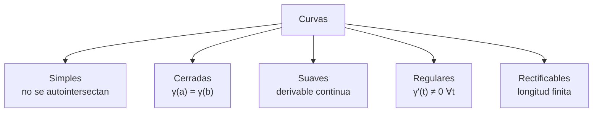

# Matemáticas para Ciencias Aplicadas III - Integral sobre trayectorias y superficies

## 3.1 Curvas. Orientación.

---

### 1. Introducción a las Curvas

Una curva en el espacio ℝⁿ es una aplicación continua de un intervalo real I en ℝⁿ.

**Definición formal:**
Una **curva parametrizada** es una función vectorial continua:

$$\gamma: I \subseteq \mathbb{R} \rightarrow \mathbb{R}^n$$

donde $I = [a,b]$ es un intervalo cerrado.

### 2. Parametrización de Curvas

#### 2.1. Representación paramétrica

$$\gamma(t) = (x_1(t), x_2(t), \dots, x_n(t)), \quad t \in [a,b]$$

#### 2.2. Ejemplos comunes

**Línea recta:**

$$\gamma(t) = \vec{P} + t\vec{v}, \quad t \in \mathbb{R}$$

**Circunferencia (2D):**

$$\gamma(t) = (R\cos t, R\sin t), \quad t \in [0, 2\pi]$$

**Hélice circular (3D):**

$$\gamma(t) = (R\cos t, R\sin t, ht), \quad t \in [0, 2\pi]$$

### 3. Clasificación de Curvas



### 4. Vector Tangente y Normal

#### 4.1. Vector tangente

$$\vec{T}(t) = \frac{\gamma'(t)}{\|\gamma'(t)\|}$$

#### 4.2. Vector normal (en ℝ³)

$$\vec{N}(t) = \frac{\vec{T}'(t)}{\|\vec{T}'(t)\|}$$

#### 4.3. Código Python para visualizar vectores tangentes

```python
import numpy as np
import matplotlib.pyplot as plt

def plot_tangent_vectors(curve, derivative, t_values):
    fig = plt.figure(figsize=(10, 8))
    ax = fig.add_subplot(111, projection='3d')

    # Calcular puntos y vectores tangentes
    points = curve(t_values)
    tangents = derivative(t_values)

    # Normalizar vectores tangentes
    tangents_norm = tangents / np.linalg.norm(tangents, axis=0)

    # Graficar curva
    ax.plot(points[0], points[1], points[2], 'b-', label='Curva')

    # Graficar vectores tangentes
    ax.quiver(points[0], points[1], points[2],
             tangents_norm[0], tangents_norm[1], tangents_norm[2],
             length=0.5, color='r', label='Vector Tangente')

    ax.legend()
    plt.show()

# Ejemplo: hélice circular
t = np.linspace(0, 4*np.pi, 100)
curve = lambda t: np.array([np.cos(t), np.sin(t), 0.1*t])
derivative = lambda t: np.array([-np.sin(t), np.cos(t), 0.1*np.ones_like(t)])

plot_tangent_vectors(curve, derivative, t)
```

### 5. Orientación de Curvas

#### 5.1. Definición de orientación

Una curva tiene **dos orientaciones posibles**: la dirección positiva y la negativa.

#### 5.2. Cambio de parámetro

Sea $\phi: [c,d] \rightarrow [a,b]$ una función biyectiva y creciente, entonces:

$$\gamma_1(s) = \gamma(\phi(s))$$

preserva la orientación.

Si $\phi$ es decreciente, invierte la orientación.

#### 5.3. Ejemplo de reparametrización

**Curva original:**
$$\gamma(t) = (\cos t, \sin t), \quad t \in [0, 2\pi]$$

**Reparametrización que preserva orientación:**

$$s = 2\pi - t \quad \Rightarrow \quad \gamma_1(s) = (\cos(2\pi - s), \sin(2\pi - s))$$

### 6. Longitud de Arco

#### 6.1. Fórmula de longitud

$$L = \int_a^b \|\gamma'(t)\| dt = \int_a^b \sqrt{\left(\frac{dx}{dt}\right)^2 + \left(\frac{dy}{dt}\right)^2 + \left(\frac{dz}{dt}\right)^2} dt$$

#### 6.2. Parámetro longitud de arco

$$s(t) = \int_a^t \|\gamma'(u)\| du$$

$$\frac{ds}{dt} = \|\gamma'(t)\|$$

### 7. Integral de Línea

#### 7.1. Integral de campo escalar

$$\int_C f ds = \int_a^b f(\gamma(t)) \|\gamma'(t)\| dt$$

#### 7.2. Integral de campo vectorial

$$\int_C \vec{F} \cdot d\vec{r} = \int_a^b \vec{F}(\gamma(t)) \cdot \gamma'(t) dt$$

### 8. Ejemplos Resueltos

#### Ejemplo 1: Calcular longitud de arco

**Curva:** $\gamma(t) = (t, t^2, 0)$, $t \in [0, 1]$

**Solución:**

$$\gamma'(t) = (1, 2t, 0)$$

$$\|\gamma'(t)\| = \sqrt{1 + 4t^2}$$

$$L = \int_0^1 \sqrt{1 + 4t^2} dt = \frac{1}{4}[2t\sqrt{1+4t^2} + \ln|2t+\sqrt{1+4t^2}|]_0^1$$

#### Ejemplo 2: Integral de línea

**Campo vectorial:** $\vec{F}(x,y) = (y, -x)$
**Curva:** $\gamma(t) = (\cos t, \sin t)$, $t \in [0, \pi/2]$

**Solución:**

$$\gamma'(t) = (-\sin t, \cos t)$$

$$\vec{F}(\gamma(t)) = (\sin t, -\cos t)$$

$$\int_C \vec{F} \cdot d\vec{r} = \int_0^{\pi/2} (\sin t, -\cos t) \cdot (-\sin t, \cos t) dt$$

$$= \int_0^{\pi/2} (-\sin^2 t - \cos^2 t) dt = -\int_0^{\pi/2} dt = -\frac{\pi}{2}$$

### 9. Ejercicios Propuestos

#### Ejercicio 1

Parametrice la curva intersección entre $x^2 + y^2 = 4$ y $z = x + y$ con orientación antihoraria vista desde arriba.

#### Ejercicio 2

Calcule la longitud de la curva $\gamma(t) = (e^t\cos t, e^t\sin t, e^t)$ para $t \in [0, 1]$.

#### Ejercicio 3

Evalúe $\int_C (x^2 + y^2) ds$ donde C es la circunferencia $x^2 + y^2 = 9$.

#### Ejercicio 4

Determine si la reparametrización $s = 1 - t$ de $\gamma(t) = (t, t^2)$ preserva o invierte la orientación.

#### Ejercicio 5

Calcule $\int_C \vec{F} \cdot d\vec{r}$ donde $\vec{F} = (x, y, z)$ y C es la hélice $\gamma(t) = (\cos t, \sin t, t)$ para $t \in [0, 2\pi]$.

### 10. Aplicaciones Físicas

#### 10.1. Trabajo realizado por un campo de fuerzas

$$W = \int_C \vec{F} \cdot d\vec{r}$$

#### 10.2. Flujo a través de una curva

$$\Phi = \int_C \vec{F} \cdot \vec{n} ds$$

donde $\vec{n}$ es el vector normal unitario.

### 11. Referencias Bibliográficas

1. **Calculus: Early Transcendentals** - James Stewart
2. **Advanced Calculus** - Gerald B. Folland
3. **Vector Calculus** - Jerrold E. Marsden
4. **Mathematical Methods for Physics and Engineering** - Riley, Hobson, Bence

### 12. Consejos de Estudio

- Practique la parametrización de diferentes tipos de curvas
- Domine el cálculo de derivadas de funciones vectoriales
- Visualice las curvas y sus orientaciones usando software matemático
- Resuelva problemas físicos para entender aplicaciones prácticas

### Soluciones a Ejercicios Propuestos

**Ejercicio 2:**

$$\gamma'(t) = (e^t\cos t - e^t\sin t, e^t\sin t + e^t\cos t, e^t)$$

$$\|\gamma'(t)\| = e^t\sqrt{3}$$

$$L = \sqrt{3}(e - 1)$$

**Ejercicio 4:** La reparametrización invierte la orientación pues $\frac{ds}{dt} = -1 < 0$

**Ejercicio 5:**
$$\int_0^{2\pi} (\cos t, \sin t, t) \cdot (-\sin t, \cos t, 1) dt = \int_0^{2\pi} t dt = 2\pi^2$$
