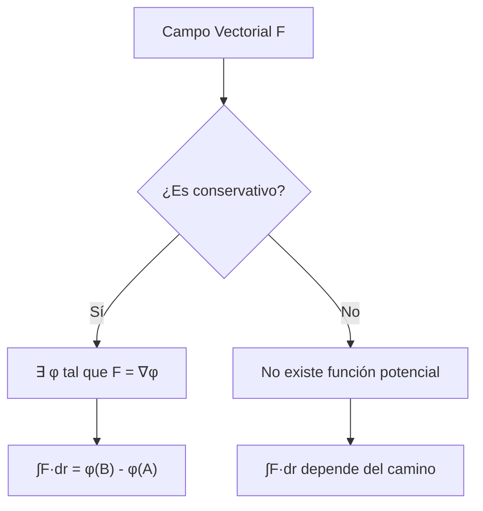
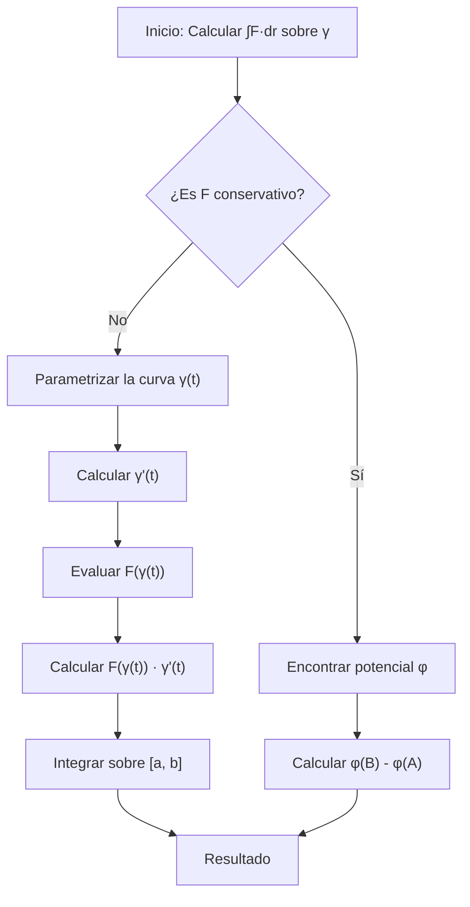

# Matemáticas para Ciencias Aplicadas III - Integral sobre trayectorias y superficies

## 3.2 La integral de trayectoria.

---

### 1. Introducción a la Integral de Trayectoria

La integral de trayectoria (o integral de línea) es una generalización de la integral definida para funciones evaluadas sobre una curva en el plano o en el espacio. Existen dos tipos principales: la integral de línea de un campo escalar y la integral de línea de un campo vectorial.

### 2. Integral de Trayectoria de un Campo Escalar

#### 2.1. Definición

Sea $f: U \subseteq \mathbb{R}^n \rightarrow \mathbb{R}$ un campo escalar continuo y sea $\gamma: [a,b] \rightarrow \mathbb{R}^n$ una curva regular. La integral de trayectoria de $f$ sobre $\gamma$ se define como:

$$\int_{\gamma} f \, ds = \int_a^b f(\gamma(t)) \|\gamma'(t)\| \, dt$$

#### 2.2. Interpretación física

- Si $f$ representa la densidad lineal de masa, la integral calcula la masa total de la curva.
- Si $f = 1,$ la integral calcula la longitud de la curva.

#### 2.3. Propiedades

1. **Linealidad**:

   $$\int_{\gamma} (αf + βg) \, ds = α\int_{\gamma} f \, ds + β\int_{\gamma} g \, ds$$

2. **Aditividad**: Si $\gamma = \gamma_1 \cup \gamma_2,$ entonces:
   
   $$\int_{\gamma} f \, ds = \int_{\gamma_1} f \, ds + \int_{\gamma_2} f \, ds$$

3. **Independencia de la parametrización**: El valor de la integral no depende de la parametrización específica de la curva, **ni de su orientación**: $\int_{-\gamma} f \, ds = \int_{\gamma} f \, ds,$ porque $ds = \|\gamma'(t)\| \, dt$ siempre es positivo.

### 3. Integral de Trayectoria de un Campo Vectorial

#### 3.1. Definición

Sea $\vec{F}: U \subseteq \mathbb{R}^n \rightarrow \mathbb{R}^n$ un campo vectorial continuo y sea $\gamma: [a,b] \rightarrow \mathbb{R}^n$ una curva regular. La integral de trayectoria de $\vec{F}$ sobre $\gamma$ se define como:

$$\int_{\gamma} \vec{F} \cdot d\vec{r} = \int_a^b \vec{F}(\gamma(t)) \cdot \gamma'(t) \, dt$$

#### 3.2. Interpretación física

- Si $\vec{F}$ representa un campo de fuerzas, la integral calcula el trabajo realizado al mover una partícula a lo largo de la curva.
- En electromagnetismo, representa la circulación del campo.

#### 3.3. Relación con la integral de campo escalar

$$\int_{\gamma} \vec{F} \cdot d\vec{r} = \int_{\gamma} (\vec{F} \cdot \vec{T}) \, ds$$

donde $\vec{T}$ es el vector tangente unitario. Solo cuenta la componente de $\vec{F}$ **a lo largo** de la curva; la componente normal no hace trabajo.

#### 3.4. Efecto de la orientación

Si $-\gamma$ es la curva recorrida en sentido contrario,

$$\int_{-\gamma} \vec{F} \cdot d\vec{r} = -\int_{\gamma} \vec{F} \cdot d\vec{r}$$

porque el vector tangente cambia de sentido. Por eso la integral de un campo vectorial es independiente de la parametrización **solo entre parametrizaciones con la misma orientación**.

#### 3.5. Notación diferencial

Con $\vec{F} = (P, Q, R)$ y $d\vec{r} = (dx, dy, dz),$ se escribe

$$\int_\gamma \vec{F} \cdot d\vec{r} = \int_\gamma P \, dx + Q \, dy + R \, dz$$

y al parametrizar se sustituye $dx = x'(t)\,dt,$ $dy = y'(t)\,dt,$ $dz = z'(t)\,dt.$

### 4. Campos Conservativos

#### 4.1. Definición

Un campo vectorial $\vec{F}$ se dice **conservativo** si existe un campo escalar $\varphi$ (llamado potencial) tal que:

$$\vec{F} = \nabla \varphi$$

#### 4.2. Teorema fundamental para integrales de línea

Si $\vec{F} = \nabla \varphi$ es conservativo y $\gamma$ es una curva regular que une los puntos $A$ y $B,$ entonces:

$$\int_{\gamma} \vec{F} \cdot d\vec{r} = \varphi(B) - \varphi(A)$$

#### 4.3. Independencia del camino

Para un campo conservativo, la integral de línea depende sólo de los puntos inicial y final, no de la trayectoria específica.



### 5. Aplicaciones Físicas

#### 5.1. Trabajo mecánico

$$W = \int_{\gamma} \vec{F} \cdot d\vec{r}$$

#### 5.2. Circulación

$$\Gamma = \oint_{\gamma} \vec{v} \cdot d\vec{r}$$

(para fluidos en movimiento)

#### 5.3. Ley de Ampère (electromagnetismo)

$$\oint_{\gamma} \vec{B} \cdot d\vec{r} = \mu_0 I_{\text{enc}}$$

### 6. Algoritmo para Calcular Integrales de Trayectoria



### 7. Ejemplos Resueltos

#### Ejemplo 1: Integral de campo escalar

Calcular $\int_{\gamma} (x + y) \, ds$ donde $\gamma$ es el segmento de recta desde $(0,0)$ hasta $(1,1).$

**Solución:**
Parametrización: $\gamma(t) = (t, t),$ $t \in [0, 1]$
$\gamma'(t) = (1, 1),$ $\|\gamma'(t)\| = \sqrt{2}$

$$\int_{\gamma} (x + y) \, ds = \int_0^1 (t + t) \sqrt{2} \, dt = \sqrt{2} \int_0^1 2t \, dt = \sqrt{2}[t^2]_0^1 = \sqrt{2}$$

#### Ejemplo 2: Integral de campo vectorial

Calcular $\int_{\gamma} \vec{F} \cdot d\vec{r}$ donde $\vec{F} = (y, x)$ y $\gamma$ es la parábola $y = x^2$ desde $(0,0)$ hasta $(1,1).$

**Solución:**
Parametrización: $\gamma(t) = (t, t^2),$ $t \in [0, 1]$
$\gamma'(t) = (1, 2t)$
$\vec{F}(\gamma(t)) = (t^2, t)$

$$\int_{\gamma} \vec{F} \cdot d\vec{r} = \int_0^1 (t^2, t) \cdot (1, 2t) \, dt = \int_0^1 (t^2 + 2t^2) \, dt = \int_0^1 3t^2 \, dt = [t^3]_0^1 = 1$$

El campo $(y, x) = \nabla(xy)$ es conservativo, así que también se obtiene $1 \cdot 1 - 0 = 1$ sin parametrizar.

#### Ejemplo 2b: Un campo no conservativo

Para $\vec{F} = (-y, x)$ de $(0,0)$ a $(1,1):$

- Por el segmento $(t, t):$ $\int_0^1 (-t + t) \, dt = 0.$
- Por la parábola $(t, t^2):$ $\int_0^1 (-t^2 + 2t^2) \, dt = \frac{1}{3}.$

Los valores son distintos, lo que prueba que $\vec{F}$ no es conservativo: su rotacional escalar es $2.$

#### Ejemplo 3: Campo conservativo

Calcular $\int_{\gamma} \vec{F} \cdot d\vec{r}$ donde $\vec{F} = (2x, 2y)$ y $\gamma$ es cualquier camino desde $(0,0)$ hasta $(1,2).$

**Solución:**
El campo es conservativo: $\vec{F} = \nabla \varphi$ con $\varphi(x,y) = x^2 + y^2$

$$\int_{\gamma} \vec{F} \cdot d\vec{r} = \varphi(1,2) - \varphi(0,0) = (1^2 + 2^2) - (0^2 + 0^2) = 5$$

### 8. Ejercicios Propuestos

#### Ejercicio 1

Calcular $\int_{\gamma} (x^2 + y^2) \, ds$ donde $\gamma$ es la circunferencia $x^2 + y^2 = 4$ recorrida en sentido antihorario.

#### Ejercicio 2

Evaluar $\int_{\gamma} \vec{F} \cdot d\vec{r}$ donde $\vec{F} = (x^2, xy)$ y $\gamma$ es el cuadrado con vértices $(0,0),$ $(1,0),$ $(1,1),$ $(0,1)$ recorrido en sentido antihorario.

#### Ejercicio 3

Determinar si el campo $\vec{F} = (y^2, 2xy)$ es conservativo y, en caso afirmativo, encontrar su potencial.

#### Ejercicio 4

Calcular el trabajo realizado por el campo $\vec{F} = (z, x, y)$ al mover una partícula a lo largo de la hélice $\gamma(t) = (\cos t, \sin t, t)$ desde $t = 0$ hasta $t = 2\pi.$

#### Ejercicio 5

Hallar la longitud del arco de la curva $\gamma(t) = (t, t^2, \frac{2}{3}t^3)$ desde $(0,0,0)$ hasta $(1,1,\frac{2}{3}).$

### 9. Implementación Computacional

#### Código Python para integral de trayectoria

```python
import numpy as np
from scipy.integrate import quad

def line_integral_scalar(f, gamma, gamma_deriv, a, b):
    """Calcula la integral de línea de un campo escalar"""
    integrand = lambda t: f(gamma(t)) * np.linalg.norm(gamma_deriv(t))
    result, error = quad(integrand, a, b)
    return result, error

def line_integral_vector(F, gamma, gamma_deriv, a, b):
    """Calcula la integral de línea de un campo vectorial"""
    integrand = lambda t: np.dot(F(gamma(t)), gamma_deriv(t))
    result, error = quad(integrand, a, b)
    return result, error

# Ejemplo de uso
def ejemplo_campo_escalar():
    # f(x,y) = x + y
    f = lambda r: r[0] + r[1]

    # γ(t) = (t, t), t ∈ [0,1]
    gamma = lambda t: np.array([t, t])
    gamma_deriv = lambda t: np.array([1, 1])

    result, error = line_integral_scalar(f, gamma, gamma_deriv, 0, 1)
    print(f"Integral de campo escalar: {result}, Error: {error}")

def ejemplo_campo_vectorial():
    # F(x,y) = (y, x)
    F = lambda r: np.array([r[1], r[0]])

    # γ(t) = (t, t²), t ∈ [0,1]
    gamma = lambda t: np.array([t, t**2])
    gamma_deriv = lambda t: np.array([1, 2*t])

    result, error = line_integral_vector(F, gamma, gamma_deriv, 0, 1)
    print(f"Integral de campo vectorial: {result}, Error: {error}")

ejemplo_campo_escalar()
ejemplo_campo_vectorial()
```

### 10. Referencias Bibliográficas

1. **Calculus: Early Transcendentals** - James Stewart
2. **Advanced Engineering Mathematics** - Erwin Kreyszig
3. **Vector Calculus** - Jerrold E. Marsden
4. **Mathematical Methods for Physics and Engineering** - Riley, Hobson, Bence

### 11. Consejos de Estudio

- Dominar la parametrización de diferentes tipos de curvas
- Practicar el cálculo de derivadas de funciones vectoriales
- Comprender la diferencia entre integral de campo escalar y vectorial
- Identificar cuando un campo es conservativo para simplificar cálculos
- Visualizar las curvas y campos para una mejor comprensión geométrica

### Soluciones a Ejercicios Propuestos

**Ejercicio 1:**
Parametrización: $\gamma(t) = (2\cos t, 2\sin t),$ $t \in [0, 2\pi]$
$\|\gamma'(t)\| = 2$

$$\int_{\gamma} (x^2 + y^2) \, ds = \int_0^{2\pi} 4 \cdot 2 \, dt = 8 \int_0^{2\pi} dt = 16\pi$$

**Ejercicio 2:** Por lados. Abajo, $(t, 0):$ $\int_0^1 t^2 \, dt = \frac{1}{3}.$ Derecha, $(1, t):$ $\int_0^1 t \, dt = \frac{1}{2}.$ Arriba, $(1 - t, 1)$ con $dx = -dt:$ $-\int_0^1 (1 - t)^2 \, dt = -\frac{1}{3}.$ Izquierda, $(0, 1 - t):$ el integrando es $0.$ Total: $\frac{1}{2}.$ El teorema de Green da lo mismo: $\iint (y - 0) \, dA = \frac{1}{2}.$

**Ejercicio 3:**
El campo es conservativo en todo $\mathbb{R}^2$ pues $\frac{\partial}{\partial y}(y^2) = 2y = \frac{\partial}{\partial x}(2xy).$
Potencial: $\varphi(x,y) = xy^2 + C.$

**Ejercicio 4:** $\vec{F}(\gamma(t)) = (t, \cos t, \sin t)$ y $\gamma'(t) = (-\sin t, \cos t, 1):$

$$W = \int_0^{2\pi} \left(-t\sin t + \cos^2 t + \sin t\right) dt = 2\pi + \pi + 0 = 3\pi$$

**Ejercicio 5:**
$\gamma'(t) = (1, 2t, 2t^2),$ $\|\gamma'(t)\| = \sqrt{1 + 4t^2 + 4t^4} = 1 + 2t^2$

$$L = \int_0^1 (1 + 2t^2) \, dt = [t + \frac{2}{3}t^3]_0^1 = 1 + \frac{2}{3} = \frac{5}{3}$$
