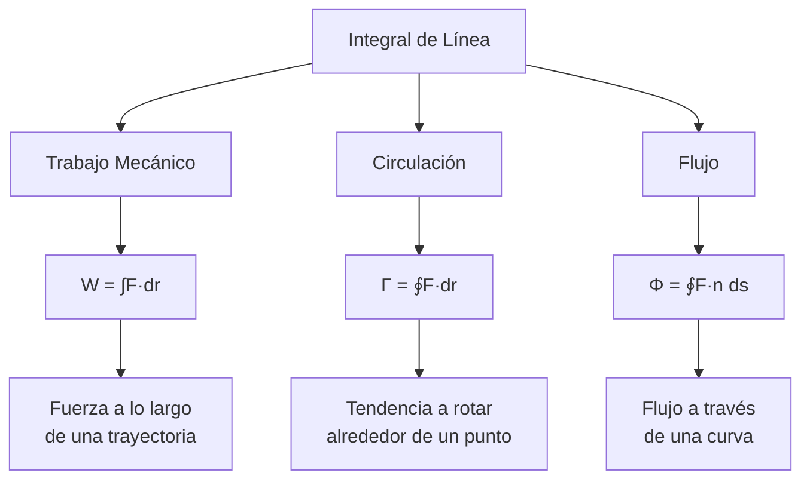
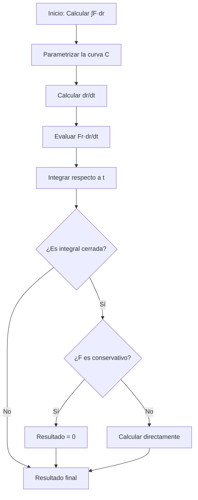

# Matemáticas para Ciencias Aplicadas III - Integral sobre trayectorias y superficies

## 3.3 Integrales de línea (trabajo, circulación).

---

### 1. Introducción Conceptual

Las integrales de línea extenden el concepto de integración a lo largo de curvas en el plano o espacio. Tienen aplicaciones fundamentales en física para calcular trabajo, circulación y flujo.

### 2. Definición Formal

#### 2.1. Integral de línea de un campo vectorial

Dado un campo vectorial $\vec{F}: \mathbb{R}^n \rightarrow \mathbb{R}^n$ y una curva $C$ parametrizada por $\vec{r}(t)$ con $t \in [a,b]$, la integral de línea se define como:

$$\int_C \vec{F} \cdot d\vec{r} = \int_a^b \vec{F}(\vec{r}(t)) \cdot \vec{r}'(t)  dt$$

#### 2.2. Notación alternativa

$$\int_C \vec{F} \cdot d\vec{r} = \int_C P dx + Q dy + R dz$$
donde $\vec{F} = (P, Q, R)$

### 3. Interpretación Física

#### 3.1. Trabajo mecánico

El trabajo realizado por una fuerza $\vec{F}$ al mover una partícula a lo largo de una trayectoria $C$ es:

$$W = \int_C \vec{F} \cdot d\vec{r}$$

#### 3.2. Circulación de un campo

La circulación mide la tendencia de un campo a rotar alrededor de una curva:

$$\Gamma = \oint_C \vec{F} \cdot d\vec{r}$$



### 4. Campos Conservativos y Independencia del Camino

#### 4.1. Definición de campo conservativo

Un campo vectorial $\vec{F}$ es conservativo si existe una función potencial $\varphi$ tal que:

$$\vec{F} = \nabla \varphi$$

#### 4.2. Teorema fundamental

Para un campo conservativo:

$$\int_C \vec{F} \cdot d\vec{r} = \varphi(B) - \varphi(A)$$

#### 4.3. Condiciones de independencia

Las siguientes afirmaciones son equivalentes:

1. $\vec{F}$ es conservativo
2. $\int_C \vec{F} \cdot d\vec{r}$ es independiente del camino
3. $\oint_C \vec{F} \cdot d\vec{r} = 0$ para toda curva cerrada $C$

### 5. Métodos de Cálculo

#### 5.1. Algoritmo general

1. Parametrizar la curva $C: \vec{r}(t) = (x(t), y(t), z(t))$
2. Calcular $\vec{r}'(t)$
3. Evaluar $\vec{F}(\vec{r}(t))$
4. Calcular el producto punto $\vec{F}(\vec{r}(t)) \cdot \vec{r}'(t)$
5. Integrar entre los límites del parámetro

#### 5.2. Ejemplo de parametrizaciones comunes

**Segmento de recta** de $A$ a $B$:

$$\vec{r}(t) = A + t(B - A), \quad t \in [0, 1]$$

**Circunferencia** de radio $R$:

$$\vec{r}(t) = (R\cos t, R\sin t), \quad t \in [0, 2\pi]$$

**Hélice circular**:

$$\vec{r}(t) = (R\cos t, R\sin t, kt), \quad t \in [0, 2\pi]$$

### 6. Aplicaciones Físicas Detalladas

#### 6.1. Trabajo en campos de fuerza

**Ejemplo**: Calcular el trabajo realizado por $\vec{F} = (y, x)$ a lo largo de la parábola $y = x^2$ desde $(0,0)$ hasta $(1,1)$.

**Solución**:
Parametrización: $\vec{r}(t) = (t, t^2)$, $t \in [0, 1]$
$\vec{r}'(t) = (1, 2t)$
$\vec{F}(\vec{r}(t)) = (t^2, t)$
$$W = \int_0^1 (t^2, t) \cdot (1, 2t)  dt = \int_0^1 (t^2 + 2t^2)  dt = \int_0^1 3t^2  dt = 1$$

#### 6.2. Circulación en fluidos

La circulación de un campo de velocidades $\vec{v}$ alrededor de una curva cerrada $C$ indica la presencia de vórtices:

$$\Gamma = \oint_C \vec{v} \cdot d\vec{r}$$

#### 6.3. Ley de Ampère en electromagnetismo

$$\oint_C \vec{B} \cdot d\vec{r} = \mu_0 I_{\text{enc}}$$

### 7. Implementación Computacional

```python
import numpy as np
from scipy.integrate import quad

def trabajo_campo_vectorial(F, r, r_deriv, a, b):
    """
    Calcula el trabajo de un campo vectorial a lo largo de una curva

    Parámetros:
    F: función del campo vectorial F(r) = (P, Q, R)
    r: función de parametrización de la curva r(t)
    r_deriv: derivada de la parametrización r'(t)
    a, b: límites de integración
    """
    def integrando(t):
        pos = r(t)
        deriv = r_deriv(t)
        campo = F(pos)
        return np.dot(campo, deriv)

    resultado, error = quad(integrando, a, b)
    return resultado, error

# Ejemplo: Trabajo de F = (y, x) a lo largo de y = x² desde (0,0) hasta (1,1)
def ejemplo_trabajo():
    # Campo vectorial F = (y, x)
    F = lambda r: np.array([r[1], r[0]])

    # Parametrización de y = x²: r(t) = (t, t²)
    r = lambda t: np.array([t, t**2])
    r_deriv = lambda t: np.array([1, 2*t])

    trabajo, error = trabajo_campo_vectorial(F, r, r_deriv, 0, 1)
    print(f"Trabajo realizado: {trabajo:.4f}, Error: {error:.2e}")

# Ejemplo: Circulación de F = (-y, x) alrededor de circunferencia unitaria
def ejemplo_circulacion():
    # Campo vectorial F = (-y, x) - campo rotacional
    F = lambda r: np.array([-r[1], r[0]])

    # Parametrización de circunferencia unitaria
    r = lambda t: np.array([np.cos(t), np.sin(t)])
    r_deriv = lambda t: np.array([-np.sin(t), np.cos(t)])

    circulacion, error = trabajo_campo_vectorial(F, r, r_deriv, 0, 2*np.pi)
    print(f"Circulación: {circulacion:.4f}, Error: {error:.2e}")

# Ejecutar ejemplos
ejemplo_trabajo()
ejemplo_circulacion()
```

### 8. Ejercicios Propuestos

#### Ejercicio 1

Calcular el trabajo realizado por el campo $\vec{F} = (x^2, xy)$ a lo largo del cuadrado con vértices $(0,0)$, $(1,0)$, $(1,1)$, $(0,1)$.

#### Ejercicio 2

Determinar la circulación del campo $\vec{F} = (-y^3, x^3)$ alrededor de la elipse $\frac{x^2}{4} + \frac{y^2}{9} = 1$.

#### Ejercicio 3

Verificar si el campo $\vec{F} = (2xy + z^3, x^2, 3xz^2)$ es conservativo y encontrar el trabajo desde $(0,0,0)$ hasta $(1,1,1)$.

#### Ejercicio 4

Calcular $\int_C (x + y) dx + (x - y) dy$ donde $C$ es el arco de parábola $y = x^2$ desde $(0,0)$ hasta $(1,1)$.

#### Ejercicio 5

Un campo de fuerzas $\vec{F} = (z, x, y)$ actúa sobre una partícula. Calcular el trabajo al moverla a lo largo de la hélice $\vec{r}(t) = (\cos t, \sin t, t)$ desde $t = 0$ hasta $t = 2\pi$.

### 9. Diagramas de Flujo para Resolución de Problemas



### 10. Casos Especiales y Teoremas

#### 10.1. Teorema de Green (para integrales en el plano)

$$\oint_C P dx + Q dy = \iint_D \left(\frac{\partial Q}{\partial x} - \frac{\partial P}{\partial y}\right) dA$$

#### 10.2. Condiciones para campos conservativos

En $\mathbb{R}^2$: $\frac{\partial P}{\partial y} = \frac{\partial Q}{\partial x}$
En $\mathbb{R}^3$: $\nabla \times \vec{F} = \vec{0}$

### 11. Soluciones a Ejercicios Propuestos

#### Solución Ejercicio 3

El campo $\vec{F} = (2xy + z^3, x^2, 3xz^2)$ es conservativo porque:

$$ \nabla \times \vec{F} = \left(\frac{\partial}{\partial y}(3xz^2) - \frac{\partial}{\partial z}(x^2), \frac{\partial}{\partial z}(2xy + z^3) - \frac{\partial}{\partial x}(3xz^2), \frac{\partial}{\partial x}(x^2) - \frac{\partial}{\partial y}(2xy + z^3)\right) = (0, 0, 0) $$

Encontramos el potencial $\varphi$:

$$\frac{\partial \varphi}{\partial x} = 2xy + z^3 \Rightarrow \varphi = x^2y + xz^3 + g(y,z)$$

$$\frac{\partial \varphi}{\partial y} = x^2 + \frac{\partial g}{\partial y} = x^2 \Rightarrow g(y,z) = h(z)$$

$$\frac{\partial \varphi}{\partial z} = 3xz^2 + h'(z) = 3xz^2 \Rightarrow h(z) = C$$

$$\varphi = x^2y + xz^3 + C$$

Trabajo $= \varphi(1,1,1) - \varphi(0,0,0) = (1 + 1) - 0 = 2$

### 12. Referencias Bibliográficas

1. **Calculus: Early Transcendentals** - James Stewart
2. **Advanced Engineering Mathematics** - Erwin Kreyszig
3. **Vector Calculus** - Jerrold E. Marsden
4. **Mathematical Methods for Physics and Engineering** - Riley, Hobson, Bence
5. **Classical Electrodynamics** - J.D. Jackson

### 13. Consejos de Estudio

- Dominar la parametrización de diferentes tipos de curvas
- Practicar el reconocimiento de campos conservativos
- Visualizar físicamente el significado de trabajo y circulación
- Utilizar software para verificar resultados y visualizar campos
- Resolver problemas con aplicaciones físicas reales
