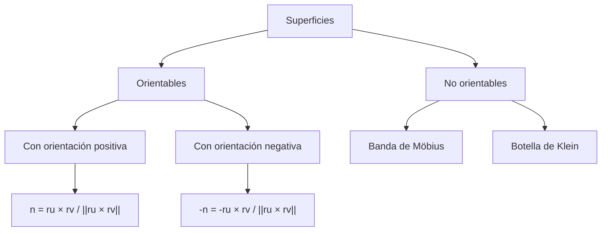
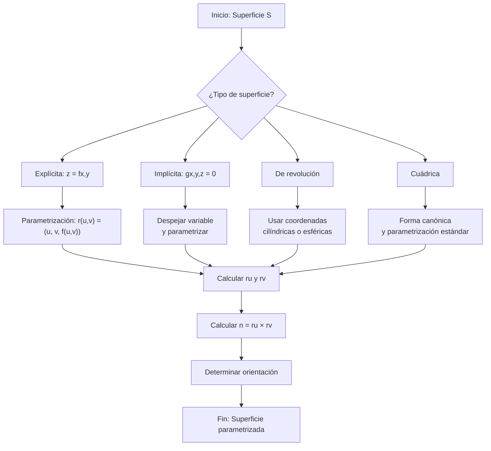

# Matemáticas para Ciencias Aplicadas III - Integral sobre trayectorias y superficies

## 3.4 Parametrización de superficies. Orientación.

---

### 1. Introducción a las Superficies Parametrizadas

Una superficie parametrizada es una función vectorial que mapea una región plana (parámetros) a una superficie en el espacio tridimensional.

**Definición formal:**
Una **parametrización de superficie** es una función vectorial de clase $C^1$

$$\vec{r}: D \subseteq \mathbb{R}^2 \rightarrow \mathbb{R}^3$$

donde $D$ es un dominio de parámetros y $\vec{r}(u,v) = (x(u,v), y(u,v), z(u,v)).$ La superficie es la imagen $S = \vec{r}(D).$ Se dice que la parametrización es **regular** en un punto si $\vec{r}_u \times \vec{r}_v \neq \vec{0}$ ahí; en esos puntos la superficie tiene plano tangente.

### 2. Elementos Fundamentales de una Superficie Parametrizada

#### 2.1. Vectores tangentes

$$\vec{r}_u = \frac{\partial \vec{r}}{\partial u} = \left(\frac{\partial x}{\partial u}, \frac{\partial y}{\partial u}, \frac{\partial z}{\partial u}\right)$$

$$\vec{r}_v = \frac{\partial \vec{r}}{\partial v} = \left(\frac{\partial x}{\partial v}, \frac{\partial y}{\partial v}, \frac{\partial z}{\partial v}\right)$$

#### 2.2. Vector normal a la superficie

$$\vec{n} = \vec{r}_u \times \vec{r}_v$$

Es perpendicular a los dos vectores tangentes y, por lo tanto, al **plano tangente** en $\vec{r}(u_0, v_0),$ cuya ecuación es $\vec{n} \cdot (\vec{x} - \vec{r}(u_0, v_0)) = 0.$

#### 2.3. Elemento de área

$$dS = \|\vec{r}_u \times \vec{r}_v\| \, du \, dv$$

porque el rectángulo de lados $du,$ $dv$ se transforma, aproximadamente, en el paralelogramo generado por $\vec{r}_u\,du$ y $\vec{r}_v\,dv.$

### 3. Parametrizaciones Comunes de Superficies

#### 3.1. Superficies explícitas $(z = f(x,y))$

$$\vec{r}(x,y) = (x, y, f(x,y)), \quad (x,y) \in D$$

En este caso $\vec{r}_x \times \vec{r}_y = (-f_x, -f_y, 1),$ que apunta hacia arriba, y $dS = \sqrt{1 + f_x^2 + f_y^2} \, dx \, dy.$

#### 3.2. Superficies de revolución

Para una curva $\rho = f(z) \geq 0$ del plano $yz$ rotada alrededor del eje $z,$ donde $\rho$ es la distancia al eje,

$$\vec{r}(\theta, z) = (f(z)\cos\theta, f(z)\sin\theta, z)$$

#### 3.3. Superficies esféricas

$$\vec{r}(\theta, \phi) = (R\sin\phi\cos\theta, R\sin\phi\sin\theta, R\cos\phi)$$

$$\theta \in [0, 2\pi], \quad \phi \in [0, \pi]$$

#### 3.4. Superficies cilíndricas

$$\vec{r}(\theta, z) = (R\cos\theta, R\sin\theta, z)$$

$$\theta \in [0, 2\pi], \quad z \in [z_1, z_2]$$

### 4. Orientación de Superficies

#### 4.1. Concepto de orientación

Una superficie es **orientable** si es posible elegir en cada punto un vector normal unitario $\hat{n}$ que varíe de forma **continua** sobre toda la superficie. Una **orientación** es una de esas elecciones; una superficie orientable conexa tiene exactamente dos.

- Una superficie **cerrada**, como la esfera, el toro o la frontera de un sólido, se orienta por convención con la **normal exterior**.
- La **banda de Möbius** no es orientable: si se lleva el vector normal a lo largo de la línea central, regresa al punto de partida apuntando en sentido opuesto.
- Cambiar el orden de los parámetros invierte la orientación, porque $\vec{r}_v \times \vec{r}_u = -\vec{r}_u \times \vec{r}_v.$

#### 4.2. Vector normal unitario

$$\hat{n} = \frac{\vec{r}_u \times \vec{r}_v}{\|\vec{r}_u \times \vec{r}_v\|}$$

#### 4.3. Clasificación de superficies



### 5. Tipos de Parametrizaciones

#### 5.1. Parametrización rectangular

Para una superficie plana:

$$\vec{r}(u,v) = (u, v, 0), \quad (u,v) \in [a,b] \times [c,d]$$

#### 5.2. Parametrización cilíndrica

$$\vec{r}(\theta, z) = (R\cos\theta, R\sin\theta, z)$$

#### 5.3. Parametrización esférica

$$\vec{r}(\theta, \phi) = (R\sin\phi\cos\theta, R\sin\phi\sin\theta, R\cos\phi)$$

#### 5.4. Parametrización por coordenadas curvilíneas

$$\vec{r}(u,v) = (x(u,v), y(u,v), z(u,v))$$

### 6. Ejemplos de Parametrización

#### Ejemplo 1: Plano inclinado

Superficie: $z = 2x + 3y - 1$ sobre el rectángulo $[0,1] \times [0,2]$

**Parametrización:**

$$\vec{r}(u,v) = (u, v, 2u + 3v - 1), \quad u \in [0,1], v \in [0,2]$$

**Vectores tangentes:**

$$\vec{r}_u = (1, 0, 2), \quad \vec{r}_v = (0, 1, 3)$$

**Vector normal:**

$$ \vec{r}_u \times \vec{r}_v = \begin{vmatrix} \mathbf{i} & \mathbf{j} & \mathbf{k} \\ 1 & 0 & 2 \\ 0 & 1 & 3 \\ \end{vmatrix} = (-2, -3, 1) $$

#### Ejemplo 2: Esfera unitaria
**Parametrización:**

$$\vec{r}(\theta, \phi) = (\sin\phi\cos\theta, \sin\phi\sin\theta, \cos\phi)$$

$$\theta \in [0, 2\pi], \quad \phi \in [0, \pi]$$

**Vectores tangentes:**

$$\vec{r}_\theta = (-\sin\phi\sin\theta, \sin\phi\cos\theta, 0)$$

$$\vec{r}_\phi = (\cos\phi\cos\theta, \cos\phi\sin\theta, -\sin\phi)$$

**Vector normal:**

$$\vec{r}_\theta \times \vec{r}_\phi = -\sin\phi (\sin\phi\cos\theta, \sin\phi\sin\theta, \cos\phi) = -\sin\phi \, \vec{r}(\theta,\phi)$$

Como $\sin\phi \geq 0,$ este vector apunta **hacia adentro**. Para la normal exterior se usa el orden inverso:

$$\vec{r}_\phi \times \vec{r}_\theta = \sin\phi \, \vec{r}(\theta,\phi), \qquad \|\vec{r}_\phi \times \vec{r}_\theta\| = \sin\phi$$

En los polos, $\phi = 0$ y $\phi = \pi,$ el producto se anula: la parametrización no es regular ahí, aunque la esfera es perfectamente lisa. Es un defecto de la parametrización, no de la superficie.

### 7. Implementación Computacional

```python
import numpy as np
import matplotlib.pyplot as plt
from mpl_toolkits.mplot3d import Axes3D

def parametrizacion_plano(u, v):
    """Parametrización de un plano: z = 2x + 3y - 1"""
    x = u
    y = v
    z = 2*u + 3*v - 1
    return x, y, z

def parametrizacion_esfera(theta, phi, R=1):
    """Parametrización de una esfera de radio R"""
    x = R * np.sin(phi) * np.cos(theta)
    y = R * np.sin(phi) * np.sin(theta)
    z = R * np.cos(phi)
    return x, y, z

def calcular_vectores_tangentes(r_func, u, v, h=1e-6):
    """Calcula los vectores tangentes numéricamente"""
    # Vector tangente respecto a u
    r_u_plus = np.array(r_func(u + h, v))
    r_u_minus = np.array(r_func(u - h, v))
    r_u = (r_u_plus - r_u_minus) / (2*h)

    # Vector tangente respecto a v
    r_v_plus = np.array(r_func(u, v + h))
    r_v_minus = np.array(r_func(u, v - h))
    r_v = (r_v_plus - r_v_minus) / (2*h)

    return r_u, r_v

def vector_normal(r_u, r_v):
    """Calcula el vector normal como producto cruz"""
    return np.cross(r_u, r_v)

# Visualización de una superficie parametrizada
def visualizar_superficie():
    fig = plt.figure(figsize=(12, 5))

    # Plano
    ax1 = fig.add_subplot(121, projection='3d')
    u = np.linspace(0, 1, 20)
    v = np.linspace(0, 2, 20)
    U, V = np.meshgrid(u, v)
    X, Y, Z = parametrizacion_plano(U, V)
    ax1.plot_surface(X, Y, Z, alpha=0.7, cmap='viridis')
    ax1.set_title('Plano: z = 2x + 3y - 1')

    # Esfera
    ax2 = fig.add_subplot(122, projection='3d')
    theta = np.linspace(0, 2*np.pi, 30)
    phi = np.linspace(0, np.pi, 30)
    Theta, Phi = np.meshgrid(theta, phi)
    X, Y, Z = parametrizacion_esfera(Theta, Phi)
    ax2.plot_surface(X, Y, Z, alpha=0.7, cmap='plasma')
    ax2.set_title('Esfera unitaria')

    plt.tight_layout()
    plt.show()

# Ejemplo de uso
u_val, v_val = 0.5, 1.0
r_u, r_v = calcular_vectores_tangentes(parametrizacion_plano, u_val, v_val)
n = vector_normal(r_u, r_v)
print(f"Vector normal en ({u_val}, {v_val}): {n}")

visualizar_superficie()
```

### 8. Ejercicios Propuestos

#### Ejercicio 1
Parametrice la superficie del cono $z = \sqrt{x^2 + y^2}$ para $0 \leq z \leq 3$ y calcule sus vectores tangentes y normal.

#### Ejercicio 2
Encuentre una parametrización del paraboloide $z = x^2 + y^2$ para $0 \leq z \leq 4$ y determine el elemento de área $dS.$ Use coordenadas polares en el plano $xy.$

#### Ejercicio 3
Parametrice la superficie cilíndrica $x^2 + y^2 = 9$ para $0 \leq z \leq 5$ y verifique que es orientable.

#### Ejercicio 4
Para la superficie esférica $x^2 + y^2 + z^2 = 4,$ encuentre el vector normal unitario que apunta hacia afuera.

#### Ejercicio 5
Parametrice el toro generado al rotar la circunferencia $(x-2)^2 + z^2 = 1$ alrededor del eje $z.$

### 9. Aplicación: Integrales de Superficie

#### 9.1. Integral de superficie de campo escalar

$$\iint_S f(x,y,z) \, dS = \iint_D f(\vec{r}(u,v)) \|\vec{r}_u \times \vec{r}_v\| \, du \, dv$$

#### 9.2. Integral de superficie de campo vectorial (flujo)

$$\iint_S \vec{F} \cdot d\vec{S} = \iint_S \vec{F} \cdot \hat{n} \, dS = \iint_D \vec{F}(\vec{r}(u,v)) \cdot (\vec{r}_u \times \vec{r}_v) \, du \, dv$$

### 10. Diagrama de Flujo: Parametrización de Superficies



### 11. Soluciones a Ejercicios Propuestos

#### Solución Ejercicio 1
**Parametrización del cono:**
Usando coordenadas cilíndricas: $x = u\cos v,$ $y = u\sin v,$ $z = u$

$$\vec{r}(u,v) = (u\cos v, u\sin v, u), \quad u \in [0,3], v \in [0,2\pi]$$

**Vectores tangentes:**

$$\vec{r}_u = (\cos v, \sin v, 1), \quad \vec{r}_v = (-u\sin v, u\cos v, 0)$$

**Vector normal:**

$$\vec{r}_u \times \vec{r}_v = (-u\cos v, -u\sin v, u)$$

Su componente $z$ es positiva, así que apunta hacia arriba y hacia el eje, es decir, hacia el interior del cono. En el vértice $u = 0$ se anula: el cono tiene una punta.

#### Solución Ejercicio 2

$\vec{r}(\rho, \theta) = (\rho\cos\theta, \rho\sin\theta, \rho^2),$ con $0 \leq \rho \leq 2,$ $0 \leq \theta \leq 2\pi.$ Entonces $\vec{r}_\rho \times \vec{r}_\theta = (-2\rho^2\cos\theta, -2\rho^2\sin\theta, \rho)$ y

$$dS = \rho\sqrt{1 + 4\rho^2} \, d\rho \, d\theta$$

#### Solución Ejercicio 3

$\vec{r}(\theta, z) = (3\cos\theta, 3\sin\theta, z),$ con $0 \leq \theta \leq 2\pi$ y $0 \leq z \leq 5.$ $\vec{r}_\theta \times \vec{r}_z = (3\cos\theta, 3\sin\theta, 0)$ nunca se anula y varía continuamente, así que la normal unitaria $(\cos\theta, \sin\theta, 0)$ define una orientación: la exterior.

#### Solución Ejercicio 4
**Parametrización esférica:**

$$\vec{r}(\theta, \phi) = (2\sin\phi\cos\theta, 2\sin\phi\sin\theta, 2\cos\phi)$$

**Vector normal:** con el orden $\phi,$ $\theta,$

$$\vec{r}_\phi \times \vec{r}_\theta = 4\sin\phi (\sin\phi\cos\theta, \sin\phi\sin\theta, \cos\phi) = 2\sin\phi \, \vec{r}(\theta,\phi)$$

**Vector normal unitario hacia afuera:**

$$\hat{n} = \frac{\vec{r}_\phi \times \vec{r}_\theta}{\|\vec{r}_\phi \times \vec{r}_\theta\|} = (\sin\phi\cos\theta, \sin\phi\sin\theta, \cos\phi) = \frac{\vec{r}}{2}$$

En general, en una esfera centrada en el origen la normal exterior es el vector de posición dividido entre el radio.

#### Solución Ejercicio 5

El punto de la circunferencia a distancia $2 + \cos\varphi$ del eje y altura $\sin\varphi$ gira un ángulo $\theta:$

$$\vec{r}(\theta, \varphi) = \left((2 + \cos\varphi)\cos\theta, \; (2 + \cos\varphi)\sin\theta, \; \sin\varphi\right), \quad \theta, \varphi \in [0, 2\pi]$$

### 12. Referencias Bibliográficas

1. **Calculus: Early Transcendentals** - James Stewart
2. **Advanced Engineering Mathematics** - Erwin Kreyszig
3. **Vector Calculus** - Jerrold E. Marsden
4. **Differential Geometry of Curves and Surfaces** - Manfredo P. do Carmo
5. **Mathematical Methods for Physics and Engineering** - Riley, Hobson, Bence

### 13. Consejos de Estudio

- Practique la parametrización de diferentes tipos de superficies
- Domine el cálculo de productos vectoriales para obtener vectores normales
- Visualice las superficies usando software matemático
- Comprenda la diferencia entre superficies orientables y no orientables
- Relacione las parametrizaciones con aplicaciones físicas como flujo y área
