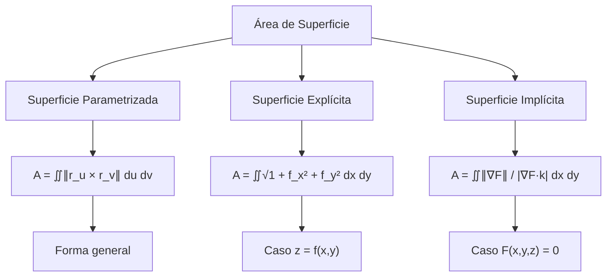
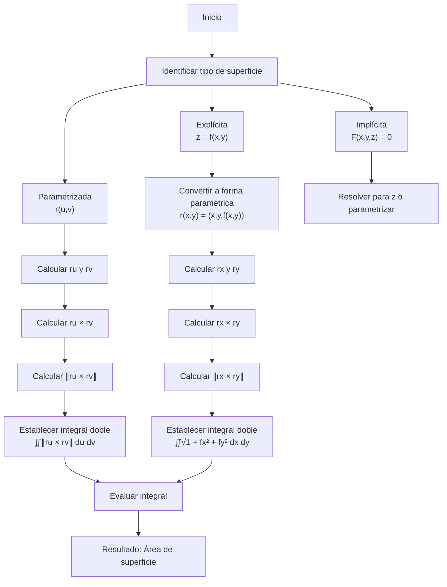

# Matemáticas para Ciencias Aplicadas III - Integral sobre trayectorias y superficies

## 3.5 Área de una superficie.

---

### 1. Introducción Conceptual

El área de una superficie es una generalización del concepto de área plana a superficies curvas en el espacio. Es fundamental en múltiples aplicaciones físicas y geométricas, desde el cálculo de tensiones superficiales hasta la determinación de flujos de calor.

### 2. Definición Formal del Área de Superficie

#### 2.1. Para superficies parametrizadas

Dada una superficie $S$ parametrizada por $\vec{r}(u,v) = (x(u,v), y(u,v), z(u,v))$ donde $(u,v) \in D$, el área de superficie está dada por:

$$A = \iint_S dS = \iint_D \|\vec{r}_u \times \vec{r}_v\|  du  dv$$

donde:

- $\vec{r}_u = \frac{\partial \vec{r}}{\partial u} = \left(\frac{\partial x}{\partial u}, \frac{\partial y}{\partial u}, \frac{\partial z}{\partial u}\right)$
- $\vec{r}_v = \frac{\partial \vec{r}}{\partial v} = \left(\frac{\partial x}{\partial v}, \frac{\partial y}{\partial v}, \frac{\partial z}{\partial v}\right)$
- $dS = \|\vec{r}_u \times \vec{r}_v\|  du  dv$ es el **elemento de área superficial**

#### 2.2. Para superficies definidas explícitamente $(z = f(x,y))$

$$A = \iint_D \sqrt{1 + \left(\frac{\partial f}{\partial x}\right)^2 + \left(\frac{\partial f}{\partial y}\right)^2}  dx  dy$$

#### 2.3. Para superficies definidas implícitamente $(F(x,y,z) = 0)$

$$A = \iint_D \frac{\|\nabla F\|}{|\nabla F \cdot \hat{k}|}  dx  dy$$

### 3. Interpretación Geométrica

El elemento de área $dS$ representa el área del paralelogramo infinitesimal formado por los vectores tangentes $\vec{r}_u du$ y $\vec{r}_v dv$:

$$dS = \|\vec{r}_u \times \vec{r}_v\|  du  dv$$



### 4. Metodología de Cálculo

#### 4.1. Algoritmo para calcular área de superficie

1. **Parametrizar** la superficie o identificar su representación
2. **Calcular** los vectores tangentes $\vec{r}_u$ y $\vec{r}_v$
3. **Calcular** el producto vectorial $\vec{r}_u \times \vec{r}_v$
4. **Calcular** la norma $\|\vec{r}_u \times \vec{r}_v\|$
5. **Establecer** los límites de integración
6. **Evaluar** la integral doble resultante

#### 4.2. Casos especiales

**Superficies de revolución** (generadas por $y = f(x)$ rotada alrededor del eje x):

$$A = 2\pi \int_a^b f(x) \sqrt{1 + [f'(x)]^2}  dx$$

**Superficies cilíndricas**:

$$A = \int_C h(s)  ds$$

donde $h(s)$ es la altura y $C$ es la curva directriz

### 5. Ejemplos Resueltos

#### Ejemplo 1: Área de un plano

Calcular el área del plano $z = 2x + 3y + 1$ sobre el rectángulo $[0,2] \times [0,3]$.

**Solución:**

- Parametrización: $\vec{r}(x,y) = (x, y, 2x + 3y + 1)$
- $\vec{r}_x = (1, 0, 2)$, $\vec{r}_y = (0, 1, 3)$
- $\vec{r}_x \times \vec{r}_y = (-2, -3, 1)$
- $\|\vec{r}_x \times \vec{r}_y\| = \sqrt{(-2)^2 + (-3)^2 + 1^2} = \sqrt{14}$

$$A = \int_0^3 \int_0^2 \sqrt{14}  dx  dy = \sqrt{14} \cdot 2 \cdot 3 = 6\sqrt{14}$$

#### Ejemplo 2: Área de una esfera

Calcular el área de una esfera de radio $R$.

**Solución:**

- Parametrización: $\vec{r}(\theta, \phi) = (R\sin\phi\cos\theta, R\sin\phi\sin\theta, R\cos\phi)$
- $\vec{r}\_\theta = (-R\sin\phi\sin\theta, R\sin\phi\cos\theta, 0)$
- $\vec{r}\_\phi = (R\cos\phi\cos\theta, R\cos\phi\sin\theta, -R\sin\phi)$
- $\vec{r}\_\theta \times \vec{r}\_\phi = R^2 \sin \phi (\sin \phi \cos \theta, \sin \phi \sin \theta, \cos \phi)$
- $\|\vec{r}\_\theta \times \vec{r}\_\phi\| = R^2|\sin\phi|$

$$A = \int_0^{2\pi} \int_0^\pi R^2|\sin\phi|  d\phi  d\theta = R^2 \int_0^{2\pi} d\theta \int_0^\pi \sin\phi  d\phi = R^2 \cdot 2\pi \cdot 2 = 4\pi R^2$$

#### Ejemplo 3: Área de un paraboloide

Calcular el área del paraboloide $z = x^2 + y^2$ bajo el plano $z = 4$.

**Solución:**

- $\vec{r}(x,y) = (x, y, x^2 + y^2)$, donde $x^2 + y^2 \leq 4$
- $\vec{r}_x = (1, 0, 2x)$, $\vec{r}_y = (0, 1, 2y)$
- $\vec{r}_x \times \vec{r}_y = (-2x, -2y, 1)$
- $\|\vec{r}_x \times \vec{r}_y\| = \sqrt{4x^2 + 4y^2 + 1} = \sqrt{4r^2 + 1}$ (en coordenadas polares)

$$A = \iint_{x^2+y^2 \leq 4} \sqrt{4x^2 + 4y^2 + 1}  dx  dy = \int_0^{2\pi} \int_0^2 \sqrt{4r^2 + 1}  r  dr  d\theta$$
$$= 2\pi \int_0^2 r\sqrt{4r^2 + 1}  dr = \frac{\pi}{4} \int_1^{17} \sqrt{u}  du = \frac{\pi}{6}(17\sqrt{17} - 1)$$

### 6. Implementación Computacional

```python
import numpy as np
from scipy.integrate import dblquad

def area_superficie_explicita(f, f_x, f_y, region):
    """
    Calcula el área de superficie para z = f(x,y)

    Parámetros:
    f: función z = f(x,y)
    f_x: derivada parcial ∂f/∂x
    f_y: derivada parcial ∂f/∂y
    region: tupla (x_min, x_max, y_min, y_max) definiendo la región
    """
    x_min, x_max, y_min, y_max = region

    def integrando(y, x):
        return np.sqrt(1 + f_x(x, y)**2 + f_y(x, y)**2)

    area, error = dblquad(integrando, x_min, x_max, y_min, y_max)
    return area, error

def area_superficie_parametrizada(r, r_u, r_v, u_lim, v_lim):
    """
    Calcula el área de superficie para una superficie parametrizada

    Parámetros:
    r: función de parametrización r(u,v) = (x,y,z)
    r_u: derivada parcial ∂r/∂u
    r_v: derivada parcial ∂r/∂v
    u_lim: tupla (u_min, u_max)
    v_lim: tupla (v_min, v_max)
    """
    u_min, u_max = u_lim
    v_min, v_max = v_lim

    def integrando(v, u):
        ru = r_u(u, v)
        rv = r_v(u, v)
        cross_norm = np.linalg.norm(np.cross(ru, rv))
        return cross_norm

    area, error = dblquad(integrando, u_min, u_max, v_min, v_max)
    return area, error

# Ejemplo: Área del paraboloide z = x² + y², 0 ≤ z ≤ 4
def ejemplo_paraboloide():
    # Definir función y derivadas
    f = lambda x, y: x**2 + y**2
    f_x = lambda x, y: 2*x
    f_y = lambda x, y: 2*y

    # Región circular: x² + y² ≤ 4
    # Usamos coordenadas polares implícitamente mediante límites
    region = (-2, 2, lambda x: -np.sqrt(4-x**2), lambda x: np.sqrt(4-x**2))

    area, error = area_superficie_explicita(f, f_x, f_y, region)
    print(f"Área del paraboloide: {area:.4f}, Error: {error:.2e}")

# Ejemplo: Área de esfera unitaria (octava parte)
def ejemplo_esfera():
    # Parametrización esférica
    r = lambda theta, phi: (np.sin(phi)*np.cos(theta),
                           np.sin(phi)*np.sin(theta),
                           np.cos(phi))

    r_theta = lambda theta, phi: (-np.sin(phi)*np.sin(theta),
                                 np.sin(phi)*np.cos(theta),
                                 0)

    r_phi = lambda theta, phi: (np.cos(phi)*np.cos(theta),
                               np.cos(phi)*np.sin(theta),
                               -np.sin(phi))

    # Octava parte de la esfera
    area_octava, error = area_superficie_parametrizada(r, r_theta, r_phi,
                                                      (0, np.pi/2), (0, np.pi/2))
    print(f"Área de octava parte de esfera: {area_octava:.4f}")
    print(f"Área total (8 × octava): {8*area_octava:.4f}")

ejemplo_paraboloide()
ejemplo_esfera()
```

### 7. Ejercicios Propuestos

#### Ejercicio 1

Calcular el área de la superficie del cono $z = \sqrt{x^2 + y^2}$ entre los planos $z = 0$ y $z = 3$.

#### Ejercicio 2

Encontrar el área de la porción del plano $2x + 3y + 4z = 12$ que se encuentra en el primer octante.

#### Ejercicio 3

Calcular el área de la superficie de revolución generada al rotar la curva $y = x^2$, $0 \leq x \leq 2$, alrededor del eje $y$.

#### Ejercicio 4

Determinar el área de la superficie $z = xy$ que se encuentra dentro del cilindro $x^2 + y^2 = 16$.

#### Ejercicio 5

Calcular el área de la esfera $x^2 + y^2 + z^2 = a^2$ usando la parametrización en coordenadas esféricas.

### 8. Diagrama de Flujo: Cálculo del Área de Superficie



### 9. Aplicaciones Físicas

#### 9.1. Centroide de superficie

Las coordenadas del centroide $(\bar{x}, \bar{y}, \bar{z})$ de una superficie están dadas por:

$$\bar{x} = \frac{1}{A} \iint_S x  dS, \quad \bar{y} = \frac{1}{A} \iint_S y  dS, \quad \bar{z} = \frac{1}{A} \iint_S z  dS$$

#### 9.2. Momentos de inercia

El momento de inercia respecto a un eje es:

$$I = \iint_S \rho  d^2  dS$$

donde $\rho$ es la densidad y $d$ es la distancia al eje.

#### 9.3. Flujo de calor

La tasa de flujo de calor a través de una superficie es:

$$Q = -k \iint_S \nabla T \cdot \hat{n}  dS$$

donde $k$ es la conductividad térmica y $T$ es la temperatura.

### 10. Soluciones a Ejercicios Propuestos

#### Solución Ejercicio 1

**Cono:** $z = \sqrt{x^2 + y^2}$, $0 \leq z \leq 3$

Usando coordenadas cilíndricas:

- $ x = r\cos\theta$, $y = r\sin\theta$, $z = r$
- $ \vec{r}(r,\theta) = (r\cos\theta, r\sin\theta, r), r \in [0,3], \theta \in [0,2\pi] $
- $ \vec{r}\_r = (\cos\theta, \sin\theta, 1), \vec{r}_\theta = (-r\sin\theta, r\cos\theta, 0) $
- $ \vec{r}\_r \times \vec{r}\_\theta = (-r\cos\theta, -r\sin\theta, r) $
- $ \|\vec{r}\_r \times \vec{r}\_\theta\| = \sqrt{r^2\cos^2\theta + r^2\sin^2\theta + r^2} = r\sqrt{2} $

$$ A = \int_0^{2\pi} \int_0^3 r\sqrt{2}  dr  d\theta = \sqrt{2} \cdot 2\pi \cdot \frac{9}{2} = 9\pi\sqrt{2} $$

#### Solución Ejercicio 4

**Superficie:** $z = xy$ dentro de $x^2 + y^2 = 16$

- $\vec{r}(x,y) = (x, y, xy)$, $x^2 + y^2 \leq 16$
- $\vec{r}\_x = (1, 0, y)$, $\vec{r}\_y = (0, 1, x)$
- $\vec{r}\_x \times \vec{r}\_y = (-y, -x, 1)$
- $\|\vec{r}\_x \times \vec{r}\_y\| = \sqrt{y^2 + x^2 + 1} = \sqrt{r^2 + 1}$ (coordenadas polares)

$$A = \iint_{x^2+y^2 \leq 16} \sqrt{x^2 + y^2 + 1}  dx  dy = \int_0^{2\pi} \int_0^4 \sqrt{r^2 + 1}  r  dr  d\theta$$

$$= 2\pi \int_0^4 r\sqrt{r^2 + 1}  dr = \pi \int_1^{17} \sqrt{u}  du = \frac{2\pi}{3}(17\sqrt{17} - 1)$$

### 11. Referencias Bibliográficas

1. **Calculus: Early Transcendentals** - James Stewart
2. **Advanced Engineering Mathematics** - Erwin Kreyszig
3. **Vector Calculus** - Jerrold E. Marsden
4. **Mathematical Methods for Physics and Engineering** - Riley, Hobson, Bence
5. **Differential Geometry of Curves and Surfaces** - Manfredo P. do Carmo

### 12. Consejos de Estudio

- Domine la parametrización de diferentes tipos de superficies
- Practique el cálculo de productos vectoriales y sus normas
- Familiarícese con el cambio a coordenadas polares cuando la región de integración es circular
- Verifique resultados con casos conocidos ( ej. área de esfera = $4\pi R^2$ )
- Utilice software para visualizar superficies y verificar cálculos
