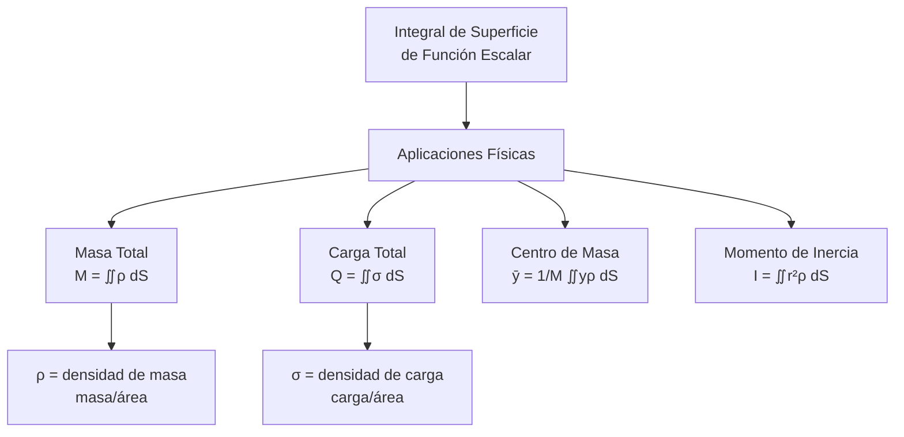
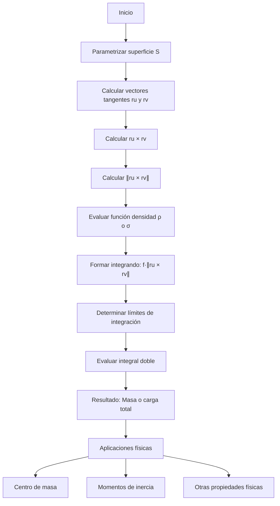

# Matemáticas para Ciencias Aplicadas III - Integral sobre trayectorias y superficies

## 3.6 Integral de funciones reales sobre superficies (masa y carga total de una superficie).

---

### 1. Introducción Conceptual

La integral de funciones reales sobre superficies generaliza el concepto de integral doble a superficies curvas en el espacio. Tiene aplicaciones fundamentales en física para calcular propiedades distribuidas sobre superficies, como masa, carga eléctrica, centro de masa y momentos de inercia.

### 2. Definición Formal

#### 2.1. Integral de superficie de una función escalar

Dada una superficie $S$ parametrizada por $\vec{r}(u,v)$ con $(u,v) \in D$ y una función escalar $f: \mathbb{R}^3 \rightarrow \mathbb{R},$ la integral de superficie se define como:

$$\iint_S f(x,y,z) \, dS = \iint_D f(\vec{r}(u,v)) \|\vec{r}_u \times \vec{r}_v\| \, du \, dv$$

donde $dS = \|\vec{r}_u \times \vec{r}_v\| \, du \, dv$ es el **elemento de área superficial**.

**Propiedades.** Como en el caso del área, el valor no depende de la parametrización (inyectiva y regular salvo en un conjunto de área cero) ni de la orientación de la superficie: solo interviene la norma del producto cruz. La integral es lineal y aditiva: si $S$ se divide en piezas $S_1, \ldots, S_k$ que solo comparten bordes, $\iint_S f \, dS = \sum_i \iint_{S_i} f \, dS.$ Con $f = 1$ se obtiene el área.

#### 2.2. Para superficies definidas explícitamente $(z = g(x,y))$

$$\iint_S f(x,y,z) \, dS = \iint_D f(x,y,g(x,y)) \sqrt{1 + \left(\frac{\partial g}{\partial x}\right)^2 + \left(\frac{\partial g}{\partial y}\right)^2} \, dx \, dy$$

### 3. Interpretación Física

#### 3.1. Masa total de una superficie

Si $\rho(x,y,z)$ es la densidad de masa superficial (masa por unidad de área), entonces:

$$M = \iint_S \rho(x,y,z) \, dS$$

#### 3.2. Carga total de una superficie

Si $\sigma(x,y,z)$ es la densidad de carga superficial (carga por unidad de área), entonces:

$$Q = \iint_S \sigma(x,y,z) \, dS$$

#### 3.3. Diagrama conceptual de aplicaciones



### 4. Metodología de Cálculo

#### 4.1. Algoritmo para calcular integrales de superficie

1. **Parametrizar** la superficie: $\vec{r}(u,v) = (x(u,v), y(u,v), z(u,v))$
2. **Calcular** los vectores tangentes: $\vec{r}_u$ y $\vec{r}_v$
3. **Calcular** el producto vectorial: $\vec{r}_u \times \vec{r}_v$
4. **Calcular** la norma: $\|\vec{r}_u \times \vec{r}_v\|$
5. **Evaluar** la función en la parametrización: $f(\vec{r}(u,v))$
6. **Configurar** y **resolver** la integral doble:

   $$\iint_D f(\vec{r}(u,v)) \|\vec{r}_u \times \vec{r}_v\| \, du \, dv$$

#### 4.2. Casos especiales

**Superficies de revolución**:

$$ \iint_S f(x,y,z) \, dS = \int_a^b \int_0^{2\pi} f(\vec{r}(t,\theta)) \|\vec{r}_t \times \vec{r}_\theta\| \, d\theta \, dt $$

**Superficies esféricas**:

$$\iint_S f(x,y,z) \, dS = \int_0^{2\pi} \int_0^\pi f(\vec{r}(\theta,\phi)) R^2 \sin\phi \, d\phi \, d\theta$$

### 5. Ejemplos Resueltos

#### Ejemplo 1: Masa de un plano con densidad variable

Calcular la masa del plano $z = 2x + 3y + 1$ sobre el rectángulo $[0,2] \times [0,3]$ con densidad $\rho(x,y,z) = x + y.$

**Solución:**

- Parametrización: $\vec{r}(x,y) = (x, y, 2x + 3y + 1)$
- $\vec{r}_x = (1, 0, 2),$ $\vec{r}_y = (0, 1, 3)$
- $\vec{r}_x \times \vec{r}_y = (-2, -3, 1)$
- $\|\vec{r}_x \times \vec{r}_y\| = \sqrt{4 + 9 + 1} = \sqrt{14}$

$$M = \iint_S \rho \, dS = \int_0^3 \int_0^2 (x + y) \sqrt{14} \, dx \, dy$$

$$= \sqrt{14} \int_0^3 \left[\frac{x^2}{2} + xy\right]_0^2 dy = \sqrt{14} \int_0^3 (2 + 2y) \, dy$$

$$= \sqrt{14} \left[2y + y^2\right]_0^3 = \sqrt{14} (6 + 9) = 15\sqrt{14}$$

#### Ejemplo 2: Carga en una esfera con densidad no uniforme

Calcular la carga total en la esfera $x^2 + y^2 + z^2 = 4$ con densidad de carga $\sigma(x,y,z) = z^2.$

**Solución:**

- Parametrización esférica: $\vec{r}(\theta,\phi) = (2\sin\phi\cos\theta, 2\sin\phi\sin\theta, 2\cos\phi)$
- $\vec{r}_\phi \times \vec{r}_\theta = 4\sin\phi (\sin\phi\cos\theta, \sin\phi\sin\theta, \cos\phi),$ que apunta hacia afuera; el orden inverso solo cambia el signo
- $\|\vec{r}_\phi \times \vec{r}_\theta\| = 4|\sin\phi| \sqrt{\sin^2\phi + \cos^2\phi} = 4|\sin\phi|$
- $\sigma(\vec{r}(\theta,\phi)) = (2\cos\phi)^2 = 4\cos^2\phi$

$$Q = \iint_S \sigma \, dS = \int_0^{2\pi} \int_0^\pi 4\cos^2\phi \cdot 4|\sin\phi| \, d\phi \, d\theta$$

$$= 16 \int_0^{2\pi} d\theta \int_0^\pi \cos^2\phi |\sin\phi| \, d\phi$$

$$= 32\pi \int_0^\pi \cos^2\phi \sin\phi \, d\phi = 32\pi \left[-\frac{\cos^3\phi}{3}\right]_0^\pi = \frac{64\pi}{3}$$

**Atajo por simetría.** En la esfera $x^2 + y^2 + z^2 = 4,$ las integrales de $x^2,$ $y^2$ y $z^2$ son iguales y suman $\iint_S 4 \, dS = 4 \cdot 16\pi.$ Por lo tanto $\iint_S z^2 \, dS = \frac{64\pi}{3}$ sin calcular ninguna integral.

#### Ejemplo 3: Masa de un cono con densidad radial

Calcular la masa del cono $z = \sqrt{x^2 + y^2}$ entre $z = 0$ y $z = 3$ con densidad $\rho(x,y,z) = z.$

**Solución:**

- Parametrización cilíndrica: $\vec{r}(r,\theta) = (r\cos\theta, r\sin\theta, r),$ $r \in [0,3],$ $\theta \in [0,2\pi]$
- $\vec{r}_r = (\cos\theta, \sin\theta, 1),$ $\vec{r}_\theta = (-r\sin\theta, r\cos\theta, 0)$
- $\vec{r}_r \times \vec{r}_\theta = (-r\cos\theta, -r\sin\theta, r)$
- $\|\vec{r}_r \times \vec{r}_\theta\| = \sqrt{r^2\cos^2\theta + r^2\sin^2\theta + r^2} = r\sqrt{2}$
- $\rho(\vec{r}(r,\theta)) = r$

$$M = \iint_S \rho \, dS = \int_0^{2\pi} \int_0^3 r \cdot r\sqrt{2} \, dr \, d\theta$$

$$= \sqrt{2} \int_0^{2\pi} d\theta \int_0^3 r^2 \, dr = \sqrt{2} \cdot 2\pi \cdot \frac{27}{3} = 18\pi\sqrt{2}$$

### 6. Implementación Computacional

```python
import numpy as np
from scipy.integrate import dblquad

def integral_superficie_funcion_escalar(f, r, r_u, r_v, u_lim, v_lim):
    """
    Calcula la integral de superficie de una función escalar

    Parámetros:
    f: función escalar f(x,y,z)
    r: función de parametrización r(u,v) = (x,y,z)
    r_u: derivada parcial ∂r/∂u
    r_v: derivada parcial ∂r/∂v
    u_lim: tupla (u_min, u_max)
    v_lim: tupla (v_min, v_max)
    """
    u_min, u_max = u_lim
    v_min, v_max = v_lim

    def integrando(v, u):
        punto = r(u, v)
        ru = r_u(u, v)
        rv = r_v(u, v)
        cross_norm = np.linalg.norm(np.cross(ru, rv))
        return f(*punto) * cross_norm

    resultado, error = dblquad(integrando, u_min, u_max, v_min, v_max)
    return resultado, error

# Ejemplo: Masa del plano z = 2x + 3y + 1 con densidad ρ = x + y
def ejemplo_masa_plano():
    # Parametrización del plano
    r = lambda x, y: (x, y, 2*x + 3*y + 1)
    r_x = lambda x, y: (1, 0, 2)
    r_y = lambda x, y: (0, 1, 3)

    # Función densidad
    densidad = lambda x, y, z: x + y

    # Límites de integración
    x_lim = (0, 2)
    y_lim = (0, 3)

    masa, error = integral_superficie_funcion_escalar(densidad, r, r_x, r_y, x_lim, y_lim)
    print(f"Masa del plano: {masa:.4f}")
    print(f"Valor teórico: {15*np.sqrt(14):.4f}")
    print(f"Error: {error:.2e}")

# Ejemplo: Carga en esfera con densidad σ = z²
def ejemplo_carga_esfera():
    # Parametrización esférica
    R = 2
    r = lambda theta, phi: (R*np.sin(phi)*np.cos(theta),
                           R*np.sin(phi)*np.sin(theta),
                           R*np.cos(phi))

    r_theta = lambda theta, phi: (-R*np.sin(phi)*np.sin(theta),
                                 R*np.sin(phi)*np.cos(theta),
                                 0)

    r_phi = lambda theta, phi: (R*np.cos(phi)*np.cos(theta),
                               R*np.cos(phi)*np.sin(theta),
                               -R*np.sin(phi))

    # Función densidad de carga
    densidad_carga = lambda x, y, z: z**2

    # Límites de integración
    theta_lim = (0, 2*np.pi)
    phi_lim = (0, np.pi)

    carga, error = integral_superficie_funcion_escalar(densidad_carga, r, r_theta, r_phi, theta_lim, phi_lim)
    print(f"\nCarga total en la esfera: {carga:.4f}")
    print(f"Valor teórico: {64*np.pi/3:.4f}")
    print(f"Error: {error:.2e}")

ejemplo_masa_plano()
ejemplo_carga_esfera()
```

### 7. Ejercicios Propuestos

#### Ejercicio 1

Calcular la masa de la superficie del paraboloide $z = x^2 + y^2$ entre $z = 0$ y $z = 4$ con densidad $\rho(x,y,z) = z.$

#### Ejercicio 2

Determinar la carga total en la porción del plano $x + y + z = 1$ en el primer octante con densidad de carga $\sigma(x,y,z) = xy.$

#### Ejercicio 3

Calcular la masa del cilindro $x^2 + y^2 = 9$ entre $z = 0$ y $z = 5$ con densidad $\rho(x,y,z) = 1 + z.$

#### Ejercicio 4

Encontrar la carga total en la superficie esférica $x^2 + y^2 + z^2 = R^2$ con densidad $\sigma(x,y,z) = x^2 + y^2.$

#### Ejercicio 5

Calcular la masa del cono $z = \sqrt{x^2 + y^2}$ entre $z = 1$ y $z = 2$ con densidad $\rho(x,y,z) = e^{-z}.$

### 8. Diagrama de Flujo: Cálculo de Masa/Carga Superficial



### 9. Aplicaciones Adicionales

#### 9.1. Centro de masa de una superficie

Las coordenadas del centro de masa $(\bar{x}, \bar{y}, \bar{z})$ son:

$$\bar{x} = \frac{1}{M} \iint_S x \rho \, dS, \quad \bar{y} = \frac{1}{M} \iint_S y \rho \, dS, \quad \bar{z} = \frac{1}{M} \iint_S z \rho \, dS$$

#### 9.2. Momentos de inercia

El momento de inercia respecto a un eje es:

$$I = \iint_S d^2 \rho \, dS$$

donde $d$ es la distancia al eje.

#### 9.3. Valor promedio de una función sobre una superficie

$$\text{Promedio}(f) = \frac{1}{\text{Área}(S)} \iint_S f \, dS$$

### 10. Soluciones a Ejercicios Propuestos

#### Solución Ejercicio 1

**Paraboloide:** $z = x^2 + y^2,$ $0 \leq z \leq 4$ con $\rho = z$

- Parametrización: $\vec{r}(r,\theta) = (r\cos\theta, r\sin\theta, r^2),$ $r \in [0,2],$ $\theta \in [0,2\pi]$
- $\vec{r}_r = (\cos\theta, \sin\theta, 2r),$ $\vec{r}_\theta = (-r\sin\theta, r\cos\theta, 0)$
- $\vec{r}_r \times \vec{r}_\theta = (-2r^2\cos\theta, -2r^2\sin\theta, r)$
- $\|\vec{r}_r \times \vec{r}_\theta\| = \sqrt{4r^4 + r^2} = r\sqrt{4r^2 + 1}$
- $\rho = z = r^2$

$$M = \int_0^{2\pi} \int_0^2 r^2 \cdot r\sqrt{4r^2 + 1} \, dr \, d\theta = 2\pi \int_0^2 r^3\sqrt{4r^2 + 1} \, dr$$

Sustitución: $u = 4r^2 + 1,$ $du = 8r \, dr,$ $r^2 = \frac{u-1}{4}$

$$= 2\pi \int_1^{17} \frac{u-1}{4} \sqrt{u} \frac{du}{8} = \frac{\pi}{16} \int_1^{17} (u-1)\sqrt{u} \, du = \frac{\pi}{16} \left[\frac{2}{5}u^{5/2} - \frac{2}{3}u^{3/2}\right]_1^{17}$$

$$= \frac{\pi}{60}\left(391\sqrt{17} + 1\right) \approx 84.46$$

#### Solución Ejercicio 2

$z = 1 - x - y$ da $dS = \sqrt{3} \, dx \, dy$ sobre el triángulo $x + y \leq 1:$

$$Q = \sqrt{3}\int_0^1\int_0^{1-x} xy \, dy \, dx = \sqrt{3}\int_0^1 \frac{x(1-x)^2}{2} \, dx = \frac{\sqrt{3}}{24}$$

#### Solución Ejercicio 3

Con $\vec{r}(\theta, z) = (3\cos\theta, 3\sin\theta, z),$ $dS = 3 \, d\theta \, dz:$

$$M = \int_0^{2\pi}\int_0^5 (1 + z) \, 3 \, dz \, d\theta = 6\pi\left(5 + \frac{25}{2}\right) = 105\pi$$

#### Solución Ejercicio 4

**Esfera:** $x^2 + y^2 + z^2 = R^2$ con $\sigma = x^2 + y^2$

- Parametrización esférica: $\vec{r}(\theta,\phi) = (R\sin\phi\cos\theta, R\sin\phi\sin\theta, R\cos\phi)$
- $\|\vec{r}_\theta \times \vec{r}_\phi\| = R^2\sin\phi$
- $\sigma = x^2 + y^2 = R^2\sin^2\phi$

$$Q = \int_0^{2\pi} \int_0^\pi R^2\sin^2\phi \cdot R^2\sin\phi \, d\phi \, d\theta = R^4 \int_0^{2\pi} d\theta \int_0^\pi \sin^3\phi \, d\phi$$

$$= 2\pi R^4 \int_0^\pi \sin^3\phi \, d\phi = 2\pi R^4 \left[-\cos\phi + \frac{\cos^3\phi}{3}\right]_0^\pi = \frac{8\pi R^4}{3}$$

Con el atajo por simetría: $\iint (x^2 + y^2) = \frac{2}{3}\iint (x^2 + y^2 + z^2) = \frac{2}{3}R^2 \cdot 4\pi R^2.$

#### Solución Ejercicio 5

Con la parametrización del ejemplo 3, $z = r,$ $dS = \sqrt{2} \, r \, dr \, d\theta$ y $1 \leq r \leq 2:$

$$M = 2\sqrt{2}\pi\int_1^2 r e^{-r} \, dr = 2\sqrt{2}\pi\left[-(r + 1)e^{-r}\right]_1^2 = 2\sqrt{2}\pi\left(2e^{-1} - 3e^{-2}\right) \approx 2.93$$

### 11. Referencias Bibliográficas

1. **Calculus: Early Transcendentals** - James Stewart
2. **Advanced Engineering Mathematics** - Erwin Kreyszig
3. **Vector Calculus** - Jerrold E. Marsden
4. **Mathematical Methods for Physics and Engineering** - Riley, Hobson, Bence
5. **Electrodynamics** - Griffiths (para aplicaciones con densidad de carga)

### 12. Consejos de Estudio

- Domine la parametrización de diferentes tipos de superficies
- Practique el cálculo de productos vectoriales y sus normas
- Verifique que la parametrización cubra toda la superficie
- Para superficies simétricas, aproveche las simetrías para simplificar integrales
- Utilice software para visualizar superficies y verificar resultados
