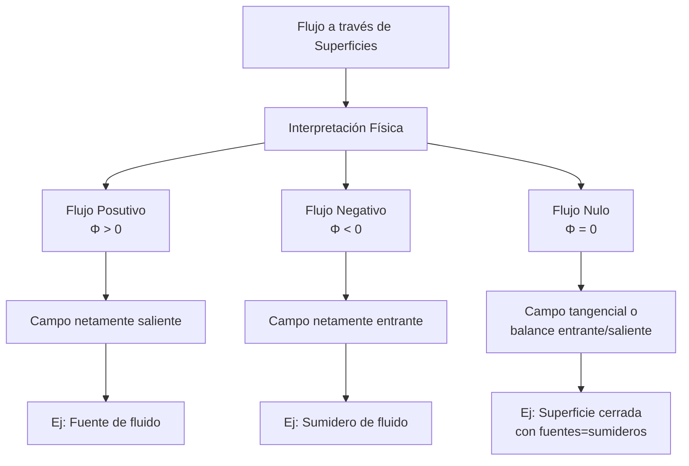
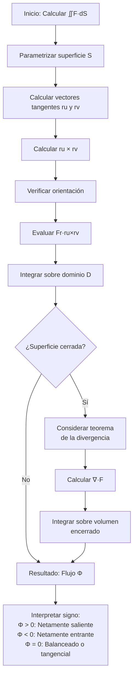

# Matemáticas para Ciencias Aplicadas III - Integral sobre trayectorias y superficies

## 3.7 Integral de superficie (flujo a través de una superficie).

---

### 1. Introducción Conceptual

La integral de superficie de un campo vectorial, también conocida como **flujo**, mide la cantidad de campo que "atraviesa" una superficie. Es un concepto fundamental en física para describir fenómenos como el flujo de fluidos, campos electromagnéticos y transferencia de calor.

### 2. Definición Formal

#### 2.1. Integral de flujo

Dado un campo vectorial $\vec{F}: \mathbb{R}^3 \rightarrow \mathbb{R}^3$ y una superficie orientable $S$ parametrizada por $\vec{r}(u,v)$ con $(u,v) \in D$, el flujo de $\vec{F}$ a través de $S$ es:

$$\Phi = \iint_S \vec{F} \cdot d\vec{S} = \iint_S \vec{F} \cdot \hat{n}  dS = \iint_D \vec{F}(\vec{r}(u,v)) \cdot (\vec{r}_u \times \vec{r}_v)  du  dv$$

donde:

- $d\vec{S} = \hat{n}  dS$ es el **vector elemento de área**
- $\hat{n}$ es el vector normal unitario
- $\vec{r}_u \times \vec{r}_v$ determina la orientación

#### 2.2. Para superficies definidas explícitamente $(z = g(x,y))$

$$\Phi = \iint_D \vec{F}(x,y,g(x,y)) \cdot (-g_x, -g_y, 1)  dx  dy$$

#### 2.3. Para superficies definidas implícitamente $(G(x,y,z) = 0)$

$$\Phi = \iint_D \vec{F} \cdot \frac{\nabla G}{\|\nabla G\|} \frac{\|\nabla G\|}{|\nabla G \cdot \hat{k}|}  dx  dy$$

### 3. Interpretación Física del Flujo

El flujo representa la "cantidad neta" de campo que atraviesa una superficie:

- **Flujo positivo**: El campo sale predominantemente de la superficie
- **Flujo negativo**: El campo entra predominantemente a la superficie
- **Flujo cero**: El campo es paralelo a la superficie o entra/sale en igual medida



### 4. Metodología de Cálculo

#### 4.1. Algoritmo para calcular flujo

1. **Parametrizar** la superficie: $\vec{r}(u,v)$
2. **Calcular** vectores tangentes: $\vec{r}_u$, $\vec{r}_v$
3. **Calcular** vector normal: $\vec{r}_u \times \vec{r}_v$
4. **Evaluar** campo vectorial: $\vec{F}(\vec{r}(u,v))$
5. **Calcular** producto punto: $\vec{F} \cdot (\vec{r}_u \times \vec{r}_v)$
6. **Integrar** sobre el dominio de parámetros

#### 4.2. Orientación de superficies

- **Superficies abiertas**: Elección arbitraria de orientación
- **Superficies cerradas**: Convención de normal exterior

### 5. Teoremas Fundamentales

#### 5.1. Teorema de la Divergencia (Gauss)

$$\oiint_S \vec{F} \cdot d\vec{S} = \iiint_V (\nabla \cdot \vec{F})  dV$$

#### 5.2. Teorema de Stokes

$$\oint_C \vec{F} \cdot d\vec{r} = \iint_S (\nabla \times \vec{F}) \cdot d\vec{S}$$

### 6. Ejemplos Resueltos

#### Ejemplo 1: Flujo a través de un plano

Calcular el flujo de $\vec{F} = (x, y, z)$ a través del plano $z = 2x + 3y + 1$ sobre el rectángulo $[0,2] \times [0,3]$ con orientación hacia arriba.

**Solución:**

- Parametrización: $\vec{r}(x,y) = (x, y, 2x + 3y + 1)$
- $\vec{r}\_x = (1, 0, 2)$, $\vec{r}\_y = (0, 1, 3)$
- $\vec{r}\_x \times \vec{r}\_y = (-2, -3, 1)$ (orientación correcta: componente z positiva)
- $\vec{F}(\vec{r}(x,y)) = (x, y, 2x + 3y + 1)$

$$\Phi = \int_0^3 \int_0^2 (x, y, 2x + 3y + 1) \cdot (-2, -3, 1)  dx  dy$$
$$= \int_0^3 \int_0^2 (-2x - 3y + 2x + 3y + 1)  dx  dy = \int_0^3 \int_0^2 1  dx  dy = 6$$

#### Ejemplo 2: Flujo a través de una esfera

Calcular el flujo de $\vec{F} = (x, y, z)$ a través de la esfera $x^2 + y^2 + z^2 = R^2$ con orientación exterior.

**Solución:**

- Parametrización esférica: $\vec{r}(\theta,\phi) = (R\sin\phi\cos\theta, R\sin\phi\sin\theta, R\cos\phi)$
- $\vec{r}\_\theta = (-R\sin\phi\sin\theta, R\sin\phi\cos\theta, 0)$
- $\vec{r}\_\phi = (R\cos\phi\cos\theta, R\cos\phi\sin\theta, -R\sin\phi)$
- $\vec{r}\_\theta \times \vec{r}\_\phi = R^2\sin\phi (\sin\phi\cos\theta, \sin\phi\sin\theta, \cos\phi) = R^2\sin\phi  \vec{r}(\theta,\phi)$
- $\vec{F}(\vec{r}(\theta,\phi)) = (R\sin\phi\cos\theta, R\sin\phi\sin\theta, R\cos\phi)$

$$\vec{F} \cdot (\vec{r}\_\theta \times \vec{r}\_\phi) = R^3\sin\phi$$
$$\Phi = \int_0^{2\pi} \int_0^\pi R^3\sin\phi  d\phi  d\theta = R^3 \cdot 2\pi \cdot 2 = 4\pi R^3$$

#### Ejemplo 3: Flujo a través de un cilindro

Calcular el flujo de $\vec{F} = (x^2, y^2, z^2)$ a través del cilindro $x^2 + y^2 = 4$, $0 \leq z \leq 5$ con orientación exterior.

**Solución:**

- Parametrización cilíndrica: $\vec{r}(\theta,z) = (2\cos\theta, 2\sin\theta, z)$
- $\vec{r}\_\theta = (-2\sin\theta, 2\cos\theta, 0)$, $\vec{r}\_z = (0, 0, 1)$
- $\vec{r}\_\theta \times \vec{r}\_z = (2\cos\theta, 2\sin\theta, 0)$ (orientación exterior)
- $\vec{F}(\vec{r}(\theta,z)) = (4\cos^2\theta, 4\sin^2\theta, z^2)$

$$\vec{F} \cdot (\vec{r}\_\theta \times \vec{r}\_z) = 8\cos^3\theta + 8\sin^3\theta$$
$$\Phi = \int_0^5 \int_0^{2\pi} (8\cos^3\theta + 8\sin^3\theta)  d\theta  dz = 0$$
(las integrales de $\cos^3\theta$ y $\sin^3\theta$ sobre $[0,2\pi]$ son cero)

### 7. Implementación Computacional

```python
import numpy as np
from scipy.integrate import dblquad

def flujo_superficie(F, r, r_u, r_v, u_lim, v_lim):
    """
    Calcula el flujo de un campo vectorial a través de una superficie

    Parámetros:
    F: campo vectorial F(x,y,z) = (P, Q, R)
    r: función de parametrización r(u,v) = (x,y,z)
    r_u: derivada parcial ∂r/∂u
    r_v: derivada parcial ∂r/∂v
    u_lim: tupla (u_min, u_max)
    v_lim: tupla (v_min, v_max)
    """
    u_min, u_max = u_lim
    v_min, v_max = v_lim

    def integrando(v, u):
        punto = r(u, v)
        ru = r_u(u, v)
        rv = r_v(u, v)
        normal = np.cross(ru, rv)
        campo = F(*punto)
        return np.dot(campo, normal)

    resultado, error = dblquad(integrando, u_min, u_max, v_min, v_max)
    return resultado, error

# Ejemplo: Flujo a través del plano z = 2x + 3y + 1
def ejemplo_flujo_plano():
    # Campo vectorial
    F = lambda x, y, z: np.array([x, y, z])

    # Parametrización del plano
    r = lambda x, y: np.array([x, y, 2*x + 3*y + 1])
    r_x = lambda x, y: np.array([1, 0, 2])
    r_y = lambda x, y: np.array([0, 1, 3])

    # Límites de integración
    x_lim = (0, 2)
    y_lim = (0, 3)

    flujo, error = flujo_superficie(F, r, r_x, r_y, x_lim, y_lim)
    print(f"Flujo a través del plano: {flujo:.4f}")
    print(f"Valor teórico: 6.0000")
    print(f"Error: {error:.2e}")

# Ejemplo: Flujo a través de superficie esférica
def ejemplo_flujo_esfera():
    R = 2
    # Campo vectorial
    F = lambda x, y, z: np.array([x, y, z])

    # Parametrización esférica
    r = lambda theta, phi: np.array([R*np.sin(phi)*np.cos(theta),
                                   R*np.sin(phi)*np.sin(theta),
                                   R*np.cos(phi)])

    r_theta = lambda theta, phi: np.array([-R*np.sin(phi)*np.sin(theta),
                                         R*np.sin(phi)*np.cos(theta),
                                         0])

    r_phi = lambda theta, phi: np.array([R*np.cos(phi)*np.cos(theta),
                                       R*np.cos(phi)*np.sin(theta),
                                       -R*np.sin(phi)])

    # Límites de integración
    theta_lim = (0, 2*np.pi)
    phi_lim = (0, np.pi)

    flujo, error = flujo_superficie(F, r, r_theta, r_phi, theta_lim, phi_lim)
    print(f"\nFlujo a través de la esfera: {flujo:.4f}")
    print(f"Valor teórico: {4*np.pi*R**3/3:.4f}")  # Usando teorema de la divergencia
    print(f"Error: {error:.2e}")

ejemplo_flujo_plano()
ejemplo_flujo_esfera()
```

### 8. Ejercicios Propuestos

#### Ejercicio 1

Calcular el flujo de $\vec{F} = (x, y, 0)$ a través del paraboloide $z = x^2 + y^2$ entre $z = 0$ y $z = 4$ con orientación hacia arriba.

#### Ejercicio 2

Determinar el flujo de $\vec{F} = (0, 0, z)$ a través de la superficie del cilindro $x^2 + y^2 = 9$ entre $z = 0$ y $z = 5$ con orientación exterior.

#### Ejercicio 3

Calcular el flujo de $\vec{F} = (y, z, x)$ a través de la porción del plano $x + y + z = 1$ en el primer octante con orientación hacia arriba.

#### Ejercicio 4

Usar el teorema de la divergencia para calcular el flujo de $\vec{F} = (x^3, y^3, z^3)$ a través de la esfera $x^2 + y^2 + z^2 = 4$ con orientación exterior.

#### Ejercicio 5

Calcular el flujo de $\vec{F} = (e^y, z, x^2)$ a través de la superficie $z = 4 - x^2 - y^2$ para $z \geq 0$ con orientación hacia arriba.

### 9. Diagrama de Flujo: Cálculo de Flujo



### 10. Aplicaciones Físicas

#### 10.1. Ley de Gauss en electromagnetismo

$$\oiint_S \vec{E} \cdot d\vec{S} = \frac{Q_{\text{enc}}}{\varepsilon_0}$$

#### 10.2. Flujo de fluidos

$$\Phi = \iint_S \vec{v} \cdot d\vec{S}$$
donde $\vec{v}$ es el campo de velocidades

#### 10.3. Transferencia de calor

$$Q = -k \iint_S \nabla T \cdot d\vec{S}$$
(Ley de Fourier)

### 11. Soluciones a Ejercicios Propuestos

#### Solución Ejercicio 1

**Paraboloide:** $z = x^2 + y^2, 0 \leq z \leq 4 \text{ con } \vec{F} = (x, y, 0)$

- Parametrización: $\vec{r}(r,\theta) = (r\cos\theta, r\sin\theta, r^2), r \in [0,2], \theta \in [0,2\pi]$
- $\vec{r}\_r = (\cos\theta, \sin\theta, 2r)$, $\vec{r}_\theta = (-r\sin\theta, r\cos\theta, 0)$
- $\vec{r}\_r \times \vec{r}\_\theta = (-2r^2\cos\theta, -2r^2\sin\theta, r)$ (orientación hacia arriba: componente z positiva)
- $\vec{F} = (r\cos\theta, r\sin\theta, 0)$

$$\vec{F} \cdot (\vec{r}_r \times \vec{r}\_\theta) = -2r^3\cos^2\theta - 2r^3\sin^2\theta + 0 = -2r^3$$
$$\Phi = \int_0^{2\pi} \int_0^2 -2r^3  dr  d\theta = -2 \cdot 2\pi \cdot \frac{16}{4} = -16\pi$$

#### Solución Ejercicio 4

**Teorema de la divergencia:** $\Phi = \iiint_V (\nabla \cdot \vec{F})  dV$

- $\vec{F} = (x^3, y^3, z^3)$, $\nabla \cdot \vec{F} = 3x^2 + 3y^2 + 3z^2 = 3(x^2 + y^2 + z^2)$
- En coordenadas esféricas: $x^2 + y^2 + z^2 = r^2$, $dV = r^2\sin\phi  dr  d\phi  d\theta$

$$\Phi = \int_0^{2\pi} \int_0^\pi \int_0^2 3r^2 \cdot r^2\sin\phi  dr  d\phi  d\theta = 3 \int_0^{2\pi} d\theta \int_0^\pi \sin\phi  d\phi \int_0^2 r^4  dr$$
$$= 3 \cdot 2\pi \cdot 2 \cdot \frac{32}{5} = \frac{384\pi}{5}$$

### 12. Referencias Bibliográficas

1. **Calculus: Early Transcendentals** - James Stewart
2. **Advanced Engineering Mathematics** - Erwin Kreyszig
3. **Vector Calculus** - Jerrold E. Marsden
4. **Introduction to Electrodynamics** - David J. Griffiths
5. **Fluid Mechanics** - Frank M. White

### 13. Consejos de Estudio

- Domine la parametrización de diferentes tipos de superficies
- Verifique siempre la orientación del vector normal
- Para superficies cerradas, considere usar el teorema de la divergencia
- Practique el cálculo de productos punto y productos vectoriales
- Visualice físicamente el significado del flujo
