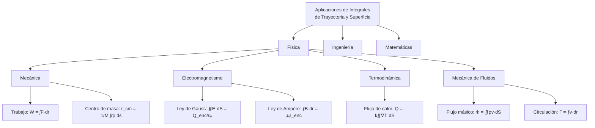
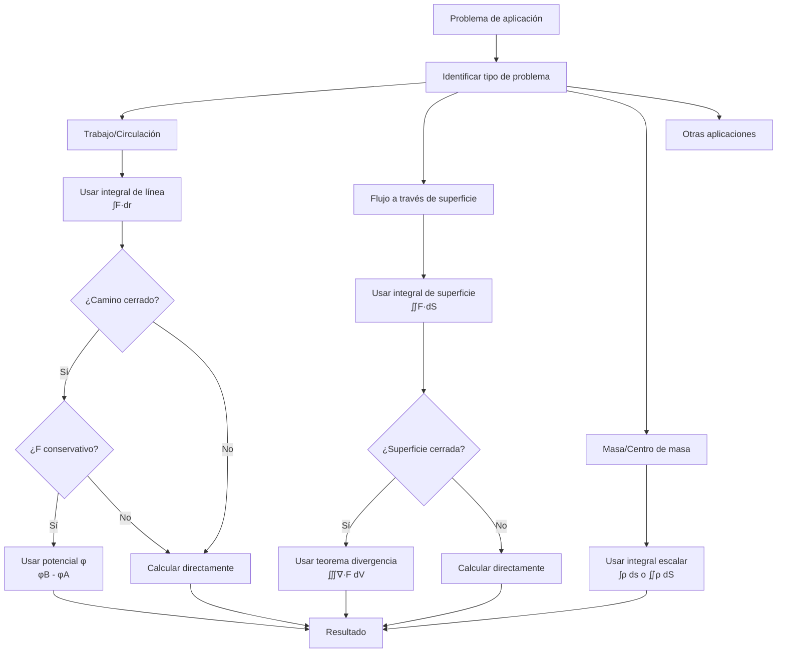

# Matemáticas para Ciencias Aplicadas III - Integral sobre trayectorias y superficies

### 3.8 Aplicaciones.

---

### 1. Introducción a las Aplicaciones

Las integrales sobre trayectorias y superficies tienen numerosas aplicaciones en física, ingeniería y matemáticas. Estas herramientas permiten modelar y resolver problemas del mundo real que involucran distribuciones continuas en curvas y superficies.

### 2. Aplicaciones Físicas Principales

#### 2.1. Mecánica y dinámica

- **Trabajo realizado por una fuerza variable**: $W = \int_C \vec{F} \cdot d\vec{r}$
- **Centro de masa de un alambre**: $\vec{r}_{cm} = \frac{1}{M} \int_C \vec{r} \rho  ds$
- **Momento de inercia**: $I = \int_C r^2 \rho  ds$

#### 2.2. Electromagnetismo

- **Ley de Ampère**: $\oint_C \vec{B} \cdot d\vec{r} = \mu_0 I_{enc}$
- **Ley de Gauss**: $\oiint_S \vec{E} \cdot d\vec{S} = \frac{Q_{enc}}{\varepsilon_0}$
- **Potencial vectorial**: $\vec{A} = \frac{\mu_0}{4\pi} \oint_C \frac{I d\vec{r}'}{|\vec{r} - \vec{r}'|}$

#### 2.3. Termodinámica y transferencia de calor

- **Flujo de calor**: $Q = -k \iint_S \nabla T \cdot d\vec{S}$
- **Ley de Fourier**: $\frac{dQ}{dt} = -k \iint_S \nabla T \cdot d\vec{S}$

#### 2.4. Mecánica de fluidos

- **Flujo másico**: $\dot{m} = \iint_S \rho \vec{v} \cdot d\vec{S}$
- **Circulación**: $\Gamma = \oint_C \vec{v} \cdot d\vec{r}$
- **Teorema de Kelvin**: $\frac{D\Gamma}{Dt} = 0$ (para fluidos ideales)



### 3. Aplicaciones en Ingeniería

#### 3.1. Ingeniería estructural

- **Cálculo de tensiones en superficies curvas**
- **Análisis de deformaciones en materiales**

#### 3.2. Ingeniería eléctrica

- **Cálculo de inductancias mutuas**
- **Análisis de campos electromagnéticos**

#### 3.3. Ingeniería de materiales

- **Difusión a través de superficies**
- **Transferencia de masa**

### 4. Formulario de Aplicaciones

#### 4.1. Integrales de línea

| Aplicación         | Fórmula                                              |
| ------------------ | ---------------------------------------------------- |
| Trabajo            | $W = \int_C \vec{F} \cdot d\vec{r}$                  |
| Circulación        | $\Gamma = \oint_C \vec{v} \cdot d\vec{r}$            |
| Masa total         | $M = \int_C \rho  ds$                                |
| Centro de masa     | $\vec{r}_{cm} = \frac{1}{M} \int_C \vec{r} \rho  ds$ |
| Momento de inercia | $I = \int_C r^2 \rho  ds$                            |

#### 4.2. Integrales de superficie

| Aplicación       | Fórmula                                         |
| ---------------- | ----------------------------------------------- |
| Flujo eléctrico  | $\Phi_E = \iint_S \vec{E} \cdot d\vec{S}$       |
| Flujo magnético  | $\Phi_B = \iint_S \vec{B} \cdot d\vec{S}$       |
| Flujo másico     | $\dot{m} = \iint_S \rho \vec{v} \cdot d\vec{S}$ |
| Flujo de calor   | $Q = -k \iint_S \nabla T \cdot d\vec{S}$        |
| Área superficial | $A = \iint_S dS$                                |

### 5. Ejemplos Resueltos

#### Ejemplo 1: Trabajo realizado por una fuerza

Calcular el trabajo realizado por $\vec{F} = (x^2, xy)$ a lo largo de la trayectoria $y = x^2$ desde $(0,0)$ hasta $(1,1)$.

**Solución:**

- Parametrización: $\vec{r}(t) = (t, t^2)$, $t \in [0,1]$
- $d\vec{r} = (1, 2t) dt$
- $\vec{F}(\vec{r}(t)) = (t^2, t^3)$

$$W = \int_0^1 (t^2, t^3) \cdot (1, 2t) dt = \int_0^1 (t^2 + 2t^4) dt = \left[\frac{t^3}{3} + \frac{2t^5}{5}\right]_0^1 = \frac{1}{3} + \frac{2}{5} = \frac{11}{15}$$

#### Ejemplo 2: Flujo eléctrico through esfera

Calcular el flujo de $\vec{E} = \frac{q}{4\pi\varepsilon_0 r^2} \hat{r}$ a través de una esfera de radio $R$ centrada en el origen.

**Solución:**

- Parametrización esférica: $\vec{r}(\theta,\phi) = (R\sin\phi\cos\theta, R\sin\phi\sin\theta, R\cos\phi)$
- $\vec{r}_\theta \times \vec{r}\_\phi = R^2\sin\phi \hat{r}$
- $\vec{E} = \frac{q}{4\pi\varepsilon_0 R^2} \hat{r}$
  $$\Phi_E = \iint_S \vec{E} \cdot d\vec{S} = \int_0^{2\pi} \int_0^\pi \frac{q}{4\pi\varepsilon_0 R^2} R^2\sin\phi  d\phi  d\theta = \frac{q}{\varepsilon_0}$$

#### Ejemplo 3: Centro de masa de un alambre

Encontrar el centro de masa de un alambre en forma de semicírculo $x^2 + y^2 = R^2$, $y \geq 0$ con densidad $\rho(x,y) = y$.

**Solución:**

- Parametrización: $\vec{r}(t) = (R\cos t, R\sin t)$, $t \in [0,\pi]$
- $ds = \|\vec{r}'(t)\| dt = R dt$
- $\rho(\vec{r}(t)) = R\sin t$

$$M = \int_0^\pi R\sin t \cdot R dt = R^2 \int_0^\pi \sin t dt = 2R^2$$
$$\bar{x} = \frac{1}{M} \int_0^\pi R\cos t \cdot R\sin t \cdot R dt = \frac{R^3}{2R^2} \int_0^\pi \cos t\sin t dt = 0$$
$$\bar{y} = \frac{1}{M} \int_0^\pi R\sin t \cdot R\sin t \cdot R dt = \frac{R^3}{2R^2} \int_0^\pi \sin^2 t dt = \frac{R}{2} \cdot \frac{\pi}{2} = \frac{\pi R}{4}$$
Centro de masa: $(0, \frac{\pi R}{4})$

### 6. Implementación Computacional

```python
import numpy as np
from scipy.integrate import quad, dblquad

def trabajo_fuerza(F, r, r_deriv, a, b):
    """Calcula el trabajo realizado por una fuerza a lo largo de una trayectoria"""
    def integrando(t):
        pos = r(t)
        deriv = r_deriv(t)
        fuerza = F(pos)
        return np.dot(fuerza, deriv)

    resultado, error = quad(integrando, a, b)
    return resultado, error

def flujo_campo_vectorial(F, r, r_u, r_v, u_lim, v_lim):
    """Calcula el flujo de un campo vectorial a través de una superficie"""
    u_min, u_max = u_lim
    v_min, v_max = v_lim

    def integrando(v, u):
        punto = r(u, v)
        ru = r_u(u, v)
        rv = r_v(u, v)
        normal = np.cross(ru, rv)
        campo = F(punto)
        return np.dot(campo, normal)

    resultado, error = dblquad(integrando, u_min, u_max, v_min, v_max)
    return resultado, error

def centro_masa_alambre(rho, r, r_deriv, a, b):
    """Calcula el centro de masa de un alambre"""
    def masa_integrando(t):
        return rho(r(t)) * np.linalg.norm(r_deriv(t))

    def momento_x_integrando(t):
        return r(t)[0] * rho(r(t)) * np.linalg.norm(r_deriv(t))

    def momento_y_integrando(t):
        return r(t)[1] * rho(r(t)) * np.linalg.norm(r_deriv(t))

    def momento_z_integrando(t):
        return r(t)[2] * rho(r(t)) * np.linalg.norm(r_deriv(t))

    M, _ = quad(masa_integrando, a, b)
    Mx, _ = quad(momento_x_integrando, a, b)
    My, _ = quad(momento_y_integrando, a, b)
    Mz, _ = quad(momento_z_integrando, a, b)

    return np.array([Mx/M, My/M, Mz/M]), M

# Ejemplo: Trabajo de una fuerza a lo largo de una parábola
def ejemplo_trabajo():
    F = lambda r: np.array([r[0]**2, r[0]*r[1], 0])  # F = (x², xy, 0)
    r = lambda t: np.array([t, t**2, 0])  # y = x²
    r_deriv = lambda t: np.array([1, 2*t, 0])

    trabajo, error = trabajo_fuerza(F, r, r_deriv, 0, 1)
    print(f"Trabajo realizado: {trabajo:.6f}")
    print(f"Error estimado: {error:.2e}")

# Ejemplo: Centro de masa de un semicírculo
def ejemplo_centro_masa():
    rho = lambda r: r[1]  # Densidad proporcional a y
    r = lambda t: np.array([np.cos(t), np.sin(t), 0])  # Circulo unitario
    r_deriv = lambda t: np.array([-np.sin(t), np.cos(t), 0])

    centro, masa = centro_masa_alambre(rho, r, r_deriv, 0, np.pi)
    print(f"\nCentro de masa: ({centro[0]:.4f}, {centro[1]:.4f})")
    print(f"Masa total: {masa:.4f}")

ejemplo_trabajo()
ejemplo_centro_masa()
```

### 7. Ejercicios Propuestos

#### Ejercicio 1

Calcular el trabajo realizado por el campo de fuerzas $\vec{F} = (y, -x, z)$ a lo largo de la hélice $\vec{r}(t) = (\cos t, \sin t, t)$ desde $t = 0$ hasta $t = 2\pi$.

#### Ejercicio 2

Determinar el flujo del campo $\vec{v} = (x, y, z)$ a través de la superficie del cubo $0 \leq x,y,z \leq 1$ con orientación exterior.

#### Ejercicio 3

Encontrar el centro de masa de un alambre en forma de hélice $\vec{r}(t) = (\cos t, \sin t, t)$ para $0 \leq t \leq 2\pi$ con densidad constante $\rho = 1$.

#### Ejercicio 4

Calcular la circulación del campo $\vec{B} = (-y, x, 0)$ alrededor de la circunferencia $x^2 + y^2 = R^2$ en el plano $z = 0$.

#### Ejercicio 5

Determinar el flujo de calor a través de la superficie esférica $x^2 + y^2 + z^2 = R^2$ si la temperatura está dada por $T(x,y,z) = x^2 + y^2$.

### 8. Diagrama de Flujo: Selección de Método



### 9. Aplicaciones Avanzadas

#### 9.1. Teorema de Stokes en aerodinámica

$$\oint_C \vec{v} \cdot d\vec{r} = \iint_S (\nabla \times \vec{v}) \cdot d\vec{S}$$
Aplicación en la teoría de sustentación de alas.

#### 9.2. Ley de Gauss en gravitación

$$\oiint_S \vec{g} \cdot d\vec{S} = -4\pi G M_{enc}$$
Para campos gravitacionales.

#### 9.3. Ecuaciones de Maxwell

- $\nabla \cdot \vec{E} = \frac{\rho}{\varepsilon_0}$
- $\nabla \cdot \vec{B} = 0$
- $\nabla \times \vec{E} = -\frac{\partial \vec{B}}{\partial t}$
- $\nabla \times \vec{B} = \mu_0 \vec{J} + \mu_0\varepsilon_0 \frac{\partial \vec{E}}{\partial t}$

### 10. Soluciones a Ejercicios Propuestos

#### Solución Ejercicio 1

**Trabajo a lo largo de hélice:**

- $\vec{F} = (y, -x, z)$, $\vec{r}(t) = (\cos t, \sin t, t)$, $t \in [0, 2\pi]$
- $\vec{r}'(t) = (-\sin t, \cos t, 1)$
- $\vec{F}(\vec{r}(t)) = (\sin t, -\cos t, t)$

$$W = \int_0^{2\pi} (\sin t, -\cos t, t) \cdot (-\sin t, \cos t, 1) dt$$
$$= \int_0^{2\pi} (-\sin^2 t - \cos^2 t + t) dt = \int_0^{2\pi} (-1 + t) dt = 2\pi^2 - 2\pi$$

#### Solución Ejercicio 4

**Circulación del campo $\vec{B} = (-y, x, 0)$:**

- Parametrización: $\vec{r}(t) = (R\cos t, R\sin t, 0)$, $t \in [0, 2\pi]$
- $\vec{r}'(t) = (-R\sin t, R\cos t, 0)$
- $\vec{B}(\vec{r}(t)) = (-R\sin t, R\cos t, 0)$

$$\Gamma = \oint_C \vec{B} \cdot d\vec{r} = \int_0^{2\pi} (-R\sin t, R\cos t, 0) \cdot (-R\sin t, R\cos t, 0) dt$$
$$= \int_0^{2\pi} (R^2\sin^2 t + R^2\cos^2 t) dt = \int_0^{2\pi} R^2 dt = 2\pi R^2$$

### 11. Referencias Bibliográficas

1. **Calculus: Early Transcendentals** - James Stewart
2. **Advanced Engineering Mathematics** - Erwin Kreyszig
3. **Vector Calculus** - Jerrold E. Marsden
4. **Introduction to Electrodynamics** - David J. Griffiths
5. **Fluid Mechanics** - Frank M. White
6. **Classical Mechanics** - John R. Taylor

### 12. Consejos para Resolución de Problemas

1. **Identifique el tipo de aplicación** (trabajo, flujo, masa, etc.)
2. **Seleccione la parametrización adecuada** para la curva o superficie
3. **Verifique la orientación** para integrales vectoriales
4. **Aproveche simetrías** para simplificar cálculos
5. **Considere teoremas fundamentales** (Green, Stokes, Gauss)
6. **Verifique unidades** en aplicaciones físicas
7. **Utilice software** para visualizar y verificar resultados
