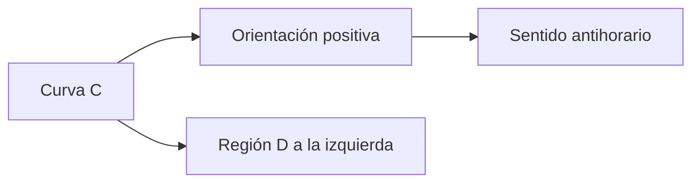
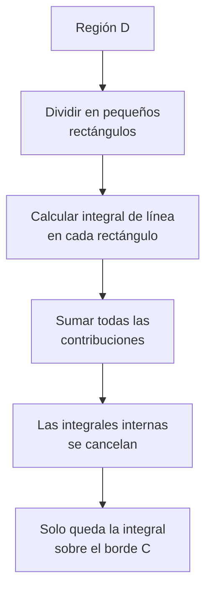
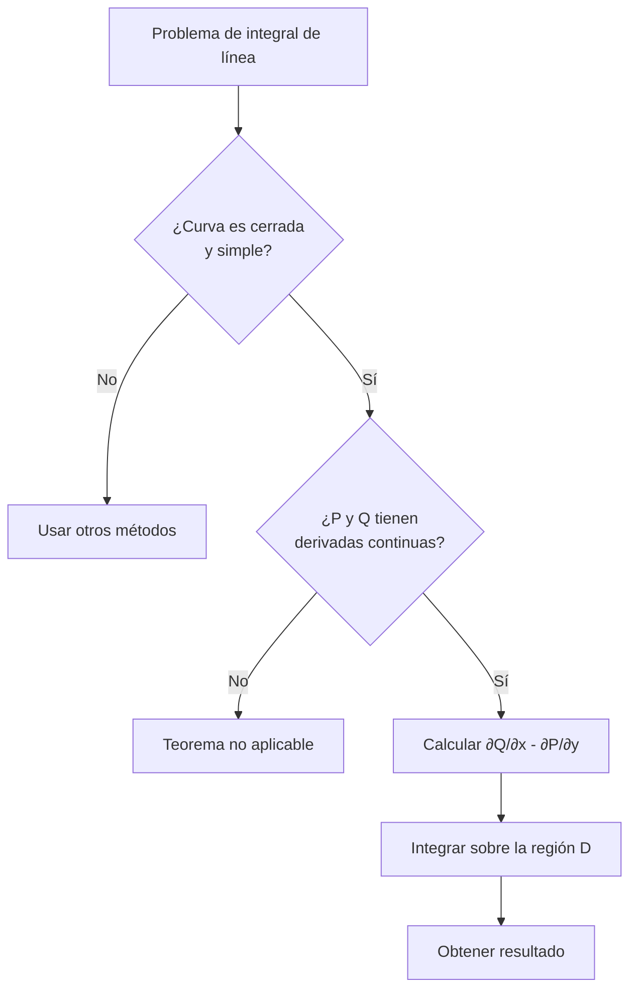

# Matemáticas para Ciencias Aplicadas III - Teoremas de Green y Stokes

## 4.1 Teorema de Green.

---

El **Teorema de Green** es un resultado fundamental del cálculo vectorial que establece una relación entre una integral de línea alrededor de una curva cerrada simple y una integral doble sobre la región plana limitada por dicha curva. Este teorema es un caso especial del Teorema de Stokes en dos dimensiones.

### Definiciones Preliminares

#### Curva Cerrada Simple

Una curva $C$ es **cerrada simple** si:

- Es continua
- No se interseca a sí misma
- Forma un bucle cerrado

#### Orientación Positiva

La orientación positiva de una curva cerrada simple es aquella en la que **la región siempre queda a la izquierda** al recorrer la curva.



### Enunciado del Teorema de Green

Sea $C$ una curva cerrada simple, suave a trozos y orientada positivamente en el plano, y sea $D$ la región limitada por $C$. Si $P(x,y)$ y $Q(x,y)$ tienen derivadas parciales continuas en una región abierta que contiene a $D$, entonces:

$$\oint_C (Pdx + Qdy) = \iint_D \left(\frac{\partial Q}{\partial x} - \frac{\partial P}{\partial y}\right) dA$$

#### Notación Vectorial

Si definimos el campo vectorial $\vec{F} = P\hat{i} + Q\hat{j}$, entonces:

$$\oint_C \vec{F} \cdot d\vec{r} = \iint_D \left(\frac{\partial Q}{\partial x} - \frac{\partial P}{\partial y}\right) dA$$

### Interpretación Física

El Teorema de Green relaciona:

- La **circulación** de un campo vectorial alrededor de una curva cerrada
- El **rotacional** del campo sobre el área encerrada

$$\text{Circulación} = \text{Rotacional integrado sobre el área}$$

### Casos Especiales y Aplicaciones

#### 1. Cálculo de Áreas

Si elegimos $P$ y $Q$ tales que $\frac{\partial Q}{\partial x} - \frac{\partial P}{\partial y} = 1$, podemos calcular áreas:

$$A = \frac{1}{2} \oint_C (-ydx + xdy)$$

#### 2. Independencia del Camino

El Teorema de Green ayuda a determinar si una integral de línea es independiente del camino.

### Demostración Intuitiva



### Ejemplos Resueltos

#### Ejemplo 1: Integral Básica

Calcular $\oint_C (x^2 - y^2)dx + 2xydy$ donde $C$ es el círculo $x^2 + y^2 = 4$.

**Solución:**

1. Identificamos: $P = x^2 - y^2$, $Q = 2xy$
2. Calculamos las derivadas parciales:
   $\frac{\partial Q}{\partial x} = 2y$, $\frac{\partial P}{\partial y} = -2y$
3. Aplicamos Green:

   $\oint_C = \iint_D (2y - (-2y))dA = \iint_D 4ydA$

4. Usamos coordenadas polares:

   $\int_0^{2\pi} \int_0^2 4(r\sin\theta)rdrd\theta = 0$

#### Ejemplo 2: Cálculo de Área

Calcular el área de la elipse $\frac{x^2}{a^2} + \frac{y^2}{b^2} = 1$ usando Green.

**Solución:**
Usamos la fórmula de área:

$A = \frac{1}{2} \oint_C (-ydx + xdy)$

Parametrizamos: $x = a\cos t$, $y = b\sin t$, $0 \leq t \leq 2\pi$

$dx = -a\sin tdt$, $dy = b\cos tdt$

$A = \frac{1}{2} \int_0^{2\pi} [-(b\sin t)(-a\sin t) + (a\cos t)(b\cos t)]dt$

$A = \frac{1}{2} \int_0^{2\pi} (ab\sin^2 t + ab\cos^2 t)dt = \frac{ab}{2} \int_0^{2\pi} dt = \pi ab$

### Implementación Computacional

```python
import numpy as np
import sympy as sp

def teorema_green(P, Q, x, y, region):
    """
    Calcula la integral usando el Teorema de Green

    Parameters:
    P, Q: componentes del campo vectorial
    x, y: variables
    region: función que define la región de integración
    """
    # Calcular ∂Q/∂x - ∂P/∂y
    dQ_dx = sp.diff(Q, x)
    dP_dy = sp.diff(P, y)
    integrando = dQ_dx - dP_dy

    # Calcular la integral doble
    resultado = sp.integrate(integrando, (x, y) sobre region)
    return resultado

# Ejemplo de uso
x, y = sp.symbols('x y')
P = x**2 - y**2
Q = 2*x*y

resultado = teorema_green(P, Q, x, y, "x^2 + y^2 <= 4")
print(f"Resultado: {resultado}")
```

### Ejercicios Propuestos

#### Ejercicio 1

Calcular $\oint_C (x^2 + y)dx + (3x - y^2)dy$ donde $C$ es el cuadrado con vértices $(0,0)$, $(2,0)$, $(2,2)$, $(0,2)$.

#### Ejercicio 2

Usar el Teorema de Green para calcular el área de la región limitada por $y = x^2$ e $y = x$.

#### Ejercicio 3

Verificar el Teorema de Green para $\oint_C (x^2 - y^2)dx + 2xydy$ donde $C$ es el triángulo con vértices $(0,0)$, $(1,0)$, $(1,1)$.

#### Ejercicio 4

Calcular $\oint_C e^x \sin y dx + e^x \cos y dy$ donde $C$ es la elipse $4x^2 + 9y^2 = 36$.

#### Ejercicio 5

Determinar el trabajo realizado por el campo $\vec{F} = (x^2 + y^2)\hat{i} + 2xy\hat{j}$ al mover una partícula alrededor del perímetro del rectángulo $0 \leq x \leq 3$, $0 \leq y \leq 2$.

### Diagrama de Flujo para Aplicar el Teorema



### Consideraciones Importantes

1. **Continuidad de derivadas**: Las derivadas parciales deben ser continuas en la región
2. **Orientación**: La curva debe estar orientada positivamente (antihorario)
3. **Región simplemente conexa**: La región no debe tener "huecos"

### Extensiones y Generalizaciones

El Teorema de Green es caso particular de:

- Teorema de Stokes (3D)
- Teorema de la Divergencia (3D)
- Teorema Fundamental del Cálculo para Integrales de Línea

### Referencias

1. Stewart, J. (2008). _Cálculo de varias variables_. Cengage Learning.
2. Marsden, J. E., & Tromba, A. J. (2012). _Vector Calculus_. W. H. Freeman.
3. Apostol, T. M. (1969). _Calculus, Vol. 2_. Wiley.

### Consejos de Estudio

1. **Domina la parametrización** de curvas comunes (círculos, elipses, etc.)
2. **Practica el cambio** entre integrales de línea y dobles
3. **Verifica siempre** las condiciones de aplicabilidad del teorema
4. **Usa software** (SymPy, Mathematica) para verificar tus resultados
