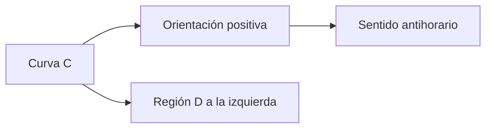
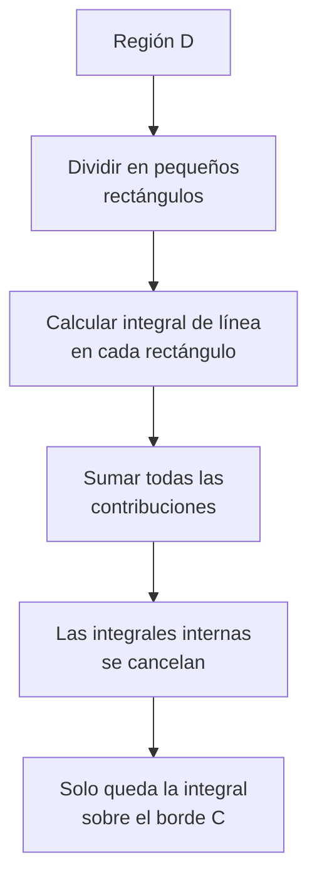
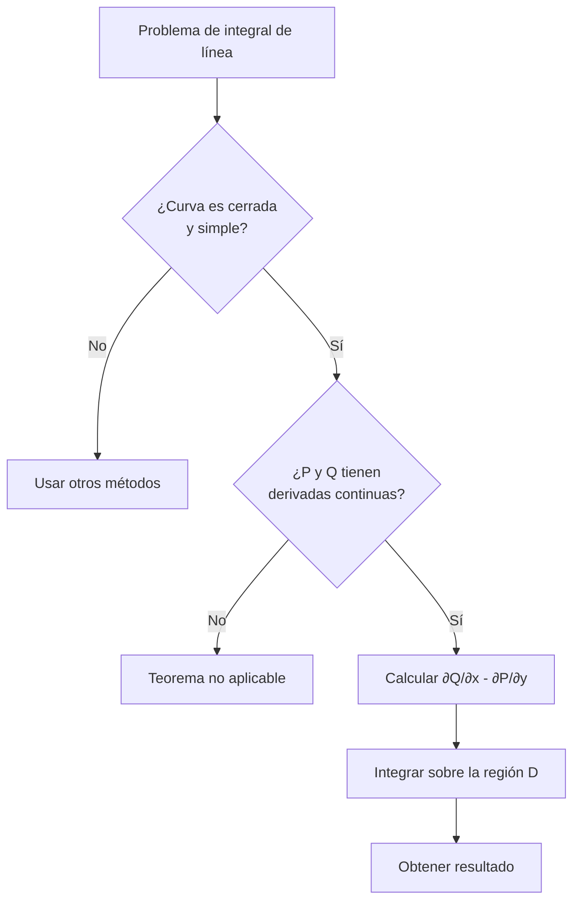

# Matemáticas para Ciencias Aplicadas III - Teoremas de Green y Stokes

## 4.1 Teorema de Green.

---

El **Teorema de Green** es un resultado fundamental del cálculo vectorial que establece una relación entre una integral de línea alrededor de una curva cerrada simple y una integral doble sobre la región plana limitada por dicha curva. Este teorema es un caso especial del Teorema de Stokes en dos dimensiones.

### Definiciones Preliminares

#### Curva Cerrada Simple

Una curva $C$ es **cerrada simple** si:

- Es continua
- No se interseca a sí misma
- Forma un bucle cerrado

#### Orientación Positiva

La orientación positiva de una curva cerrada simple es aquella en la que **la región siempre queda a la izquierda** al recorrer la curva.



### Enunciado del Teorema de Green

Sea $C$ una curva cerrada simple, suave a trozos y orientada positivamente en el plano, y sea $D$ la región limitada por $C.$ Si $P(x,y)$ y $Q(x,y)$ tienen derivadas parciales continuas en una región abierta que contiene a $D,$ entonces:

$$\oint_C (P \, dx + Q \, dy) = \iint_D \left(\frac{\partial Q}{\partial x} - \frac{\partial P}{\partial y}\right) dA$$

#### Idea de la Demostración

Basta probar por separado $-\oint_C P \, dx = \iint_D \frac{\partial P}{\partial y} \, dA$ y $\oint_C Q \, dy = \iint_D \frac{\partial Q}{\partial x} \, dA.$ Para la primera, si $D = \{a \leq x \leq b, \ g_1(x) \leq y \leq g_2(x)\}$ es de Tipo I, el teorema fundamental del cálculo da

$$\iint_D \frac{\partial P}{\partial y} \, dA = \int_a^b \left[P(x, g_2(x)) - P(x, g_1(x))\right] dx$$

Por otro lado, en $\oint_C P \, dx$ la curva inferior se recorre de izquierda a derecha y aporta $\int_a^b P(x, g_1(x)) \, dx;$ la superior se recorre de derecha a izquierda y aporta $-\int_a^b P(x, g_2(x)) \, dx;$ los lados verticales no aportan, porque en ellos $dx = 0.$ Comparando, las dos expresiones coinciden con signo opuesto. La segunda igualdad es análoga usando que $D$ es de Tipo II.

#### Notación Vectorial

Si definimos el campo vectorial $\vec{F} = P\hat{i} + Q\hat{j},$ entonces:

$$\oint_C \vec{F} \cdot d\vec{r} = \iint_D \left(\frac{\partial Q}{\partial x} - \frac{\partial P}{\partial y}\right) dA$$

### Interpretación Física

El Teorema de Green relaciona:

- La **circulación** de un campo vectorial alrededor de una curva cerrada
- El **rotacional** del campo sobre el área encerrada

$$\text{Circulación} = \text{Rotacional integrado sobre el área}$$

#### Forma de Divergencia (Flujo)

Aplicando el teorema al campo $(-Q, P)$ se obtiene la versión para el **flujo** hacia afuera a través de $C:$

$$\oint_C \vec{F} \cdot \hat{n} \, ds = \oint_C P \, dy - Q \, dx = \iint_D \left(\frac{\partial P}{\partial x} + \frac{\partial Q}{\partial y}\right) dA = \iint_D \nabla \cdot \vec{F} \, dA$$

donde $\hat{n}$ es la normal exterior. Es el teorema de la divergencia en el plano.

### Casos Especiales y Aplicaciones

#### 1. Cálculo de Áreas

Si elegimos $P$ y $Q$ tales que $\frac{\partial Q}{\partial x} - \frac{\partial P}{\partial y} = 1,$ podemos calcular áreas:

$$A = \frac{1}{2} \oint_C (-y \, dx + x \, dy) = \oint_C x \, dy = -\oint_C y \, dx$$

#### 2. Independencia del Camino

Si $\frac{\partial Q}{\partial x} = \frac{\partial P}{\partial y}$ en una región **simplemente conexa**, Green da $\oint_C P \, dx + Q \, dy = 0$ para toda curva cerrada simple en ella, y por lo tanto la integral es independiente del camino.

#### 3. Regiones con Huecos

Green también vale para regiones con agujeros, siempre que $C$ incluya **todas** las curvas frontera con la orientación positiva: la exterior en sentido antihorario y las interiores en sentido horario, de modo que la región quede siempre a la izquierda. Por ejemplo, para $\vec{F} = \left(\frac{-y}{x^2 + y^2}, \frac{x}{x^2 + y^2}\right),$ que cumple $\frac{\partial Q}{\partial x} = \frac{\partial P}{\partial y}$ fuera del origen, la región entre dos circunferencias centradas en el origen da $\oint_{C_{\text{ext}}} - \oint_{C_{\text{int}}} = 0:$ la circulación vale $2\pi$ alrededor de cualquier circunferencia centrada en el origen. Green **no** se puede aplicar al disco completo, porque $\vec{F}$ no está definido en el origen.

### Demostración Intuitiva



### Ejemplos Resueltos

#### Ejemplo 1: Integral Básica

Calcular $\oint_C (x^2 - y^2) \, dx + 2xy \, dy$ donde $C$ es la circunferencia $x^2 + y^2 = 4$ recorrida en sentido antihorario.

**Solución:**

1. Identificamos: $P = x^2 - y^2,$ $Q = 2xy$
2. Calculamos las derivadas parciales:
   $\frac{\partial Q}{\partial x} = 2y,$ $\frac{\partial P}{\partial y} = -2y$
3. Aplicamos Green:

   $\oint_C = \iint_D (2y - (-2y)) \, dA = \iint_D 4y \, dA$

4. Usamos coordenadas polares:

   $\int_0^{2\pi} \int_0^2 4(r\sin\theta) \, r \, dr \, d\theta = 0,$ porque $\int_0^{2\pi}\sin\theta \, d\theta = 0.$ También se ve por simetría: $y$ es impar y el disco es simétrico respecto al eje $x.$

#### Ejemplo 2: Cálculo de Área

Calcular el área de la elipse $\frac{x^2}{a^2} + \frac{y^2}{b^2} = 1$ usando Green.

**Solución:**
Usamos la fórmula de área:

$A = \frac{1}{2} \oint_C (-y \, dx + x \, dy)$

Parametrizamos: $x = a\cos t,$ $y = b\sin t,$ $0 \leq t \leq 2\pi.$

$dx = -a\sin t \, dt,$ $dy = b\cos t \, dt$

$A = \frac{1}{2} \int_0^{2\pi} [-(b\sin t)(-a\sin t) + (a\cos t)(b\cos t)] \, dt$

$A = \frac{1}{2} \int_0^{2\pi} (ab\sin^2 t + ab\cos^2 t) \, dt = \frac{ab}{2} \int_0^{2\pi} dt = \pi ab$

### Implementación Computacional

```python
import sympy as sp

x, y, t = sp.symbols('x y t', real=True)

def lado_derecho_green(P, Q, lim_y, lim_x):
    """∬_D (∂Q/∂x - ∂P/∂y) dA para una región de Tipo I:
    lim_y = (y, g1(x), g2(x)) y lim_x = (x, a, b)."""
    integrando = sp.diff(Q, x) - sp.diff(P, y)
    return sp.integrate(integrando, lim_y, lim_x)

def integral_de_linea(P, Q, curva, lim_t):
    """∮_C P dx + Q dy para C parametrizada por curva = (x(t), y(t))."""
    xt, yt = curva
    sust = {x: xt, y: yt}
    integrando = P.subs(sust) * sp.diff(xt, t) + Q.subs(sust) * sp.diff(yt, t)
    return sp.integrate(sp.simplify(integrando), (t, *lim_t))

# Ejemplo 1: disco x² + y² ≤ 4
P = x**2 - y**2
Q = 2*x*y
doble = lado_derecho_green(P, Q, (y, -sp.sqrt(4 - x**2), sp.sqrt(4 - x**2)), (x, -2, 2))
linea = integral_de_linea(P, Q, (2*sp.cos(t), 2*sp.sin(t)), (0, 2*sp.pi))
print("Integral doble:", sp.simplify(doble), " Integral de línea:", linea)   # 0 y 0

# Ejercicio 3: triángulo (0,0), (1,0), (1,1), lado a lado y con Green
lados = [((t, 0), (0, 1)), ((1, t), (0, 1)), ((1 - t, 1 - t), (0, 1))]
linea = sum(integral_de_linea(P, Q, c, l) for c, l in lados)
doble = lado_derecho_green(P, Q, (y, 0, x), (x, 0, 1))
print("Triángulo:", linea, "=", doble)   # 2/3
```

### Ejercicios Propuestos

#### Ejercicio 1

Calcular $\oint_C (x^2 + y) \, dx + (3x - y^2) \, dy$ donde $C$ es el cuadrado con vértices $(0,0),$ $(2,0),$ $(2,2),$ $(0,2).$

#### Ejercicio 2

Usar el Teorema de Green para calcular el área de la región limitada por $y = x^2$ e $y = x.$

#### Ejercicio 3

Verificar el Teorema de Green para $\oint_C (x^2 - y^2) \, dx + 2xy \, dy$ donde $C$ es el triángulo con vértices $(0,0),$ $(1,0),$ $(1,1).$

#### Ejercicio 4

Calcular $\oint_C e^x \sin y \, dx + e^x \cos y \, dy$ donde $C$ es la elipse $4x^2 + 9y^2 = 36.$

#### Ejercicio 5

Determinar el trabajo realizado por el campo $\vec{F} = (x^2 + y^2)\hat{i} + 2xy\hat{j}$ al mover una partícula alrededor del perímetro del rectángulo $0 \leq x \leq 3,$ $0 \leq y \leq 2.$

#### Soluciones

Todas las curvas se recorren en sentido antihorario.

1. $\frac{\partial Q}{\partial x} - \frac{\partial P}{\partial y} = 3 - 1 = 2,$ así que la integral es $2 \cdot \text{Área} = 2 \cdot 4 = 8.$
2. $A = \oint_C x \, dy.$ Sobre $y = x^2$ de $(0,0)$ a $(1,1):$ $\int_0^1 t \cdot 2t \, dt = \frac{2}{3}.$ Sobre $y = x$ de regreso: $-\int_0^1 t \, dt = -\frac{1}{2}.$ Área $= \frac{1}{6}.$
3. $\iint_D 4y \, dA = \int_0^1\int_0^x 4y \, dy \, dx = \frac{2}{3}.$ Por lados: $\frac{1}{3} + 1 - \frac{2}{3} = \frac{2}{3}.$ Ver el código de la sección anterior.
4. $\frac{\partial Q}{\partial x} - \frac{\partial P}{\partial y} = e^x\cos y - e^x\cos y = 0:$ la integral es $0.$ El campo es $\nabla(e^x\sin y).$
5. $\frac{\partial Q}{\partial x} - \frac{\partial P}{\partial y} = 2y - 2y = 0:$ el trabajo es $0.$

### Diagrama de Flujo para Aplicar el Teorema



### Consideraciones Importantes

1. **Continuidad de derivadas**: Las derivadas parciales deben ser continuas en toda la región, incluido su interior. Un solo punto problemático, como el origen para $\frac{(-y, x)}{x^2 + y^2},$ invalida el teorema en esa región.
2. **Orientación**: La curva debe estar orientada positivamente (antihorario); con la orientación contraria el resultado cambia de signo.
3. **Regiones con huecos**: Se permiten si la frontera incluye todas sus curvas con la orientación correcta, como se explicó en la sección 3.

### Extensiones y Generalizaciones

- El Teorema de Green es el caso plano del **Teorema de Stokes**, cuando la superficie es una región del plano $xy$ con normal $\hat{k}.$
- Su forma de divergencia es la versión en el plano del **Teorema de la Divergencia** de Gauss.
- Los tres, junto con el Teorema Fundamental del Cálculo, son casos del **teorema de Stokes generalizado** $\int_{\partial M} \omega = \int_M d\omega:$ la integral de una derivada sobre una región depende solo de lo que pasa en su frontera.

### Referencias

1. Stewart, J. (2008). _Cálculo de varias variables_. Cengage Learning.
2. Marsden, J. E., & Tromba, A. J. (2012). _Vector Calculus_. W. H. Freeman.
3. Apostol, T. M. (1969). _Calculus, Vol. 2_. Wiley.

### Consejos de Estudio

1. **Domina la parametrización** de curvas comunes (círculos, elipses, etc.)
2. **Practica el cambio** entre integrales de línea y dobles
3. **Verifica siempre** las condiciones de aplicabilidad del teorema
4. **Usa software** (SymPy, Mathematica) para verificar tus resultados
