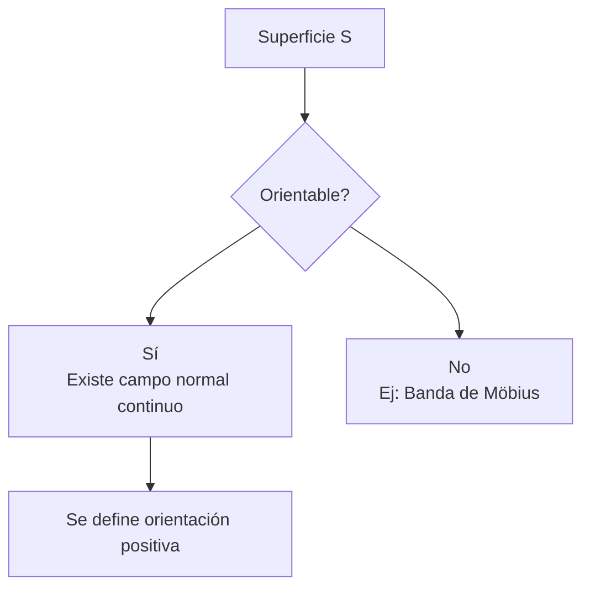
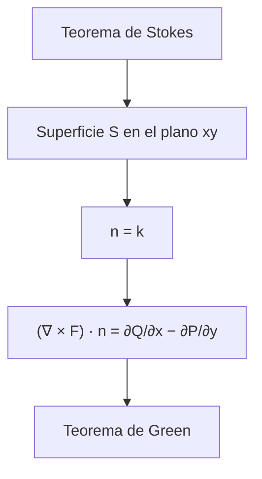
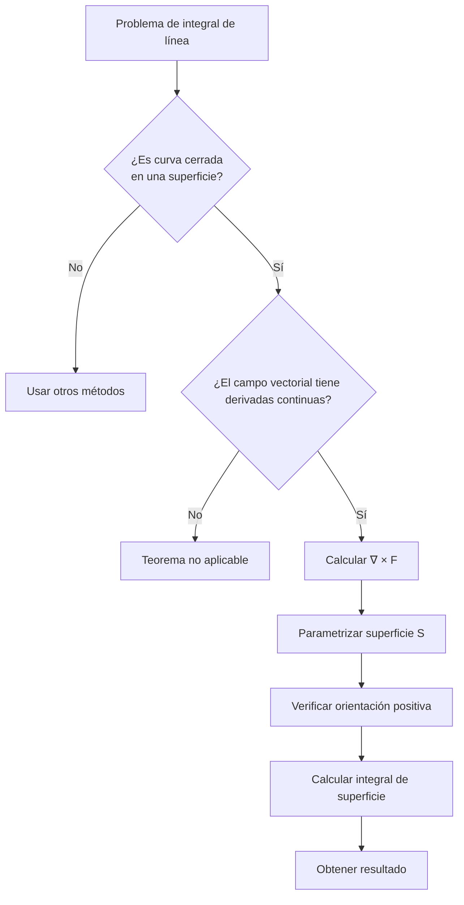

# Matemáticas para Ciencias Aplicadas III - Teoremas de Green y Stokes
## 4.2 Teorema de Stokes.

---

### Introducción

El **Teorema de Stokes** es uno de los resultados más importantes del cálculo vectorial: generaliza el Teorema de Green a superficies en el espacio y, como él, es pariente del Teorema Fundamental del Cálculo. Establece una relación fundamental entre la integral de superficie del rotacional de un campo vectorial sobre una superficie $S$ y la integral de línea del campo vectorial sobre la curva frontera de $S.$

### Conceptos Preliminares

#### Campo Vectorial
Un campo vectorial en $\mathbb{R}^3$ es una función $\vec{F}: D \subseteq \mathbb{R}^3 \to \mathbb{R}^3$ que asigna a cada punto $(x, y, z)$ un vector:

$$ \vec{F}(x, y, z) = P(x, y, z)\hat{i} + Q(x, y, z)\hat{j} + R(x, y, z)\hat{k} $$

#### Rotacional de un Campo Vectorial
El rotacional de un campo vectorial $\vec{F} = P\hat{i} + Q\hat{j} + R\hat{k}$ es:

$$ \nabla \times \vec{F} = \begin{vmatrix} \hat{i} & \hat{j} & \hat{k} \\ \frac{\partial}{\partial x} & \frac{\partial}{\partial y} & \frac{\partial}{\partial z} \\ P & Q & R \end{vmatrix} = \left(\frac{\partial R}{\partial y} - \frac{\partial Q}{\partial z}\right)\hat{i} + \left(\frac{\partial P}{\partial z} - \frac{\partial R}{\partial x}\right)\hat{j} + \left(\frac{\partial Q}{\partial x} - \frac{\partial P}{\partial y}\right)\hat{k} $$

#### Superficie Orientable
Una superficie $S$ es orientable si es posible elegir un campo de vectores normales unitarios $\hat{n}$ que varíen continuamente sobre $S.$



### Enunciado del Teorema de Stokes

Sea $S$ una superficie orientada, suave a trozos, cuya frontera es una curva cerrada simple $C,$ suave a trozos. Sea $\vec{F}$ un campo vectorial cuyas componentes tienen derivadas parciales continuas en una región abierta de $\mathbb{R}^3$ que contiene a $S.$ Entonces:

$$\oint_C \vec{F} \cdot d\vec{r} = \iint_S (\nabla \times \vec{F}) \cdot d\vec{S}$$

Donde:
- La orientación de $C$ es la **inducida** por la de $S:$ si se camina sobre $C$ con la cabeza en la dirección de $\hat{n},$ la superficie queda a la izquierda. Equivalentemente, con el pulgar derecho en la dirección de $\hat{n},$ los demás dedos indican el sentido de $C.$
- $d\vec{S} = \hat{n} \, dS$ es el vector de elemento de superficie

Si $S$ tiene varias curvas frontera, como un cilindro abierto por ambos lados, el lado izquierdo es la suma de las integrales sobre todas ellas, cada una con su orientación inducida.

**Consecuencia importante:** el lado derecho solo depende de la curva $C;$ por lo tanto, **todas las superficies con la misma frontera** y orientación compatible dan el mismo flujo del rotacional. Esto permite sustituir una superficie complicada por una sencilla, como un disco plano.

#### Forma Alternativa

$$\oint_C \vec{F} \cdot d\vec{r} = \iint_S (\nabla \times \vec{F}) \cdot \hat{n} \, dS$$

#### Interpretación del Rotacional

Si $S_\varepsilon$ es un disco pequeño de radio $\varepsilon$ centrado en $p$ con normal $\hat{n}$ y frontera $C_\varepsilon,$

$$(\nabla \times \vec{F})(p) \cdot \hat{n} = \lim_{\varepsilon \to 0} \frac{1}{\pi\varepsilon^2}\oint_{C_\varepsilon} \vec{F} \cdot d\vec{r}$$

La componente del rotacional en la dirección $\hat{n}$ es la **circulación por unidad de área** en el plano perpendicular a $\hat{n}.$

### Relación con el Teorema de Green

El Teorema de Green es un caso especial del Teorema de Stokes cuando la superficie $S$ y la curva $C$ están en el plano $xy:$



### Aplicaciones del Teorema de Stokes

#### 1. Simplificación de Integrales de Línea
Si $\nabla \times \vec{F} = \vec{0},$ entonces $\oint_C \vec{F} \cdot d\vec{r} = 0$ para cualquier curva cerrada $C.$

#### 2. Campos Conservativos
Un campo vectorial $\vec{F}$ de clase $C^1$ en una región **simplemente conexa** de $\mathbb{R}^3,$ por ejemplo todo $\mathbb{R}^3,$ es conservativo si y solo si $\nabla \times \vec{F} = \vec{0}.$ La parte difícil usa Stokes: si el rotacional es cero, la circulación sobre cualquier curva cerrada es cero, porque la curva es frontera de alguna superficie dentro de la región. Sin la hipótesis falla: $\left(\frac{-y}{x^2+y^2}, \frac{x}{x^2+y^2}, 0\right)$ tiene rotacional cero fuera del eje $z,$ pero circulación $2\pi$ alrededor de él.

#### 3. Interpretación Física
El teorema establece que la circulación total de $\vec{F}$ alrededor de $C$ es igual al flujo del rotacional de $\vec{F}$ a través de $S.$

### Ejemplos Resueltos

#### Ejemplo 1: Aplicación Directa
Calcular $\oint_C \vec{F} \cdot d\vec{r}$ donde $\vec{F} = z^2\hat{i} + x^2\hat{j} + y^2\hat{k}$ y $C$ es la curva intersección del plano $z = y$ y el cilindro $x^2 + y^2 = 1,$ orientada en sentido antihorario.

**Solución:**
1. Calculamos $\nabla \times \vec{F}:$

   $$ \nabla \times \vec{F} = \begin{vmatrix} \hat{i} & \hat{j} & \hat{k} \\ \frac{\partial}{\partial x} & \frac{\partial}{\partial y} & \frac{\partial}{\partial z} \\ z^2 & x^2 & y^2 \end{vmatrix} = (2y)\hat{i} + (2z)\hat{j} + (2x)\hat{k} $$

2. Tomamos como $S$ la parte del plano $z = y$ dentro del cilindro, que tiene a $C$ por frontera, con normal hacia arriba, compatible con el sentido antihorario visto desde arriba:

   $$ \vec{r}(u,v) = u\cos v\hat{i} + u\sin v\hat{j} + u\sin v\hat{k}, \quad 0 \leq u \leq 1, 0 \leq v \leq 2\pi $$

3. Calculamos $\vec{r}_u \times \vec{r}_v:$

   $$ \vec{r}_u = \cos v\hat{i} + \sin v\hat{j} + \sin v\hat{k} $$

   $$ \vec{r}_v = -u\sin v\hat{i} + u\cos v\hat{j} + u\cos v\hat{k} $$

   $$ \vec{r}_u \times \vec{r}_v = \begin{vmatrix} \hat{i} & \hat{j} & \hat{k} \\ \cos v & \sin v & \sin v \\ -u\sin v & u\cos v & u\cos v \end{vmatrix} = 0\,\hat{i} - u\,\hat{j} + u\,\hat{k} $$

   Su componente $\hat{k}$ es positiva: apunta hacia arriba, como se quería.

4. En la superficie, $\nabla \times \vec{F} = (2u\sin v, \; 2u\sin v, \; 2u\cos v),$ así que

   $$ (\nabla \times \vec{F}) \cdot (\vec{r}_u \times \vec{r}_v) = -2u^2\sin v + 2u^2\cos v $$

5. Evaluamos la integral de superficie:

   $$ \iint_S (\nabla \times \vec{F}) \cdot d\vec{S} = \int_0^{2\pi} \int_0^1 2u^2(\cos v - \sin v) \, du \, dv = \frac{2}{3}\int_0^{2\pi}(\cos v - \sin v) \, dv = 0 $$

6. Comprobación directa: con $\vec{r}(t) = (\cos t, \sin t, \sin t),$ $\vec{F} \cdot \vec{r}' = -\sin^3 t + \cos^3 t + \sin^2 t\cos t,$ y cada término integra $0$ en $[0, 2\pi].$

#### Ejemplo 2: Verificación del Teorema
Verificar el Teorema de Stokes para $\vec{F} = y\hat{i} + z\hat{j} + x\hat{k}$ sobre la superficie $S$ del paraboloide $z = 1 - x^2 - y^2,$ $z \geq 0.$

**Solución:**
1. Calculamos $\nabla \times \vec{F}:$

   $$ \nabla \times \vec{F} = \begin{vmatrix} \hat{i} & \hat{j} & \hat{k} \\ \frac{\partial}{\partial x} & \frac{\partial}{\partial y} & \frac{\partial}{\partial z} \\ y & z & x \end{vmatrix} = -\hat{i} - \hat{j} - \hat{k} $$

2. Calculamos la integral de superficie con la normal hacia arriba. Para la gráfica $z = 1 - x^2 - y^2$ el vector normal es $(-z_x, -z_y, 1) = (2x, 2y, 1)$ y la proyección es el disco unitario $D:$

   $$ \iint_S (\nabla \times \vec{F}) \cdot d\vec{S} = \iint_D (-1, -1, -1) \cdot (2x, 2y, 1) \, dA = \iint_D (-2x - 2y - 1) \, dA = -\pi $$

   Los términos $-2x$ y $-2y$ integran cero por simetría, y queda $-\text{Área}(D) = -\pi.$

3. Calculamos la integral de línea sobre $C:$ $x^2 + y^2 = 1,$ $z = 0$

   Parametrización: $\vec{r}(t) = \cos t\hat{i} + \sin t\hat{j} + 0\hat{k},$ $0 \leq t \leq 2\pi,$ en sentido antihorario visto desde arriba, que es la orientación inducida por la normal hacia arriba.

   $$ \oint_C \vec{F} \cdot d\vec{r} = \int_0^{2\pi} (\sin t\hat{i} + 0\hat{j} + \cos t\hat{k}) \cdot (-\sin t\hat{i} + \cos t\hat{j}) \, dt $$

   $$ = \int_0^{2\pi} (-\sin^2 t) \, dt = -\pi $$

   Ambos lados valen $-\pi:$ el teorema se verifica. Como el rotacional es constante, cualquier superficie con la misma frontera da el mismo resultado; con el disco plano, $(-1,-1,-1) \cdot \hat{k} \cdot \pi = -\pi.$

### Implementación Computacional

```python
import sympy as sp
import numpy as np

def rotacional(F, variables):
    """
    Calcula el rotacional de un campo vectorial F
    
    Parameters:
    F: lista de componentes [P, Q, R] del campo vectorial
    variables: lista de variables [x, y, z]
    """
    x, y, z = variables
    P, Q, R = F
    
    # Calcula las componentes del rotacional
    rot_x = sp.diff(R, y) - sp.diff(Q, z)
    rot_y = sp.diff(P, z) - sp.diff(R, x)
    rot_z = sp.diff(Q, x) - sp.diff(P, y)
    
    return [rot_x, rot_y, rot_z]

# Ejemplo de uso
x, y, z = sp.symbols('x y z')
F = [y, z, x]  # Campo vectorial F = y i + z j + x k

rot_F = rotacional(F, [x, y, z])
print(f"Rotacional de F: {rot_F}")

# Verificación del ejemplo 2: ambos lados del teorema
u, v, t = sp.symbols('u v t', real=True)
superficie = sp.Matrix([u*sp.cos(v), u*sp.sin(v), 1 - u**2])     # paraboloide en polares
normal = superficie.diff(u).cross(superficie.diff(v))           # (2u²cos v, 2u²sin v, u): hacia arriba
rot = sp.Matrix(rot_F).subs({x: superficie[0], y: superficie[1], z: superficie[2]})
lado_superficie = sp.integrate((rot.T * normal)[0], (u, 0, 1), (v, 0, 2*sp.pi))

curva = sp.Matrix([sp.cos(t), sp.sin(t), 0])
F_curva = sp.Matrix(F).subs({x: curva[0], y: curva[1], z: curva[2]})
lado_curva = sp.integrate((F_curva.T * curva.diff(t))[0], (t, 0, 2*sp.pi))
print("Superficie:", sp.simplify(lado_superficie), " Curva:", lado_curva)   # -pi y -pi
```

### Ejercicios Propuestos

#### Ejercicio 1
Verificar el Teorema de Stokes para $\vec{F} = xz\hat{i} + yz\hat{j} + xy\hat{k}$ donde $S$ es la parte de la esfera $x^2 + y^2 + z^2 = 4$ que está dentro del cilindro $x^2 + y^2 = 1$ y por encima del plano $xy,$ con normal exterior.

#### Ejercicio 2
Calcular $\oint_C \vec{F} \cdot d\vec{r}$ donde $\vec{F} = (2x - y)\hat{i} + (x + 3z)\hat{j} + (2y - z)\hat{k}$ y $C$ es la curva intersección del cilindro $x^2 + y^2 = 4$ y el plano $x + z = 6,$ recorrida en sentido antihorario vista desde arriba.

#### Ejercicio 3
Usar el Teorema de Stokes para evaluar $\iint_S (\nabla \times \vec{F}) \cdot d\vec{S}$ donde $\vec{F} = x^2y^3z\hat{i} + \sin(xyz)\hat{j} + xyz\hat{k}$ y $S$ es la parte del cono $z^2 = x^2 + y^2$ entre los planos $z = 1$ y $z = 3,$ con la normal que tiene componente $z$ positiva.

#### Ejercicio 4
Demostrar que si $S$ es una superficie cerrada, entonces $\iint_S (\nabla \times \vec{F}) \cdot d\vec{S} = 0.$

#### Ejercicio 5
Calcular $\oint_C (e^x \sin y - yz) \, dx + (e^x \cos y - xz) \, dy + xy \, dz$ donde $C$ es la curva intersección del cilindro $x^2 + y^2 = 1$ y el plano $x + y + z = 1,$ en sentido antihorario visto desde arriba.

#### Soluciones

1. La frontera es la circunferencia $x^2 + y^2 = 1,$ $z = \sqrt{3}.$ Con $\vec{r}(t) = (\cos t, \sin t, \sqrt{3}),$ $\vec{F} \cdot \vec{r}' = -\sqrt{3}\cos t\sin t + \sqrt{3}\sin t\cos t = 0,$ así que ambos lados valen $0.$ En la superficie, $\nabla \times \vec{F} = (x - y, \; x - y, \; 0),$ y su flujo también es $0$ por simetría.
2. $\nabla \times \vec{F} = (2 - 3, \; 0 - 0, \; 1 + 1) = (-1, 0, 2).$ Con la superficie plana $z = 6 - x$ sobre el disco de radio $2,$ la normal hacia arriba es $(1, 0, 1)$ y $(\nabla \times \vec{F}) \cdot (1, 0, 1) = 1.$ El resultado es el área del disco: $4\pi.$
3. La frontera son dos circunferencias, a alturas $3$ y $1.$ Con normal de componente $z$ positiva, la de arriba se recorre en sentido antihorario y la de abajo en sentido horario. Sobre la circunferencia de radio $a$ a altura $a,$ en sentido antihorario, el término $\sin(xyz)$ integra cero y el otro da $-a^7\int_0^{2\pi}\cos^2 t\sin^4 t \, dt = -\frac{\pi a^7}{8}.$ El resultado es $-\frac{\pi}{8}(3^7 - 1) = -\frac{1093\pi}{4}.$ Aquí Stokes evita parametrizar el cono y calcular un rotacional complicado.
4. Una curva cerrada $\gamma$ divide a $S$ en dos piezas $S_1$ y $S_2.$ Por Stokes, el flujo por $S_1$ es la circulación sobre $\gamma$ y el flujo por $S_2$ es la circulación sobre $\gamma$ en sentido contrario, porque las orientaciones inducidas son opuestas. Su suma es $0.$ También se obtiene del teorema de la divergencia, ya que $\nabla \cdot (\nabla \times \vec{F}) = 0.$
5. $\nabla \times \vec{F} = (2x, -2y, 0).$ Con la superficie plana $z = 1 - x - y$ sobre el disco unitario y normal $(1, 1, 1),$ el integrando es $2x - 2y,$ que integra $0$ por simetría. La integral vale $0.$

### Diagrama de Flujo para Aplicar el Teorema de Stokes



### Consideraciones Importantes

1. **Orientación**: La curva $C$ debe tener la orientación inducida por la de $S,$ según la regla de la mano derecha
2. **Continuidad**: Las componentes de $\vec{F}$ deben tener derivadas parciales continuas
3. **Superficie**: Debe ser suave a trozos y orientable
4. **Frontera**: La curva $C$ debe ser la frontera de $S$

### Aplicaciones Físicas

#### 1. Ley de Faraday

$$\oint_C \vec{E} \cdot d\vec{l} = -\frac{d}{dt} \iint_S \vec{B} \cdot d\vec{S}$$

Con Stokes, $\oint_C \vec{E} \cdot d\vec{l} = \iint_S (\nabla \times \vec{E}) \cdot d\vec{S};$ como la igualdad vale para toda superficie, se obtiene la forma diferencial $\nabla \times \vec{E} = -\frac{\partial \vec{B}}{\partial t}.$

#### 2. Ecuaciones de Maxwell
El Teorema de Stokes permite pasar de la forma integral a la forma diferencial de las leyes de Faraday y de Ampère-Maxwell. Por ejemplo, la ley de Ampère $\oint_C \vec{B} \cdot d\vec{l} = \mu_0 I$ para un hilo recto infinito da $B \cdot 2\pi r = \mu_0 I$ sobre una circunferencia de radio $r,$ es decir $B = \frac{\mu_0 I}{2\pi r}.$

#### 3. Circulación en fluidos
La circulación alrededor de una curva cerrada es el flujo de la vorticidad $\nabla \times \vec{v}$ a través de cualquier superficie que la tenga por frontera.

### Referencias

1. Marsden, J. E., & Tromba, A. J. (2012). *Vector Calculus*. W. H. Freeman.
2. Stewart, J. (2008). *Cálculo de varias variables*. Cengage Learning.
3. Apostol, T. M. (1969). *Calculus, Vol. 2*. Wiley.
4. Schey, H. M. (2005). *Div, Grad, Curl, and All That*. W. W. Norton.

### Consejos de Estudio

1. **Domina el cálculo de rotacionales** de campos vectoriales
2. **Practica la parametrización** de superficies comunes
3. **Comprende la regla de la mano derecha** para orientaciones
4. **Verifica siempre** las condiciones de aplicabilidad del teorema
5. **Resuelve problemas físicos** para entender las aplicaciones

