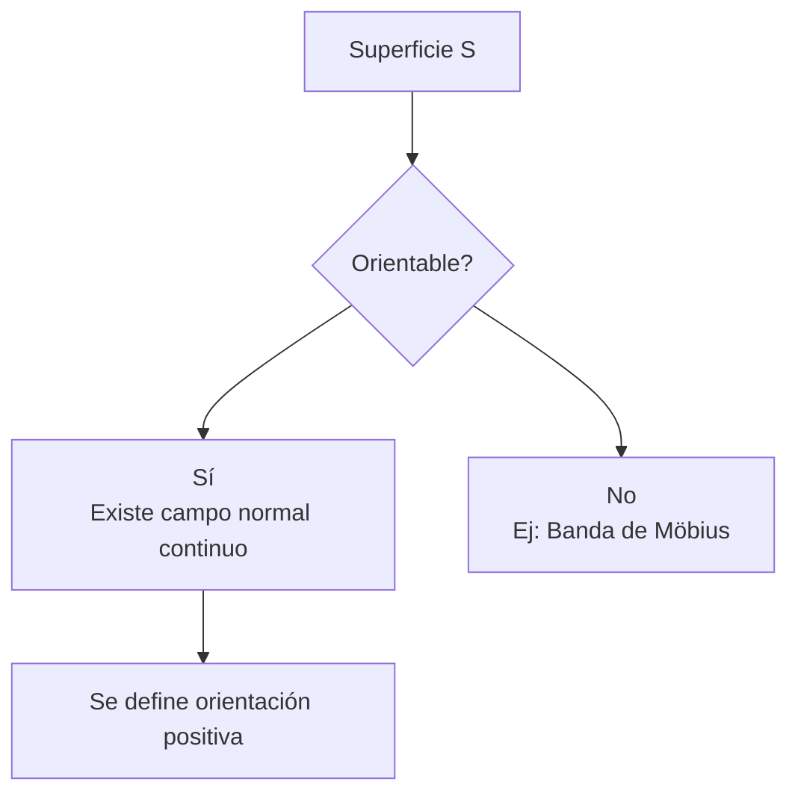
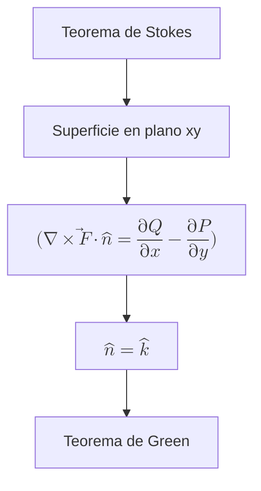
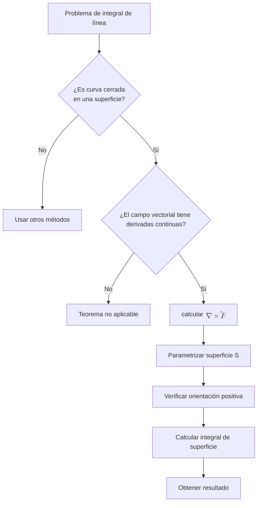

# Matemáticas para Ciencias Aplicadas III - Teoremas de Green y Stokes
## 4.2 Teorema de Stokes.

---

### Introducción

El **Teorema de Stokes** es uno de los resultados más importantes del cálculo vectorial, ya que generaliza el Teorema Fundamental del Cálculo, el Teorema de Green y el Teorema de la Divergencia. Establece una relación fundamental entre la integral de superficie del rotacional de un campo vectorial sobre una superficie $S$ y la integral de línea del campo vectorial sobre la curva frontera de $S$.

### Conceptos Preliminares

#### Campo Vectorial
Un campo vectorial en $ \mathbb{R}^3 $ es una función $ \vec{F}: D \subseteq \mathbb{R}^3 \to \mathbb{R}^3 $ que asigna a cada punto $ (x, y, z) $ un vector:

$$ \vec{F}(x, y, z) = P(x, y, z)\hat{i} + Q(x, y, z)\hat{j} + R(x, y, z)\hat{k} $$

#### Rotacional de un Campo Vectorial
El rotacional de un campo vectorial $ \vec{F} = P\hat{i} + Q\hat{j} + R\hat{k} $ es:

$$ \nabla \times \vec{F} = \begin{vmatrix} \hat{i} & \hat{j} & \hat{k} \\\ \frac{\partial}{\partial x} & \frac{\partial}{\partial y} & \frac{\partial}{\partial z} \\\ P & Q & R \end{vmatrix} = \left(\frac{\partial R}{\partial y} - \frac{\partial Q}{\partial z}\right)\hat{i} + \left(\frac{\partial P}{\partial z} - \frac{\partial R}{\partial x}\right)\hat{j} + \left(\frac{\partial Q}{\partial x} - \frac{\partial P}{\partial y}\right)\hat{k} $$

#### Superficie Orientable
Una superficie $S$ es orientable si es posible elegir un campo de vectores normales unitarios $\hat{n}$ que varíen continuamente sobre $S$.



### Enunciado del Teorema de Stokes

Sea $S$ una superficie orientada, suave a trozos, cuya frontera es una curva cerrada simple $C$, suave a trozos. Sea $\vec{F}$ un campo vectorial cuyas componentes tienen derivadas parciales continuas en una región abierta de $\mathbb{R}^3$ que contiene a $S$. Entonces:

$$\oint_C \vec{F} \cdot d\vec{r} = \iint_S (\nabla \times \vec{F}) \cdot d\vec{S}$$

Donde:
- La orientación de $C$ es positiva (regla de la mano derecha)
- $d\vec{S} = \hat{n}dS$ es el vector de elemento de superficie

#### Forma Alternativa

$$\oint_C \vec{F} \cdot d\vec{r} = \iint_S (\nabla \times \vec{F}) \cdot \hat{n}dS$$

### Relación con el Teorema de Green

El Teorema de Green es un caso especial del Teorema de Stokes cuando la superficie $S$ y la curva $C$ están en el plano $xy$:



### Aplicaciones del Teorema de Stokes

#### 1. Simplificación de Integrales de Línea
Si $\nabla \times \vec{F} = \vec{0}$, entonces $\oint_C \vec{F} \cdot d\vec{r} = 0$ para cualquier curva cerrada $C$.

#### 2. Campos Conservativos
Un campo vectorial $\vec{F}$ es conservativo si y solo si $\nabla \times \vec{F} = \vec{0}$.

#### 3. Interpretación Física
El teorema establece que la circulación total de $\vec{F}$ alrededor de $C$ es igual al flujo del rotacional de $\vec{F}$ a través de $S$.

### Ejemplos Resueltos

#### Ejemplo 1: Aplicación Directa
Calcular $\oint_C \vec{F} \cdot d\vec{r}$ donde $\vec{F} = z^2\hat{i} + x^2\hat{j} + y^2\hat{k}$ y $C$ es la curva intersección del plano $z = y$ y el cilindro $x^2 + y^2 = 1$, orientada en sentido antihorario.

**Solución:**
1. Calculamos $\nabla \times \vec{F}$:

   $$ \nabla \times \vec{F} = \begin{vmatrix} \hat{i} & \hat{j} & \hat{k} \\\ \frac{\partial}{\partial x} & \frac{\partial}{\partial y} & \frac{\partial}{\partial z} \\\ z^2 & x^2 & y^2 \end{vmatrix} = (2y)\hat{i} + (2z)\hat{j} + (2x)\hat{k} $$

2. Parametrizamos la superficie $S$ ( plano $z = y$ ):

   $$ \vec{r}(u,v) = u\cos v\hat{i} + u\sin v\hat{j} + u\sin v\hat{k}, \quad 0 \leq u \leq 1, 0 \leq v \leq 2\pi $$

3. Calculamos $\vec{r}_u \times \vec{r}_v$:

   $$ \vec{r}_u = \cos v\hat{i} + \sin v\hat{j} + \sin v\hat{k} $$
   $$ \vec{r}_v = -u\sin v\hat{i} + u\cos v\hat{j} + u\cos v\hat{k} $$
   $$ \vec{r}_u \times \vec{r}_v = \begin{vmatrix} \hat{i} & \hat{j} & \hat{k} \\\ \cos v & \sin v & \sin v \\\ -u\sin v & u\cos v & u\cos v \end{vmatrix} = (-u\sin v\cos v + u\sin v\cos v)\hat{i} + \cdots $$

4. Evaluamos la integral de superficie:

   $$ \iint_S (\nabla \times \vec{F}) \cdot d\vec{S} = \int_0^{2\pi} \int_0^1 (\nabla \times \vec{F}) \cdot (\vec{r}_u \times \vec{r}_v)dudv $$

#### Ejemplo 2: Verificación del Teorema
Verificar el Teorema de Stokes para $\vec{F} = y\hat{i} + z\hat{j} + x\hat{k}$ sobre la superficie $S$ del paraboloide $z = 1 - x^2 - y^2$, $z \geq 0$.

**Solución:**
1. Calculamos $\nabla \times \vec{F}$:

   $$ \nabla \times \vec{F} = \begin{vmatrix} \hat{i} & \hat{j} & \hat{k} \\\ \frac{\partial}{\partial x} & \frac{\partial}{\partial y} & \frac{\partial}{\partial z} \\\ y & z & x \end{vmatrix} = -\hat{i} - \hat{j} - \hat{k} $$

2. Calculamos la integral de superficie:
   
   $$ \iint_S (\nabla \times \vec{F}) \cdot d\vec{S} = \iint_S (-\hat{i} - \hat{j} - \hat{k}) \cdot \hat{n}dS $$

3. Calculamos la integral de línea sobre $C$: $x^2 + y^2 = 1$, $z = 0$

   Parametrización: $ \vec{r}(t) = \cos t\hat{i} + \sin t\hat{j} + 0\hat{k} $, $ 0 \leq t \leq 2\pi $
   
   $$ \oint_C \vec{F} \cdot d\vec{r} = \int_0^{2\pi} (\sin t\hat{i} + 0\hat{j} + \cos t\hat{k}) \cdot (-\sin t\hat{i} + \cos t\hat{j})dt $$

   $$ = \int_0^{2\pi} (-\sin^2 t)dt = -\pi $$

### Implementación Computacional

```python
import sympy as sp
import numpy as np

def rotacional(F, variables):
    """
    Calcula el rotacional de un campo vectorial F
    
    Parameters:
    F: lista de componentes [P, Q, R] del campo vectorial
    variables: lista de variables [x, y, z]
    """
    x, y, z = variables
    P, Q, R = F
    
    # Calcula las componentes del rotacional
    rot_x = sp.diff(R, y) - sp.diff(Q, z)
    rot_y = sp.diff(P, z) - sp.diff(R, x)
    rot_z = sp.diff(Q, x) - sp.diff(P, y)
    
    return [rot_x, rot_y, rot_z]

# Ejemplo de uso
x, y, z = sp.symbols('x y z')
F = [y, z, x]  # Campo vectorial F = y i + z j + x k

rot_F = rotacional(F, [x, y, z])
print(f"Rotacional de F: {rot_F}")
```

### Ejercicios Propuestos

#### Ejercicio 1
Verificar el Teorema de Stokes para $\vec{F} = xz\hat{i} + yz\hat{j} + xy\hat{k}$ donde $S$ es la parte de la esfera $x^2 + y^2 + z^2 = 4$ que está inside el cilindro $x^2 + y^2 = 1$ y above el plano $xy$.

#### Ejercicio 2
Calcular $\oint_C \vec{F} \cdot d\vec{r}$ donde $\vec{F} = (2x - y)\hat{i} + (x + 3z)\hat{j} + (2y - z)\hat{k}$ y $C$ es la curva intersección del cilindro $x^2 + y^2 = 4$ y el plano $x + z = 6$.

#### Ejercicio 3
Usar el Teorema de Stokes para evaluar $\iint_S (\nabla \times \vec{F}) \cdot d\vec{S}$ donde $\vec{F} = x^2y^3z\hat{i} + \sin(xyz)\hat{j} + xyz\hat{k}$ y $S$ es la parte del cono $z^2 = x^2 + y^2$ entre los planos $z = 1$ y $z = 3$.

#### Ejercicio 4
Demostrar que si $S$ es una superficie cerrada, entonces $\iint_S (\nabla \times \vec{F}) \cdot d\vec{S} = 0$.

#### Ejercicio 5
Calcular $\oint_C (e^x \sin y - yz)dx + (e^x \cos y - xz)dy + xydz$ donde $C$ es la curva intersección del cilindro $x^2 + y^2 = 1$ y el plano $x + y + z = 1$.

### Diagrama de Flujo para Aplicar el Teorema de Stokes



### Consideraciones Importantes

1. **Orientación**: La curva $C$ debe estar orientada positivamente respecto a la superficie $S$ (regla de la mano derecha)
2. **Continuidad**: Las componentes de $\vec{F}$ deben tener derivadas parciales continuas
3. **Superficie**: Debe ser suave a trozos y orientable
4. **Frontera**: La curva $C$ debe ser la frontera de $S$

### Aplicaciones Físicas

#### 1. Ley de Faraday
$$\oint_C \vec{E} \cdot d\vec{l} = -\frac{d}{dt} \iint_S \vec{B} \cdot d\vec{S}$$

#### 2. Ecuaciones de Maxwell
El Teorema de Stokes es fundamental en la formulación de las ecuaciones del electromagnetismo.

### Referencias

1. Marsden, J. E., & Tromba, A. J. (2012). *Vector Calculus*. W. H. Freeman.
2. Stewart, J. (2008). *Cálculo de varias variables*. Cengage Learning.
3. Apostol, T. M. (1969). *Calculus, Vol. 2*. Wiley.
4. Schey, H. M. (2005). *Div, Grad, Curl, and All That*. W. W. Norton.

### Consejos de Estudio

1. **Domina el cálculo de rotacionales** de campos vectoriales
2. **Practica la parametrización** de superficies comunes
3. **Comprende la regla de la mano derecha** para orientaciones
4. **Verifica siempre** las condiciones de aplicabilidad del teorema
5. **Resuelve problemas físicos** para entender las aplicaciones

