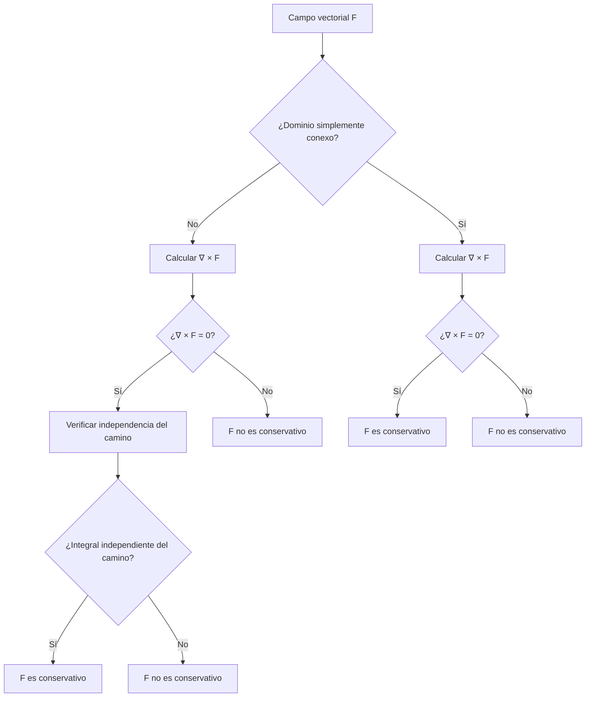

# Matemáticas para Ciencias Aplicadas III - Teoremas de Green y Stokes

## 4.3 Campos conservativos.

---

### Introducción

Los **campos conservativos** son un concepto fundamental en el cálculo vectorial y la física matemática. Un campo vectorial es conservativo si representa una fuerza que conserva la energía mecánica total de un sistema. Estos campos tienen propiedades matemáticas especiales que simplifican enormemente el cálculo de integrales de línea y tienen importantes aplicaciones en física, particularmente en mecánica y electromagnetismo.

### Definición Formal

Un campo vectorial $\vec{F}: D \subseteq \mathbb{R}^n \to \mathbb{R}^n$ se dice **conservativo** si existe una función escalar $\phi: D \subseteq \mathbb{R}^n \to \mathbb{R}$ tal que:

$$\vec{F} = \nabla \phi$$

Donde $\phi$ se denomina **función potencial** de $\vec{F}$ y $\nabla$ es el operador gradiente.

#### Notación

- En $\mathbb{R}^2:$ $\vec{F}(x, y) = P(x, y)\hat{i} + Q(x, y)\hat{j}$ es conservativo si existe $\phi(x, y)$ tal que:

  $$\frac{\partial \phi}{\partial x} = P \quad \text{y} \quad \frac{\partial \phi}{\partial y} = Q$$

- En $\mathbb{R}^3:$ $\vec{F}(x, y, z) = P(x, y, z)\hat{i} + Q(x, y, z)\hat{j} + R(x, y, z)\hat{k}$ es conservativo si existe $\phi(x, y, z)$ tal que:
  
  $$\frac{\partial \phi}{\partial x} = P, \quad \frac{\partial \phi}{\partial y} = Q, \quad \frac{\partial \phi}{\partial z} = R$$

### Caracterización de Campos Conservativos

#### Teorema Fundamental

Para un campo vectorial $\vec{F}$ definido en un conjunto **abierto y conexo** $D,$ las siguientes afirmaciones son equivalentes:

1. $\vec{F}$ es conservativo
2. $\oint_C \vec{F} \cdot d\vec{r} = 0$ para toda curva cerrada $C$ en $D$
3. La integral $\int_C \vec{F} \cdot d\vec{r}$ es independiente del camino en $D$

Además, si $\vec{F}$ es de clase $C^1,$ cualquiera de ellas implica $\nabla \times \vec{F} = \vec{0},$ que en el plano es $\frac{\partial P}{\partial y} = \frac{\partial Q}{\partial x}.$ El recíproco necesita una hipótesis sobre la forma del dominio, como se ve a continuación.

#### Condiciones para Campos Conservativos

##### En $\mathbb{R}^2:$

Si $\vec{F} = P\hat{i} + Q\hat{j}$ es de clase $C^1$ en un conjunto **simplemente conexo** $D,$ entonces:

$$\vec{F} \text{ es conservativo} \iff \frac{\partial P}{\partial y} = \frac{\partial Q}{\partial x} \quad \text{en } D$$

##### En $\mathbb{R}^3:$

Si $\vec{F} = P\hat{i} + Q\hat{j} + R\hat{k}$ es de clase $C^1$ en un conjunto **simplemente conexo** $D,$ entonces:

$$\vec{F} \text{ es conservativo} \iff \nabla \times \vec{F} = \vec{0} \quad \text{en } D$$

Donde $\nabla \times \vec{F}$ es el rotacional de $\vec{F}.$ Un dominio es **simplemente conexo** si es conexo y toda curva cerrada en él se puede contraer a un punto sin salir del dominio. $\mathbb{R}^2,$ $\mathbb{R}^3,$ los discos y las bolas lo son; el plano sin el origen y el espacio sin el eje $z$ no lo son. El espacio sin un punto, en cambio, sí es simplemente conexo.

#### El Contraejemplo Clásico

Sea $\vec{F} = \frac{-y\hat{i} + x\hat{j}}{x^2 + y^2}$ en $\mathbb{R}^2 \setminus \{(0,0)\}.$ Se cumple

$$\frac{\partial P}{\partial y} = \frac{y^2 - x^2}{(x^2 + y^2)^2} = \frac{\partial Q}{\partial x}$$

pero en la circunferencia unitaria, $\vec{r}(t) = (\cos t, \sin t),$

$$\oint_C \vec{F} \cdot d\vec{r} = \int_0^{2\pi} (\sin^2 t + \cos^2 t) \, dt = 2\pi \neq 0$$

así que $\vec{F}$ no es conservativo en ese dominio. Localmente sí lo es: en el semiplano $x > 0$ es el gradiente de $\theta = \arctan\frac{y}{x},$ el ángulo polar, que no se puede definir de forma continua en toda una vuelta alrededor del origen.


### Cálculo de la Función Potencial

#### Método de Integración

Para encontrar $\phi$ tal que $\vec{F} = \nabla\phi:$

1. Integrar $\frac{\partial \phi}{\partial x} = P$ respecto a $x:$

   $$\phi(x, y, z) = \int P(x, y, z) \, dx + g(y, z)$$

2. Derivar respecto a $y$ e igualar a $Q:$

   $$\frac{\partial \phi}{\partial y} = \frac{\partial}{\partial y}\left(\int P \, dx\right) + \frac{\partial g}{\partial y} = Q$$

3. Determinar $g(y, z)$ integrando respecto a $y$
4. Repetir el proceso para $z$

#### Ejemplo de Cálculo

Para $\vec{F} = (2xy + z^3)\hat{i} + (x^2 + 2y)\hat{j} + (3xz^2 + 2z)\hat{k}:$

1. $\frac{\partial \phi}{\partial x} = 2xy + z^3 \Rightarrow \phi = x^2y + xz^3 + g(y, z)$
2. $\frac{\partial \phi}{\partial y} = x^2 + \frac{\partial g}{\partial y} = x^2 + 2y \Rightarrow \frac{\partial g}{\partial y} = 2y$
3. $g(y, z) = y^2 + h(z)$
4. $\frac{\partial \phi}{\partial z} = 3xz^2 + \frac{\partial h}{\partial z} = 3xz^2 + 2z \Rightarrow \frac{\partial h}{\partial z} = 2z$
5. $h(z) = z^2 + C$

Por tanto: $\phi(x, y, z) = x^2y + xz^3 + y^2 + z^2 + C.$ Se comprueba derivando: $\nabla\phi = (2xy + z^3, \; x^2 + 2y, \; 3xz^2 + 2z).$

#### Método de la Integral de Línea

También se puede construir $\phi$ integrando $\vec{F}$ sobre un camino cómodo desde el origen hasta $(x, y, z),$ por ejemplo por segmentos paralelos a los ejes, o por el segmento recto: $\phi(x, y, z) = \int_0^1 \vec{F}(tx, ty, tz) \cdot (x, y, z) \, dt.$

### Implementación Computacional

```python
import sympy as sp

def es_conservativo_2d(P, Q, x, y):
    """
    Verifica la condición ∂P/∂y = ∂Q/∂x (suficiente si el dominio es simplemente conexo)
    """
    return sp.simplify(sp.diff(P, y) - sp.diff(Q, x)) == 0

def es_conservativo_3d(F, variables):
    """
    Verifica si un campo 3D es conservativo
    """
    x, y, z = variables
    P, Q, R = F

    rot_x = sp.diff(R, y) - sp.diff(Q, z)
    rot_y = sp.diff(P, z) - sp.diff(R, x)
    rot_z = sp.diff(Q, x) - sp.diff(P, y)

    return all(sp.simplify(c) == 0 for c in (rot_x, rot_y, rot_z))

def encontrar_potencial(F, variables):
    """
    Encuentra la función potencial de un campo conservativo con el método de integración:
    se integra cada componente y se agrega solo lo que depende de las variables restantes.
    """
    x, y, z = variables
    P, Q, R = F

    phi = sp.integrate(P, x)                        # φ = ∫P dx + g(y, z)
    g_y = sp.simplify(Q - sp.diff(phi, y))          # ∂g/∂y, no debe depender de x
    phi = phi + sp.integrate(g_y, y)                # φ = ... + h(z)
    h_z = sp.simplify(R - sp.diff(phi, z))          # h'(z), solo depende de z
    phi = phi + sp.integrate(h_z, z)

    # Comprobación: el gradiente de φ debe ser F
    assert all(sp.simplify(sp.diff(phi, v) - c) == 0 for v, c in zip(variables, F))
    return phi

# Ejemplo de uso
x, y, z = sp.symbols('x y z')
F = [2*x*y + z**3, x**2 + 2*y, 3*x*z**2 + 2*z]

if es_conservativo_3d(F, [x, y, z]):
    potencial = encontrar_potencial(F, [x, y, z])
    print(f"Función potencial: {potencial}")   # x**2*y + x*z**3 + y**2 + z**2
else:
    print("El campo no es conservativo")
```

### Aplicaciones Físicas

#### 1. Conservación de la Energía

En mecánica, si $\vec{F} = -\nabla V$ (donde $V$ es energía potencial), entonces:

$$E = \frac{1}{2}mv^2 + V = \text{constante}$$

#### 2. Trabajo y Energía Potencial

El trabajo realizado por un campo conservativo es independiente del camino:

$$W = \int_C \vec{F} \cdot d\vec{r} = \phi(B) - \phi(A)$$

#### 3. Flujo Potencial

En fluidodinámica, un campo de velocidades irrotacional en un dominio simplemente conexo es el gradiente de un **potencial de velocidades** $\varphi;$ si además el fluido es incompresible, $\nabla \cdot \nabla\varphi = 0$ y $\varphi$ satisface la ecuación de Laplace.

### Ejemplos Resueltos

#### Ejemplo 1: Campo 2D

Determinar si $\vec{F} = (2xy + y^3)\hat{i} + (x^2 + 3xy^2)\hat{j}$ es conservativo.

**Solución:**

$$\frac{\partial P}{\partial y} = 2x + 3y^2, \quad \frac{\partial Q}{\partial x} = 2x + 3y^2$$

Como son iguales y el dominio es $\mathbb{R}^2$ (simplemente conexo), el campo es conservativo.

#### Ejemplo 2: Campo 3D no Conservativo

Verificar que $\vec{F} = y\hat{i} + z\hat{j} + x\hat{k}$ no es conservativo.

**Solución:**

$$ \nabla \times \vec{F} = \begin{vmatrix} \hat{i} & \hat{j} & \hat{k} \\ \frac{\partial}{\partial x} & \frac{\partial}{\partial y} & \frac{\partial}{\partial z} \\ y & z & x \end{vmatrix} = -\hat{i} - \hat{j} - \hat{k} \neq \vec{0} $$

#### Ejemplo 3: Campo Gravitacional
El campo gravitacional $\vec{F} = -\frac{GMm}{r^3}\vec{r}$ es conservativo con potencial $\phi = \frac{GMm}{r},$ porque $\nabla\left(\frac{1}{r}\right) = -\frac{\vec{r}}{r^3}.$ La energía potencial de la física es $V = -\phi = -\frac{GMm}{r}.$ El dominio $\mathbb{R}^3 \setminus \{0\}$ no contiene el origen, pero es simplemente conexo, así que no hay problema.

### Ejercicios Propuestos

#### Ejercicio 1
Determinar si los siguientes campos son conservativos y encontrar el potencial cuando sea posible:
a) $\vec{F} = (2x + e^y)\hat{i} + (xe^y + 2y)\hat{j}$
b) $\vec{F} = (y^2z^3)\hat{i} + (2xyz^3)\hat{j} + (3xy^2z^2)\hat{k}$
c) $\vec{F} = (y + z)\hat{i} + (x + z)\hat{j} + (x + y)\hat{k}$

#### Ejercicio 2
Calcular $\int_C \vec{F} \cdot d\vec{r}$ donde $\vec{F} = (2xy + y^2)\hat{i} + (x^2 + 2xy)\hat{j}$ y $C$ es cualquier camino desde $(0, 0)$ hasta $(1, 2).$

#### Ejercicio 3
Demostrar que si $\vec{F}$ es conservativo y de clase $C^2,$ entonces $\nabla \times \vec{F} = \vec{0}.$

#### Ejercicio 4
Encontrar el trabajo realizado por $\vec{F} = (2xy + z^3)\hat{i} + (x^2 + 2y)\hat{j} + (3xz^2 + 2z)\hat{k}$ al mover una partícula desde $(0, 0, 0)$ hasta $(1, 1, 1).$

#### Ejercicio 5
Investigar si el campo $\vec{F} = \frac{-y\hat{i} + x\hat{j}}{x^2 + y^2}$ es conservativo en $\mathbb{R}^2 - \{(0, 0)\}.$

#### Soluciones

1. a) $\frac{\partial P}{\partial y} = e^y = \frac{\partial Q}{\partial x}:$ conservativo, $\phi = x^2 + xe^y + y^2.$ b) Las tres componentes del rotacional se anulan, por ejemplo $\frac{\partial R}{\partial y} - \frac{\partial Q}{\partial z} = 6xyz^2 - 6xyz^2 = 0:$ conservativo, $\phi = xy^2z^3.$ c) Conservativo, $\phi = xy + yz + zx.$
2. $\vec{F} = \nabla(x^2y + xy^2),$ así que la integral vale $\phi(1, 2) - \phi(0, 0) = 2 + 4 = 6.$
3. Si $\vec{F} = \nabla\phi,$ la primera componente del rotacional es $\phi_{zy} - \phi_{yz} = 0$ por el teorema de Schwarz; las demás son análogas.
4. Con el potencial del ejemplo de cálculo, $\phi(1,1,1) - \phi(0,0,0) = 1 + 1 + 1 + 1 = 4.$
5. No es conservativo: aunque $\frac{\partial P}{\partial y} = \frac{\partial Q}{\partial x},$ su circulación alrededor de la circunferencia unitaria es $2\pi.$ Ver el contraejemplo clásico.

### Diagrama de Flujo para Análisis de Campos Conservativos



### Propiedades Importantes

1. **Superposición**: La suma de campos conservativos es conservativa
2. **Multiplicación por escalar**: Si $\vec{F}$ es conservativo y $c$ es constante, entonces $c\vec{F}$ es conservativo
3. **Composición**: El gradiente de cualquier función escalar es un campo conservativo

### Campos No Conservativos

En un campo no conservativo el trabajo depende del camino y no existe una energía potencial. Ejemplos importantes:
- Campos magnéticos alrededor de corrientes: $\nabla \times \vec{B} = \mu_0\vec{J} \neq \vec{0}.$
- Campos eléctricos inducidos por un campo magnético variable: $\nabla \times \vec{E} = -\frac{\partial \vec{B}}{\partial t}.$
- Campos rotacionales: $\vec{F} = (-y, x, 0),$ con $\nabla \times \vec{F} = (0, 0, 2).$

La fricción, $\vec{F} = -k\vec{v},$ también es no conservativa y disipa energía, aunque depende de la velocidad y no solo de la posición, así que no es un campo vectorial en el sentido de este tema.

### Referencias

1. Marsden, J. E., & Tromba, A. J. (2012). *Vector Calculus*. W. H. Freeman.
2. Stewart, J. (2008). *Cálculo de varias variables*. Cengage Learning.
3. Arfken, G. B., Weber, H. J., & Harris, F. E. (2013). *Mathematical Methods for Physicists*. Academic Press.
4. Griffiths, D. J. (2017). *Introduction to Electrodynamics*. Cambridge University Press.

### Consejos de Estudio

1. **Domina el cálculo de rotacionales** en 2D y 3D
2. **Practica la integración** para encontrar funciones potenciales
3. **Comprende la importancia** de la topología del dominio
4. **Visualiza campos** usando software como Mathematica o Python
5. **Relaciona con aplicaciones físicas** para una comprensión más intuitiva
