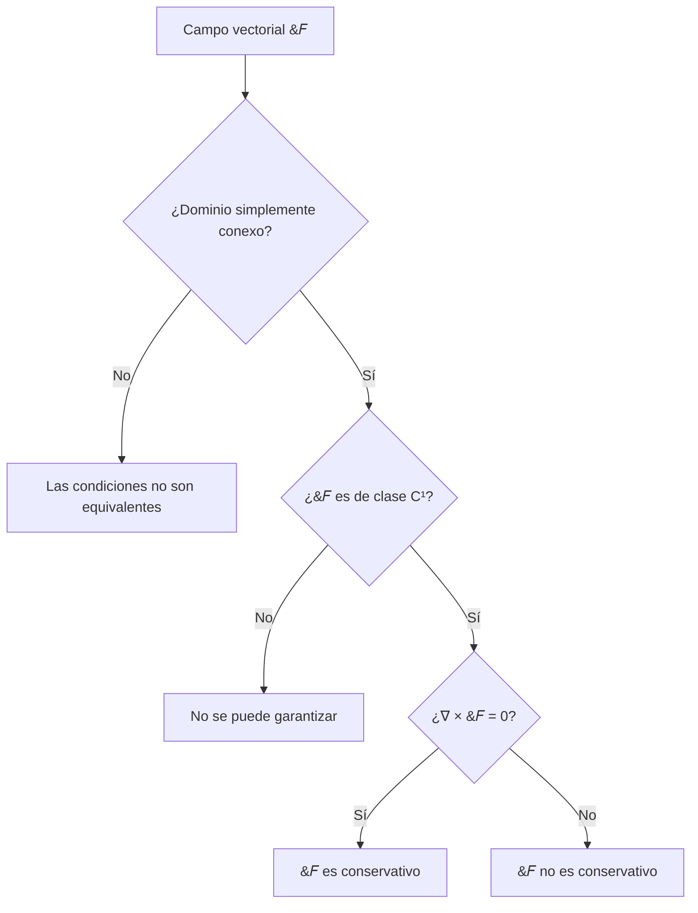

# Matemáticas para Ciencias Aplicadas III - Teoremas de Green y Stokes

## 4.3 Campos conservativos.

---

### Introducción

Los **campos conservativos** son un concepto fundamental en el cálculo vectorial y la física matemática. Un campo vectorial es conservativo si representa una fuerza que conserva la energía mecánica total de un sistema. Estos campos tienen propiedades matemáticas especiales que simplifican enormemente el cálculo de integrales de línea y tienen importantes aplicaciones en física, particularly en mecánica y electromagnetismo.

### Definición Formal

Un campo vectorial $\vec{F}: D \subseteq \mathbb{R}^n \to \mathbb{R}^n$ se dice **conservativo** si existe una función escalar $\phi: D \subseteq \mathbb{R}^n \to \mathbb{R}$ tal que:

$$\vec{F} = \nabla \phi$$

Donde $\phi$ se denomina **función potencial** de $\vec{F}$ y $\nabla$ es el operador gradiente.

#### Notación

- En $\mathbb{R}^2$: $\vec{F}(x, y) = P(x, y)\hat{i} + Q(x, y)\hat{j}$ es conservativo si existe $\phi(x, y)$ tal que:

  $$\frac{\partial \phi}{\partial x} = P \quad \text{y} \quad \frac{\partial \phi}{\partial y} = Q$$

- En $\mathbb{R}^3$: $\vec{F}(x, y, z) = P(x, y, z)\hat{i} + Q(x, y, z)\hat{j} + R(x, y, z)\hat{k}$ es conservativo si existe $\phi(x, y, z)$ tal que:
  
  $$\frac{\partial \phi}{\partial x} = P, \quad \frac{\partial \phi}{\partial y} = Q, \quad \frac{\partial \phi}{\partial z} = R$$

### Caracterización de Campos Conservativos

#### Teorema Fundamental

Para un campo vectorial $\vec{F}$ definido en un conjunto **abierto y conexo** $D$, las siguientes afirmaciones son equivalentes:

1. $\vec{F}$ es conservativo
2. $\oint_C \vec{F} \cdot d\vec{r} = 0$ para toda curva cerrada $C$ en $D$
3. La integral $\int_C \vec{F} \cdot d\vec{r}$ es independiente del camino en $D$

#### Condiciones para Campos Conservativos

##### En $\mathbb{R}^2$:

Si $\vec{F} = P\hat{i} + Q\hat{j}$ es de clase $C^1$ en un conjunto **simplemente conexo** $D$, entonces:

$$\vec{F} \text{ es conservativo} \iff \frac{\partial P}{\partial y} = \frac{\partial Q}{\partial x} \quad \text{en } D$$

##### En $\mathbb{R}^3$:

Si $\vec{F} = P\hat{i} + Q\hat{j} + R\hat{k}$ es de clase $C^1$ en un conjunto **simplemente conexo** $D$, entonces:

$$\vec{F} \text{ es conservativo} \iff \nabla \times \vec{F} = \vec{0} \quad \text{en } D$$

Donde $\nabla \times \vec{F}$ es el rotacional de $\vec{F}$.



### Cálculo de la Función Potencial

#### Método de Integración

Para encontrar $\phi$ tal que $\vec{F} = \nabla\phi$:

1. Integrar $\frac{\partial \phi}{\partial x} = P$ respecto a $x$:

   $$\phi(x, y, z) = \int P(x, y, z)dx + g(y, z)$$

2. Derivar respecto a $y$ e igualar a $Q$:

   $$\frac{\partial \phi}{\partial y} = \frac{\partial}{\partial y}\left(\int Pdx\right) + \frac{\partial g}{\partial y} = Q$$

3. Determinar $g(y, z)$ integrando respecto a $y$
4. Repetir el proceso para $z$

#### Ejemplo de Cálculo

Para $\vec{F} = (2xy + z^3)\hat{i} + (x^2 + 2y)\hat{j} + (3xz^2 + 2z)\hat{k}$:

1. $\frac{\partial \phi}{\partial x} = 2xy + z^3 \Rightarrow \phi = x^2y + xz^3 + g(y, z)$
2. $\frac{\partial \phi}{\partial y} = x^2 + \frac{\partial g}{\partial y} = x^2 + 2y \Rightarrow \frac{\partial g}{\partial y} = 2y$
3. $g(y, z) = y^2 + h(z)$
4. $\frac{\partial \phi}{\partial z} = 3xz^2 + \frac{\partial h}{\partial z} = 3xz^2 + 2z \Rightarrow \frac{\partial h}{\partial z} = 2z$
5. $h(z) = z^2 + C$

Por tanto: $\phi(x, y, z) = x^2y + xz^3 + y^2 + z^2 + C$

### Implementación Computacional

```python
import sympy as sp

def es_conservativo_2d(P, Q, x, y):
    """
    Verifica si un campo 2D es conservativo
    """
    return sp.diff(P, y) == sp.diff(Q, x)

def es_conservativo_3d(F, variables):
    """
    Verifica si un campo 3D es conservativo
    """
    x, y, z = variables
    P, Q, R = F

    rot_x = sp.diff(R, y) - sp.diff(Q, z)
    rot_y = sp.diff(P, z) - sp.diff(R, x)
    rot_z = sp.diff(Q, x) - sp.diff(P, y)

    return rot_x == 0 and rot_y == 0 and rot_z == 0

def encontrar_potencial(F, variables):
    """
    Encuentra la función potencial de un campo conservativo
    """
    x, y, z = variables
    P, Q, R = F

    # Integrar P respecto a x
    phi = sp.integrate(P, x) + sp.Function('g')(y, z)

    # Derivar respecto a y y comparar con Q
    dphi_dy = sp.diff(phi, y)
    ecuacion_y = sp.Eq(dphi_dy, Q)

    # Resolver para g(y, z)
    sol_y = sp.dsolve(ecuacion_y, sp.Function('g')(y, z))
    g_y = sol_y.rhs

    # Actualizar phi
    phi = phi.subs(sp.Function('g')(y, z), g_y)

    # Derivar respecto a z y comparar con R
    dphi_dz = sp.diff(phi, z)
    ecuacion_z = sp.Eq(dphi_dz, R)

    # Resolver la ecuación final
    sol_z = sp.dsolve(ecuacion_z)

    return sol_z.rhs if sol_z else phi

# Ejemplo de uso
x, y, z = sp.symbols('x y z')
F = [2*x*y + z**3, x**2 + 2*y, 3*x*z**2 + 2*z]

if es_conservativo_3d(F, [x, y, z]):
    potencial = encontrar_potencial(F, [x, y, z])
    print(f"Función potencial: {potencial}")
else:
    print("El campo no es conservativo")
```

### Aplicaciones Físicas

#### 1. Conservación de la Energía

En mecánica, si $\vec{F} = -\nabla V$ (donde $V$ es energía potencial), entonces:

$$E = \frac{1}{2}mv^2 + V = \text{constante}$$

#### 2. Trabajo y Energía Potencial

El trabajo realizado por un campo conservativo es independiente del camino:

$$W = \int_C \vec{F} \cdot d\vec{r} = \phi(B) - \phi(A)$$

#### 3. Ley de Conservación

En fluidodinámica, los campos de velocidad irrotacionales son conservativos.

### Ejemplos Resueltos

#### Ejemplo 1: Campo 2D

Determinar si $\vec{F} = (2xy + y^3)\hat{i} + (x^2 + 3xy^2)\hat{j}$ es conservativo.

**Solución:**

$$\frac{\partial P}{\partial y} = 2x + 3y^2, \quad \frac{\partial Q}{\partial x} = 2x + 3y^2$$

Como son iguales y el dominio es $\mathbb{R}^2$ (simplemente conexo), el campo es conservativo.

#### Ejemplo 2: Campo 3D no Conservativo

Verificar que $\vec{F} = y\hat{i} + z\hat{j} + x\hat{k}$ no es conservativo.

**Solución:**

$$ \nabla \times \vec{F} = \begin{vmatrix} \hat{i} & \hat{j} & \hat{k} \\\ \frac{\partial}{\partial x} & \frac{\partial}{\partial y} & \frac{\partial}{\partial z} \\\ y & z & x \end{vmatrix} = -\hat{i} - \hat{j} - \hat{k} \neq \vec{0} $$

#### Ejemplo 3: Campo Gravitational
El campo gravitacional $\vec{F} = -\frac{GMm}{r^3}\vec{r}$ es conservativo con potencial $\phi = \frac{GMm}{r}$.

### Ejercicios Propuestos

#### Ejercicio 1
Determinar si los siguientes campos son conservativos y encontrar el potencial cuando sea posible:
a) $\vec{F} = (2x + e^y)\hat{i} + (xe^y + 2y)\hat{j}$
b) $\vec{F} = (y^2z^3)\hat{i} + (2xyz^3)\hat{j} + (3xy^2z^2)\hat{k}$
c) $\vec{F} = (y + z)\hat{i} + (x + z)\hat{j} + (x + y)\hat{k}$

#### Ejercicio 2
Calcular $\int_C \vec{F} \cdot d\vec{r}$ donde $\vec{F} = (2xy + y^2)\hat{i} + (x^2 + 2xy)\hat{j}$ y $C$ es cualquier camino desde $(0, 0)$ hasta $(1, 2)$.

#### Ejercicio 3
Demostrar que si $\vec{F}$ es conservativo y de clase $C^2$, entonces $\nabla \times \vec{F} = \vec{0}$.

#### Ejercicio 4
Encontrar el trabajo realizado por $\vec{F} = (2xy + z^3)\hat{i} + (x^2 + 2y)\hat{j} + (3xz^2 + 2z)\hat{k}$ al mover una partícula desde $(0, 0, 0)$ hasta $(1, 1, 1)$.

#### Ejercicio 5
Investigar si el campo $\vec{F} = \frac{-y\hat{i} + x\hat{j}}{x^2 + y^2}$ es conservativo en $\mathbb{R}^2 - \{(0, 0)\}$.

### Diagrama de Flujo para Análisis de Campos Conservativos


### Propiedades Importantes

1. **Superposición**: La suma de campos conservativos es conservativa
2. **Multiplicación por escalar**: Si $\vec{F}$ es conservativo y $c$ es constante, entonces $c\vec{F}$ es conservativo
3. **Composición**: El gradiente de cualquier función escalar es un campo conservativo

### Campos No Conservativos

Un campo no conservativo disipa energía. Ejemplos importantes:
- Campos magnéticos: $\nabla \times \vec{B} = \mu_0\vec{J}$
- Campos de fricción: $\vec{F} = -k\vec{v}$
- Campos rotacionales: $\vec{F} = (-y, x, 0)$

### Referencias

1. Marsden, J. E., & Tromba, A. J. (2012). *Vector Calculus*. W. H. Freeman.
2. Stewart, J. (2008). *Cálculo de varias variables*. Cengage Learning.
3. Arfken, G. B., Weber, H. J., & Harris, F. E. (2013). *Mathematical Methods for Physicists*. Academic Press.
4. Griffiths, D. J. (2017). *Introduction to Electrodynamics*. Cambridge University Press.

### Consejos de Estudio

1. **Domina el cálculo de rotacionales** en 2D y 3D
2. **Practica la integración** para encontrar funciones potenciales
3. **Comprende la importancia** de la topología del dominio
4. **Visualiza campos** usando software como Mathematica o Python
5. **Relaciona con aplicaciones físicas** para una comprensión más intuitiva
