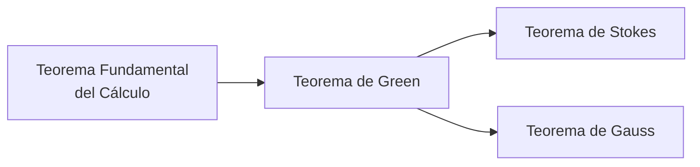
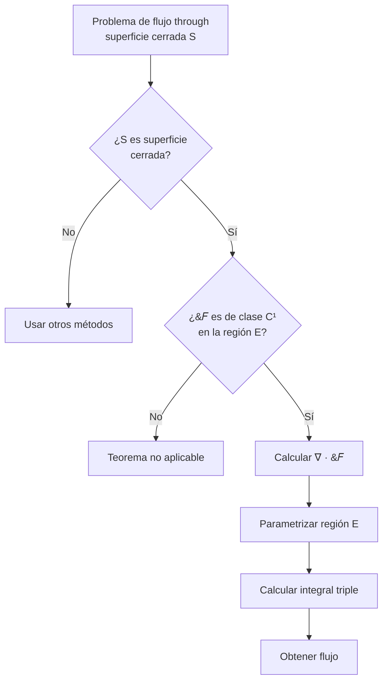

# Matemáticas para Ciencias Aplicadas III - Teoremas de Green y Stokes

## 4.4 Teorema de Gauss.

---

### Introducción

El **Teorema de Gauss**, también conocido como **Teorema de la Divergencia**, es uno de los resultados fundamentales del cálculo vectorial que establece una relación entre el flujo de un campo vectorial a través de una superficie cerrada y la integral de la divergencia de dicho campo sobre el volumen encerrado por la superficie. Este teorema tiene aplicaciones cruciales en física, particularly en electromagnetismo, fluidodinámica y teoría de campos.

### Conceptos Preliminares

#### Divergencia de un Campo Vectorial

La divergencia de un campo vectorial $\vec{F} = P\hat{i} + Q\hat{j} + R\hat{k}$ es un escalar definido como:

$$\nabla \cdot \vec{F} = \frac{\partial P}{\partial x} + \frac{\partial Q}{\partial y} + \frac{\partial R}{\partial z}$$

La divergencia mide la tendencia de un campo a "divergir" o "converger" en un punto.

#### Superficie Cerrada

Una superficie $S$ es cerrada si forma el límite completo de una región sólida $E$ en el espacio. Ejemplos: esfera, cubo, elipsoide.

#### Vector Normal Unitario Exterior

Para una superficie cerrada, el vector normal unitario $\hat{n}$ apunta hacia el exterior de la región encerrada.

```mermaid
flowchart TD
    A[Superficie Cerrada S] --> B[Region Encerrada E]
    B --> C[Vector Normal &#774;n<br>apunta hacia el exterior]
```



### Enunciado del Teorema de Gauss

Sea $E$ una región sólida simple en $\mathbb{R}^3$ y sea $S$ la superficie frontera de $E$, orientada positivamente (hacia el exterior). Si $\vec{F}$ es un campo vectorial cuyas componentes tienen derivadas parciales continuas en una región abierta que contiene a $E$, entonces:

$$\oiint_S \vec{F} \cdot d\vec{S} = \iiint_E (\nabla \cdot \vec{F}) dV$$

#### Formas Equivalentes

$$\oiint_S \vec{F} \cdot \hat{n} dS = \iiint_E (\nabla \cdot \vec{F}) dV$$

$$\oiint_S (P dy dz + Q dz dx + R dx dy) = \iiint_E \left(\frac{\partial P}{\partial x} + \frac{\partial Q}{\partial y} + \frac{\partial R}{\partial z}\right) dx dy dz$$

### Relación con Otros Teoremas

El Teorema de Gauss es la generalización tridimensional del Teorema de Green:



### Aplicaciones del Teorema de Gauss

#### 1. Cálculo de Flujos

Simplifica el cálculo del flujo a través de superficies cerradas.

#### 2. Ley de Gauss en Electromagnetismo

$$\oiint_S \vec{E} \cdot d\vec{S} = \frac{Q_{\text{enc}}}{\varepsilon_0}$$

#### 3. Conservación de Masa en Fluidos

$$\frac{\partial \rho}{\partial t} + \nabla \cdot (\rho \vec{v}) = 0$$

#### 4. Ecuación de Continuidad

$$\oiint_S \vec{J} \cdot d\vec{S} = -\frac{d}{dt} \iiint_V \rho dV$$

### Ejemplos Resueltos

#### Ejemplo 1: Flujo a través de una Esfera

Calcular el flujo de $\vec{F} = x^3\hat{i} + y^3\hat{j} + z^3\hat{k}$ a través de la esfera $x^2 + y^2 + z^2 = a^2$.

**Solución:**

1. Calculamos la divergencia:

   $$\nabla \cdot \vec{F} = \frac{\partial}{\partial x}(x^3) + \frac{\partial}{\partial y}(y^3) + \frac{\partial}{\partial z}(z^3) = 3x^2 + 3y^2 + 3z^2 = 3(x^2 + y^2 + z^2)$$

2. Aplicamos el Teorema de Gauss:

   $$\oiint_S \vec{F} \cdot d\vec{S} = \iiint_E 3(x^2 + y^2 + z^2) dV$$

3. Usamos coordenadas esféricas:

   $$= 3 \int_0^{2\pi} \int_0^{\pi} \int_0^a \rho^2 \cdot \rho^2 \sin\phi d\rho d\phi d\theta = 3 \int_0^{2\pi} d\theta \int_0^{\pi} \sin\phi d\phi \int_0^a \rho^4 d\rho$$

   $$= 3 \cdot 2\pi \cdot 2 \cdot \frac{a^5}{5} = \frac{12\pi a^5}{5}$$

#### Ejemplo 2: Verificación del Teorema

Verificar el Teorema de Gauss para $\vec{F} = x\hat{i} + y\hat{j} + z\hat{k}$ sobre el cubo $0 \leq x,y,z \leq a$.

**Solución:**

1. Divergencia: $\nabla \cdot \vec{F} = 1 + 1 + 1 = 3$

2. Integral de volumen:

   $$\iiint_E 3 dV = 3 \cdot a^3 = 3a^3$$

3. Calculamos el flujo directamente a través de las 6 caras:
   - Cara x=0: $\vec{F} \cdot (-\hat{i}) = -x = 0$, flujo = 0
   - Cara x=a: $\vec{F} \cdot \hat{i} = x = a$, flujo = $a \cdot a^2 = a^3$
   - Similar para otras caras: total = $3a^3$

### Implementación Computacional

```python
import sympy as sp
import numpy as np

def divergencia(F, variables):
    """
    Calcula la divergencia de un campo vectorial F

    Parameters:
    F: lista de componentes [P, Q, R] del campo vectorial
    variables: lista de variables [x, y, z]
    """
    x, y, z = variables
    P, Q, R = F

    div = sp.diff(P, x) + sp.diff(Q, y) + sp.diff(R, z)
    return div

def teorema_gauss(F, variables, region):
    """
    Aplica el Teorema de Gauss para calcular el flujo
    """
    # Calcular la divergencia
    div_F = divergencia(F, variables)

    # Calcular la integral triple de la divergencia
    resultado = sp.integrate(div_F, (variables[0], region[0], region[1]),
                            (variables[1], region[2], region[3]),
                            (variables[2], region[4], region[5]))

    return resultado

# Ejemplo de uso
x, y, z = sp.symbols('x y z')
F = [x**3, y**3, z**3]  # Campo vectorial

# Para el cubo [0,a] x [0,a] x [0,a]
a = sp.symbols('a', positive=True)
resultado = teorema_gauss(F, [x, y, z], [0, a, 0, a, 0, a])
print(f"Flujo a través del cubo: {resultado}")
```

### Ejercicios Propuestos

#### Ejercicio 1

Verificar el Teorema de Gauss para $\vec{F} = x^2\hat{i} + y^2\hat{j} + z^2\hat{k}$ sobre el cilindro sólido $x^2 + y^2 \leq 4$, $0 \leq z \leq 3$.

#### Ejercicio 2

Calcular $\oiint_S \vec{F} \cdot d\vec{S}$ donde $\vec{F} = (x^3 + y\sin z)\hat{i} + (y^3 + z\sin x)\hat{j} + 3z\hat{k}$ y $S$ es la superficie de la esfera $x^2 + y^2 + z^2 = 9$.

#### Ejercicio 3

Usar el Teorema de Gauss para evaluar el flujo de $\vec{F} = xy\hat{i} + yz\hat{j} + zx\hat{k}$ a través de la superficie del tetraedro limitado por los planos $x=0$, $y=0$, $z=0$ y $x+y+z=1$.

#### Ejercicio 4

Demostrar que para cualquier campo vectorial $\vec{F}$ de clase $C^1$ y cualquier superficie cerrada $S$:

$$\oiint_S (\nabla \times \vec{F}) \cdot d\vec{S} = 0$$

#### Ejercicio 5

Calcular el flujo del campo $\vec{F} = \frac{\vec{r}}{|\vec{r}|^3}$ (campo gravitacional/eléctrico) a través de una superficie cerrada que no contiene al origen.

### Diagrama de Flujo para Aplicar el Teorema de Gauss



### Aplicaciones Físicas Importantes

#### 1. Electrostática: Ley de Gauss

$$\oiint_S \vec{E} \cdot d\vec{S} = \frac{Q_{\text{enc}}}{\varepsilon_0}$$

#### 2. Magnetostática: Ley de Gauss para el Magnetismo

$$\oiint_S \vec{B} \cdot d\vec{S} = 0$$

#### 3. Fluidodinámica: Ecuación de Continuidad

$$\frac{\partial \rho}{\partial t} + \nabla \cdot (\rho \vec{v}) = 0$$

#### 4. Transferencia de Calor

Ley de Fourier para la conducción de calor.

### Relación con la Ley de Conservación

El Teorema de Gauss es fundamental para formular leyes de conservación locales:


### Extensiones y Generalizaciones

#### Teorema de la Divergencia en 2D (Teorema de Green)

$$\oint_C (P dx + Q dy) = \iint_D \left(\frac{\partial Q}{\partial x} - \frac{\partial P}{\partial y}\right) dA$$

#### Teorema de Stokes

$$\oint_C \vec{F} \cdot d\vec{r} = \iint_S (\nabla \times \vec{F}) \cdot d\vec{S}$$

### Referencias

1. Marsden, J. E., & Tromba, A. J. (2012). _Vector Calculus_. W. H. Freeman.
2. Stewart, J. (2008). _Cálculo de varias variables_. Cengage Learning.
3. Griffiths, D. J. (2017). _Introduction to Electrodynamics_. Cambridge University Press.
4. Arfken, G. B., Weber, H. J., & Harris, F. E. (2013). _Mathematical Methods for Physicists_. Academic Press.

### Consejos de Estudio

1. **Domina el cálculo de divergencias** de campos vectoriales
2. **Practica la parametrización** de volúmenes comunes
3. **Comprende la orientación** de superficies cerradas
4. **Verifica siempre** las condiciones de aplicabilidad del teorema
5. **Relaciona con aplicaciones físicas** para una comprensión más intuitiva
