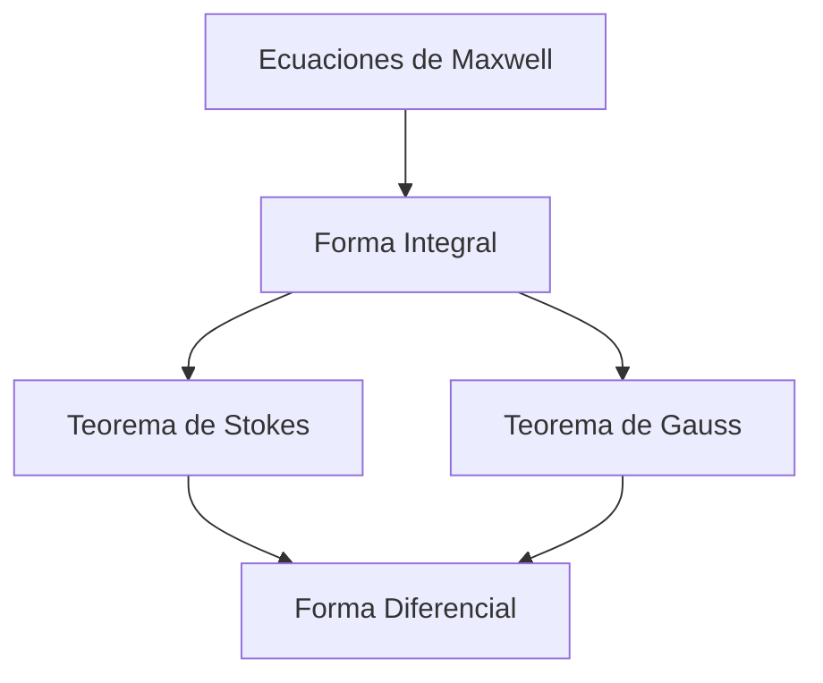
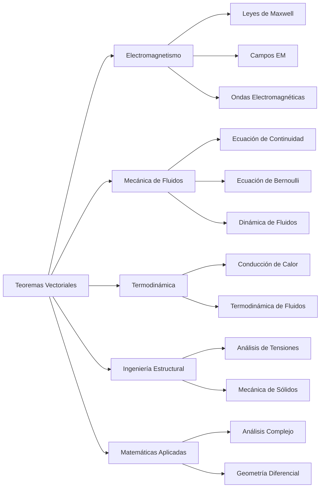

# Matemáticas para Ciencias Aplicadas III - Teoremas de Green y Stokes

## 4.5 Aplicaciones.

---

### Introducción

Los teoremas de Green, Stokes y Gauss son herramientas fundamentales del cálculo vectorial con aplicaciones profundas en múltiples áreas de la ciencia e ingeniería. Estas aplicaciones van desde la física teórica hasta la ingeniería práctica, proporcionando marcos matemáticos para modelar fenómenos naturales y sistemas tecnológicos.

### Marco Teórico Resumido

#### Teorema de Green

$$\oint_C (P \, dx + Q \, dy) = \iint_D \left(\frac{\partial Q}{\partial x} - \frac{\partial P}{\partial y}\right) dA$$

#### Teorema de Stokes

$$\oint_C \vec{F} \cdot d\vec{r} = \iint_S (\nabla \times \vec{F}) \cdot d\vec{S}$$

#### Teorema de Gauss

$$\oiint_S \vec{F} \cdot d\vec{S} = \iiint_E (\nabla \cdot \vec{F}) \, dV$$

**El método general.** Una ley física expresada en forma integral vale para *toda* curva, superficie o región. Al aplicar Stokes o Gauss se obtiene una igualdad del tipo $\iiint_V g \, dV = 0$ para toda región $V;$ si $g$ es continua, eso obliga a que $g = 0$ en cada punto. Así se pasa de la forma integral a la forma diferencial de una ley.

### Aplicaciones en Electromagnetismo

#### Ley de Faraday

$$\oint_C \vec{E} \cdot d\vec{l} = -\frac{d}{dt} \iint_S \vec{B} \cdot d\vec{S}$$

#### Ley de Ampère-Maxwell

$$\oint_C \vec{B} \cdot d\vec{l} = \mu_0 \iint_S \left(\vec{J} + \varepsilon_0 \frac{\partial \vec{E}}{\partial t}\right) \cdot d\vec{S}$$

#### Ley de Gauss para Electricidad

$$\oiint_S \vec{E} \cdot d\vec{S} = \frac{Q_{\text{enc}}}{\varepsilon_0}$$

#### Ley de Gauss para Magnetismo

$$\oiint_S \vec{B} \cdot d\vec{S} = 0$$

Por ejemplo, aplicando Gauss a la ley de Gauss eléctrica, $\iiint_V \nabla \cdot \vec{E} \, dV = \frac{1}{\varepsilon_0}\iiint_V \rho \, dV$ para toda región $V,$ de donde $\nabla \cdot \vec{E} = \frac{\rho}{\varepsilon_0}.$ Del mismo modo, Stokes convierte la ley de Faraday en $\nabla \times \vec{E} = -\frac{\partial \vec{B}}{\partial t}.$



### Aplicaciones en Mecánica de Fluidos

#### Ecuación de Continuidad

$$\frac{\partial \rho}{\partial t} + \nabla \cdot (\rho \vec{v}) = 0$$

#### Teorema de Transporte de Reynolds

Para un volumen $V(t)$ que se mueve con el fluido,

$$\frac{d}{dt} \iiint_{V(t)} \rho \phi \, dV = \iiint_{V} \frac{\partial}{\partial t}(\rho \phi) \, dV + \oiint_S \rho \phi (\vec{v} \cdot \hat{n}) \, dS$$

El último término, el flujo a través de la frontera, se convierte con Gauss en $\iiint_V \nabla \cdot (\rho\phi\vec{v}) \, dV.$ Con $\phi = 1$ y conservación de la masa se obtiene la ecuación de continuidad.

#### Ecuación de Bernoulli

Para un flujo estacionario, incompresible y sin viscosidad, a lo largo de cada línea de corriente

$$\frac{p}{\rho} + \frac{v^2}{2} + gz = \text{constante}$$

Si además el flujo es **irrotacional**, $\vec{v} = \nabla\varphi$ es un campo conservativo y la constante es la misma en todo el fluido, no solo sobre cada línea de corriente.

### Aplicaciones en Termodinámica

#### Ley de Fourier para Conducción de Calor

Con $\vec{q} = -k\nabla T$ y $k$ constante,

$$\oiint_S \vec{q} \cdot d\vec{S} = \iiint_V \nabla \cdot \vec{q} \, dV = -\iiint_V k \nabla^2 T \, dV$$

En estado estacionario y sin fuentes de calor, el flujo neto por cualquier superficie cerrada es cero, así que $\nabla^2 T = 0:$ la temperatura es una función armónica.

#### Primera Ley de la Termodinámica (volumen de control)

$$\frac{dE_{\text{vc}}}{dt} = \dot{Q} - \dot{W} - \oiint_S \rho \left(h + \frac{v^2}{2} + gz\right) \vec{v} \cdot d\vec{S}$$

Con la normal exterior, la integral es la energía que **sale** con el fluido; por eso lleva signo menos.

### Aplicaciones en Ingeniería Estructural

#### Teorema de Reciprocidad de Maxwell-Betti

En un cuerpo elástico lineal, el trabajo que hacen las cargas del sistema 1 sobre los desplazamientos producidos por el sistema 2 es igual al que hacen las cargas del sistema 2 sobre los desplazamientos del sistema 1. Su demostración usa el teorema de la divergencia aplicado al tensor de esfuerzos.

#### Análisis de Tensiones

Si $\sigma$ es el tensor de esfuerzos y $\vec{f}$ la fuerza por unidad de volumen, el equilibrio de cualquier porción $V$ del cuerpo exige que la fuerza en la superficie más la del volumen sumen cero:

$$\oiint_S \sigma \hat{n} \, dS + \iiint_V \vec{f} \, dV = \vec{0}$$

Con el teorema de la divergencia, aplicado a cada fila de $\sigma,$ se obtiene la ecuación de equilibrio local $\nabla \cdot \sigma + \vec{f} = \vec{0}.$

### Implementación Computacional

```python
import sympy as sp
import numpy as np

def calcular_flujo_electrico(carga, epsilon_0=8.854e-12):
    """Flujo eléctrico a través de una superficie cerrada (ley de Gauss)."""
    return carga / epsilon_0

def fem_inducida(B_t, area):
    """FEM en una espira plana con campo uniforme B(t) perpendicular: -dΦ/dt."""
    t = sp.symbols('t')
    flujo = B_t(t) * area
    return -sp.diff(flujo, t)

def residuo_continuidad(rho, v, x, y, z, t):
    """∂ρ/∂t + ∇·(ρv). Es cero si ρ y v describen un flujo que conserva la masa."""
    rv = [rho * c for c in v]
    return sp.simplify(sp.diff(rho, t) + sp.diff(rv[0], x) + sp.diff(rv[1], y) + sp.diff(rv[2], z))

# Ejemplo: Ley de Gauss para una carga puntual
q = 1e-9  # 1 nC
print(f"Flujo eléctrico: {calcular_flujo_electrico(q):.4e} N·m²/C")

# Ejemplo 2: B = 0.5 t² T sobre una espira de radio 0.1 m
print("FEM:", fem_inducida(lambda t: sp.Rational(1, 2) * t**2, sp.pi * sp.Rational(1, 10)**2))  # -0.01*pi*t

# Ejemplo 3 y ejercicio 3
x, y, z, t = sp.symbols('x y z t')
print("Residuo ejemplo 3:", residuo_continuidad(1000 * (1 + t / 10), [2*x, 3*y, 0], x, y, z, t))
print("Divergencia ejercicio 3:", sp.diff(2*x*y, x) + sp.diff(3*y*z, y) + sp.diff(z**2, z))
```

### Ejemplos Resueltos

#### Ejemplo 1: Campo Eléctrico de una Esfera

Calcular el campo eléctrico de una esfera conductora de radio $R$ con carga $Q.$

**Solución:**

1. Por simetría, $\vec{E} = E(r)\hat{r}$
2. Aplicamos Ley de Gauss: $\oiint_S \vec{E} \cdot d\vec{S} = \frac{Q_{\text{enc}}}{\varepsilon_0}$
3. Para $r > R,$ con una esfera gaussiana de radio $r:$ $E(r) \cdot 4\pi r^2 = \frac{Q}{\varepsilon_0}$
4. $\vec{E} = \frac{Q}{4\pi\varepsilon_0 r^2} \hat{r},$ el mismo campo que una carga puntual en el centro
5. Para $r < R$ la carga encerrada es cero, porque en un conductor la carga está en la superficie: $\vec{E} = \vec{0}.$

#### Ejemplo 2: Flujo Magnético Variable

Una espira circular de radio $0.1$ m, en el plano $xy,$ está en un campo magnético uniforme $\vec{B} = 0.5t^2 \hat{z}$ T. Calcular la fem inducida.

**Solución:**

1. Flujo magnético: $\Phi_B = \iint_S \vec{B} \cdot d\vec{S} = B \cdot \pi r^2 = 0.5t^2 \cdot \pi (0.1)^2$
2. Fem: $\mathcal{E} = -\frac{d\Phi_B}{dt} = -\frac{d}{dt}(0.0157t^2) = -0.0314t$ V

#### Ejemplo 3: Ecuación de Continuidad

Verificar la ecuación de continuidad para $\rho = 1000(1 + 0.1t)$ kg/m³ y $\vec{v} = (2x, 3y, 0)$ m/s.

**Solución:**

1. $\frac{\partial \rho}{\partial t} = 100$
2. $\nabla \cdot (\rho \vec{v}) = \frac{\partial}{\partial x}(2000x(1+0.1t)) + \frac{\partial}{\partial y}(3000y(1+0.1t)) = 5000(1+0.1t)$
3. Ecuación: $100 + 5000(1+0.1t) \neq 0.$ La pareja $\rho,$ $\vec{v}$ no satisface la ecuación de continuidad, así que no describe un flujo físico posible: con $\nabla \cdot \vec{v} = 5 > 0$ el fluido se expande y su densidad debería **disminuir**, pero aquí aumenta.

### Ejercicios Propuestos

#### Ejercicio 1

Un capacitor de placas paralelas tiene área $A = 0.1$ m² y separación $d = 0.01$ m. Calcular el campo eléctrico usando la Ley de Gauss si la carga es $Q = 1$ μC.

#### Ejercicio 2

Un solenoide de 1000 vueltas, longitud $0.5$ m y radio $0.02$ m, lleva una corriente $I = 5\cos(100\pi t)$ A. Calcular la fem inducida en una espira concéntrica de radio $0.03$ m.

#### Ejercicio 3

Para un fluido incompresible con $\vec{v} = (2xy, 3yz, z^2)$ m/s, verificar si satisface la ecuación de continuidad.

#### Ejercicio 4

Calcular el flujo de calor a través de una esfera de radio $R$ si la temperatura sigue $T = T_0\left(1 - \frac{r^2}{R^2}\right)$ y la conductividad térmica es $k.$

#### Ejercicio 5

Usar el Teorema de Green para calcular el trabajo realizado por $\vec{F} = (x^2 + y^2)\hat{i} + 2xy\hat{j}$ alrededor del rectángulo $[0,2] \times [0,1].$

#### Soluciones

1. Con una caja gaussiana que atraviesa una placa, $E A = \frac{Q}{\varepsilon_0},$ así que $E = \frac{Q}{\varepsilon_0 A} = \frac{10^{-6}}{8.854 \times 10^{-12} \cdot 0.1} \approx 1.13 \times 10^6$ V/m, suponiendo placas muy grandes comparadas con $d.$
2. Dentro del solenoide $B = \mu_0 n I$ con $n = \frac{1000}{0.5} = 2000$ vueltas/m, y fuera $B \approx 0.$ La espira de radio $0.03$ m solo recibe flujo en el área del solenoide, $\pi(0.02)^2:$ $\Phi = \mu_0 n I \pi (0.02)^2 \approx 1.58 \times 10^{-5}\cos(100\pi t)$ Wb. La fem es $-\frac{d\Phi}{dt} \approx 4.96 \times 10^{-3}\sin(100\pi t)$ V.
3. $\nabla \cdot \vec{v} = 2y + 3z + 2z = 2y + 5z \neq 0,$ así que no es el campo de velocidades de un fluido incompresible.
4. $\nabla T = -\frac{2T_0}{R^2}\vec{r},$ que en $r = R$ vale $-\frac{2T_0}{R}\hat{r}.$ El flujo hacia afuera es $-k\oiint \nabla T \cdot \hat{n} \, dS = k\frac{2T_0}{R} \cdot 4\pi R^2 = 8\pi k T_0 R.$ Es positivo: el calor sale, porque el centro está más caliente.
5. $\frac{\partial Q}{\partial x} - \frac{\partial P}{\partial y} = 2y - 2y = 0,$ así que el trabajo es $0:$ $\vec{F} = \nabla\left(\frac{x^3}{3} + xy^2\right).$

### Diagrama de Aplicaciones



### Aplicaciones en Procesamiento de Imágenes

#### Teorema de Green en Visión Computacional

$$\oint_C \vec{G} \cdot d\vec{r} = \iint_D (\nabla \times \vec{G}) \cdot \hat{k} \, dA$$

Una aplicación práctica es el cálculo del **área y el centroide de una región** a partir solo de los puntos de su contorno, con $A = \frac{1}{2}\oint (x \, dy - y \, dx);$ para un polígono con vértices $(x_i, y_i)$ da la fórmula del área de Gauss o fórmula de la lazada, $A = \frac{1}{2}\left|\sum_i (x_i y_{i+1} - x_{i+1} y_i)\right|.$ El rotacional del gradiente de una imagen es cero salvo por errores numéricos, lo que sirve para verificar o integrar campos de gradientes.

#### Gradiente y Rotacional en Análisis de Imágenes

```python
import numpy as np

def area_poligono(xs, ys):
    """Fórmula de la lazada, consecuencia del teorema de Green."""
    return 0.5 * abs(np.dot(xs, np.roll(ys, -1)) - np.dot(np.roll(xs, -1), ys))

print("Área del cuadrado unitario:", area_poligono(np.array([0, 1, 1, 0]), np.array([0, 0, 1, 1])))

def calcular_gradiente_imagen(imagen):
    """
    Calcula el gradiente de una imagen usando diferencias finitas
    """
    grad_x = np.gradient(imagen, axis=1)
    grad_y = np.gradient(imagen, axis=0)
    return grad_x, grad_y

def calcular_rotacional_2D(grad_x, grad_y):
    """
    Calcula el rotacional en 2D (componente z)
    """
    return np.gradient(grad_y, axis=1) - np.gradient(grad_x, axis=0)

# El rotacional del gradiente de una "imagen" suave es (casi) cero
X, Y = np.meshgrid(np.linspace(0, 1, 50), np.linspace(0, 1, 50))
imagen = np.sin(3 * X) * np.cos(2 * Y)
gx, gy = calcular_gradiente_imagen(imagen)
print("Máximo |rot(grad)|:", np.abs(calcular_rotacional_2D(gx, gy)).max())
```

### Aplicaciones en Geofísica

#### Modelado de Campos Gravitacionales

$$\oiint_S \vec{g} \cdot d\vec{S} = -4\pi G M_{\text{enc}}$$

Para una distribución esférica de masa, la superficie gaussiana da $g(r) = \frac{GM_{\text{enc}}(r)}{r^2};$ dentro de un planeta homogéneo, $M_{\text{enc}} \propto r^3$ y la gravedad crece linealmente con $r.$

#### Análisis de Flujos Geotérmicos

$$\oiint_S \vec{q} \cdot d\vec{S} = \iiint_V \nabla \cdot \vec{q} \, dV = -\iiint_V k \nabla^2 T \, dV$$

### Referencias

1. Griffiths, D. J. (2017). _Introduction to Electrodynamics_. Cambridge University Press.
2. Batchelor, G. K. (2000). _An Introduction to Fluid Dynamics_. Cambridge University Press.
3. Incropera, F. P., & DeWitt, D. P. (2002). _Fundamentals of Heat and Mass Transfer_. Wiley.
4. Arfken, G. B., Weber, H. J., & Harris, F. E. (2013). _Mathematical Methods for Physicists_. Academic Press.
5. Gonzalez, R. C., & Woods, R. E. (2018). _Digital Image Processing_. Pearson.

### Consejos para Resolución de Problemas

1. **Identificar la simetría** del problema para elegir el teorema apropiado
2. **Verificar condiciones** de continuidad y diferenciabilidad
3. **Elegir el sistema de coordenadas** adecuado (cartesianas, cilíndricas, esféricas)
4. **Parametrizar correctamente** superficies y curvas
5. **Comprobar resultados** con casos límite y unidades
