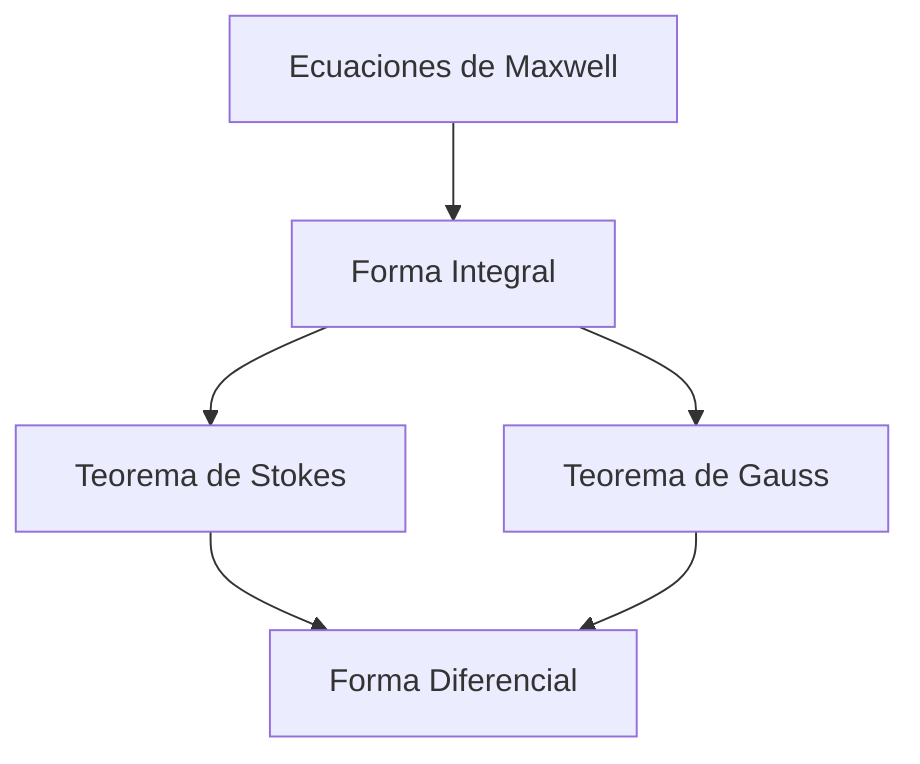
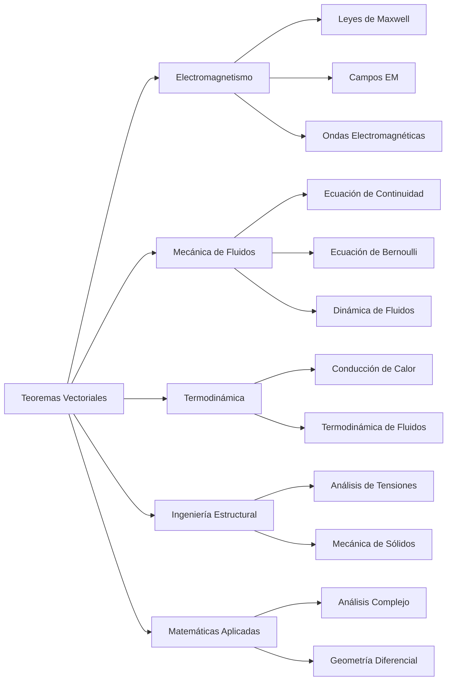

# Matemáticas para Ciencias Aplicadas III - Teoremas de Green y Stokes

## 4.5 Aplicaciones.

---

### Introducción

Los teoremas de Green, Stokes y Gauss son herramientas fundamentales del cálculo vectorial con aplicaciones profundas en múltiples áreas de la ciencia e ingeniería. Estas aplicaciones van desde la física teórica hasta la ingeniería práctica, proporcionando marcos matemáticos para modelar fenómenos naturales y sistemas tecnológicos.

### Marco Teórico Resumido

#### Teorema de Green

$$\oint_C (Pdx + Qdy) = \iint_D \left(\frac{\partial Q}{\partial x} - \frac{\partial P}{\partial y}\right) dA$$

#### Teorema de Stokes

$$\oint_C \vec{F} \cdot d\vec{r} = \iint_S (\nabla \times \vec{F}) \cdot d\vec{S}$$

#### Teorema de Gauss

$$\oiint_S \vec{F} \cdot d\vec{S} = \iiint_E (\nabla \cdot \vec{F}) dV$$

### Aplicaciones en Electromagnetismo

#### Ley de Faraday

$$\oint_C \vec{E} \cdot d\vec{l} = -\frac{d}{dt} \iint_S \vec{B} \cdot d\vec{S}$$

#### Ley de Ampère-Maxwell

$$\oint_C \vec{B} \cdot d\vec{l} = \mu_0 \iint_S \left(\vec{J} + \varepsilon_0 \frac{\partial \vec{E}}{\partial t}\right) \cdot d\vec{S}$$

#### Ley de Gauss para Electricidad

$$\oiint_S \vec{E} \cdot d\vec{S} = \frac{Q_{\text{enc}}}{\varepsilon_0}$$

#### Ley de Gauss para Magnetismo

$$\oiint_S \vec{B} \cdot d\vec{S} = 0$$



### Aplicaciones en Mecánica de Fluidos

#### Ecuación de Continuidad

$$\frac{\partial \rho}{\partial t} + \nabla \cdot (\rho \vec{v}) = 0$$

#### Teorema de Transporte de Reynolds

$$\frac{d}{dt} \iiint_V \rho \phi dV = \iiint_V \frac{\partial}{\partial t}(\rho \phi) dV + \oiint_S \rho \phi (\vec{v} \cdot \hat{n}) dS$$

#### Ecuación de Bernoulli (Forma Integral)

$$\oint_C \left(\frac{p}{\rho} + \frac{v^2}{2} + gz\right) \vec{v} \cdot d\vec{l} = 0$$

### Aplicaciones en Termodinámica

#### Ley de Fourier para Conducción de Calor

$$\oiint_S \vec{q} \cdot d\vec{S} = \iiint_V \nabla \cdot \vec{q} dV = -\iiint_V k \nabla^2 T dV$$

#### Primera Ley de la Termodinámica

$$\frac{dU}{dt} = \dot{Q} - \dot{W} + \oiint_S \rho \left(h + \frac{v^2}{2} + gz\right) \vec{v} \cdot d\vec{S}$$

### Aplicaciones en Ingeniería Estructural

#### Teorema de Reciprocidad de Maxwell-Betti

$$\oint_C \vec{F}_1 \cdot \vec{u}_2 dl = \oint_C \vec{F}_2 \cdot \vec{u}_1 dl$$

#### Análisis de Tensiones

$$\oiint_S \sigma \cdot \hat{n} dS = \iiint_V \nabla \cdot \sigma dV = \iiint_V \vec{f} dV$$

### Implementación Computacional

```python
import sympy as sp
import numpy as np
from sympy import diff, integrate, symbols, Eq, solve

def calcular_flujo_electrico(carga, epsilon_0=8.854e-12):
    """
    Calcula el flujo eléctrico a través de una superficie cerrada
    usando la Ley de Gauss
    """
    return carga / epsilon_0

def ley_faraday(campo_magnetico, tiempo, superficie):
    """
    Calcula la fuerza electromotriz usando la Ley de Faraday
    """
    # fem = -d(Φ_B)/dt
    flujo_magnetico = np.trapz(np.trapz(campo_magnetico, superficie))
    fem = -np.gradient(flujo_magnetico, tiempo)
    return fem

def ecuacion_continuidad(densidad, velocidad, volumen, tiempo):
    """
    Resuelve la ecuación de continuidad para fluidos
    """
    # ∂ρ/∂t + ∇·(ρv) = 0
    d_rho_dt = np.gradient(densidad, tiempo)
    div_rho_v = np.gradient(densidad * velocidad, volumen)
    return d_rho_dt + div_rho_v

# Ejemplo: Ley de Gauss para una carga puntual
q = 1e-9  # 1 nC
flujo = calcular_flujo_electrico(q)
print(f"Flujo eléctrico: {flujo:.4e} N·m²/C")
```

### Ejemplos Resueltos

#### Ejemplo 1: Campo Eléctrico de una Esfera

Calcular el campo eléctrico de una esfera conductora de radio R con carga Q.

**Solución:**

1. Por simetría, $\vec{E} = E(r)\hat{r}$
2. Aplicamos Ley de Gauss: $\oiint_S \vec{E} \cdot d\vec{S} = \frac{Q_{\text{enc}}}{\varepsilon_0}$
3. Para r > R: $E(r) \cdot 4\pi r^2 = \frac{Q}{\varepsilon_0}$
4. $\vec{E} = \frac{Q}{4\pi\varepsilon_0 r^2} \hat{r}$

#### Ejemplo 2: Flujo Magnético Variable

Una espira circular de radio 0.1m está en un campo magnético $\vec{B} = 0.5t^2 \hat{z}$ T. Calcular la fem inducida.

**Solución:**

1. Flujo magnético: $\Phi_B = \iint_S \vec{B} \cdot d\vec{S} = B \cdot \pi r^2 = 0.5t^2 \cdot \pi (0.1)^2$
2. Fem: $\mathcal{E} = -\frac{d\Phi_B}{dt} = -\frac{d}{dt}(0.0157t^2) = -0.0314t$ V

#### Ejemplo 3: Ecuación de Continuidad

Verificar la ecuación de continuidad para $\rho = 1000(1 + 0.1t)$ kg/m³ y $\vec{v} = (2x, 3y, 0)$ m/s.

**Solución:**

1. $\frac{\partial \rho}{\partial t} = 100$
2. $\nabla \cdot (\rho \vec{v}) = \frac{\partial}{\partial x}(2000x(1+0.1t)) + \frac{\partial}{\partial y}(3000y(1+0.1t)) = 5000(1+0.1t)$
3. Ecuación: $100 + 5000(1+0.1t) \neq 0$ → No se conserva la masa

### Ejercicios Propuestos

#### Ejercicio 1

Un capacitor de placas paralelas tiene área A = 0.1 m² y separación d = 0.01 m. Calcular el campo eléctrico usando la Ley de Gauss si la carga es Q = 1 μC.

#### Ejercicio 2

Un solenoide de 1000 vueltas, longitud 0.5 m y radio 0.02 m, lleva una corriente I = 5cos(100πt) A. Calcular la fem inducida en una espira concéntrica de radio 0.03 m.

#### Ejercicio 3

Para un fluido incompresible con $\vec{v} = (2xy, 3yz, z^2)$ m/s, verificar si satisface la ecuación de continuidad.

#### Ejercicio 4

Calcular el flujo de calor a través de una esfera de radio R si la temperatura sigue $T = T_0(1 - r^2/R^2)$ y la conductividad térmica es k.

#### Ejercicio 5

Usar el Teorema de Green para calcular el trabajo realizado por $\vec{F} = (x^2 + y^2)\hat{i} + 2xy\hat{j}$ alrededor del rectángulo [0,2]×[0,1].

### Diagrama de Aplicaciones



### Aplicaciones en Procesamiento de Imágenes

#### Teorema de Green en Visión Computacional

$$\oint_C \vec{G} \cdot d\vec{r} = \iint_D (\nabla \times \vec{G}) \cdot \hat{k} dA$$

#### Gradiente y Rotacional en Análisis de Imágenes

```python
def calcular_gradiente_imagen(imagen):
    """
    Calcula el gradiente de una imagen usando diferencias finitas
    """
    grad_x = np.gradient(imagen, axis=1)
    grad_y = np.gradient(imagen, axis=0)
    return grad_x, grad_y

def calcular_rotacional_2D(grad_x, grad_y):
    """
    Calcula el rotacional en 2D (componente z)
    """
    return np.gradient(grad_y, axis=1) - np.gradient(grad_x, axis=0)
```

### Aplicaciones en Geofísica

#### Modelado de Campos Gravitationales

$$\oiint_S \vec{g} \cdot d\vec{S} = -4\pi G M_{\text{enc}}$$

#### Análisis de Flujos Geotermales

$$\oiint_S \vec{q} \cdot d\vec{S} = \iiint_V \nabla \cdot \vec{q} dV = -\iiint_V k \nabla^2 T dV$$

### Referencias

1. Griffiths, D. J. (2017). _Introduction to Electrodynamics_. Cambridge University Press.
2. Batchelor, G. K. (2000). _An Introduction to Fluid Dynamics_. Cambridge University Press.
3. Incropera, F. P., & DeWitt, D. P. (2002). _Fundamentals of Heat and Mass Transfer_. Wiley.
4. Arfken, G. B., Weber, H. J., & Harris, F. E. (2013). _Mathematical Methods for Physicists_. Academic Press.
5. Gonzalez, R. C., & Woods, R. E. (2018). _Digital Image Processing_. Pearson.

### Consejos para Resolución de Problemas

1. **Identificar la simetría** del problema para elegir el teorema apropiado
2. **Verificar condiciones** de continuidad y diferenciabilidad
3. **Elegir el sistema de coordenadas** adecuado (cartesianas, cilíndricas, esféricas)
4. **Parametrizar correctamente** superficies y curvas
5. **Comprobar resultados** con casos límite y unidades
