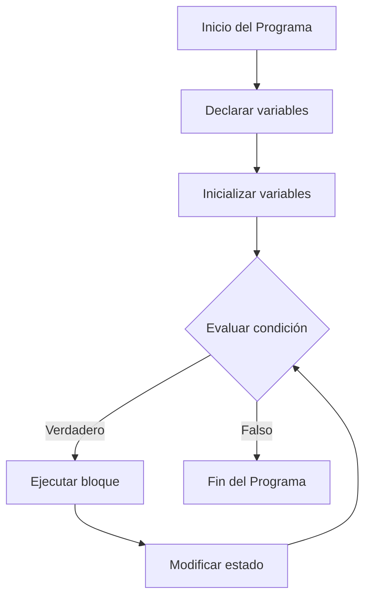
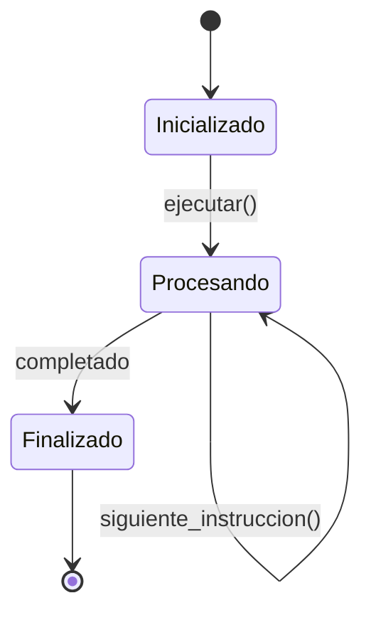

# Modelado y Programación - Lenguajes de programación

## 1.1 Programación imperativa.

---

La **programación imperativa** es un paradigma de programación que describe la computación en términos de instrucciones que cambian el estado de un programa. Se centra en **cómo** se realiza una tarea, paso a paso.

#### Características Principales

- **Secuencialidad**: Las instrucciones se ejecutan en orden
- **Estado mutable**: Uso de variables que pueden cambiar de valor
- **Efectos secundarios**: Las funciones pueden modificar estado externo
- **Estructuras de control**: Bucles, condicionales y bifurcaciones

### Conceptos Fundamentales

#### Variables y Asignación

```python
# Asignación imperativa
x = 5          # Asignación inicial
x = x + 1      # Modificación del estado
print(x)       # Output: 6
```

#### Estructuras de Control

##### Condicionales

```python
# Estructura if-else
edad = 18
if edad >= 18:
    print("Mayor de edad")
else:
    print("Menor de edad")
```

##### Bucles

```python
# Bucle for
for i in range(5):
    print(f"Iteración: {i}")

# Bucle while
contador = 0
while contador < 5:
    print(contador)
    contador += 1
```

### Diagrama de Flujo de Programa Imperativo



### Modelo Matemático de Ejecución Imperativa

El estado de un programa imperativo puede representarse como:

$$
\sigma = \{x_1 \mapsto v_1, x_2 \mapsto v_2, \dots, x_n \mapsto v_n\}
$$

Donde:

- $\sigma$ es el estado del programa
- $x_i$ son las variables
- $v_i$ son los valores actuales

La ejecución de una instrucción transforma el estado:

$$
\langle S, \sigma \rangle \rightarrow \sigma'
$$

### Ejemplos de Código

#### Ejemplo 1: Cálculo de Factorial

```python
def factorial(n):
    resultado = 1
    for i in range(1, n + 1):
        resultado *= i
    return resultado

# Ejemplo de uso
print(f"5! = {factorial(5)}")  # Output: 120
```

#### Ejemplo 2: Manipulación de Arrays

```python
# Programa imperativo para procesar una lista
numeros = [1, 2, 3, 4, 5]
cuadrados = []

for num in numeros:
    cuadrado = num ** 2
    cuadrados.append(cuadrado)

print(f"Cuadrados: {cuadrados}")
```

#### Ejemplo 3: Gestión de Estado

```python
class Contador:
    def __init__(self):
        self.valor = 0

    def incrementar(self):
        self.valor += 1

    def decrementar(self):
        self.valor -= 1

# Uso del contador
contador = Contador()
contador.incrementar()
contador.incrementar()
print(f"Valor actual: {contador.valor}")
```

### Comparación con Otros Paradigmas

#### Programación Imperativa vs. Declarativa

| Aspecto  | Imperativa       | Declarativa          |
| -------- | ---------------- | -------------------- |
| Enfoque  | **Cómo** hacerlo | **Qué** hacer        |
| Estado   | Mutable          | Inmutable            |
| Flujo    | Explícito        | Implícito            |
| Ejemplos | C, Python, Java  | SQL, Haskell, Prolog |

### Ejercicios Propuestos

#### Ejercicio 1: Implementación de Bubble Sort

```python
# Completa la implementación del algoritmo Bubble Sort
def bubble_sort(lista):
    n = len(lista)
    # Tu código aquí
    return lista

# Prueba tu implementación
numeros = [64, 34, 25, 12, 22, 11, 90]
print(f"Lista ordenada: {bubble_sort(numeros)}")
```

#### Ejercicio 2: Simulación de Banco

```python
class CuentaBancaria:
    def __init__(self, saldo_inicial=0):
        self.saldo = saldo_inicial

    def depositar(self, monto):
        # Implementar esta función
        pass

    def retirar(self, monto):
        # Implementar esta función
        pass

    def consultar_saldo(self):
        return self.saldo

# Crea y prueba la cuenta bancaria
```

#### Ejercicio 3: Calculadora de Estadísticas

Escribe un programa que calcule:

- Media: $\mu = \frac{1}{n}\sum_{i=1}^{n} x_i$
- Varianza: $\sigma^2 = \frac{1}{n}\sum_{i=1}^{n} (x_i - \mu)^2$
- Desviación estándar: $\sigma = \sqrt{\sigma^2}$

### Diagrama de Estado de Programa



### Patrones Comunes en Programación Imperativa

#### Patrón 1: Acumulador

```python
def suma_acumulativa(numeros):
    acumulador = 0
    resultados = []

    for num in numeros:
        acumulador += num
        resultados.append(acumulador)

    return resultados
```

#### Patrón 2: Transformación con Estado

```python
def procesar_con_estado(datos):
    estado = {}  # Diccionario para mantener estado

    for item in datos:
        if item not in estado:
            estado[item] = 0
        estado[item] += 1
        # Procesamiento adicional

    return estado
```

### Análisis de Complejidad

#### Notación Big O para Operaciones Imperativas

| Operación      | Complejidad | Ejemplo             |
| -------------- | ----------- | ------------------- |
| Asignación     | $O(1)$      | `x = 5`             |
| Acceso a array | $O(1)$      | `arr[i]`            |
| Bucle simple   | $O(n)$      | `for i in range(n)` |
| Bucle anidado  | $O(n^2)$    | Dos bucles anidados |

### Referencias y Recursos Adicionales

#### Libros Recomendados

1. "Structure and Interpretation of Computer Programs" - Harold Abelson
2. "Programming Language Pragmatics" - Michael L. Scott
3. "Concepts of Programming Languages" - Robert W. Sebesta

#### Enlaces Útiles

- [Python Documentation](https://docs.python.org/3/)
- [Interactive Python Tutorial](https://www.learnpython.org/)
- [Visualize Code Execution](http://www.pythontutor.com/)

#### Herramientas de Práctica

- [HackerRank - Python Challenges](https://www.hackerrank.com/domains/python)
- [LeetCode - Algorithm Problems](https://leetcode.com/)
- [Codecademy - Python Course](https://www.codecademy.com/learn/learn-python-3)

### Consejos para Dominar la Programación Imperativa

1. **Practica con ejercicios variados** desde problemas simples hasta complejos
2. **Analiza el flujo de ejecución** paso a paso
3. **Depura frecuentemente** para entender el estado del programa
4. **Experimenta con modificaciones** para ver cómo afectan el comportamiento
5. **Compara soluciones** imperativas con otros paradigmas

### Autoevaluación

1. ¿Cuál es la diferencia fundamental entre programación imperativa y declarativa?
2. Explica cómo el estado cambia en un programa imperativo
3. Implementa un programa que use al menos tres estructuras de control diferentes
4. Describe un caso donde la programación imperativa sea más apropiada que la funcional
