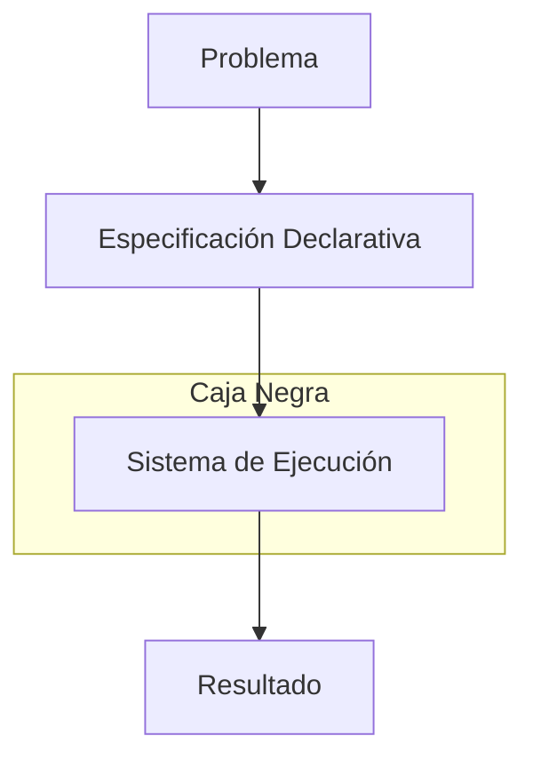
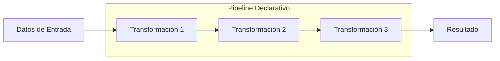

# Modelado y Programación - Lenguajes de programación

## 1.2 Programación declarativa.

---

La **programación declarativa** es un paradigma de programación que se centra en **qué** debe hacer un programa, en lugar de **cómo** debe hacerlo (enfoque imperativo). Describe la lógica de la computación sin especificar el flujo de control detallado.

#### Características Principales

- **Expresividad**: Describe el resultado deseado
- **Inmutabilidad**: Los datos no se modifican después de su creación
- **Transparencia referencial**: Las funciones siempre producen el mismo resultado para los mismos inputs
- **Ausencia de efectos secundarios**: Las funciones no modifican estado externo

### Comparación con Paradigma Imperativo

| Aspecto             | Programación Declarativa | Programación Imperativa |
| ------------------- | ------------------------ | ----------------------- |
| Enfoque             | **Qué** se debe hacer    | **Cómo** hacerlo        |
| Estado              | Inmutable                | Mutable                 |
| Flujo               | Implícito                | Explícito               |
| Efectos secundarios | Minimizados              | Comunes                 |
| Ejemplos            | SQL, Haskell, Prolog     | C, Python, Java         |

### Modelo Mental de Programación Declarativa



### Fundamentos Matemáticos

#### Funciones y λ-cálculo

La programación funcional se basa en el λ-cálculo:

$$
(\lambda x. x + 1) 5 \rightarrow 5 + 1 \rightarrow 6
$$

#### Evaluación de Expresiones

En programación declarativa, las expresiones se evalúan mediante reducción:

$$
fact(n) = \begin{cases}
1 & \text{si } n = 0 \\
n \times fact(n-1) & \text{si } n > 0
\end{cases}
$$

### Ejemplos de Programación Declarativa

#### SQL (Lenguaje Declarativo de Base de Datos)

```sql
-- Qué: Obtener nombres de empleados con salario > 50000
-- No cómo: No especifica cómo recorrer las tablas o índices
SELECT nombre FROM empleados WHERE salario > 50000;
```

#### Haskell (Programación Funcional)

```haskell
-- Definición declarativa del factorial
factorial 0 = 1
factorial n = n * factorial (n - 1)

-- Uso de higher-order functions
cuadrados = map (^2) [1, 2, 3, 4, 5]
-- Resultado: [1, 4, 9, 16, 25]
```

#### Prolog (Programación Lógica)

```prolog
% Definición de relaciones familiares
padre(juan, maria).
padre(juan, carlos).
abuelo(X, Y) :- padre(X, Z), padre(Z, Y).

% Consulta: ¿Quién es el abuelo de maria?
% ?- abuelo(X, maria).
```

#### HTML (Lenguaje de Marcado Declarativo)

```html
<!-- Describe la estructura, no cómo dibujarla -->
<div class="container">
  <h1>Título Principal</h1>
  <p>Párrafo de contenido</p>
</div>
```

### Ejercicios Propuestos

#### Ejercicio 1: Transformación Declarativa de Listas

Dada una lista de números, escribe una expresión declarativa para:

1. Filtrar los números pares
2. Elevar cada número al cuadrado
3. Calcular la suma de los resultados

**Solución en Haskell:**

```haskell
sumaCuadradosPares = sum . map (^2) . filter even
```

#### Ejercicio 2: Expresiones Regulares

Usa expresiones regulares (paradigma declarativo) para validar:

- Direcciones de email
- Números de teléfono
- Fechas en formato DD/MM/AAAA

#### Ejercicio 3: Consultas SQL

Dada una base de datos con tablas "clientes" y "pedidos":

1. Encuentra clientes sin pedidos
2. Calcula el valor total de pedidos por cliente
3. Encuentra el producto más vendido

### Patrones de Programación Declarativa

#### 1. Composición de Funciones

Aplicar una serie de transformaciones a datos:

$$
f \circ g \circ h(x) = f(g(h(x)))
$$

#### 2. Pattern Matching

```haskell
-- Definición por casos
fibonacci 0 = 0
fibonacci 1 = 1
fibonacci n = fibonacci (n-1) + fibonacci (n-2)
```

#### 3. Evaluación Perezoza (Lazy Evaluation)

Las expresiones se evalúan solo cuando se necesitan:

```haskell
-- Lista infinita de números naturales
naturals = [0..]

-- Toma los primeros 10 números pares
primeros10Pares = take 10 (filter even naturals)
```

### Ventajas y Desventajas

#### Ventajas

- **Menos código**: Más expresivo y conciso
- **Menos errores**: Sin estado mutable o efectos secundarios
- **Más mantenible**: Código más predecible y fácil de razonar
- **Parallelización**: Fácil de paralelizar automáticamente

#### Desventajas

- **Curva de aprendizaje**: Diferente forma de pensar
- **Rendimiento**: A veces menos eficiente que código imperativo
- **Debugging**: Más difícil depurar en algunos casos

### Ejemplos Avanzados

#### Programación Reactiva (FRP)

```javascript
// RxJS - Programación reactiva declarativa
const clicks = fromEvent(document, 'click');
const result = clicks.pipe(
  throttleTime(1000),
  map((event) => event.clientX),
  filter((x) => x > 200),
  take(5),
);
```

#### DSLs (Domain Specific Languages) Declarativos

```sql
-- SQL es un DSL declarativo para bases de datos
CREATE VIEW empleados_well_paid AS
SELECT nombre, departamento
FROM empleados
WHERE salario > 70000;
```

### Diagrama de Transformación Declarativa



### Conceptos Clave para Dominar

#### 1. Transparencia Referencial

Una función es referencialmente transparente si puede ser reemplazada por su valor resultante sin cambiar el comportamiento del programa.

#### 2. Inmutabilidad

Los datos una vez creados no pueden ser modificados:

```haskell
-- En lugar de modificar, se crean nuevas estructuras
listaOriginal = [1, 2, 3]
listaNueva = 0 : listaOriginal  -- [0, 1, 2, 3]
```

#### 3. Recursión en lugar de Iteración

```haskell
-- Enfoque declarativo con recursión
suma [] = 0
suma (x:xs) = x + suma xs

-- En lugar de enfoque imperativo con bucles
-- total = 0
-- for i in lista: total += i
```

### Referencias y Recursos

#### Libros Recomendados

1. "Learn You a Haskell for Great Good!" - Miran Lipovača
2. "The Reasoned Schemer" - Daniel P. Friedman
3. "Programming in Haskell" - Graham Hutton

#### Enlaces Útiles

- [Try Haskell](https://tryhaskell.org/) - Tutorial interactivo
- [Learn Prolog Now!](http://www.learnprolognow.org/) - Curso de Prolog
- [SQLZoo](https://sqlzoo.net/) - Practica SQL interactivamente

#### Herramientas para Practicar

- [Haskell: GHCi](https://www.haskell.org/ghc/) - Intérprete de Haskell
- [SWI-Prolog](https://www.swi-prolog.org/) - Implementación de Prolog
- [SQL Fiddle](http://sqlfiddle.com/) - Practicar SQL online

### Consejos para Aprender Programación Declarativa

1. **Empieza con SQL**: Es el lenguaje declarativo más ampliamente usado
2. **Practica con Haskell**: Te fuerza a pensar declarativamente
3. **Resuelve problemas pequeños**: Comienza con ejercicios simples
4. **Aprende a usar map, filter, reduce**: Fundamentales en programación funcional
5. **Evita el estado mutable**: Practica escribiendo funciones puras

### Autoevaluación

1. ¿Cuál es la diferencia fundamental entre programación declarativa e imperativa?
2. Escribe una función pura que calcule el área de un círculo
3. Explica el concepto de transparencia referencial con un ejemplo
4. Convierte este código imperativo a declarativo:

```python
# Código imperativo
resultados = []
for i in range(10):
    if i % 2 == 0:
        resultados.append(i * 2)
```

5. ¿Qué ventajas tiene el uso de inmutabilidad en programación?
