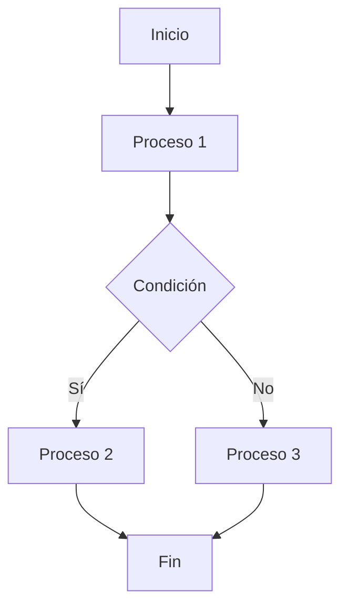
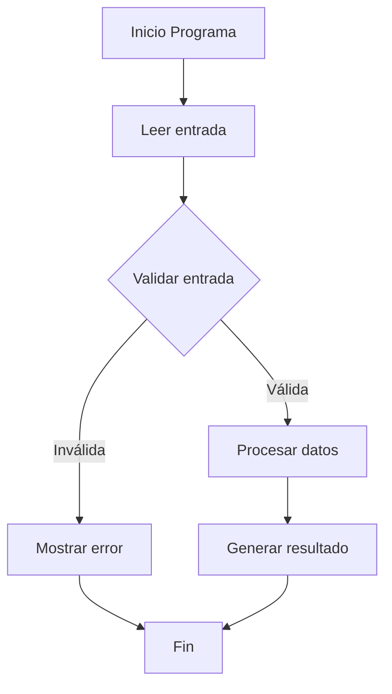

# Modelado y Programación - Lenguajes de programación

## 1.3 Programación estructurada.

---

La **programación estructurada** es un paradigma de programación que busca mejorar la claridad, calidad y tiempo de desarrollo de un programa mediante el uso extensivo de tres estructuras de control básicas:

1. **Secuencia**: Ejecución de instrucciones en orden
2. **Selección**: Decisión entre alternativas (if-then-else)
3. **Iteración**: Repetición de instrucciones (bucles)

#### Principios Fundamentales

- **Teorema del programa estructurado**: Cualquier programa puede escribirse usando solo tres estructuras de control
- **Diseño descendente** (top-down): Descomposición de problemas en subproblemas
- **Eliminación de goto**: Uso limitado de saltos incondicionales
- **Una entrada y una salida**: Cada bloque se entra por arriba y se sale por abajo, así que se puede entender sin mirar el resto del programa

El movimiento se popularizó con la carta de Edsger Dijkstra *Go To Statement Considered Harmful* (1968): los saltos arbitrarios producen el llamado **código espagueti**, cuyo flujo es muy difícil de seguir y de verificar.

### Estructuras Básicas de Control

#### 1. Estructura Secuencial

```python
# Ejecución secuencial de instrucciones
a = 5
b = 10
resultado = a + b
print(f"La suma es: {resultado}")
```

#### 2. Estructura de Selección

```python
# Estructura if-elif-else
calificacion = 85

if calificacion >= 90:
    print("Excelente")
elif calificacion >= 70:
    print("Aprobado")
else:
    print("Reprobado")
```

#### 3. Estructura de Iteración

```python
# Diferentes tipos de bucles
# While loop
contador = 0
while contador < 5:
    print(f"Contador: {contador}")
    contador += 1

# For loop
for i in range(5):
    print(f"Iteración: {i}")
```

### Teorema del Programa Estructurado

El **teorema de Böhm-Jacopini** (1966) establece que toda función computable por un diagrama de flujo, con saltos arbitrarios, también se puede calcular con un programa que combine únicamente:

- **Secuencia**: $S_1; S_2$
- **Selección**: `if` $B$ `then` $S_1$ `else` $S_2$
- **Iteración**: `while` $B$ `do` $S$

Las tres se pueden **anidar** unas dentro de otras sin límite. El precio puede ser añadir variables auxiliares, por ejemplo banderas booleanas que recuerden en qué punto del algoritmo se está. Por eso `break`, `continue` y `return` anticipado no son indispensables, aunque a menudo hacen el código más claro.

#### Representación de Flujos de Control



### Técnicas de Programación Estructurada

#### Diseño Descendente (Top-Down)

```python
# Ejemplo de diseño descendente para calcular promedio
def main():
    numeros = leer_numeros()
    promedio = calcular_promedio(numeros)
    mostrar_resultado(promedio)

def leer_numeros():
    # Implementación detallada
    return [1, 2, 3, 4, 5]

def calcular_promedio(numeros):
    return sum(numeros) / len(numeros)

def mostrar_resultado(promedio):
    print(f"El promedio es: {promedio}")

if __name__ == "__main__":
    main()
```

#### Modularización

```python
# Programa modularizado en funciones
def procesar_datos(datos):
    datos_validos = validar_datos(datos)
    datos_procesados = transformar_datos(datos_validos)
    resultado = analizar_datos(datos_procesados)
    return resultado

def validar_datos(datos):
    # Lógica de validación
    return [d for d in datos if d > 0]

def transformar_datos(datos):
    # Lógica de transformación
    return [d * 2 for d in datos]

def analizar_datos(datos):
    # Lógica de análisis
    return sum(datos) / len(datos)
```

### Ejercicios Propuestos

#### Ejercicio 1: Refactorización de Código

Refactoriza el siguiente código usando principios de programación estructurada:

```python
# Código espagueti (antiestructurado)
x = 0
y = 10
if x < y: print("x es menor")
while x < y:
    print(x)
    x += 1
    if x == 5: break
```

#### Ejercicio 2: Diseño Descendente

Diseña un programa para gestionar una biblioteca usando el enfoque top-down:

1. Identifica las funciones principales
2. Descompón en subfunciones
3. Implementa cada módulo

#### Ejercicio 3: Diagrama de Flujo

Crea un diagrama de flujo para un sistema de login con:

- Verificación de credenciales
- Intentos limitados
- Diferentes niveles de acceso

### Estructuras de Control Anidadas

#### Ejemplo de Estructuras Complejas

```python
def clasificar_triangulo(a, b, c):
    # Validar si es triángulo
    if a + b > c and a + c > b and b + c > a:
        # Clasificar por lados
        if a == b == c:
            return "Equilátero"
        elif a == b or a == c or b == c:
            return "Isósceles"
        else:
            return "Escaleno"
    else:
        return "No es un triángulo válido"

# Ejemplo de uso
print(clasificar_triangulo(3, 4, 5))  # Escaleno
print(clasificar_triangulo(5, 5, 5))  # Equilátero
```

### Ventajas de la Programación Estructurada

#### Beneficios Principales

- **Legibilidad**: Código más fácil de entender y mantener
- **Reducción de errores**: Menos bugs por flujos complejos
- **Facilidad de depuración**: Más simple localizar problemas
- **Reutilización**: Módulos que pueden ser reuseados
- **Mantenibilidad**: Más fácil modificar y extender

#### Comparación con Programación no Estructurada

| Aspecto       | Estructurada | No Estructurada |
| ------------- | ------------ | --------------- |
| Flujo         | Predecible   | Caótico         |
| Legibilidad   | Alta         | Baja            |
| Mantenimiento | Fácil        | Difícil         |
| Uso de goto   | Limitado     | Extensivo       |
| Modularidad   | Alta         | Baja            |

### Complejidad Ciclomática

La complejidad ciclomática es una métrica que mide la complejidad estructural de un programa:

$$ V(G) = E - N + 2P $$

Para un programa con un solo punto de entrada y de salida, $V(G)$ es igual al número de condiciones de decisión más uno. Es el número de caminos linealmente independientes, y por eso es una cota inferior del número de casos de prueba necesarios para cubrir todas las ramas. Valores mayores a 10 suelen considerarse señal de que una función debe dividirse.

Donde:

- $V(G)$ = complejidad ciclomática
- $E$ = número de aristas en el grafo de flujo
- $N$ = número de nodos en el grafo de flujo
- $P$ = número de componentes conectados

#### Ejemplo de Cálculo

```python
# Complejidad ciclomática = número de decisiones + 1
def evaluar_nota(nota):
    if nota >= 90:          # decisión 1
        return "A"
    elif nota >= 80:        # decisión 2
        return "B"
    elif nota >= 70:        # decisión 3
        return "C"
    elif nota >= 60:        # decisión 4
        return "D"
    else:                   # el else no es una decisión nueva
        return "F"
# Complejidad ciclomática = 4 + 1 = 5: hay 5 caminos independientes
```

### Diagramas de Flujo Estructurados



### Mejores Prácticas

#### 1. Evitar el Uso de Goto

Python no tiene `goto`; en lenguajes antiguos como BASIC era común:

```text
10 LET I = 0
20 IF I >= 10 THEN GOTO 60
30 PRINT I
40 LET I = I + 1
50 GOTO 20
60 END
```

La versión estructurada usa un bucle y se lee de arriba abajo:

```python
def proceso_estructurado(limite=10):
    i = 0
    while i < limite:
        print(i)
        i += 1
```

#### 2. Limitar la Profundidad de Anidamiento

```python
# Anidamiento excesivo
def procesar_pedido(pedido):
    if pedido is not None:
        if pedido["pagado"]:
            if pedido["en_stock"]:
                return "enviado"
    return "rechazado"

# Mejor estructuración: cláusulas de guarda
def procesar_pedido_guardas(pedido):
    if pedido is None:
        return "rechazado"
    if not pedido["pagado"]:
        return "rechazado"
    if not pedido["en_stock"]:
        return "rechazado"
    return "enviado"      # lógica principal sin anidar

p = {"pagado": True, "en_stock": True}
print(procesar_pedido(p), procesar_pedido_guardas(p))   # enviado enviado
```

Las cláusulas de guarda usan varios `return`, lo que se aparta de la regla estricta de una sola salida, pero reducen el anidamiento. Es un compromiso aceptado en la práctica.

#### 3. Usar Funciones con Propósito Único

```python
# Función con múltiples responsabilidades [X]
def procesar_todo(datos):
    # Validación, transformación, análisis...
    pass

# Funciones especializadas (✓)
def validar_datos(datos):
    pass

def transformar_datos(datos):
    pass

def analizar_datos(datos):
    pass
```

### Ejemplos Avanzados

#### Sistema de Gestión de Estudiantes

```text
# Esqueleto: las funciones cargar_estudiantes, agregar_estudiante, etc. se implementan aparte
def main():
    estudiantes = cargar_estudiantes()

    while True:
        opcion = mostrar_menu()

        if opcion == "1":
            agregar_estudiante(estudiantes)
        elif opcion == "2":
            buscar_estudiante(estudiantes)
        elif opcion == "3":
            mostrar_estadisticas(estudiantes)
        elif opcion == "4":
            break
        else:
            print("Opción inválida")

def mostrar_menu():
    print("\n1. Agregar estudiante")
    print("2. Buscar estudiante")
    print("3. Mostrar estadísticas")
    print("4. Salir")
    return input("Seleccione una opción: ")

# Implementar otras funciones...
```

El esqueleto anterior es diseño descendente en acción: `main` describe el flujo general y delega cada tarea a una función que todavía se puede refinar.

### Referencias y Recursos

#### Libros Recomendados

1. "Structured Programming" by O.-J. Dahl, E. W. Dijkstra, and C. A. R. Hoare
2. "The Elements of Programming Style" by Brian W. Kernighan and P. J. Plauger
3. "Code Complete" by Steve McConnell

#### Enlaces Útiles

- [Python Style Guide (PEP 8)](https://pep8.org/)
- [Refactoring Guru - Structured Programming](https://refactoring.guru/)
- [Codecademy - Learn Python 3](https://www.codecademy.com/learn/learn-python-3)

#### Herramientas para Análisis

- [Radon](https://pypi.org/project/radon/) - Análisis de complejidad ciclomática en Python
- [Pylint](https://pypi.org/project/pylint/) - Análisis estático de código
- [CodeClimate](https://codeclimate.com/) - Plataforma de calidad de código

### Consejos para Aplicar Programación Estructurada

1. **Planifica antes de programar**: Diseña la estructura con diagramas de flujo
2. **Divide y vencerás**: Descompón problemas grandes en subproblemas
3. **Usa nombres descriptivos**: Variables y funciones con nombres significativos
4. **Mantén funciones cortas**: Idealmente menos de 20 líneas por función
5. **Evita efectos secundarios**: Funciones que no modifican estado externo
6. **Documenta tu código**: Comentarios que explican el qué y por qué

### Autoevaluación

1. ¿Cuáles son las tres estructuras básicas de la programación estructurada?
2. Explica el teorema del programa estructurado
3. Calcula la complejidad ciclomática de:

```python
def ejemplo(x, y):
    if x > 0:
        if y > 0:
            return 1
        else:
            return 2
    else:
        return 3
```

4. Convierte este código con goto a programación estructurada:

```text
i = 0
inicio:
if i >= 10: goto fin
print(i)
i += 1
goto inicio
fin:
```

5. ¿Por qué es importante limitar la profundidad de anidamiento?

### Soluciones

**Ejercicio 1.** El código original es estructurado en su flujo, pero mezcla responsabilidades y usa `break` para una condición que pertenece al bucle:

```python
def imprimir_hasta(inicio, fin, tope):
    if inicio < fin:
        print("x es menor")
    x = inicio
    while x < fin and x < tope:   # la condición de salida queda en un solo lugar
        print(x)
        x += 1

imprimir_hasta(0, 10, 5)   # imprime "x es menor" y luego 0, 1, 2, 3, 4
```

**Autoevaluación 3.** Hay dos decisiones, así que $V(G) = 2 + 1 = 3:$ los caminos que devuelven 1, 2 y 3.

**Autoevaluación 4.**

```python
i = 0
while i < 10:
    print(i)
    i += 1
```

**Autoevaluación 5.** Cada nivel de anidamiento añade una condición que el lector debe recordar a la vez; con más de tres o cuatro niveles el código se vuelve difícil de seguir y de probar, y suele indicar que una parte debe extraerse a otra función.
