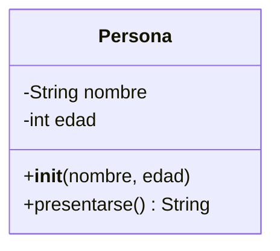
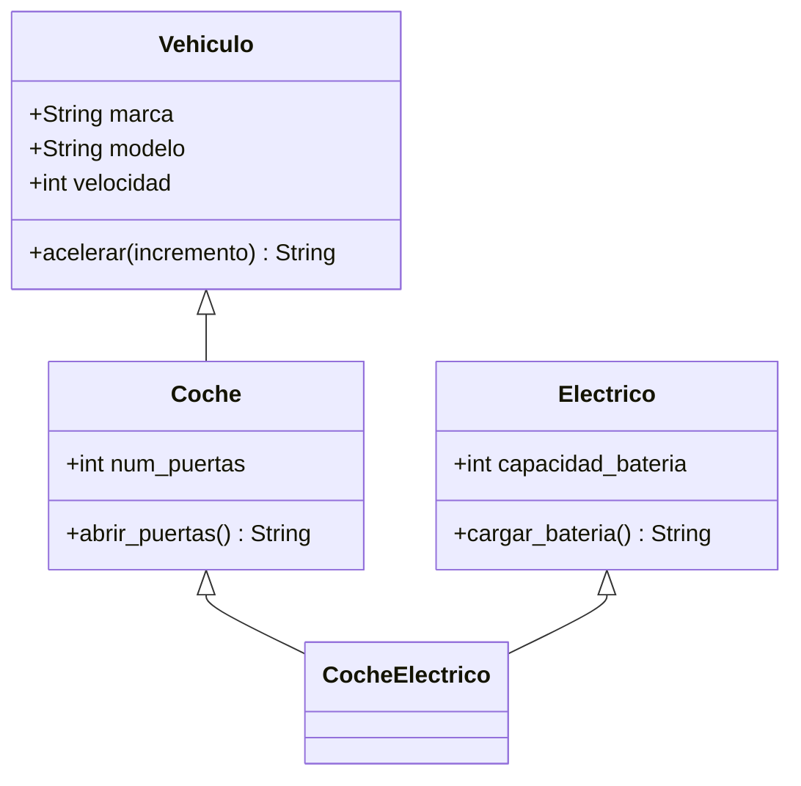
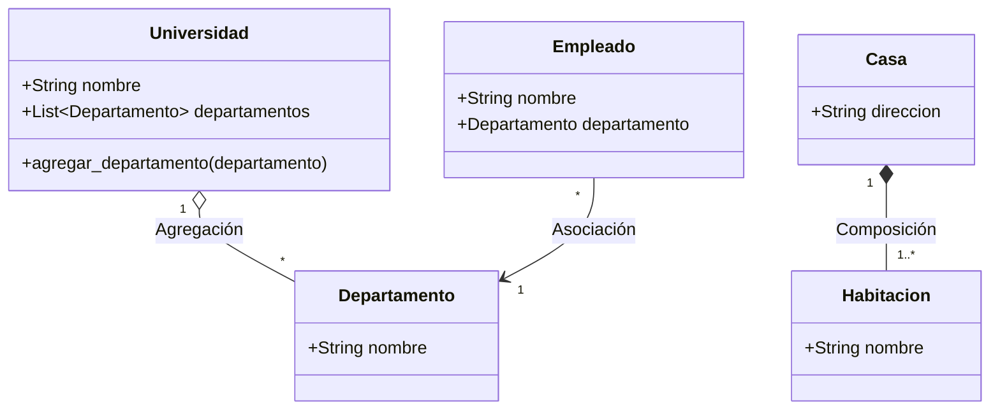

# Modelado y Programación - Lenguajes de programación

## 1.4 Programación orientada a objetos.

---

La **Programación Orientada a Objetos (POO)** es un paradigma de programación que organiza el diseño alrededor de objetos y datos, en lugar de funciones y lógica. Un objeto es una instancia de una clase que encapsula datos y comportamientos relacionados.

#### Pilares Fundamentales de la POO

1. **Abstracción**: Simplificar la complejidad mediante modelos
2. **Encapsulamiento**: Ocultar detalles internos de implementación
3. **Herencia**: Mecanismo para crear nuevas clases a partir de existentes
4. **Polimorfismo**: Capacidad de objetos de diferentes clases de responder al mismo mensaje

### Conceptos Básicos

#### Clases y Objetos

Una **clase** es una plantilla o molde para crear objetos. Un **objeto** es una instancia de una clase.

```python
# Definición de una clase
class Persona:
    def __init__(self, nombre, edad):
        self.nombre = nombre  # Atributo
        self.edad = edad      # Atributo

    def presentarse(self):    # Método
        return f"Soy {self.nombre} y tengo {self.edad} años"

# Creación de objetos
persona1 = Persona("Ana", 25)
persona2 = Persona("Carlos", 30)

print(persona1.presentarse())  # Soy Ana y tengo 25 años
```

#### Diagrama de Clases Básico



En UML, `-` indica un miembro privado y `+` uno público. Una clase se dibuja una sola vez; los objetos `persona1` y `persona2` son instancias de ella, no clases nuevas.

### Los Cuatro Pilares de la POO

#### 1. Abstracción

Simplificar la realidad capturando solo los aspectos relevantes para el contexto.

```python
from abc import ABC, abstractmethod

# Clase abstracta
class Animal(ABC):
    @abstractmethod
    def hacer_sonido(self):
        pass

    @abstractmethod
    def mover(self):
        pass

# Implementación concreta
class Perro(Animal):
    def hacer_sonido(self):
        return "¡Guau!"

    def mover(self):
        return "Corriendo en cuatro patas"
```

#### 2. Encapsulamiento

Proteger los datos internos de un objeto, controlando el acceso mediante métodos.

```python
class CuentaBancaria:
    def __init__(self, titular, saldo_inicial=0):
        self.titular = titular
        self.__saldo = saldo_inicial  # Atributo privado

    def depositar(self, monto):
        if monto > 0:
            self.__saldo += monto
            return True
        return False

    def retirar(self, monto):
        if 0 < monto <= self.__saldo:
            self.__saldo -= monto
            return True
        return False

    def obtener_saldo(self):  # Método público para acceso controlado
        return self.__saldo

# Uso
cuenta = CuentaBancaria("Juan", 1000)
cuenta.depositar(500)
print(cuenta.obtener_saldo())  # 1500
print(cuenta.retirar(5000))     # False: el objeto protege su invariante saldo >= 0
```

En Python la privacidad es una convención: `__saldo` se renombra internamente a `_CuentaBancaria__saldo` para evitar accesos accidentales, pero no lo impide del todo. Lenguajes como Java o C++ sí la imponen con `private`. Lo importante del encapsulamiento es que el estado solo cambia a través de métodos que mantienen sus **invariantes**.

#### 3. Herencia

Crear nuevas clases basadas en clases existentes, reutilizando código.

```python
# Clase base
class Vehiculo:
    def __init__(self, marca, modelo):
        self.marca = marca
        self.modelo = modelo
        self.velocidad = 0

    def acelerar(self, incremento):
        self.velocidad += incremento
        return f"Velocidad: {self.velocidad} km/h"

# Clase derivada
class Coche(Vehiculo):
    def __init__(self, marca, modelo, num_puertas):
        super().__init__(marca, modelo)
        self.num_puertas = num_puertas

    def abrir_puertas(self):
        return f"Abriendo {self.num_puertas} puertas"

# Herencia múltiple
class Electrico:
    def __init__(self, capacidad_bateria):
        self.capacidad_bateria = capacidad_bateria

    def cargar_bateria(self):
        return "Batería cargando"

class CocheElectrico(Coche, Electrico):
    def __init__(self, marca, modelo, num_puertas, capacidad_bateria):
        Coche.__init__(self, marca, modelo, num_puertas)
        Electrico.__init__(self, capacidad_bateria)

auto = CocheElectrico("Marca", "Modelo", 4, 75)
print(auto.acelerar(30), "|", auto.cargar_bateria())   # Velocidad: 30 km/h | Batería cargando
print([c.__name__ for c in CocheElectrico.__mro__])
# ['CocheElectrico', 'Coche', 'Vehiculo', 'Electrico', 'object']
```

Con herencia múltiple, el **orden de resolución de métodos** (MRO) decide en qué clase se busca primero un método. Java no permite herencia múltiple de clases, solo de interfaces, para evitar ambigüedades como el problema del diamante. Una regla de diseño frecuente es **preferir la composición sobre la herencia**: usar herencia solo cuando realmente se cumple la relación "es un".

#### 4. Polimorfismo

Objetos de diferentes clases pueden ser tratados de manera uniforme.

```python
class Pato:
    def hacer_sonido(self):
        return "¡Cuac!"

class Gato:
    def hacer_sonido(self):
        return "¡Miau!"

class Vaca:
    def hacer_sonido(self):
        return "¡Muu!"

# Función polimórfica
def escuchar_sonido(animal):
    return animal.hacer_sonido()

# Uso polimórfico
animales = [Pato(), Gato(), Vaca()]
for animal in animales:
    print(escuchar_sonido(animal))
```

Este ejemplo usa **tipado pato** (*duck typing*): Python solo exige que el objeto tenga el método `hacer_sonido`. En lenguajes con tipos estáticos, como Java, el polimorfismo de subtipos requiere que las clases compartan una superclase o interfaz, como `Animal` en la sección de abstracción. En ambos casos, qué método se ejecuta se decide **en tiempo de ejecución** según la clase real del objeto (enlace dinámico).

Otra forma de polimorfismo es la **sobrecarga**: varios métodos con el mismo nombre y distintos parámetros, que el compilador distingue en tiempo de compilación. Java y C++ la permiten; Python no.

### Diagrama de Herencia



### Relaciones entre Clases

#### Asociación

Relación donde un objeto usa otro objeto.

```python
class Departamento:
    def __init__(self, nombre):
        self.nombre = nombre

class Empleado:
    def __init__(self, nombre, departamento):
        self.nombre = nombre
        self.departamento = departamento  # Asociación

# Uso
depto_ventas = Departamento("Ventas")
empleado = Empleado("Ana", depto_ventas)
```

#### Agregación

Relación "tiene-un" débil: las partes pueden existir independientemente del contenedor y hasta pertenecer a varios contenedores. Si se destruye la universidad, los departamentos pueden seguir existiendo.

```python
class Universidad:
    def __init__(self, nombre):
        self.nombre = nombre
        self.departamentos = []  # Agregación

    def agregar_departamento(self, departamento):
        self.departamentos.append(departamento)

class Departamento:
    def __init__(self, nombre):
        self.nombre = nombre

# Uso
uni = Universidad("MIT")
depto = Departamento("Informática")
uni.agregar_departamento(depto)
```

#### Composición

Relación "parte-de" fuerte: el contenedor crea las partes y controla su ciclo de vida. Las partes no se comparten y desaparecen con el contenedor.

```python
class Casa:
    def __init__(self, direccion):
        self.direccion = direccion
        self.habitaciones = []  # Composición
        self.agregar_habitacion("Sala")

    def agregar_habitacion(self, nombre):
        self.habitaciones.append(Habitacion(nombre))

class Habitacion:
    def __init__(self, nombre):
        self.nombre = nombre

# Las habitaciones no existen sin la casa
```

### Diagrama de Relaciones



### Patrones de Diseño Comunes

#### Singleton

Asegura que una clase tenga solo una instancia.

```python
class Singleton:
    _instancia = None

    def __new__(cls):
        if cls._instancia is None:
            cls._instancia = super().__new__(cls)
        return cls._instancia

# Uso
s1 = Singleton()
s2 = Singleton()
print(s1 is s2)  # True
```

#### Factory Method

Crea objetos sin especificar la clase exacta.

```python
class FabricaAnimales:
    def crear_animal(self, tipo):
        if tipo == "perro":
            return Perro()
        elif tipo == "gato":
            return Gato()
        else:
            raise ValueError("Tipo de animal desconocido")

# Uso
fabrica = FabricaAnimales()
animal = fabrica.crear_animal("perro")
print(animal.hacer_sonido())   # ¡Guau!
```

Estrictamente, este ejemplo es una **fábrica simple**. El patrón *Factory Method* del libro de Gamma et al. delega la creación a **subclases** que redefinen un método de fabricación; se estudia en el tema 3.2.

### Ejercicios Propuestos

#### Ejercicio 1: Sistema de Biblioteca

Crea un sistema POO para una biblioteca con:

- Clases: Libro, Autor, Usuario, Prestamo
- Relaciones: asociación, agregación
- Métodos: prestar_libro(), devolver_libro(), buscar_libro()

#### Ejercicio 2: Juego de Cartas

Implementa un juego de cartas usando:

- Herencia para diferentes tipos de cartas
- Polimorfismo para efectos especiales
- Encapsulamiento para proteger el estado del juego

#### Ejercicio 3: Sistema de Figuras Geométricas

```python
# Crear una jerarquía de figuras geométricas
class Figura:
    def area(self):
        pass

    def perimetro(self):
        pass

# Implementar Círculo, Rectángulo, Triángulo
# Calcular área y perímetro de cada una
```

### Principios SOLID

#### 1. Principio de Responsabilidad Única (SRP)

Una clase debe tener una sola razón para cambiar.

#### 2. Principio de Abierto/Cerrado (OCP)

Las entidades deben estar abiertas para extensión pero cerradas para modificación.

#### 3. Principio de Sustitución de Liskov (LSP)

Los objetos de una superclase deben ser reemplazables por objetos de una subclase **sin alterar el comportamiento correcto** del programa. Ejemplo clásico de violación: si `Cuadrado` hereda de `Rectangulo` y `cambiar_ancho` también cambia el alto, un código que espera que el área sea `ancho * alto` después de cambiar solo el ancho falla con un cuadrado.

#### 4. Principio de Segregación de Interfaces (ISP)

Muchas interfaces específicas son mejores que una interfaz general.

#### 5. Principio de Inversión de Dependencias (DIP)

Depender de abstracciones, no de implementaciones concretas.

### Referencias y Recursos

#### Libros Recomendados

1. "Design Patterns: Elements of Reusable Object-Oriented Software" - Gamma et al.
2. "Clean Code: A Handbook of Agile Software Craftsmanship" - Robert C. Martin
3. "Head First Design Patterns" - Eric Freeman, Elisabeth Robson

#### Enlaces Útiles

- [UML Diagramming Guide](https://www.uml-diagrams.org/)
- [Refactoring Guru - Design Patterns](https://refactoring.guru/design-patterns)
- [Python OOP Tutorial](https://realpython.com/python3-object-oriented-programming/)

#### Herramientas

- [Visual Paradigm](https://www.visual-paradigm.com/) - Para diagramas UML
- [PyCharm](https://www.jetbrains.com/pycharm/) - IDE con soporte para POO
- [Python Tutor](http://pythontutor.com/) - Visualización de ejecución de código

### Consejos para Diseño POO

1. **Identifica los sustantivos**: Suelen convertirse en clases
2. **Piensa en relaciones**: "es-un", "tiene-un", "parte-de"
3. **Mantén la cohesión**: Cada clase debe tener un propósito claro
4. **Reduce el acoplamiento**: Las clases deben depender lo mínimo posible entre sí
5. **Usa principios SOLID**: Guías para diseño robusto y mantenible
6. **Documenta con UML**: Diagramas de clase, secuencia, estado

### Autoevaluación

1. ¿Cuáles son los cuatro pilares de la POO? Explícalos brevemente.
2. Diferencia entre agregación y composición con ejemplos.
3. Implementa una clase `Rectangulo` con métodos para área y perímetro.
4. Explica el principio de sustitución de Liskov con un ejemplo.
5. Diseña un diagrama de clases para un sistema de reservas de hotel.

### Soluciones

**Ejercicio 3 y autoevaluación 3.**

```python
import math
from abc import ABC, abstractmethod

class Figura(ABC):
    @abstractmethod
    def area(self): ...

    @abstractmethod
    def perimetro(self): ...

class Circulo(Figura):
    def __init__(self, r):
        self.r = r
    def area(self):
        return math.pi * self.r ** 2
    def perimetro(self):
        return 2 * math.pi * self.r

class Rectangulo(Figura):
    def __init__(self, ancho, alto):
        self.ancho, self.alto = ancho, alto
    def area(self):
        return self.ancho * self.alto
    def perimetro(self):
        return 2 * (self.ancho + self.alto)

class Triangulo(Figura):
    def __init__(self, a, b, c):
        if not (a + b > c and a + c > b and b + c > a):
            raise ValueError("Los lados no forman un triángulo")
        self.a, self.b, self.c = a, b, c
    def area(self):                       # fórmula de Herón
        s = self.perimetro() / 2
        return math.sqrt(s * (s - self.a) * (s - self.b) * (s - self.c))
    def perimetro(self):
        return self.a + self.b + self.c

for f in [Circulo(1), Rectangulo(3, 4), Triangulo(3, 4, 5)]:
    print(type(f).__name__, round(f.area(), 2), round(f.perimetro(), 2))
# Circulo 3.14 6.28 | Rectangulo 12 14 | Triangulo 6.0 12
```

**Autoevaluación 2.** Un profesor y un departamento forman una agregación: el profesor existe aunque el departamento cierre. Un pedido y sus líneas de pedido forman una composición: las líneas no tienen sentido sin el pedido y se eliminan con él.
