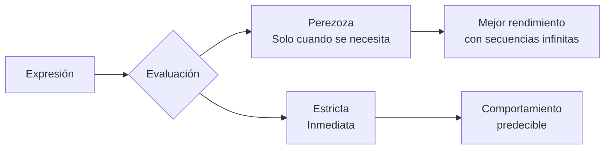
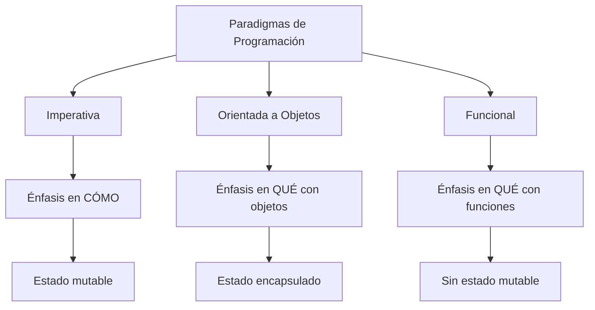

# Modelado y Programación - Lenguajes de programación

## 1.5 Programación funcional.

---

La **programación funcional** es un paradigma de programación que trata la computación como la evaluación de funciones matemáticas y evita el cambio de estado y los datos mutables. Se enfoca en **qué** se debe hacer en lugar de **cómo** hacerlo.

#### Principios Fundamentales

- **Funciones puras**: Sin efectos secundarios y transparencia referencial
- **Inmutabilidad**: Los datos no se modifican después de su creación
- **Funciones de primera clase**: Las funciones pueden tratarse como cualquier otro valor
- **Evaluación perezosa**: Las expresiones se evalúan solo cuando se necesitan

### Bases Matemáticas: λ-Cálculo

La programación funcional se basa en el λ-cálculo, un sistema formal para expresar computación:

#### Expresiones Lambda

$$
(\lambda x. x + 1) 5 \rightarrow 5 + 1 \rightarrow 6
$$

#### Funciones de Orden Superior

$$
map(f, [x_1, x_2, ..., x_n]) = [f(x_1), f(x_2), ..., f(x_n)]
$$

#### Reducción de Expresiones

$$
foldl(f, z, [x_1, x_2, ..., x_n]) = f(f(f(z, x_1), x_2), ..., x_n)
$$

### Conceptos Clave en Código

#### Funciones Puras

```python
# Función pura: mismo input → mismo output, sin efectos secundarios
def cuadrado(x):
    return x * x

# Función impura: tiene efecto secundario (modifica estado externo)
contador = 0
def incrementar_impuro():
    global contador
    contador += 1
    return contador
```

#### Inmutabilidad

```python
# Enfoque funcional: crear nuevas estructuras en lugar de modificar
def agregar_elemento(lista, elemento):
    return lista + [elemento]  # Nueva lista creada

# vs enfoque imperativo (modifica la original)
def agregar_elemento_imperativo(lista, elemento):
    lista.append(elemento)  # Modifica la lista original
    return lista
```

#### Funciones como Ciudadanos de Primera Clase

```python
# Las funciones pueden asignarse a variables
sumar = lambda x, y: x + y
operacion = sumar
resultado = operacion(3, 4)  # 7

# Las funciones pueden pasarse como argumentos
def aplicar_funcion(f, x, y):
    return f(x, y)

aplicar_funcion(sumar, 5, 3)  # 8
```

### Funciones de Orden Superior

#### Map

```python
# Aplica función a cada elemento
numeros = [1, 2, 3, 4, 5]
cuadrados = list(map(lambda x: x ** 2, numeros))
# [1, 4, 9, 16, 25]
```

#### Filter

```python
# Filtra elementos que cumplen condición
pares = list(filter(lambda x: x % 2 == 0, numeros))
# [2, 4]
```

#### Reduce

```python
from functools import reduce

# Reduce lista a un único valor
suma = reduce(lambda acc, x: acc + x, numeros, 0)
# 15
```

#### Composiciónde Funciones

```python
def compose(f, g):
    return lambda x: f(g(x))

doble = lambda x: x * 2
incrementar = lambda x: x + 1

doble_mas_uno = compose(doble, incrementar)
resultado = doble_mas_uno(5)  # (5 + 1) * 2 = 12
```

### Evaluación Perezoza vs Estricta



#### Ejemplo de Evaluación Perezoza

```python
# Generador perezoso en Python
def numeros_naturales():
    n = 0
    while True:
        yield n
        n += 1

# Solo calcula lo necesario
naturales = numeros_naturales()
primeros_5 = [next(naturales) for _ in range(5)]
# [0, 1, 2, 3, 4]
```

### Recursión y Tail Recursion

#### Recursión Simple

```python
def factorial(n):
    if n == 0:
        return 1
    else:
        return n * factorial(n - 1)

factorial(5)  # 120
```

#### Tail Recursion (Optimizable)

```python
def factorial_tail(n, acc=1):
    if n == 0:
        return acc
    else:
        return factorial_tail(n - 1, acc * n)

factorial_tail(5)  # 120
```

#### Recursión con Listas

```python
def longitud(lista):
    if not lista:
        return 0
    else:
        return 1 + longitud(lista[1:])

longitud([1, 2, 3, 4])  # 4
```

### Ejercicios Propuestos

#### Ejercicio 1: Implementar Funciones Funcionales

```python
# Implementa estas funciones usando enfoque funcional
def todos_cumplen(predicado, lista):
    # Retorna True si todos los elementos cumplen el predicado
    pass

def alguno_cumple(predicado, lista):
    # Retorna True si algún elemento cumple el predicado
    pass

def transformar_y_filtrar(transformacion, predicado, lista):
    # Aplica transformación y luego filtra
    pass
```

#### Ejercicio 2: Calculadora Funcional

Crea una calculadora usando funciones de orden superior:

```python
operaciones = {
    'suma': lambda x, y: x + y,
    'resta': lambda x, y: x - y,
    'multiplica': lambda x, y: x * y
}

def calcular(operacion, a, b):
    # Implementa usando el diccionario de operaciones
    pass
```

#### Ejercicio 3: Procesamiento de Datos

Procesa una lista de transacciones:

```python
transacciones = [
    {'monto': 100, 'tipo': 'deposito'},
    {'monto': 50, 'tipo': 'retiro'},
    {'monto': 200, 'tipo': 'deposito'}
]

# Calcula el balance final usando reduce
```

### Patrones Funcionales Comunes

#### Currying

```python
def curried_sumar(a):
    def sumar_b(b):
        return a + b
    return sumar_b

sumar_5 = curried_sumar(5)
resultado = sumar_5(3)  # 8
```

#### Functools.partial

```python
from functools import partial

def potencia(base, exponente):
    return base ** exponente

cuadrado = partial(potencia, exponente=2)
cubo = partial(potencia, exponente=3)

cuadrado(4)  # 16
cubo(3)      # 27
```

#### Monades en Python (Option)

```python
class Option:
    def __init__(self, value=None, is_empty=False):
        self.value = value
        self.is_empty = is_empty

    @staticmethod
    def some(value):
        return Option(value)

    @staticmethod
    def none():
        return Option(is_empty=True)

    def map(self, f):
        if self.is_empty:
            return Option.none()
        return Option.some(f(self.value))

    def flat_map(self, f):
        if self.is_empty:
            return Option.none()
        return f(self.value)

# Uso
resultado = Option.some(5).map(lambda x: x * 2).map(lambda x: x + 1)
```

### Ventajas y Desventajas

#### Ventajas (✓)

- **Código más predecible**: Funciones puras sin efectos secundarios
- **Más fácil de testear**: Funciones aisladas y determinísticas
- **Mejor para concurrencia**: Sin estado compartido mutable
- **Código más expresivo**: Menos líneas para misma funcionalidad

#### Desventajas [X]

- **Curva de aprendizaje**: Diferente forma de pensar
- **Rendimiento**: Inmutabilidad puede crear overhead
- **Debugging complejo**: Stack traces profundos con recursión
- **Ecosistema limitado**: Menos librerías puras funcionales

### Comparación con Otros Paradigmas



### Aplicaciones Prácticas

#### Procesamiento de Datos

```python
# Procesamiento funcional de dataset
datos = [{'nombre': 'A', 'edad': 25}, {'nombre': 'B', 'edad': 30}]

# Pipeline funcional
resultado = (
    datos
    | filter(lambda x: x['edad'] > 25)
    | map(lambda x: x['nombre'].upper())
    | list
)
# ['B']
```

#### Web Development (Ejemplo Reactivo)

```python
# Patrón reactivo funcional
def crear_gestor_eventos():
    suscriptores = []

    def suscribir(callback):
        suscriptores.append(callback)

    def notificar(evento):
        for callback in suscriptores:
            callback(evento)

    return suscribir, notificar

suscribir, notificar = crear_gestor_eventos()
```

### Referencias y Recursos

#### Libros Recomendados

1. "Structure and Interpretation of Computer Programs" - Harold Abelson
2. "Functional Programming in Python" - David Mertz
3. "Learn You a Haskell for Great Good!" - Miran Lipovača

#### Lenguajes Funcionales

- **Haskell**: Puramente funcional, perezoso
- **Clojure**: Funcional en JVM, inmutabilidad por defecto
- **Elixir**: Funcional, concurrente, basado en Erlang
- **Scala**: Híbrido OO/funcional en JVM

#### Herramientas y Librerías

- **Python**: functools, itertools, toolz
- **JavaScript**: Lodash, Ramda, Immutable.js
- **Java**: Vavr, Stream API

### Consejos para Aprender Programación Funcional

1. **Empieza con pequeños problemas**: Practica con katas de código
2. **Evita el estado mutable**: Usa inmutabilidad siempre que sea posible
3. **Aprende a usar recursión**: Reemplaza bucles con recursión
4. **Domina las HOF**: Practice map, filter, reduce diariamente
5. **Experimenta con lenguajes puros**: Haskell o Clojure para inmersión
6. **Refactoriza código imperativo**: Convierte código existente a funcional

### Autoevaluación

1. ¿Qué es una función pura? Da un ejemplo y un contraejemplo.
2. Implementa `map` y `filter` usando recursión.
3. Convierte este código imperativo a funcional:

```python
resultados = []
for i in range(10):
    if i % 2 == 0:
        resultados.append(i * 2)
```

4. Explica el concepto de transparencia referencial.
5. ¿Qué ventajas tiene la evaluación perezosa?
