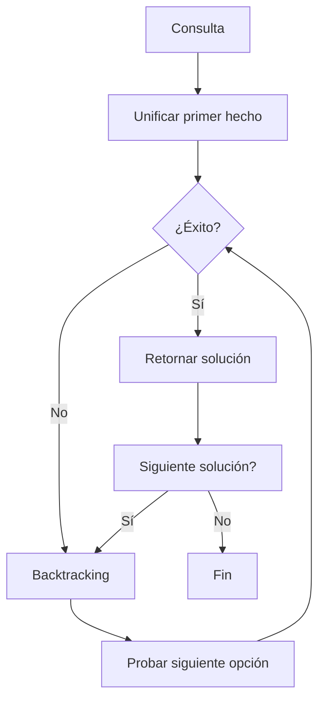

# Modelado y Programación - Lenguajes de programación

## 1.6 Programación lógica.

---

La **programación lógica** es un paradigma de programación basado en la lógica formal que expresa hechos y reglas sobre algún problema domain y permite al sistema inferir soluciones mediante mecanismos de deducción automática. Se centra en **qué** se debe resolver más que en **cómo** resolverlo.

#### Fundamentos Matemáticos

La programación lógica se basa en la **lógica de primer orden** (lógica de predicados):

$$
\forall x \forall y (padre(x, y) \rightarrow antepasado(x, y))
$$

$$
\forall x \forall y \forall z (antepasado(x, y) \land antepasado(y, z) \rightarrow antepasado(x, z))
$$

### Conceptos Básicos

#### Componentes Principales

1. **Hechos (Facts)**: Afirmaciones verdaderas sobre el dominio
2. **Reglas (Rules)**: Relaciones lógicas entre hechos
3. **Consultas (Queries)**: Preguntas al sistema sobre el conocimiento

#### Sintaxis Básica en Prolog

```prolog
% Hechos (afirmaciones básicas)
padre(juan, maria).
padre(juan, carlos).
padre(pedro, juan).
mujer(maria).
hombre(juan).
hombre(carlos).
hombre(pedro).

% Reglas (relaciones derivadas)
abuelo(X, Y) :- padre(X, Z), padre(Z, Y).
hermano(X, Y) :- padre(Z, X), padre(Z, Y), X \= Y.

% Consultas
% ?- abuelo(pedro, maria).  % true
% ?- hermano(maria, carlos). % true
```

### Sistema de Inferencia Lógica

#### Unificación y Resolución

La programación lógica utiliza el **principio de resolución** para derivar nuevas conclusiones:

$$
\frac{A \lor B, \neg A \lor C}{B \lor C}
$$

#### Backtracking Automático



### Programación en Prolog

#### Estructura de un Programa

```prolog
% BASE DE CONOCIMIENTO

% Hechos
animal(perro).
animal(gato).
animal(pez).
mamifero(perro).
mamifero(gato).
pone_huevos(pez).

% Reglas
es_mamifero(X) :- animal(X), mamifero(X).
no_es_mamifero(X) :- animal(X), not(mamifero(X)).

% Consultas típicas
% ?- es_mamifero(perro).  % true
% ?- es_mamifero(pez).    % false
```

#### Listas y Recursión

```prolog
% Miembro de una lista
miembro(X, [X|_]).
miembro(X, [_|Cola]) :- miembro(X, Cola).

% Concatenación de listas
concatenar([], L, L).
concatenar([X|L1], L2, [X|L3]) :- concatenar(L1, L2, L3).

% Longitud de una lista
longitud([], 0).
longitud([_|Cola], N) :- longitud(Cola, M), N is M + 1.
```

### Ejercicios Propuestos

#### Ejercicio 1: Base de Conocimiento Familiar

Crea una base de conocimiento que incluya:

- Relaciones de parentesco: padre, madre, abuelo, tío, primo
- Reglas para determinar si dos personas son familiares
- Consultas para encontrar todos los nietos de una persona

#### Ejercicio 2: Solucionador de Laberintos

```prolog
% Define las conexiones entre habitaciones
conectado(habitacion1, habitacion2).
conectado(habitacion2, habitacion3).
% ...

% Regla para encontrar camino entre dos puntos
camino(Inicio, Fin, Camino) :-
    camino_aux(Inicio, Fin, [Inicio], Camino).

camino_aux(Fin, Fin, Visitados, Visitados).
camino_aux(Actual, Fin, Visitados, Camino) :-
    conectado(Actual, Siguiente),
    not(miembro(Siguiente, Visitados)),
    camino_aux(Siguiente, Fin, [Siguiente|Visitados], Camino).
```

#### Ejercicio 3: Sistema de Recomendaciones

Crea un sistema que recomiende actividades basado en:

- Preferencias del usuario
- Condiciones climáticas
- Disponibilidad de tiempo

### Aplicaciones de la Programación Lógica

#### Sistemas Expertos

```prolog
% Sistema experto médico
sintoma(fiebre).
sintoma(tos).
sintoma(dolor_cabeza).

enfermedad(gripe) :-
    sintoma(fiebre),
    sintoma(tos),
    sintoma(dolor_cabeza).

enfermedad(resfriado) :-
    sintoma(tos),
    not(sintoma(fiebre)).

diagnostico(Paciente, Enfermedad) :-
    tiene_sintoma(Paciente, Sintomas),
    enfermedad(Enfermedad),
    verifica_sintomas(Enfermedad, Sintomas).
```

#### Procesamiento de Lenguaje Natural

```prolog
% Gramática simple
oracion(Sujeto, Predicado) :-
    frase_nominal(Sujeto),
    frase_verbal(Predicado).

frase_nominal(nombre(juan)) :- true.
frase_verbal(verbo(corre)) :- true.

% ?- oracion(Sujeto, Predicado).
% Sujeto = nombre(juan), Predicado = verbo(corre)
```

### Resolución de Problemas con Restricciones

#### Programación con Restricciones (CLP)

```prolog
% Sudoku solver usando restricciones
:- use_module(library(clpfd)).

sudoku(Filas) :-
    append(Filas, Vs), Vs ins 1..9,
    maplist(all_distinct, Filas),
    transpose(Filas, Columnas),
    maplist(all_distinct, Columnas),
    Filas = [A,B,C,D,E,F,G,H,I],
    bloques(A, B, C), bloques(D, E, F), bloques(G, H, I).

bloques([], [], []).
bloques([A,B,C|Bs1], [D,E,F|Bs2], [G,H,I|Bs3]) :-
    all_distinct([A,B,C,D,E,F,G,H,I]),
    bloques(Bs1, Bs2, Bs3).
```

### Ventajas y Limitaciones

#### Ventajas (✓)

- **Alto nivel de abstracción**: Describe el qué, no el cómo
- **Búsqueda automática**: Backtracking incorporado
- **Flexibilidad**: Fácil modificación y extensión
- **Manejo de conocimiento**: Ideal para sistemas expertos

#### Limitaciones [X]

- **Eficiencia**: Puede ser menos eficiente que paradigmas imperativos
- **Curva de aprendizaje**: Pensamiento diferente a programación tradicional
- **Dominios específicos**: Mejor para problemas simbólicos que numéricos

### Herramientas y Lenguajes

#### Principales Lenguajes Lógicos

1. **Prolog**: El más popular, múltiples implementaciones
2. **Mercury**: Prolog con sistema de tipos estático
3. **Datalog**: Subconjunto de Prolog para bases de datos
4. **Answer Set Programming (ASP)**: Para problemas complejos de búsqueda

#### Entornos de Desarrollo

- **SWI-Prolog**: Implementación ampliamente usada con buen debugging
- **Visual Prolog**: Con interfaz gráfica y sistema de tipos
- **Tau Prolog**: Prolog en JavaScript para web

### Ejemplos Avanzados

#### Resolución de Puzzles

```prolog
% Problema de las 8 reinas
ocho_reinas(Solucion) :-
    Solucion = [_,_,_,_,_,_,_,_],
    Solucion ins 1..8,
    todas_diferentes(Solucion),
    seguras(Solucion).

seguras([]).
seguras([X|Xs]) :-
    no_ataque(X, Xs, 1),
    seguras(Xs).

no_ataque(_, [], _).
no_ataque(X, [Y|Ys], N) :-
    X #\= Y,
    X #\= Y + N,
    X #\= Y - N,
    N1 is N + 1,
    no_ataque(X, Ys, N1).
```

#### Base de Datos Deductiva

```prolog
% Hechos básicos
vuelo(nueva_york, londres, aa100, 8:00, 20:00).
vuelo(londres, paris, ba200, 21:00, 22:30).

% Reglas de conectividad
conectado(Origen, Destino, HoraSalida, HoraLlegada) :-
    vuelo(Origen, Destino, _, HoraSalida, HoraLlegada).

conectado(Origen, Destino, HoraSalida, HoraLlegada) :-
    vuelo(Origen, Escala, _, HoraSalida, HoraLlegada1),
    vuelo(Escala, Destino, _, HoraSalida2, HoraLlegada),
    HoraLlegada1 < HoraSalida2.
```

### Conceptos Teóricos Importantes

#### Semántica de Programas Lógicos

- **Semántica declarativa**: Qué significa un programa
- **Semántica procedural**: Cómo se ejecuta un programa
- **Punto fijo**: Mínimo modelo que satisface todas las reglas

#### Teoría de Modelos

Un programa lógico define un **modelo mínimo** que contiene todos los hechos que pueden derivarse de las reglas:

$$
T_P(I) = \{A | A \leftarrow B_1, \ldots, B_n \in P \text{ y } B_1, \ldots, B_n \in I\}
$$

### Autoevaluación

1. Define los conceptos: hecho, regla, consulta y unificación.
2. Escribe un programa Prolog para calcular el factorial de un número.
3. Explica cómo funciona el backtracking en programación lógica.
4. Crea una base de conocimiento para representar genealogías.
5. ¿Qué problemas son adecuados para programación lógica y cuáles no?

### Referencias y Recursos

#### Libros Recomendados

1. "Programming in Prolog" by W. F. Clocksin and C. S. Mellish
2. "The Art of Prolog" by Leon Sterling and Ehud Shapiro
3. "Logic, Programming and Prolog" by Ulf Nilsson and Jan Maluszynski

#### Recursos Online

- [SWI-Prolog Documentation](https://www.swi-prolog.org/)
- [Learn Prolog Now!](http://www.learnprolognow.org/)
- [Prolog Tutorial](https://www.cpp.edu/~jrfisher/www/prolog_tutorial/)

#### Herramientas para Practicar

- [SWI-Prolog](https://www.swi-prolog.org/Download.html)
- [Online Prolog Compiler](https://www.tutorialspoint.com/execute_prolog_online.php)
- [Prolog Problems](https://sites.google.com/site/prologsite/prolog-problems)
