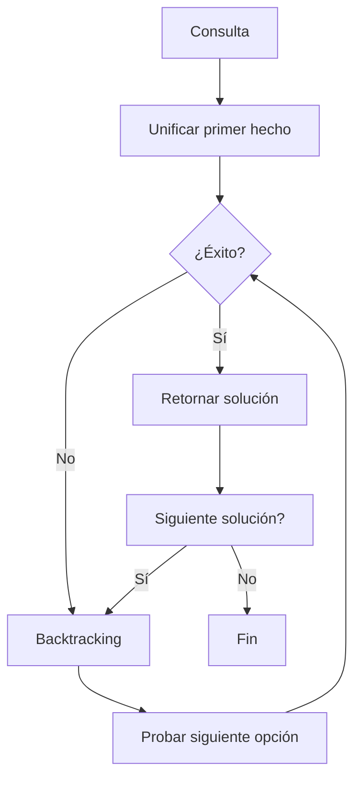

# Modelado y Programación - Lenguajes de programación

## 1.6 Programación lógica.

---

La **programación lógica** es un paradigma de programación basado en la lógica formal que expresa hechos y reglas sobre el dominio de un problema y permite al sistema inferir soluciones mediante mecanismos de deducción automática. Se centra en **qué** se debe resolver más que en **cómo** resolverlo.

#### Fundamentos Matemáticos

La programación lógica se basa en la **lógica de primer orden** (lógica de predicados):

$$
\forall x \forall y (padre(x, y) \rightarrow antepasado(x, y))
$$

$$
\forall x \forall y \forall z (antepasado(x, y) \land antepasado(y, z) \rightarrow antepasado(x, z))
$$

Prolog usa un fragmento de esta lógica, las **cláusulas de Horn**: implicaciones con una sola conclusión, $B_1 \land \cdots \land B_n \rightarrow A,$ que se escriben `A :- B1, ..., Bn.` Las dos fórmulas anteriores son, en Prolog:

```prolog
antepasado(X, Y) :- padre(X, Y).
antepasado(X, Z) :- antepasado(X, Y), antepasado(Y, Z).
```

En la práctica la segunda regla se escribe `antepasado(X, Z) :- padre(X, Y), antepasado(Y, Z).` para que la búsqueda en profundidad de Prolog no entre en un ciclo infinito: el orden de las reglas y de los objetivos afecta la ejecución, aunque no el significado lógico.

### Conceptos Básicos

#### Componentes Principales

1. **Hechos (Facts)**: Afirmaciones verdaderas sobre el dominio
2. **Reglas (Rules)**: Relaciones lógicas entre hechos
3. **Consultas (Queries)**: Preguntas al sistema sobre el conocimiento

#### Sintaxis Básica en Prolog

```prolog
% Hechos (afirmaciones básicas)
padre(juan, maria).
padre(juan, carlos).
padre(pedro, juan).
mujer(maria).
hombre(juan).
hombre(carlos).
hombre(pedro).

% Reglas (relaciones derivadas)
abuelo(X, Y) :- padre(X, Z), padre(Z, Y).
hermano(X, Y) :- padre(Z, X), padre(Z, Y), X \= Y.

% Consultas
% ?- abuelo(pedro, maria).  % true
% ?- hermano(maria, carlos). % true
```

### Sistema de Inferencia Lógica

#### Unificación y Resolución

La programación lógica utiliza el **principio de resolución** para derivar nuevas conclusiones:

$$
\frac{A \lor B, \neg A \lor C}{B \lor C}
$$

Para responder una consulta, Prolog intenta **refutar su negación**. Toma el primer objetivo pendiente, busca una cláusula cuya cabeza se pueda **unificar** con él y lo sustituye por el cuerpo de esa cláusula; si no quedan objetivos, la consulta tuvo éxito.

La **unificación** encuentra la sustitución más general que hace iguales dos términos. Por ejemplo, `padre(X, maria)` y `padre(juan, Y)` se unifican con `X = juan, Y = maria`; `f(X, X)` y `f(a, b)` no se pueden unificar.

#### Backtracking Automático



### Programación en Prolog

#### Estructura de un Programa

```prolog
% BASE DE CONOCIMIENTO

% Hechos
animal(perro).
animal(gato).
animal(pez).
mamifero(perro).
mamifero(gato).
pone_huevos(pez).

% Reglas
es_mamifero(X) :- animal(X), mamifero(X).
no_es_mamifero(X) :- animal(X), \+ mamifero(X).   % \+ es la negación

% Consultas típicas
% ?- es_mamifero(perro).  % true
% ?- es_mamifero(pez).    % false
% ?- no_es_mamifero(X).   % X = pez
```

La negación de Prolog es **negación por fallo**: `\+ mamifero(pez)` es verdadero porque no se puede demostrar `mamifero(pez)`. Equivale a suponer que todo lo que no está en la base de conocimiento es falso (**hipótesis del mundo cerrado**).

#### Listas y Recursión

```prolog
% Miembro de una lista
miembro(X, [X|_]).
miembro(X, [_|Cola]) :- miembro(X, Cola).

% Concatenación de listas
concatenar([], L, L).
concatenar([X|L1], L2, [X|L3]) :- concatenar(L1, L2, L3).

% Longitud de una lista
longitud([], 0).
longitud([_|Cola], N) :- longitud(Cola, M), N is M + 1.

% ?- concatenar([1,2], [3], L).    % L = [1,2,3]
% ?- concatenar(X, Y, [1,2]).      % X = [], Y = [1,2] ; X = [1], Y = [2] ; X = [1,2], Y = []
```

Las relaciones de Prolog funcionan **en varias direcciones**: la misma definición de `concatenar` sirve para unir listas y para partir una lista de todas las formas posibles. En cambio, `is` evalúa aritmética y exige que el lado derecho esté instanciado.

### Ejercicios Propuestos

#### Ejercicio 1: Base de Conocimiento Familiar

Crea una base de conocimiento que incluya:

- Relaciones de parentesco: padre, madre, abuelo, tío, primo
- Reglas para determinar si dos personas son familiares
- Consultas para encontrar todos los nietos de una persona

#### Ejercicio 2: Solucionador de Laberintos

```prolog
% Define las conexiones entre habitaciones
conectado(habitacion1, habitacion2).
conectado(habitacion2, habitacion3).
% ...

conectado(habitacion1, habitacion3).

% Regla para encontrar camino entre dos puntos
camino(Inicio, Fin, Camino) :-
    camino_aux(Inicio, Fin, [Inicio], CaminoInverso),
    reverse(CaminoInverso, Camino).   % los visitados se acumulan al revés

camino_aux(Fin, Fin, Visitados, Visitados).
camino_aux(Actual, Fin, Visitados, Camino) :-
    conectado(Actual, Siguiente),
    \+ miembro(Siguiente, Visitados),  % evita ciclos
    camino_aux(Siguiente, Fin, [Siguiente|Visitados], Camino).

% ?- findall(C, camino(habitacion1, habitacion3, C), Cs).
% Cs = [[habitacion1,habitacion2,habitacion3], [habitacion1,habitacion3]]
```

Si las puertas se pueden cruzar en ambos sentidos, se agrega `puerta(A, B) :- conectado(A, B) ; conectado(B, A).` y se usa `puerta` en lugar de `conectado`.

#### Ejercicio 3: Sistema de Recomendaciones

Crea un sistema que recomiende actividades basado en:

- Preferencias del usuario
- Condiciones climáticas
- Disponibilidad de tiempo

### Aplicaciones de la Programación Lógica

#### Sistemas Expertos

```prolog
% Sistema experto médico (ejemplo didáctico, no clínico)
tiene_sintoma(ana, fiebre).
tiene_sintoma(ana, tos).
tiene_sintoma(ana, dolor_cabeza).
tiene_sintoma(luis, tos).

diagnostico(P, gripe) :-
    tiene_sintoma(P, fiebre),
    tiene_sintoma(P, tos),
    tiene_sintoma(P, dolor_cabeza).

diagnostico(P, resfriado) :-
    tiene_sintoma(P, tos),
    \+ tiene_sintoma(P, fiebre).

% ?- findall(P-E, diagnostico(P, E), Ds).
% Ds = [ana-gripe, luis-resfriado]
```

#### Procesamiento de Lenguaje Natural

```prolog
% Gramática simple
oracion(Sujeto, Predicado) :-
    frase_nominal(Sujeto),
    frase_verbal(Predicado).

frase_nominal(nombre(juan)) :- true.
frase_verbal(verbo(corre)) :- true.

% ?- oracion(Sujeto, Predicado).
% Sujeto = nombre(juan), Predicado = verbo(corre)
```

### Resolución de Problemas con Restricciones

#### Programación con Restricciones (CLP)

```prolog
% Sudoku solver usando restricciones
:- use_module(library(clpfd)).

sudoku(Filas) :-
    length(Filas, 9), maplist(same_length(Filas), Filas),   % tablero 9 x 9
    append(Filas, Vs), Vs ins 1..9,
    maplist(all_distinct, Filas),
    transpose(Filas, Columnas),
    maplist(all_distinct, Columnas),
    Filas = [A,B,C,D,E,F,G,H,I],
    bloques(A, B, C), bloques(D, E, F), bloques(G, H, I).

bloques([], [], []).
bloques([A,B,C|Bs1], [D,E,F|Bs2], [G,H,I|Bs3]) :-
    all_distinct([A,B,C,D,E,F,G,H,I]),
    bloques(Bs1, Bs2, Bs3).

% Uso: Filas es una lista de 9 listas con números y variables (_) en las casillas vacías.
% ?- problema(P), sudoku(P), maplist(labeling([ff]), P).
```

El programa no describe ningún algoritmo de búsqueda: solo enuncia las reglas del sudoku. La biblioteca `clpfd` propaga las restricciones para reducir los dominios, y `labeling` prueba valores para las variables que queden.

### Ventajas y Limitaciones

#### Ventajas (✓)

- **Alto nivel de abstracción**: Describe el qué, no el cómo
- **Búsqueda automática**: Backtracking incorporado
- **Flexibilidad**: Fácil modificación y extensión
- **Manejo de conocimiento**: Ideal para sistemas expertos

#### Limitaciones [X]

- **Eficiencia**: Puede ser menos eficiente que paradigmas imperativos
- **Curva de aprendizaje**: Pensamiento diferente a programación tradicional
- **Dominios específicos**: Mejor para problemas simbólicos que numéricos

### Herramientas y Lenguajes

#### Principales Lenguajes Lógicos

1. **Prolog**: El más popular, múltiples implementaciones
2. **Mercury**: Prolog con sistema de tipos estático
3. **Datalog**: Subconjunto de Prolog para bases de datos
4. **Answer Set Programming (ASP)**: Para problemas complejos de búsqueda

#### Entornos de Desarrollo

- **SWI-Prolog**: Implementación ampliamente usada con buen debugging
- **Visual Prolog**: Con interfaz gráfica y sistema de tipos
- **Tau Prolog**: Prolog en JavaScript para web

### Ejemplos Avanzados

#### Resolución de Puzzles

```prolog
% Problema de las 8 reinas: Solucion[i] es la fila de la reina en la columna i
:- use_module(library(clpfd)).

ocho_reinas(Solucion) :-
    length(Solucion, 8),
    Solucion ins 1..8,
    all_different(Solucion),      % no hay dos reinas en la misma fila
    seguras(Solucion),
    label(Solucion).              % busca valores concretos

seguras([]).
seguras([X|Xs]) :-
    no_ataque(X, Xs, 1),
    seguras(Xs).

no_ataque(_, [], _).
no_ataque(X, [Y|Ys], N) :-        % N es la distancia entre columnas
    X #\= Y + N,                  % no comparten diagonal
    X #\= Y - N,
    N1 is N + 1,
    no_ataque(X, Ys, N1).

% ?- ocho_reinas(S).
% S = [1,5,8,6,3,7,2,4]
```

#### Base de Datos Deductiva

```prolog
% Hechos básicos: horas en minutos desde la medianoche, para poder compararlas
vuelo(nueva_york, londres, aa100, 480, 1200).    % 8:00 a 20:00
vuelo(londres, paris, ba200, 1260, 1350).        % 21:00 a 22:30

% Reglas de conectividad
conectado(Origen, Destino, HoraSalida, HoraLlegada) :-
    vuelo(Origen, Destino, _, HoraSalida, HoraLlegada).

conectado(Origen, Destino, HoraSalida, HoraLlegada) :-
    vuelo(Origen, Escala, _, HoraSalida, HoraLlegada1),
    vuelo(Escala, Destino, _, HoraSalida2, HoraLlegada),
    HoraLlegada1 < HoraSalida2.

% ?- conectado(nueva_york, paris, S, L).
% S = 480, L = 1350
```

Escribir las horas como `8:00` no funciona con `<`: Prolog lo lee como el término `8:0`, no como un número.

### Conceptos Teóricos Importantes

#### Semántica de Programas Lógicos

- **Semántica declarativa**: Qué significa un programa
- **Semántica procedural**: Cómo se ejecuta un programa
- **Punto fijo**: Mínimo modelo que satisface todas las reglas

#### Teoría de Modelos

Un programa lógico define un **modelo mínimo** que contiene todos los hechos que pueden derivarse de las reglas:

$$
T_P(I) = \{A \mid A \leftarrow B_1, \ldots, B_n \text{ es instancia básica de una cláusula de } P \text{ y } B_1, \ldots, B_n \in I\}
$$

El **modelo mínimo** es el menor punto fijo de $T_P:$ se obtiene empezando con $I_0 = \emptyset$ y aplicando $T_P$ repetidamente. Por ejemplo, con los hechos `padre` y las reglas de `antepasado`, $T_P(\emptyset)$ contiene los hechos `padre(...)`; la siguiente iteración agrega los `antepasado` directos; luego los de dos generaciones, y así hasta que no aparece nada nuevo.

### Autoevaluación

1. Define los conceptos: hecho, regla, consulta y unificación.
2. Escribe un programa Prolog para calcular el factorial de un número.
3. Explica cómo funciona el backtracking en programación lógica.
4. Crea una base de conocimiento para representar genealogías.
5. ¿Qué problemas son adecuados para programación lógica y cuáles no?

### Soluciones

**Autoevaluación 2.**

```prolog
factorial(0, 1).
factorial(N, F) :-
    N > 0,
    N1 is N - 1,
    factorial(N1, F1),
    F is N * F1.

% ?- factorial(5, F).   % F = 120
```

La condición `N > 0` evita que, al pedir más soluciones, la segunda cláusula se aplique a `0` y descienda a números negativos sin terminar.

**Autoevaluación 5.** Son adecuados los problemas simbólicos y de búsqueda: bases de conocimiento, reglas de negocio, análisis de lenguaje, planificación, problemas de restricciones como horarios o sudokus. Son poco adecuados los cálculos numéricos intensivos y los programas con mucha entrada y salida o estado mutable.

### Referencias y Recursos

#### Libros Recomendados

1. "Programming in Prolog" by W. F. Clocksin and C. S. Mellish
2. "The Art of Prolog" by Leon Sterling and Ehud Shapiro
3. "Logic, Programming and Prolog" by Ulf Nilsson and Jan Maluszynski

#### Recursos Online

- [SWI-Prolog Documentation](https://www.swi-prolog.org/)
- [Learn Prolog Now!](http://www.learnprolognow.org/)
- [Prolog Tutorial](https://www.cpp.edu/~jrfisher/www/prolog_tutorial/)

#### Herramientas para Practicar

- [SWI-Prolog](https://www.swi-prolog.org/Download.html)
- [Online Prolog Compiler](https://www.tutorialspoint.com/execute_prolog_online.php)
- [Prolog Problems](https://sites.google.com/site/prologsite/prolog-problems)
