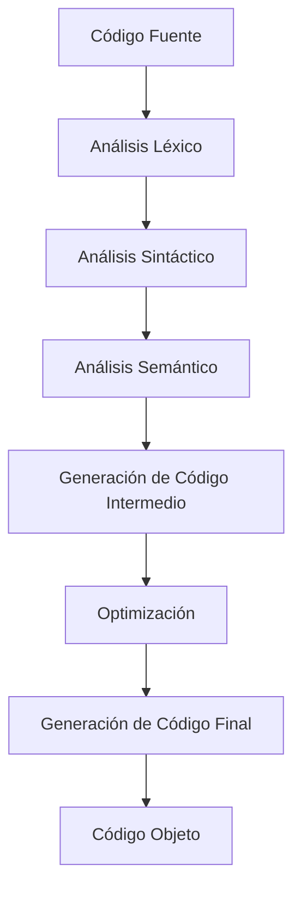
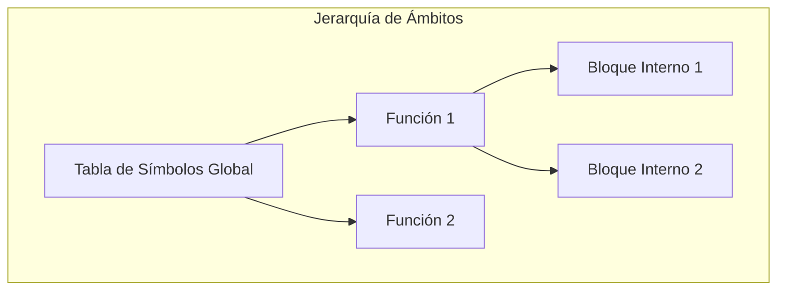

# Modelado y Programación - Lenguajes de programación

## 1.7 Tecnologías de compiladores e intérpretes.

---

Un **compilador** es un programa que traduce código fuente escrito en un lenguaje de programación (lenguaje fuente) a otro lenguaje (lenguaje objetivo), generalmente código máquina. Un **intérprete** es un programa que ejecuta directamente las instrucciones del código fuente sin una etapa de compilación previa a código máquina.

#### Diferencias Fundamentales

| Compilador                                    | Intérprete                                  |
| --------------------------------------------- | ------------------------------------------- |
| Traduce todo el programa antes de ejecutar    | Traduce y ejecuta línea por línea           |
| Genera código objeto ejecutable               | No genera código objeto                     |
| Ejecución más rápida                          | Ejecución más lenta                         |
| Detección de errores en tiempo de compilación | Detección de errores en tiempo de ejecución |

### Arquitectura de un Compilador

#### Fases de un Compilador



### Fases de Compilación Detalladas

#### 1. Análisis Léxico (Scanner)

Convierte el flujo de caracteres en tokens (componentes léxicos).

**Ejemplo**:

```c
// Código fuente: resultado = valor + 10;
Tokens generados:
- IDENTIFICADOR (resultado)
- OPERADOR_ASIGNACION (=)
- IDENTIFICADOR (valor)
- OPERADOR_SUMA (+)
- ENTERO (10)
- DELIMITADOR (;)
```

#### 2. Análisis Sintáctico (Parser)

Verifica la estructura gramatical según las reglas del lenguaje.

**Gramática formal**:

$$ \begin{align*} S &\rightarrow \text{asignacion} \\\ \text{asignacion} &\rightarrow \text{IDENTIFICADOR } = \text{ expresion } ; \\\ \text{expresion} &\rightarrow \text{termino} \\\ &\quad | \text{ expresion } + \text{ termino} \\\ &\quad | \text{ expresion } - \text{ termino} \\\ \text{termino} &\rightarrow \text{factor} \\\ &\quad | \text{ termino } * \text{ factor} \\\ &\quad | \text{ termino } / \text{ factor} \\\ \text{factor} &\rightarrow \text{IDENTIFICADOR} \\\ &\quad | \text{ ENTERO} \\\ &\quad | ( \text{ expresion } ) \end{align*} $$

#### 3. Análisis Semántico

Verifica el significado y la validez de las construcciones.

**Comprobaciones**:

- Tipos de datos compatibles
- Variables declaradas antes de usar
- Compatibilidad en operaciones

#### 4. Generación de Código Intermedio

Crea una representación intermedia (como código de tres direcciones).

**Ejemplo**:

```python
# Código fuente: x = a + b * c
# Código de tres direcciones:
t1 = b * c
t2 = a + t1
x = t2
```

#### 5. Optimización

Mejora el código intermedio para mayor eficiencia.

**Técnicas comunes**:

- Eliminación de código muerto
- Propagación de constantes
- Simplificación de expresiones

#### 6. Generación de Código Final

Produce el código objeto o assembly.

### Teoría de Autómatas y Lenguajes Formales

#### Jerarquía de Chomsky

$$ \begin{align*} \text{Tipo 0} & : \text{Gramáticas no restringidas} \\\ \text{Tipo 1} & : \text{Gramáticas sensibles al contexto} \\\ \text{Tipo 2} & : \text{Gramáticas libres de contexto} \\\ \text{Tipo 3} & : \text{Gramáticas regulares} \end{align*} $$

#### Expresiones Regulares para Análisis Léxico

$$ \begin{align*} \text{IDENTIFICADOR} & : \text{[a-zA-Z][a-zA-Z0-9]*} \\\ \text{ENTERO} & : \text{[0-9]+} \\\ \text{REAL} & : \text{[0-9]}\pm.\text{[0-9]+} \\\ \text{OPERADOR} & : \text{[+-*/=]} \\\ \text{DELIMITADOR} & : \text{[;(),\{\}]} \end{align*} $$

### Implementación de un Analizador Léxico Simple

```python
import re

class Lexer:
    def __init__(self, code):
        self.code = code
        self.position = 0
        self.tokens = []

        # Definición de patrones de tokens
        self.token_specs = [
            ('NUMBER',   r'\d+'),
            ('IDENT',    r'[a-zA-Z_][a-zA-Z0-9_]*'),
            ('OP',       r'[+\-*/=]'),
            ('WHITESPACE', r'\s+'),
            ('MISMATCH', r'.')
        ]

    def tokenize(self):
        while self.position < len(self.code):
            match = None
            for token_type, pattern in self.token_specs:
                regex = re.compile(pattern)
                match = regex.match(self.code, self.position)
                if match:
                    value = match.group(0)
                    if token_type != 'WHITESPACE':
                        self.tokens.append((token_type, value))
                    self.position = match.end()
                    break
            if not match:
                raise Exception(f'Carácter inválido: {self.code[self.position]}')
        return self.tokens

# Ejemplo de uso
lexer = Lexer("x = 10 + y * 5")
tokens = lexer.tokenize()
print(tokens)
# [('IDENT', 'x'), ('OP', '='), ('NUMBER', '10'),
#  ('OP', '+'), ('IDENT', 'y'), ('OP', '*'), ('NUMBER', '5')]
```

### Algoritmos de Parsing

#### Parsing Descendente Recursivo

```python
class Parser:
    def __init__(self, tokens):
        self.tokens = tokens
        self.position = 0
        self.current_token = self.tokens[0] if tokens else None

    def eat(self, token_type):
        if self.current_token and self.current_token[0] == token_type:
            self.position += 1
            if self.position < len(self.tokens):
                self.current_token = self.tokens[self.position]
            else:
                self.current_token = None
        else:
            raise Exception(f'Se esperaba {token_type}, se encontró {self.current_token[0]}')

    def factor(self):
        token = self.current_token
        if token[0] == 'NUMBER':
            self.eat('NUMBER')
            return {'type': 'number', 'value': int(token[1])}
        elif token[0] == 'IDENT':
            self.eat('IDENT')
            return {'type': 'variable', 'name': token[1]}
        elif token[0] == 'OP' and token[1] == '(':
            self.eat('OP')
            node = self.expr()
            self.eat('OP')  # Para ')'
            return node

    def term(self):
        node = self.factor()
        while self.current_token and self.current_token[0] == 'OP' and self.current_token[1] in ['*', '/']:
            token = self.current_token
            self.eat('OP')
            node = {'type': 'binop', 'op': token[1], 'left': node, 'right': self.factor()}
        return node

    def expr(self):
        node = self.term()
        while self.current_token and self.current_token[0] == 'OP' and self.current_token[1] in ['+', '-']:
            token = self.current_token
            self.eat('OP')
            node = {'type': 'binop', 'op': token[1], 'left': node, 'right': self.term()}
        return node
```

### Tabla de Símbolos y Gestión de Contextos



### Generación de Código Intermedio

#### Código de Tres Direcciones

```python
def generate_three_address_code(node):
    temp_counter = 0
    code = []

    def generate(node):
        nonlocal temp_counter
        if node['type'] == 'number':
            return node['value']
        elif node['type'] == 'variable':
            return node['name']
        elif node['type'] == 'binop':
            left = generate(node['left'])
            right = generate(node['right'])
            temp_var = f't{temp_counter}'
            temp_counter += 1
            code.append(f'{temp_var} = {left} {node["op"]} {right}')
            return temp_var

    result = generate(node)
    if result not in code[-1]:  # Si no se usó en la última instrucción
        code.append(f'result = {result}')
    return code

# Ejemplo
ast = {'type': 'binop', 'op': '+',
       'left': {'type': 'number', 'value': 5},
       'right': {'type': 'binop', 'op': '*',
                'left': {'type': 'number', 'value': 3},
                'right': {'type': 'number', 'value': 2}}}
tac = generate_three_address_code(ast)
print(tac)
# ['t0 = 3 * 2', 't1 = 5 + t0', 'result = t1']
```

### Ejercicios Propuestos

#### Ejercicio 1: Implementar un Analizador Léxico

Crea un lexer para un subconjunto de Python que reconozca:

- Palabras reservadas: `if`, `else`, `while`, `def`
- Identificadores y números
- Operadores y delimitadores
- Comentarios de una línea

#### Ejercicio 2: Desarrollar un Parser para Expresiones Aritméticas

Implementa un parser que maneje:

- Operadores de precedencia: `*`, `/` > `+`, `-`
- Paréntesis para agrupamiento
- Variables y constantes numéricas

#### Ejercicio 3: Generador de Código Intermedio

Desarrolla un generador de código de tres direcciones para:

- Expresiones aritméticas complejas
- Estructuras de control: if-else, while
- Asignaciones múltiples

#### Ejercicio 4: Optimizador de Código

Implementa optimizaciones básicas:

- Propagación de constantes
- Eliminación de código muerto
- Simplificación de expresiones algebraicas

### Técnicas de Optimización

#### Optimización Local

```python
# Antes de optimización
t1 = 5 * 2    # 10 (constante)
t2 = x + t1   # x + 10
t3 = t2 * 1   # x + 10 (×1 es redundante)

# Después de optimización
t2 = x + 10   # Propagación de constante
# t3 eliminado (redundante)
```

#### Optimización de Bucles

```python
# Antes: cálculo redundante en cada iteración
for i in range(n):
    result = array[i] * (width * height)  # width*height constante

# Después: cálculo fuera del bucle
area = width * height
for i in range(n):
    result = array[i] * area
```

### Algoritmos de Análisis

#### Análisis de Alcance (Scoping)

```python
class ScopeAnalyzer:
    def __init__(self):
        self.scope_stack = [{}]  # Pila de tablas de símbolos
        self.current_scope = 0

    def enter_scope(self):
        self.scope_stack.append({})
        self.current_scope += 1

    def exit_scope(self):
        self.scope_stack.pop()
        self.current_scope -= 1

    def declare_variable(self, name, type):
        if name in self.scope_stack[-1]:
            raise Exception(f"Variable '{name}' ya declarada en este ámbito")
        self.scope_stack[-1][name] = {'type': type, 'scope': self.current_scope}

    def lookup_variable(self, name):
        for scope in reversed(self.scope_stack):
            if name in scope:
                return scope[name]
        raise Exception(f"Variable '{name}' no declarada")
```

### Intérpretes vs Compiladores: Implementación

#### Esquema de un Intérprete Simple

```python
class Interpreter:
    def __init__(self):
        self.variables = {}

    def interpret(self, ast):
        if ast['type'] == 'assignment':
            var_name = ast['var_name']
            value = self.interpret(ast['value'])
            self.variables[var_name] = value
            return value

        elif ast['type'] == 'binop':
            left = self.interpret(ast['left'])
            right = self.interpret(ast['right'])
            if ast['op'] == '+': return left + right
            if ast['op'] == '-': return left - right
            if ast['op'] == '*': return left * right
            if ast['op'] == '/': return left / right

        elif ast['type'] == 'variable':
            if ast['name'] in self.variables:
                return self.variables[ast['name']]
            raise Exception(f"Variable '{ast['name']}' no definida")

        elif ast['type'] == 'number':
            return ast['value']
```

### Referencias y Recursos

#### Libros Fundamentales

1. "Compilers: Principles, Techniques, and Tools" - Aho, Sethi, Ullman (Dragon Book)
2. "Modern Compiler Implementation in ML/Java/C" - Andrew Appel
3. "Engineering a Compiler" - Cooper & Torczon

#### Herramientas para Desarrollar Compiladores

- **LEX/YACC**: Herramientas clásicas para análisis léxico/sintáctico
- **ANTLR**: Generador de parsers potente y moderno
- **LLVM**: Framework para generación de código optimizado
- **Flex/Bison**: Alternativas modernas a LEX/YACC

#### Recursos Online

- [Compiler Explorer](https://godbolt.org/): Ver código generado por diferentes compiladores
- [ANTLR Official Site](https://www.antlr.org/): Documentación y ejemplos
- [LLVM Documentation](https://llvm.org/docs/): Guías de uso de LLVM

### Consejos para el Estudio

1. **Comienza con lo simple**: Implementa un lenguaje muy básico primero
2. **Usa herramientas existentes**: ANTLR puede generar mucho código automáticamente
3. **Practica con múltiples lenguajes**: Implementa compiladores para diferentes paradigmas
4. **Analiza compiladores reales**: Estudia el código fuente de gcc, clang, o Python
5. **Experimenta con optimizaciones**: Prueba diferentes técnicas de optimización

### Autoevaluación

1. Explica las diferencias entre compiladores e intérpretes
2. Describe cada fase del proceso de compilación
3. Implementa un analizador léxico para un subconjunto de JavaScript
4. Explica el concepto de "tabla de símbolos" y su importancia
5. ¿Qué ventajas tiene usar un código intermedio en la compilación?
