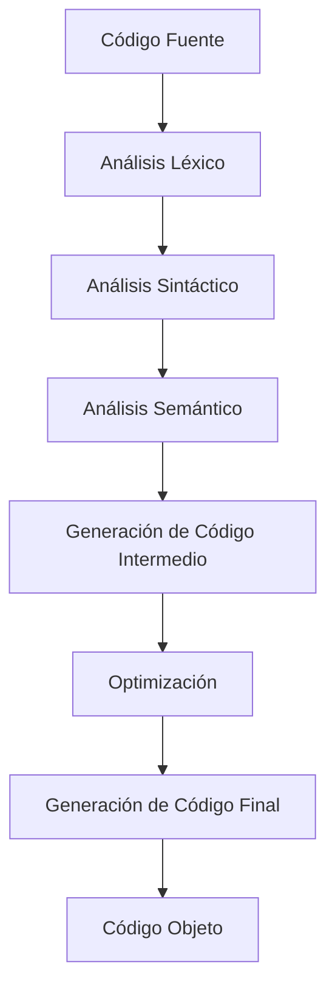
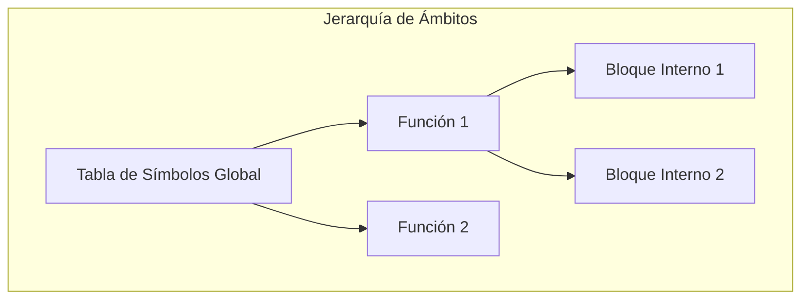

# Modelado y Programación - Lenguajes de programación

## 1.7 Tecnologías de compiladores e intérpretes.

---

Un **compilador** es un programa que traduce código fuente escrito en un lenguaje de programación (lenguaje fuente) a otro lenguaje (lenguaje objetivo), generalmente código máquina. Un **intérprete** es un programa que ejecuta directamente las instrucciones del código fuente sin una etapa de compilación previa a código máquina.

#### Diferencias Fundamentales

| Compilador                                    | Intérprete                                  |
| --------------------------------------------- | ------------------------------------------- |
| Traduce todo el programa antes de ejecutar    | Traduce y ejecuta línea por línea           |
| Genera código objeto ejecutable               | No genera código objeto                     |
| Ejecución más rápida                          | Ejecución más lenta                         |
| Detección de errores en tiempo de compilación | Detección de errores en tiempo de ejecución |

La tabla describe los extremos. En la práctica abundan los esquemas **híbridos**:

- **Bytecode y máquina virtual**: Java compila a *bytecode* que ejecuta la JVM; Python compila cada módulo a bytecode (archivos `.pyc`) que interpreta su máquina virtual. Por eso Python detecta los errores de sintaxis de todo el archivo antes de ejecutar la primera línea.
- **Compilación justo a tiempo (JIT)**: la JVM, los motores de JavaScript o PyPy compilan a código máquina, durante la ejecución, las partes del programa que más se usan.

Ser compilado o interpretado es una propiedad de la **implementación**, no del lenguaje: existen intérpretes de C y compiladores de Python.

### Arquitectura de un Compilador

#### Fases de un Compilador



### Fases de Compilación Detalladas

#### 1. Análisis Léxico (Scanner)

Convierte el flujo de caracteres en tokens (componentes léxicos).

**Ejemplo**:

```text
Código fuente: resultado = valor + 10;
Tokens generados:
- IDENTIFICADOR (resultado)
- OPERADOR_ASIGNACION (=)
- IDENTIFICADOR (valor)
- OPERADOR_SUMA (+)
- ENTERO (10)
- DELIMITADOR (;)
```

#### 2. Análisis Sintáctico (Parser)

Verifica la estructura gramatical según las reglas del lenguaje y construye un **árbol de sintaxis abstracta** (AST). Por ejemplo, `x = a + b * c` produce un árbol cuya raíz es la asignación, con `x` a la izquierda y la suma a la derecha; la multiplicación queda **más abajo** que la suma porque tiene mayor precedencia.

**Gramática formal**:

Gramática en notación BNF; la barra $|$ separa alternativas:

$$ \begin{align*} S &\rightarrow \text{asignacion} \\ \text{asignacion} &\rightarrow \text{IDENTIFICADOR } = \text{ expresion } ; \\ \text{expresion} &\rightarrow \text{termino} \\ &\quad | \text{ expresion } + \text{ termino} \\ &\quad | \text{ expresion } - \text{ termino} \\ \text{termino} &\rightarrow \text{factor} \\ &\quad | \text{ termino } * \text{ factor} \\ &\quad | \text{ termino } / \text{ factor} \\ \text{factor} &\rightarrow \text{IDENTIFICADOR} \\ &\quad | \text{ ENTERO} \\ &\quad | ( \text{ expresion } ) \end{align*} $$

#### 3. Análisis Semántico

Verifica el significado y la validez de las construcciones.

**Comprobaciones**:

- Tipos de datos compatibles
- Variables declaradas antes de usar
- Compatibilidad en operaciones
- Número y tipo de argumentos en las llamadas a funciones

Un programa puede ser sintácticamente correcto y semánticamente incorrecto: `int x = "hola";` en Java respeta la gramática pero mezcla tipos incompatibles. Para estas comprobaciones el compilador usa la **tabla de símbolos**, que guarda para cada identificador su tipo, su ámbito y otra información.

#### 4. Generación de Código Intermedio

Crea una representación intermedia (como código de tres direcciones).

**Ejemplo**:

```text
Código fuente: x = a + b * c
Código de tres direcciones:
t1 = b * c
t2 = a + t1
x = t2
```

Cada instrucción tiene a lo más un operador y tres direcciones (dos operandos y un resultado). Esta forma es independiente de la máquina destino: el mismo código intermedio puede traducirse a distintas arquitecturas, y las optimizaciones se escriben una sola vez.

#### 5. Optimización

Mejora el código intermedio para mayor eficiencia.

**Técnicas comunes**:

- Eliminación de código muerto
- Propagación de constantes
- Simplificación de expresiones

#### 6. Generación de Código Final

Produce el código objeto o ensamblador. Esta fase asigna **registros** a las variables y temporales, elige las instrucciones de la máquina destino y decide el orden de ejecución. Por ejemplo, el código de tres direcciones anterior podría traducirse, en un ensamblador hipotético, a:

```text
LOAD  R1, b
MUL   R1, c      ; R1 = b * c
ADD   R1, a      ; R1 = a + b * c
STORE R1, x
```

### Teoría de Autómatas y Lenguajes Formales

#### Jerarquía de Chomsky

| Tipo | Gramáticas | Reconocidas por | Uso en compiladores |
| --- | --- | --- | --- |
| 0 | No restringidas | Máquinas de Turing | — |
| 1 | Sensibles al contexto | Autómatas linealmente acotados | — |
| 2 | Libres de contexto | Autómatas de pila | Análisis sintáctico |
| 3 | Regulares | Autómatas finitos | Análisis léxico |

Cada tipo contiene al siguiente. Los tokens se describen con expresiones regulares porque los reconoce un autómata finito, muy eficiente; la estructura anidada de un programa, como paréntesis balanceados, ya no es regular y necesita una gramática libre de contexto.

#### Expresiones Regulares para Análisis Léxico

| Token | Expresión regular |
| --- | --- |
| IDENTIFICADOR | `[a-zA-Z_][a-zA-Z0-9_]*` |
| ENTERO | `[0-9]+` |
| REAL | `[0-9]+\.[0-9]+` |
| OPERADOR | `[+\-*/=]` |
| DELIMITADOR | `[;(){}]` |

Dentro de corchetes el guion indica un rango, así que se escapa como `\-` para que signifique el carácter `-`; sin el escape, `[+-*]` sería el rango de `+` a `*`. Cuando varias expresiones reconocen el mismo prefijo, el analizador toma la **coincidencia más larga** y, en empate, la regla que aparece primero; así `while` es palabra reservada y no identificador.

### Implementación de un Analizador Léxico Simple

```python
import re

class Lexer:
    def __init__(self, code):
        self.code = code
        self.position = 0
        self.tokens = []

        # Definición de patrones de tokens
        self.token_specs = [
            ('NUMBER',   r'\d+'),
            ('IDENT',    r'[a-zA-Z_][a-zA-Z0-9_]*'),
            ('OP',       r'[+\-*/=]'),
            ('LPAREN',   r'\('),
            ('RPAREN',   r'\)'),
            ('WHITESPACE', r'\s+'),
        ]

    def tokenize(self):
        while self.position < len(self.code):
            match = None
            for token_type, pattern in self.token_specs:
                regex = re.compile(pattern)
                match = regex.match(self.code, self.position)
                if match:
                    value = match.group(0)
                    if token_type != 'WHITESPACE':
                        self.tokens.append((token_type, value))
                    self.position = match.end()
                    break
            if not match:      # ningún patrón reconoce el carácter actual
                raise SyntaxError(f'Carácter inválido: {self.code[self.position]!r}')
        return self.tokens

# Ejemplo de uso
lexer = Lexer("x = 10 + y * 5")
tokens = lexer.tokenize()
print(tokens)
# [('IDENT', 'x'), ('OP', '='), ('NUMBER', '10'),
#  ('OP', '+'), ('IDENT', 'y'), ('OP', '*'), ('NUMBER', '5')]
```

### Algoritmos de Parsing

#### Parsing Descendente Recursivo

```python
class Parser:
    def __init__(self, tokens):
        self.tokens = tokens
        self.position = 0
        self.current_token = self.tokens[0] if tokens else None

    def eat(self, token_type):
        if self.current_token and self.current_token[0] == token_type:
            self.position += 1
            if self.position < len(self.tokens):
                self.current_token = self.tokens[self.position]
            else:
                self.current_token = None
        else:
            encontrado = self.current_token[0] if self.current_token else 'fin de la entrada'
            raise SyntaxError(f'Se esperaba {token_type}, se encontró {encontrado}')

    # factor -> NUMBER | IDENT | ( expr )
    def factor(self):
        token = self.current_token
        if token is None:
            raise SyntaxError('Expresión incompleta')
        if token[0] == 'NUMBER':
            self.eat('NUMBER')
            return {'type': 'number', 'value': int(token[1])}
        elif token[0] == 'IDENT':
            self.eat('IDENT')
            return {'type': 'variable', 'name': token[1]}
        elif token[0] == 'LPAREN':
            self.eat('LPAREN')
            node = self.expr()
            self.eat('RPAREN')
            return node
        raise SyntaxError(f'Token inesperado: {token[1]}')

    # term -> factor (('*' | '/') factor)*

    def term(self):
        node = self.factor()
        while self.current_token and self.current_token[0] == 'OP' and self.current_token[1] in ['*', '/']:
            token = self.current_token
            self.eat('OP')
            node = {'type': 'binop', 'op': token[1], 'left': node, 'right': self.factor()}
        return node

    # expr -> term (('+' | '-') term)*
    def expr(self):
        node = self.term()
        while self.current_token and self.current_token[0] == 'OP' and self.current_token[1] in ['+', '-']:
            token = self.current_token
            self.eat('OP')
            node = {'type': 'binop', 'op': token[1], 'left': node, 'right': self.term()}
        return node

    # asignacion -> IDENT '=' expr
    def asignacion(self):
        nombre = self.current_token[1]
        self.eat('IDENT')
        if self.current_token != ('OP', '='):
            raise SyntaxError("Se esperaba '='")
        self.eat('OP')
        return {'type': 'assignment', 'var_name': nombre, 'value': self.expr()}

ast = Parser(Lexer("x = (10 + y) * 5").tokenize()).asignacion()
print(ast['value']['op'], ast['value']['left']['op'])   # * +
```

La gramática de la sección anterior es **recursiva por la izquierda** (`expresion -> expresion + termino`). Un analizador descendente recursivo que la siguiera literalmente se llamaría a sí mismo sin consumir tokens y nunca terminaría. Por eso el código la reescribe con repeticiones, `expr -> term (('+' | '-') term)*`, que reconoce el mismo lenguaje y, con el ciclo `while`, conserva la asociatividad por la izquierda: `a - b - c` se agrupa como `(a - b) - c`.

### Tabla de Símbolos y Gestión de Contextos



### Generación de Código Intermedio

#### Código de Tres Direcciones

```python
def generate_three_address_code(node):
    temp_counter = 0
    code = []

    def generate(node):
        nonlocal temp_counter
        if node['type'] == 'number':
            return node['value']
        elif node['type'] == 'variable':
            return node['name']
        elif node['type'] == 'binop':
            left = generate(node['left'])
            right = generate(node['right'])
            temp_var = f't{temp_counter}'
            temp_counter += 1
            code.append(f'{temp_var} = {left} {node["op"]} {right}')
            return temp_var

    result = generate(node)
    code.append(f'result = {result}')
    return code

# Ejemplo
ast = {'type': 'binop', 'op': '+',
       'left': {'type': 'number', 'value': 5},
       'right': {'type': 'binop', 'op': '*',
                'left': {'type': 'number', 'value': 3},
                'right': {'type': 'number', 'value': 2}}}
tac = generate_three_address_code(ast)
print(tac)
# ['t0 = 3 * 2', 't1 = 5 + t0', 'result = t1']
```

### Ejercicios Propuestos

#### Ejercicio 1: Implementar un Analizador Léxico

Crea un lexer para un subconjunto de Python que reconozca:

- Palabras reservadas: `if`, `else`, `while`, `def`
- Identificadores y números
- Operadores y delimitadores
- Comentarios de una línea

#### Ejercicio 2: Desarrollar un Parser para Expresiones Aritméticas

Implementa un parser que maneje:

- Operadores de precedencia: `*`, `/` > `+`, `-`
- Paréntesis para agrupamiento
- Variables y constantes numéricas

#### Ejercicio 3: Generador de Código Intermedio

Desarrolla un generador de código de tres direcciones para:

- Expresiones aritméticas complejas
- Estructuras de control: if-else, while
- Asignaciones múltiples

#### Ejercicio 4: Optimizador de Código

Implementa optimizaciones básicas:

- Propagación de constantes
- Eliminación de código muerto
- Simplificación de expresiones algebraicas

### Técnicas de Optimización

#### Optimización Local

```text
Antes de optimización
t1 = 5 * 2    # 10: plegado de constantes
t2 = x + t1   # x + 10: propagación de constantes
t3 = t2 * 1   # multiplicar por 1 es redundante

Después de optimización
t2 = x + 10
t3 = t2       # o bien se reemplaza t3 por t2 en el resto del código
```

El **plegado de constantes** se puede implementar recorriendo el AST:

```python
def plegar_constantes(nodo):
    if nodo['type'] != 'binop':
        return nodo
    izq = plegar_constantes(nodo['left'])
    der = plegar_constantes(nodo['right'])
    if izq['type'] == 'number' and der['type'] == 'number':
        valor = {'+': lambda a, b: a + b, '-': lambda a, b: a - b,
                 '*': lambda a, b: a * b, '/': lambda a, b: a // b}[nodo['op']](izq['value'], der['value'])
        return {'type': 'number', 'value': valor}
    if nodo['op'] == '*' and der == {'type': 'number', 'value': 1}:   # e * 1 = e
        return izq
    return {'type': 'binop', 'op': nodo['op'], 'left': izq, 'right': der}

arbol = Parser(Lexer("x + 5 * 2 * 1").tokenize()).expr()
print(plegar_constantes(arbol))
# {'type': 'binop', 'op': '+', 'left': {'type': 'variable', 'name': 'x'}, 'right': {'type': 'number', 'value': 10}}
```

#### Optimización de Bucles

```text
# Antes: cálculo redundante en cada iteración
for i in range(n):
    result = array[i] * (width * height)  # width*height no cambia en el bucle

# Después: cálculo fuera del bucle (movimiento de código invariante)
area = width * height
for i in range(n):
    result = array[i] * area
```

### Algoritmos de Análisis

#### Análisis de Alcance (Scoping)

```python
class ScopeAnalyzer:
    def __init__(self):
        self.scope_stack = [{}]  # Pila de tablas de símbolos
        self.current_scope = 0

    def enter_scope(self):
        self.scope_stack.append({})
        self.current_scope += 1

    def exit_scope(self):
        self.scope_stack.pop()
        self.current_scope -= 1

    def declare_variable(self, name, type):
        if name in self.scope_stack[-1]:
            raise Exception(f"Variable '{name}' ya declarada en este ámbito")
        self.scope_stack[-1][name] = {'type': type, 'scope': self.current_scope}

    def lookup_variable(self, name):
        for scope in reversed(self.scope_stack):
            if name in scope:
                return scope[name]
        raise Exception(f"Variable '{name}' no declarada")
```

### Intérpretes vs Compiladores: Implementación

#### Esquema de un Intérprete Simple

```python
class Interpreter:
    def __init__(self):
        self.variables = {}

    def interpret(self, ast):
        if ast['type'] == 'assignment':
            var_name = ast['var_name']
            value = self.interpret(ast['value'])
            self.variables[var_name] = value
            return value

        elif ast['type'] == 'binop':
            left = self.interpret(ast['left'])
            right = self.interpret(ast['right'])
            if ast['op'] == '+': return left + right
            if ast['op'] == '-': return left - right
            if ast['op'] == '*': return left * right
            if ast['op'] == '/': return left / right

        elif ast['type'] == 'variable':
            if ast['name'] in self.variables:
                return self.variables[ast['name']]
            raise Exception(f"Variable '{ast['name']}' no definida")

        elif ast['type'] == 'number':
            return ast['value']

# El intérprete recorre el AST y ejecuta directamente, sin generar código
interprete = Interpreter()
interprete.variables['y'] = 2
print(interprete.interpret(Parser(Lexer("x = (10 + y) * 5").tokenize()).asignacion()))   # 60
print(interprete.variables)   # {'y': 2, 'x': 60}
```

El mismo AST sirve para el generador de código de tres direcciones y para el intérprete: la diferencia es si se **traduce** el árbol a otro lenguaje o se **evalúa** en el momento.

### Referencias y Recursos

#### Libros Fundamentales

1. "Compilers: Principles, Techniques, and Tools" - Aho, Sethi, Ullman (Dragon Book)
2. "Modern Compiler Implementation in ML/Java/C" - Andrew Appel
3. "Engineering a Compiler" - Cooper & Torczon

#### Herramientas para Desarrollar Compiladores

- **LEX/YACC**: Herramientas clásicas para análisis léxico/sintáctico
- **ANTLR**: Generador de parsers potente y moderno
- **LLVM**: Framework para generación de código optimizado
- **Flex/Bison**: Alternativas modernas a LEX/YACC

#### Recursos Online

- [Compiler Explorer](https://godbolt.org/): Ver código generado por diferentes compiladores
- [ANTLR Official Site](https://www.antlr.org/): Documentación y ejemplos
- [LLVM Documentation](https://llvm.org/docs/): Guías de uso de LLVM

### Consejos para el Estudio

1. **Comienza con lo simple**: Implementa un lenguaje muy básico primero
2. **Usa herramientas existentes**: ANTLR puede generar mucho código automáticamente
3. **Practica con múltiples lenguajes**: Implementa compiladores para diferentes paradigmas
4. **Analiza compiladores reales**: Estudia el código fuente de gcc, clang, o Python
5. **Experimenta con optimizaciones**: Prueba diferentes técnicas de optimización

### Autoevaluación

1. Explica las diferencias entre compiladores e intérpretes
2. Describe cada fase del proceso de compilación
3. Implementa un analizador léxico para un subconjunto de JavaScript
4. Explica el concepto de "tabla de símbolos" y su importancia
5. ¿Qué ventajas tiene usar un código intermedio en la compilación?
