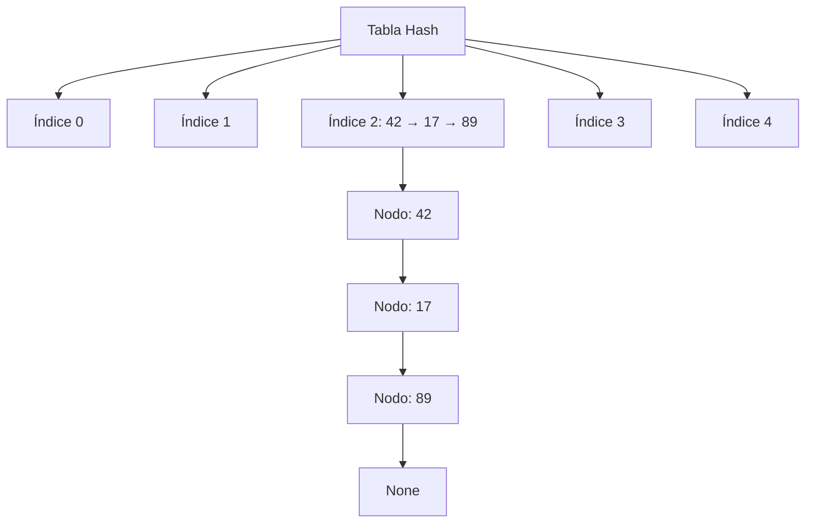

# Modelado y Programación - Estructuras de datos avanzadas

## 2.1 Tablas de dispersión.

---

Las **tablas de dispersión** (hash tables) son una de las estructuras de datos más importantes y utilizadas en programación. Permiten operaciones de búsqueda, inserción y eliminación en tiempo constante promedio O(1), lo que las hace extremadamente eficientes.

### Conceptos Fundamentales

#### Definición

Una **tabla de dispersión** es una estructura de datos que asocia llaves (keys) con valores (values) mediante una función de dispersión (hash function) que calcula una posición en un arreglo a partir de la llave.

#### Componentes Principales

- **Función de hash**: Transforma una llave en un índice del arreglo
- **Arreglo de buckets**: Contenedores donde se almacenan los datos
- **Mecanismo de resolución de colisiones**: Estrategia para manejar llaves que mapean al mismo índice

### Función de Hash

Una buena función de hash debe:

- Distribuir uniformemente las llaves
- Ser eficiente computacionalmente
- Minimizar colisiones

#### Funciones Comunes

**División simple:**
$$ h(k) = k \mod m $$

**Multiplicación:**
$$ h(k) = \lfloor m \cdot (k \cdot A \mod 1) \rfloor $$
donde $0 < A < 1$

**Hash para cadenas (djb2):**

```python
def hash_djb2(s):
    hash_val = 5381
    for char in s:
        hash_val = ((hash_val << 5) + hash_val) + ord(char)
    return hash_val
```

### Resolución de Colisiones

#### 1. Encadenamiento (Chaining)



#### 2. Direccionamiento Abierto

- **Sondeo lineal**: $h(k, i) = (h'(k) + i) \mod m$
- **Sondeo cuadrático**: $h(k, i) = (h'(k) + c_1i + c_2i^2) \mod m$
- **Doble hash**: $h(k, i) = (h_1(k) + i \cdot h_2(k)) \mod m$

### Implementación en Python

#### Implementación con Encadenamiento

```python
class HashTable:
    def __init__(self, size=10):
        self.size = size
        self.table = [[] for _ in range(size)]

    def _hash(self, key):
        return hash(key) % self.size

    def insert(self, key, value):
        index = self._hash(key)
        for i, (k, v) in enumerate(self.table[index]):
            if k == key:
                self.table[index][i] = (key, value)
                return
        self.table[index].append((key, value))

    def get(self, key):
        index = self._hash(key)
        for k, v in self.table[index]:
            if k == key:
                return v
        raise KeyError(f"Key {key} not found")

    def delete(self, key):
        index = self._hash(key)
        for i, (k, v) in enumerate(self.table[index]):
            if k == key:
                del self.table[index][i]
                return
        raise KeyError(f"Key {key} not found")
```

#### Implementación con Sondeo Lineal

```python
class LinearProbingHashTable:
    def __init__(self, size=10):
        self.size = size
        self.keys = [None] * size
        self.values = [None] * size
        self.count = 0

    def _hash(self, key):
        return hash(key) % self.size

    def _rehash(self, index):
        return (index + 1) % self.size

    def insert(self, key, value):
        if self.count >= self.size * 0.7:  # Factor de carga > 70%
            self._resize()

        index = self._hash(key)

        while self.keys[index] is not None:
            if self.keys[index] == key:
                self.values[index] = value
                return
            index = self._rehash(index)

        self.keys[index] = key
        self.values[index] = value
        self.count += 1

    def _resize(self):
        new_size = self.size * 2
        new_table = LinearProbingHashTable(new_size)

        for i in range(self.size):
            if self.keys[i] is not None:
                new_table.insert(self.keys[i], self.values[i])

        self.size = new_size
        self.keys = new_table.keys
        self.values = new_table.values
        self.count = new_table.count
```

### Análisis de Complejidad

| Operación   | Caso Promedio | Peor Caso |
| ----------- | ------------- | --------- |
| Búsqueda    | $O(1)$        | $O(n)$    |
| Inserción   | $O(1)$        | $O(n)$    |
| Eliminación | $O(1)$        | $O(n)$    |

**Factor de carga**: $\alpha = \frac{n}{m}$ donde $n$ es el número de elementos y $m$ es el tamaño de la tabla.

### Ejemplos Prácticos

#### Ejemplo 1: Contador de Palabras

```python
def word_count(text):
    word_count = {}

    for word in text.split():
        word = word.lower().strip('.,!?;:')
        if word in word_count:
            word_count[word] += 1
        else:
            word_count[word] = 1

    return word_count

# Uso
texto = "hola mundo hola python mundo programación"
resultado = word_count(texto)
print(resultado)
# Output: {'hola': 2, 'mundo': 2, 'python': 1, 'programación': 1}
```

#### Ejemplo 2: Sistema de Caché

```python
class LRUCache:
    def __init__(self, capacity):
        self.capacity = capacity
        self.cache = {}
        self.order = LinkedList()

    def get(self, key):
        if key not in self.cache:
            return -1

        # Mover al frente (recientemente usado)
        node = self.cache[key]
        self.order.move_to_front(node)
        return node.value

    def put(self, key, value):
        if key in self.cache:
            node = self.cache[key]
            node.value = value
            self.order.move_to_front(node)
        else:
            if len(self.cache) >= self.capacity:
                # Eliminar el menos recientemente usado
                lru_node = self.order.remove_tail()
                del self.cache[lru_node.key]

            new_node = self.order.add_to_front(key, value)
            self.cache[key] = new_node
```

### Ejercicios Propuestos

#### Ejercicio 1: Implementación Completa

Implementa una tabla hash con:

- Encadenamiento separado
- Redimensionamiento automático
- Estadísticas de desempeño

#### Ejercicio 2: Detección de Duplicados

Escribe una función que detecte si un array contiene duplicados usando una tabla hash.

```python
def has_duplicates(arr):
    # Tu implementación aquí
    pass

# Test
print(has_duplicates([1, 2, 3, 4, 5]))  # False
print(has_duplicates([1, 2, 3, 2, 5]))  # True
```

#### Ejercicio 3: Intersección de Conjuntos

Encuentra la intersección de dos arrays usando tablas hash.

```python
def intersection(arr1, arr2):
    # Tu implementación aquí
    pass

# Test
print(intersection([1, 2, 3, 4], [3, 4, 5, 6]))  # [3, 4]
```

#### Ejercicio 4: Análisis de Colisiones

Implementa diferentes funciones de hash y compara su distribución y tasa de colisiones.

### Aplicaciones en el Mundo Real

1. **Bases de datos**: Índices rápidos
2. **Cachés**: Memcached, Redis
3. **Compiladores**: Tablas de símbolos
4. **Sistemas de archivos**: Verificación de integridad
5. **Criptografía**: Funciones hash seguras

### Optimizaciones y Consideraciones

#### Elección del Tamaño de la Tabla

- Tamaño primo para mejor distribución
- Potencia de 2 para operaciones bits (pero cuidado con patrones)

#### Función de Hash de Calidad

```python
# Hash para cadenas - variante de FNV-1
def fnv_hash(s):
    h = 2166136261
    for char in s:
        h = (h * 16777619) ^ ord(char)
    return h
```

#### Gestión de Colisiones

- Monitorear factor de carga ( $\alpha < 0.7$ para sondeo lineal )
- Considerar tablas perfectas para datos estáticos

### Referencias y Recursos Adicionales

1. **Libros**:
   - "Introduction to Algorithms" (Cormen et al.) - Capítulo 11
   - "The Art of Computer Programming" (Knuth) - Volumen 3

2. **Artículos**:
   - [Hash Tables - Wikipedia](https://en.wikipedia.org/wiki/Hash_table)
   - [Choosing a Good Hash Function](https://www.cs.cornell.edu/courses/cs312/2008sp/lectures/lec20.html)

3. **Visualizaciones**:
   - [USFCA Hash Table Visualization](https://www.cs.usfca.edu/~galles/visualization/OpenHash.html)
   - [VisuAlgo - Hash Table](https://visualgo.net/en/hashtable)

### Prueba tu Comprensión

1. ¿Por qué es importante que una función de hash distribuya uniformemente las llaves?
2. Explica la diferencia entre encadenamiento y direccionamiento abierto
3. ¿Qué es el factor de carga y por qué es importante?
4. Describe una situación donde el peor caso O(n) sería problemático
5. ¿Cómo manejarías datos muy grandes que no caben en memoria?

### Consejos para el Examen

- Entiende bien la diferencia entre los métodos de resolución de colisiones
- Practica implementaciones desde cero
- Comprende el análisis del factor de carga
- Familiarízate con las complejidades temporales en diferentes escenarios
