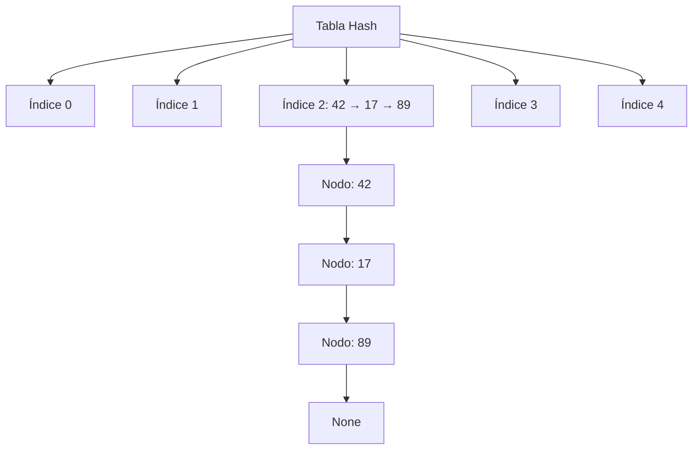

# Modelado y Programación - Estructuras de datos avanzadas

## 2.1 Tablas de dispersión.

---

Las **tablas de dispersión** (hash tables) son una de las estructuras de datos más importantes y utilizadas en programación. Permiten operaciones de búsqueda, inserción y eliminación en tiempo constante promedio $O(1),$ lo que las hace extremadamente eficientes. Los diccionarios (`dict`) y conjuntos (`set`) de Python, los `HashMap` de Java y los `unordered_map` de C++ son tablas de dispersión.

### Conceptos Fundamentales

#### Definición

Una **tabla de dispersión** es una estructura de datos que asocia llaves (keys) con valores (values) mediante una función de dispersión (hash function) que calcula una posición en un arreglo a partir de la llave.

#### Componentes Principales

- **Función de hash**: Transforma una llave en un índice del arreglo
- **Arreglo de buckets**: Contenedores donde se almacenan los datos
- **Mecanismo de resolución de colisiones**: Estrategia para manejar llaves que mapean al mismo índice

### Función de Hash

Una buena función de hash debe:

- Distribuir uniformemente las llaves
- Ser eficiente computacionalmente
- Minimizar colisiones

#### Funciones Comunes

**División simple:**

$$ h(k) = k \mod m $$

Conviene que $m$ sea un número primo lejano a una potencia de 2. Si $m = 2^p,$ $h(k)$ depende solo de los $p$ bits menos significativos de $k,$ y llaves con patrones en esos bits colisionan mucho.

**Multiplicación:**

$$ h(k) = \lfloor m \cdot (k \cdot A \mod 1) \rfloor $$

donde $0 < A < 1.$ Aquí $m$ puede ser una potencia de 2; Knuth sugiere $A \approx \frac{\sqrt{5} - 1}{2} \approx 0.618.$ Por ejemplo, con $m = 16$ y $k = 123,$ $kA \approx 76.018,$ su parte fraccionaria es $0.018$ y $h(k) = \lfloor 16 \cdot 0.018 \rfloor = 0.$

**Hash para cadenas (djb2):**

```python
def hash_djb2(s):
    hash_val = 5381
    for char in s:
        hash_val = ((hash_val << 5) + hash_val) + ord(char)   # hash * 33 + c
        hash_val &= 0xFFFFFFFF                                # se mantiene en 32 bits
    return hash_val

print(hash_djb2("hola") % 11, hash_djb2("aloh") % 11)   # anagramas con distinto índice
```

En C la aritmética de enteros sin signo se desborda sola; en Python los enteros no tienen límite, así que hay que recortar a 32 bits con la máscara. Una función que solo sumara los códigos de los caracteres daría el mismo valor a todos los anagramas.

### Resolución de Colisiones

#### 1. Encadenamiento (Chaining)



#### 2. Direccionamiento Abierto

Todos los elementos se guardan en el propio arreglo. Si la casilla $h(k)$ está ocupada, se prueban otras siguiendo una **secuencia de sondeo** $h(k, 0), h(k, 1), h(k, 2), \ldots:$

- **Sondeo lineal**: $h(k, i) = (h'(k) + i) \mod m.$ Es simple, pero forma bloques contiguos de casillas ocupadas (**agrupamiento primario**) que alargan las búsquedas.
- **Sondeo cuadrático**: $h(k, i) = (h'(k) + c_1i + c_2i^2) \mod m.$ Evita el agrupamiento primario, aunque llaves con el mismo $h'(k)$ siguen la misma secuencia.
- **Doble hash**: $h(k, i) = (h_1(k) + i \cdot h_2(k)) \mod m,$ con $h_2(k) \neq 0$ y primo relativo con $m,$ para recorrer todas las casillas. Es el que mejor se aproxima a un sondeo aleatorio.

**Ejemplo.** Con $m = 7,$ $h'(k) = k \mod 7$ y sondeo lineal, al insertar $10, 3, 17:$ $10$ va a la casilla $3;$ $3$ también cae en $3,$ que está ocupada, y pasa a $4;$ $17$ cae en $3,$ luego $4,$ y queda en $5.$

**Borrado.** En direccionamiento abierto no se puede simplemente vaciar una casilla: se cortaría la secuencia de sondeo de otras llaves, como la del $17$ si se borra el $3.$ Se marca con una **lápida** (*tombstone*) que la búsqueda salta y que la inserción puede reutilizar.

### Implementación en Python

#### Implementación con Encadenamiento

```python
class HashTable:
    def __init__(self, size=10):
        self.size = size
        self.table = [[] for _ in range(size)]

    def _hash(self, key):
        # hash() de Python; para cadenas cambia entre ejecuciones (PYTHONHASHSEED)
        return hash(key) % self.size

    def insert(self, key, value):
        index = self._hash(key)
        for i, (k, v) in enumerate(self.table[index]):
            if k == key:
                self.table[index][i] = (key, value)
                return
        self.table[index].append((key, value))

    def get(self, key):
        index = self._hash(key)
        for k, v in self.table[index]:
            if k == key:
                return v
        raise KeyError(f"Key {key} not found")

    def delete(self, key):
        index = self._hash(key)
        for i, (k, v) in enumerate(self.table[index]):
            if k == key:
                del self.table[index][i]
                return
        raise KeyError(f"Key {key} not found")

t = HashTable(5)
for palabra, n in [("uno", 1), ("dos", 2), ("tres", 3), ("cuatro", 4), ("cinco", 5), ("seis", 6)]:
    t.insert(palabra, n)
t.delete("dos")
print(t.get("seis"), sum(len(b) for b in t.table))   # 6 5
```

#### Implementación con Sondeo Lineal

```python
class LinearProbingHashTable:
    _BORRADO = object()   # lápida: casilla que tuvo un elemento borrado

    def __init__(self, size=10):
        self.size = size
        self.keys = [None] * size
        self.values = [None] * size
        self.count = 0

    def _hash(self, key):
        return hash(key) % self.size

    def _rehash(self, index):
        return (index + 1) % self.size

    def insert(self, key, value):
        if self.count >= self.size * 0.7:  # Factor de carga > 70%
            self._resize()

        index = self._hash(key)
        libre = None
        while self.keys[index] is not None:
            if self.keys[index] is self._BORRADO:
                if libre is None:
                    libre = index            # se puede reutilizar
            elif self.keys[index] == key:
                self.values[index] = value   # la llave ya existía
                return
            index = self._rehash(index)

        if libre is not None:
            index = libre
        self.keys[index] = key
        self.values[index] = value
        self.count += 1

    def _buscar(self, key):
        index = self._hash(key)
        for _ in range(self.size):
            if self.keys[index] is None:      # casilla nunca usada: la llave no está
                return None
            if self.keys[index] is not self._BORRADO and self.keys[index] == key:
                return index
            index = self._rehash(index)
        return None

    def get(self, key):
        index = self._buscar(key)
        if index is None:
            raise KeyError(key)
        return self.values[index]

    def delete(self, key):
        index = self._buscar(key)
        if index is None:
            raise KeyError(key)
        self.keys[index] = self._BORRADO
        self.values[index] = None
        self.count -= 1

    def _resize(self):
        new_size = self.size * 2
        new_table = LinearProbingHashTable(new_size)

        for i in range(self.size):
            if self.keys[i] is not None and self.keys[i] is not self._BORRADO:
                new_table.insert(self.keys[i], self.values[i])

        self.size = new_size
        self.keys = new_table.keys
        self.values = new_table.values
        self.count = new_table.count

# Ejemplo del texto: m = 7, llaves 10, 3, 17 (para enteros pequeños, hash(k) = k)
t = LinearProbingHashTable(7)
t.insert(10, "a"); t.insert(3, "b"); t.insert(17, "c")
print(t.keys)            # [None, None, None, 10, 3, 17, None]
t.delete(3)
print(t.get(17))         # c: la lápida no corta la secuencia de sondeo
```

Al redimensionar hay que **reinsertar** todos los elementos, porque su índice depende del tamaño $m.$ Duplicar el tamaño hace que el costo total de las reinserciones se reparta entre muchas inserciones: el costo **amortizado** de insertar sigue siendo $O(1).$

### Análisis de Complejidad

| Operación   | Caso Promedio | Peor Caso |
| ----------- | ------------- | --------- |
| Búsqueda    | $O(1)$        | $O(n)$    |
| Inserción   | $O(1)$        | $O(n)$    |
| Eliminación | $O(1)$        | $O(n)$    |

**Factor de carga**: $\alpha = \frac{n}{m}$ donde $n$ es el número de elementos y $m$ es el tamaño de la tabla.

Suponiendo una función hash que distribuye las llaves de manera uniforme:

- Con **encadenamiento**, cada lista tiene en promedio $\alpha$ elementos y una búsqueda cuesta $\Theta(1 + \alpha).$ Funciona incluso con $\alpha > 1.$
- Con **sondeo lineal**, una búsqueda sin éxito revisa en promedio unas $\frac{1}{2}\left(1 + \frac{1}{(1 - \alpha)^2}\right)$ casillas: unas $2.5$ con $\alpha = 0.5,$ pero unas $50$ con $\alpha = 0.9.$ Por eso se mantiene $\alpha$ por debajo de $0.7$ y se redimensiona.

El peor caso $O(n)$ ocurre cuando muchas llaves colisionan, por ejemplo si un atacante elige llaves con el mismo hash. Por eso Python usa una semilla aleatoria para el hash de cadenas.

### Ejemplos Prácticos

#### Ejemplo 1: Contador de Palabras

```python
def word_count(text):
    word_count = {}

    for word in text.split():
        word = word.lower().strip('.,!?;:')
        if word in word_count:
            word_count[word] += 1
        else:
            word_count[word] = 1

    return word_count

# Uso
texto = "hola mundo hola python mundo programación"
resultado = word_count(texto)
print(resultado)
# Output: {'hola': 2, 'mundo': 2, 'python': 1, 'programación': 1}
```

#### Ejemplo 2: Sistema de Caché

Una caché **LRU** (*least recently used*) guarda los $k$ elementos usados más recientemente. Combina una tabla hash, para encontrar un elemento en $O(1),$ con una lista doblemente enlazada que mantiene el orden de uso. `OrderedDict` de Python ya implementa esa combinación:

```python
from collections import OrderedDict

class LRUCache:
    def __init__(self, capacity):
        self.capacity = capacity
        self.cache = OrderedDict()   # orden: del menos al más recientemente usado

    def get(self, key):
        if key not in self.cache:
            return -1
        self.cache.move_to_end(key)  # ahora es el más reciente
        return self.cache[key]

    def put(self, key, value):
        if key in self.cache:
            self.cache.move_to_end(key)
        self.cache[key] = value
        if len(self.cache) > self.capacity:
            self.cache.popitem(last=False)   # elimina el menos recientemente usado

cache = LRUCache(2)
cache.put("a", 1); cache.put("b", 2)
cache.get("a")          # "a" pasa a ser el más reciente
cache.put("c", 3)       # se elimina "b"
print(list(cache.cache))   # ['a', 'c']
```

### Ejercicios Propuestos

#### Ejercicio 1: Implementación Completa

Implementa una tabla hash con:

- Encadenamiento separado
- Redimensionamiento automático
- Estadísticas de desempeño

#### Ejercicio 2: Detección de Duplicados

Escribe una función que detecte si un array contiene duplicados usando una tabla hash.

```python
def has_duplicates(arr):
    # Tu implementación aquí
    pass

# Test
print(has_duplicates([1, 2, 3, 4, 5]))  # False
print(has_duplicates([1, 2, 3, 2, 5]))  # True
```

#### Ejercicio 3: Intersección de Conjuntos

Encuentra la intersección de dos arrays usando tablas hash.

```python
def intersection(arr1, arr2):
    # Tu implementación aquí
    pass

# Test
print(intersection([1, 2, 3, 4], [3, 4, 5, 6]))  # [3, 4]
```

#### Ejercicio 4: Análisis de Colisiones

Implementa diferentes funciones de hash y compara su distribución y tasa de colisiones.

### Aplicaciones en el Mundo Real

1. **Bases de datos**: Índices rápidos
2. **Cachés**: Memcached, Redis
3. **Compiladores**: Tablas de símbolos
4. **Sistemas de archivos**: Verificación de integridad
5. **Criptografía**: Funciones hash seguras

### Optimizaciones y Consideraciones

#### Elección del Tamaño de la Tabla

- Tamaño primo para mejor distribución
- Potencia de 2 para operaciones bits (pero cuidado con patrones)

#### Función de Hash de Calidad

```python
# Hash para cadenas FNV-1 de 32 bits
def fnv_hash(s):
    h = 2166136261                          # valor inicial (offset basis)
    for byte in s.encode("utf-8"):
        h = (h * 16777619) & 0xFFFFFFFF      # primo FNV, recortado a 32 bits
        h ^= byte
    return h

print(hex(fnv_hash("hola")))
```

Estas funciones son rápidas y distribuyen bien, pero **no** son criptográficas: es fácil encontrar colisiones a propósito. Para contraseñas o firmas digitales se usan funciones como SHA-256.

#### Gestión de Colisiones

- Monitorear factor de carga ( $\alpha < 0.7$ para sondeo lineal )
- Considerar tablas perfectas para datos estáticos

### Referencias y Recursos Adicionales

1. **Libros**:
   - "Introduction to Algorithms" (Cormen et al.) - Capítulo 11
   - "The Art of Computer Programming" (Knuth) - Volumen 3

2. **Artículos**:
   - [Hash Tables - Wikipedia](https://en.wikipedia.org/wiki/Hash_table)
   - [Choosing a Good Hash Function](https://www.cs.cornell.edu/courses/cs312/2008sp/lectures/lec20.html)

3. **Visualizaciones**:
   - [USFCA Hash Table Visualization](https://www.cs.usfca.edu/~galles/visualization/OpenHash.html)
   - [VisuAlgo - Hash Table](https://visualgo.net/en/hashtable)

### Prueba tu Comprensión

1. ¿Por qué es importante que una función de hash distribuya uniformemente las llaves?
2. Explica la diferencia entre encadenamiento y direccionamiento abierto
3. ¿Qué es el factor de carga y por qué es importante?
4. Describe una situación donde el peor caso O(n) sería problemático
5. ¿Cómo manejarías datos muy grandes que no caben en memoria?

### Soluciones

```python
# Ejercicio 2: O(n) en promedio, frente a O(n²) comparando todos los pares
def has_duplicates(arr):
    vistos = set()
    for x in arr:
        if x in vistos:
            return True
        vistos.add(x)
    return False

# Ejercicio 3
def intersection(arr1, arr2):
    en_arr2 = set(arr2)
    return [x for x in dict.fromkeys(arr1) if x in en_arr2]   # sin repetidos, en el orden de arr1

print(has_duplicates([1, 2, 3, 4, 5]), has_duplicates([1, 2, 3, 2, 5]))   # False True
print(intersection([1, 2, 3, 4], [3, 4, 5, 6]))                           # [3, 4]
```

**Pregunta 5.** Se puede dividir la tabla en particiones guardadas en disco según el hash de la llave (*hashing* externo o extensible), o distribuirla entre varias máquinas con *consistent hashing*, como hacen las bases de datos distribuidas.

### Consejos para el Examen

- Entiende bien la diferencia entre los métodos de resolución de colisiones
- Practica implementaciones desde cero
- Comprende el análisis del factor de carga
- Familiarízate con las complejidades temporales en diferentes escenarios
