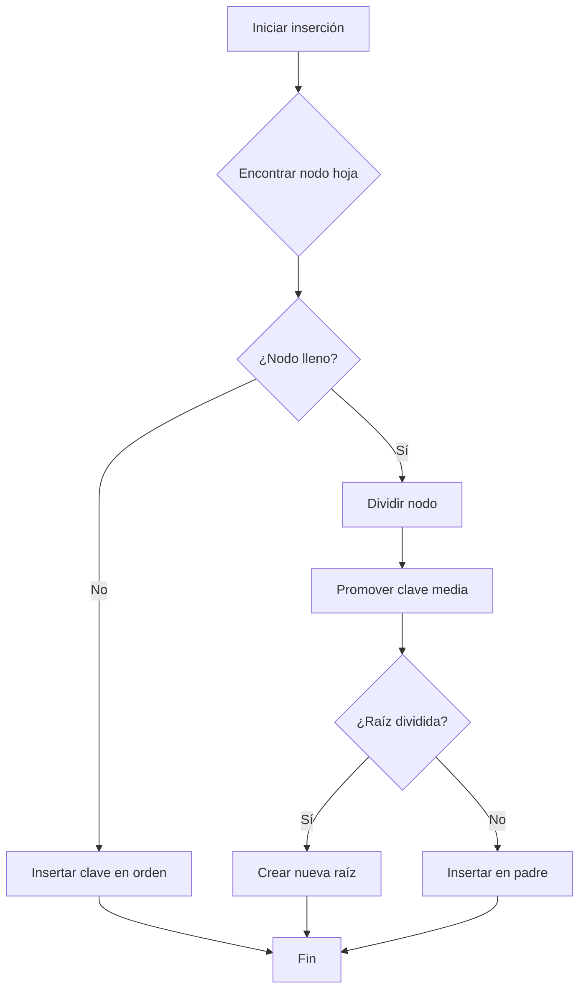
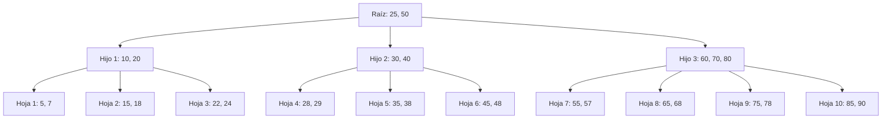
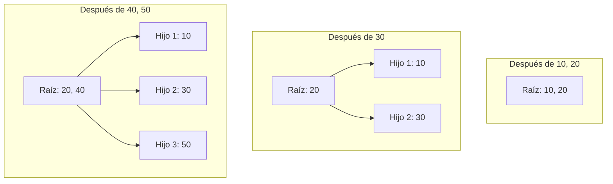
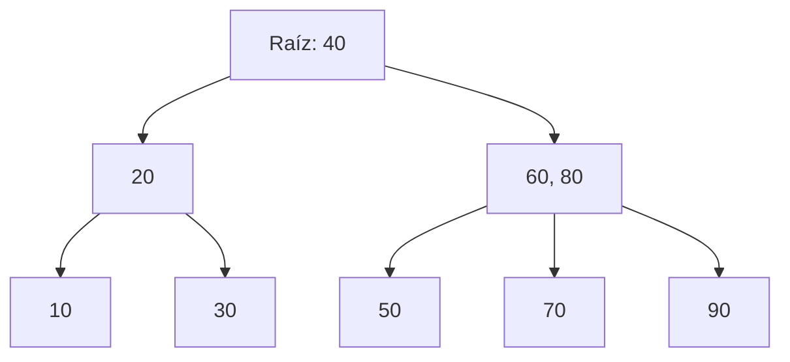
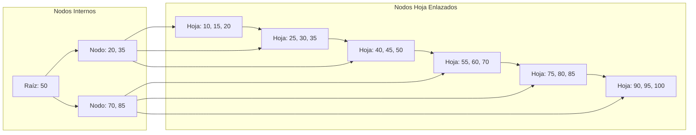

# Modelado y Programación - Estructuras de datos avanzadas

## 2.2 Árboles B.

---

Los **Árboles B** son estructuras de datos de árboles balanceados diseñados especialmente para trabajar con sistemas de almacenamiento secundario (discos duros, SSD). Fueron propuestos por Rudolf Bayer y Edward M. McCreight en 1972 mientras trabajaban en Boeing Research Labs.

#### Definición Formal

Un Árbol B de orden $m$ es un árbol que cumple con las siguientes propiedades:

1. Cada nodo tiene como máximo $m$ hijos
2. Cada nodo (excepto la raíz) tiene al menos $\lceil m/2 \rceil$ hijos
3. La raíz tiene al menos 2 hijos (a menos que sea un nodo hoja)
4. Todos los nodos hoja aparecen al mismo nivel
5. Un nodo no hoja con $k$ hijos contiene $k-1$ claves

Así, cada nodo distinto de la raíz tiene entre $\lceil m/2 \rceil - 1$ y $m - 1$ claves. Un árbol B de orden 3 es un **árbol 2-3** y uno de orden 4 es un **árbol 2-3-4**.

**Dos convenciones.** Este texto usa el **orden** $m$ (máximo de hijos), como Knuth. El libro de Cormen et al. usa el **grado mínimo** $t \geq 2:$ cada nodo distinto de la raíz tiene entre $t - 1$ y $2t - 1$ claves, es decir, entre $t$ y $2t$ hijos. Un árbol de grado mínimo $t$ es un árbol B de orden $m = 2t.$ La implementación en Python de este tema usa la convención de Cormen.

### Propiedades y Características

#### Estructura de un Nodo

Cada nodo contiene:

- $n$ claves ordenadas: $k_1 < k_2 < ... < k_n$
- $n+1$ punteros a hijos: $p_0, p_1, ..., p_n$
- Para nodos hoja, los punteros pueden ser nulos o apuntar a registros

#### Ventajas de los Árboles B

- **Balance automático**: Siempre permanecen balanceados
- **Altura logarítmica**: Para $n$ claves, altura = $O(\log_m n)$
- **Optimizados para E/S**: Múltiples claves por nodo reducen accesos a disco
- **Eficiencia en operaciones**: Búsqueda, inserción y eliminación en $O(\log n)$

**¿Por qué tantas claves por nodo?** Leer un bloque del disco cuesta mucho más que comparar claves en memoria, así que lo que importa es el **número de nodos visitados**, que es la altura. Si cada nodo ocupa un bloque de disco y guarda, por ejemplo, $m - 1 = 1000$ claves, un árbol de altura 3 almacena hasta $1001^3 - 1 \approx 10^9$ claves: cualquier búsqueda lee a lo más 3 bloques. Un árbol binario balanceado con las mismas claves tendría altura cercana a 30.

### Operaciones Básicas

#### Búsqueda

```python
def busqueda_arbol_b(nodo, clave):
    i = 0
    while i < len(nodo.claves) and clave > nodo.claves[i]:
        i += 1

    if i < len(nodo.claves) and clave == nodo.claves[i]:
        return (nodo, i)  # Clave encontrada

    if nodo.es_hoja:
        return None  # Clave no encontrada

    return busqueda_arbol_b(nodo.hijos[i], clave)
```

#### Inserción



#### Eliminación

La eliminación debe evitar que un nodo quede con menos claves del mínimo. Los casos son:

1. **La clave está en una hoja con claves de sobra**: se borra directamente.
2. **La clave está en un nodo interno**: se reemplaza por su **predecesor** (la mayor clave del subárbol izquierdo) o su **sucesor**, que siempre están en una hoja, y se borra ese predecesor o sucesor de la hoja.
3. **Una hoja queda con muy pocas claves**:
   - **Redistribución (préstamo)**: si un hermano adyacente tiene claves de sobra, la clave separadora del padre baja al nodo y la clave extrema del hermano sube a ocupar su lugar.
   - **Fusión**: si ningún hermano puede prestar, el nodo se une con un hermano y con la clave separadora del padre. El padre pierde una clave y el problema puede propagarse hacia arriba; si la raíz se queda sin claves, desaparece y **la altura disminuye**.

**Ejemplo con orden 3.** En el árbol con raíz $[20],$ hijos $[10]$ y $[30, 40],$ al borrar $10$ la hoja queda vacía. Su hermano $[30, 40]$ tiene una clave de sobra: $20$ baja a la hoja, $30$ sube a la raíz y queda la raíz $[30]$ con hijos $[20]$ y $[40].$

### Fórmulas Importantes

#### Altura Máxima

En esta sección $h$ es el **número de niveles** del árbol. Para un Árbol B de orden $m$ con $n \geq 1$ claves:

$$ h \leq 1 + \log_{\lceil m/2 \rceil} \left( \frac{n+1}{2} \right) $$

#### Capacidad de Almacenamiento

Número máximo de claves con $h$ niveles, cuando todos los nodos tienen $m$ hijos y $m - 1$ claves:

$$ n_{max} = (m - 1)\left(1 + m + m^2 + \cdots + m^{h-1}\right) = m^h - 1 $$

Número mínimo de claves con $h$ niveles, cuando la raíz tiene una clave y los demás nodos el mínimo $t - 1,$ con $t = \lceil m/2 \rceil:$

$$ n_{min} = 1 + 2(t - 1)\left(1 + t + \cdots + t^{h-2}\right) = 2 \cdot \lceil m/2 \rceil^{h-1} - 1 $$

La cota de la altura se obtiene despejando $h$ de $n \geq n_{min}.$ Por ejemplo, con $m = 3$ y $h = 3$ niveles caben entre $7$ y $26$ claves.

### Implementación en Python

```python
class NodoB:
    def __init__(self, hoja=False):
        self.hoja = hoja
        self.claves = []
        self.hijos = []
        self.siguiente = None  # Para nodos hoja en árbol B+

class ArbolB:
    def __init__(self, grado):
        self.raiz = NodoB(hoja=True)
        self.grado = grado  # grado mínimo t: cada nodo tiene entre t-1 y 2t-1 claves

    def buscar(self, clave):
        return self._buscar(self.raiz, clave)

    def _buscar(self, nodo, clave):
        i = 0
        while i < len(nodo.claves) and clave > nodo.claves[i]:
            i += 1

        if i < len(nodo.claves) and clave == nodo.claves[i]:
            return True

        if nodo.hoja:
            return False

        return self._buscar(nodo.hijos[i], clave)

    def insertar(self, clave):
        raiz = self.raiz
        if len(raiz.claves) == (2 * self.grado) - 1:
            nueva_raiz = NodoB()
            self.raiz = nueva_raiz
            nueva_raiz.hijos.append(raiz)
            self._dividir_hijo(nueva_raiz, 0)
            self._insertar_no_lleno(nueva_raiz, clave)
        else:
            self._insertar_no_lleno(raiz, clave)

    def _insertar_no_lleno(self, nodo, clave):
        i = len(nodo.claves) - 1
        if nodo.hoja:
            nodo.claves.append(0)
            while i >= 0 and clave < nodo.claves[i]:
                nodo.claves[i+1] = nodo.claves[i]
                i -= 1
            nodo.claves[i+1] = clave
        else:
            while i >= 0 and clave < nodo.claves[i]:
                i -= 1
            i += 1
            if len(nodo.hijos[i].claves) == (2 * self.grado) - 1:
                self._dividir_hijo(nodo, i)
                if clave > nodo.claves[i]:
                    i += 1
            self._insertar_no_lleno(nodo.hijos[i], clave)

    def _dividir_hijo(self, padre, indice):
        grado = self.grado
        hijo = padre.hijos[indice]
        nuevo_hijo = NodoB(hoja=hijo.hoja)

        padre.claves.insert(indice, hijo.claves[grado-1])
        padre.hijos.insert(indice+1, nuevo_hijo)

        nuevo_hijo.claves = hijo.claves[grado:(2*grado-1)]
        hijo.claves = hijo.claves[0:grado-1]

        if not hijo.hoja:
            nuevo_hijo.hijos = hijo.hijos[grado:(2*grado)]
            hijo.hijos = hijo.hijos[0:grado]

    def recorrido(self, nodo=None):
        """Claves en orden (recorrido inorden)."""
        nodo = nodo or self.raiz
        if nodo.hoja:
            return list(nodo.claves)
        resultado = []
        for i, clave in enumerate(nodo.claves):
            resultado += self.recorrido(nodo.hijos[i]) + [clave]
        return resultado + self.recorrido(nodo.hijos[-1])

    def niveles(self):
        """Lista de niveles; cada nivel es una lista con las claves de sus nodos."""
        resultado, actual = [], [self.raiz]
        while actual:
            resultado.append([n.claves for n in actual])
            actual = [h for n in actual for h in n.hijos]
        return resultado

arbol = ArbolB(2)                      # t = 2: árbol 2-3-4
for k in range(10, 101, 10):
    arbol.insertar(k)
print(arbol.recorrido())               # [10, 20, ..., 100]
for nivel in arbol.niveles():
    print(nivel)
# [[40]]
# [[20], [60, 80]]
# [[10], [30], [50], [70], [90, 100]]
print(arbol.buscar(70), arbol.buscar(75))   # True False
```

Esta inserción divide **preventivamente** cada nodo lleno que encuentra al bajar, así que nunca tiene que regresar a dividir a los padres. Por eso el árbol solo crece en altura cuando se divide la raíz, y todas las hojas siguen al mismo nivel.

### Visualización de un Árbol B



### Ejemplos Prácticos

El árbol de la figura es de orden 4: cada nodo tiene a lo más 3 claves y 4 hijos, y en cada nodo las claves separan los rangos de sus hijos; por ejemplo, todas las claves bajo `Hijo 2` están entre 25 y 50.

#### Ejemplo 1: Inserción Secuencial

Insertar claves: 10, 20, 30, 40, 50, 60, 70, 80, 90 en un Árbol B de orden 3. Cada nodo admite a lo más 2 claves; cuando un nodo llega a 3, se divide y su clave **media** sube al padre.



Al insertar 60 la hoja queda $[50, 60];$ con 70 se desborda a $[50, 60, 70]$ y sube el 60, así que la raíz queda $[20, 40, 60]$ y también se desborda: sube el 40 y se crea una nueva raíz. Con 80 y 90 ocurre lo mismo en la hoja derecha. El resultado final tiene 3 niveles:



Insertar claves ordenadas es el peor caso para un árbol binario de búsqueda simple, que degeneraría en una lista; el árbol B se mantiene balanceado.

#### Ejemplo 2: Base de Datos con Árbol B

```python
class BaseDatos:
    def __init__(self, orden_arbol=100):
        self.indice = ArbolB(orden_arbol)
        self.almacenamiento = {}

    def insertar_registro(self, id_registro, datos):
        self.indice.insertar(id_registro)
        self.almacenamiento[id_registro] = datos

    def buscar_registro(self, id_registro):
        if self.indice.buscar(id_registro):
            return self.almacenamiento.get(id_registro)
        return None

# Uso
bd = BaseDatos()
bd.insertar_registro(1001, {"nombre": "Juan", "edad": 25})
bd.insertar_registro(1002, {"nombre": "María", "edad": 30})

print(bd.buscar_registro(1001))  # Encuentra el registro
```

Esta clase es didáctica: el índice y los datos viven en memoria. En una base de datos real, cada nodo del árbol se guarda en una página del disco y las hojas contienen la posición de cada registro.

### Ejercicios Propuestos

#### Ejercicio 1: Implementación de Eliminación

Completa la implementación del Árbol B con las operaciones de eliminación, considerando todos los casos:

- Eliminación en nodo hoja
- Eliminación en nodo interno
- Redistribución desde hermanos
- Fusión de nodos

#### Ejercicio 2: Árbol B+

Implementa una variante de Árbol B+ donde:

- Todas las claves se almacenan en las hojas
- Las hojas están enlazadas entre sí
- Los nodos internos solo contienen claves de guía

#### Ejercicio 3: Análisis de Rendimiento

Escribe un programa que compare el rendimiento de:

- Árboles B vs. Árboles Binarios de Búsqueda
- Diferentes órdenes (m) del Árbol B
- Operaciones con datos ordenados vs. aleatorios

#### Ejercicio 4: Simulador Visual

Crea una aplicación que permita:

- Insertar y eliminar claves de un Árbol B
- Visualizar la estructura del árbol
- Mostrar el proceso paso a paso de las operaciones

### Aplicaciones en el Mundo Real

1. **Sistemas de bases de datos**: los índices de Oracle, MySQL (InnoDB) y PostgreSQL usan árboles B+
2. **Sistemas de archivos**: NTFS, XFS, Btrfs y ext4 usan variantes de árboles B para directorios o metadatos
3. **Buscadores y motores de indexación**
4. **Bases de datos NoSQL**
5. **Sistemas de gestión de memoria**

### Optimizaciones y Variantes

#### Árboles B+



#### Árboles B*

Variante donde los nodos se mantienen al menos $\frac{2}{3}$ llenos en lugar de $\frac{1}{2}.$ Antes de dividir un nodo lleno se intenta pasar claves a un hermano, y cuando ya no es posible se dividen **dos** nodos llenos en **tres**. Así se aprovecha mejor el espacio y el árbol queda un poco más bajo.

**Ventajas del árbol B+.** Como los nodos internos solo guardan claves de guía, caben más por bloque y el árbol es más bajo. Además, las consultas por rango (`WHERE edad BETWEEN 20 AND 30`) bajan una sola vez hasta la primera hoja y luego recorren las hojas enlazadas.

### Referencias y Recursos

1. **Libros Fundamentales**:
   - "Introduction to Algorithms" (Cormen et al.) - Capítulo 18
   - "The Art of Computer Programming" (Knuth) - Volumen 3

2. **Artículos de Investigación**:
   - Bayer, R., McCreight, E. (1972). "Organization and Maintenance of Large Ordered Indexes"
   - Comer, D. (1979). "The Ubiquitous B-Tree"

3. **Recursos Online**:
   - [Visualización de Árboles B - USFCA](https://www.cs.usfca.edu/~galles/visualization/BTree.html)
   - [Tutorial de Árboles B - GeeksforGeeks](https://www.geeksforgeeks.org/introduction-of-b-tree-2/)

### Prueba tu Comprensión

1. ¿Por qué los Árboles B son más eficientes para sistemas de disco?
2. Explica el proceso de división de un nodo durante la inserción
3. ¿Cómo se mantiene el balance en un Árbol B después de una eliminación?
4. Compara Árboles B con Árboles Binarios de Búsqueda Balanceados (AVL)
5. Describe una situación donde un Árbol B+ sería preferible sobre un Árbol B estándar

### Consejos para el Examen

- Entiende bien los casos de inserción y eliminación
- Practica dibujando Árboles B en papel
- Memoriza las fórmulas de capacidad y altura
- Comprende las diferencias entre Árboles B, B+ y B*
- Familiarízate con las complejidades de las operaciones
