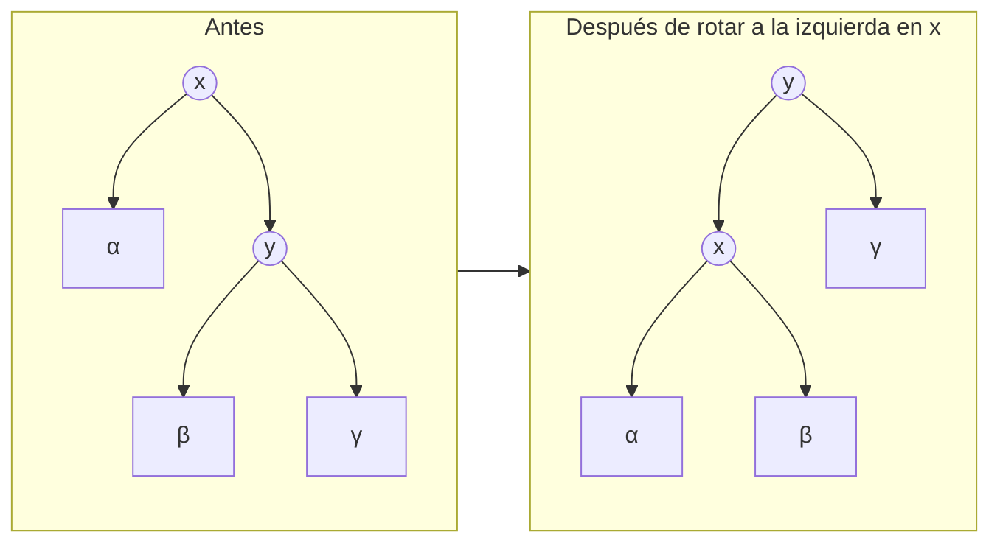
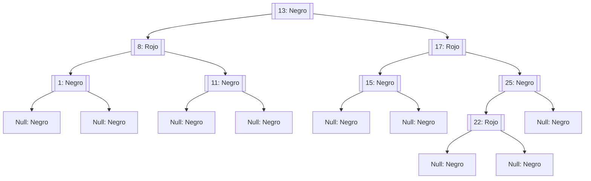
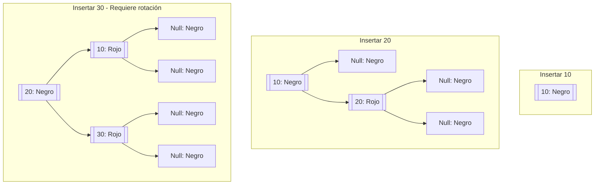
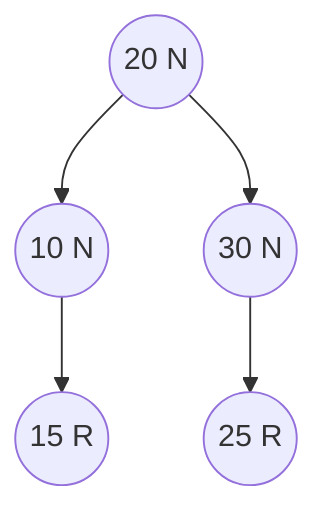
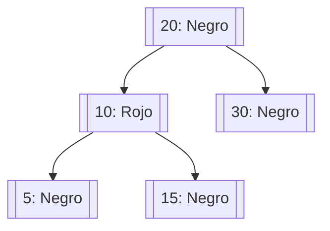

# Modelado y Programación - Estructuras de datos avanzadas

## 2.3 Árboles black/red.

---

Los **Árboles Rojo-Negro** son un tipo de árbol binario de búsqueda auto-balanceado que garantiza un rendimiento eficiente en las operaciones básicas. Fueron inventados por Rudolf Bayer en 1972 bajo el nombre "árboles binarios B simétricos" y luego renombrados por Leonidas J. Guibas y Robert Sedgewick.

#### Definición Formal

Un Árbol Rojo-Negro es un árbol binario de búsqueda que satisface las siguientes propiedades:

1. **Propiedad del color**: Cada nodo es **rojo** o **negro**
2. **Propiedad de la raíz**: La raíz siempre es negra
3. **Propiedad de las hojas**: Todas las hojas (nodos nulos) son negras
4. **Propiedad roja**: Si un nodo es rojo, ambos hijos son negros
5. **Propiedad del camino negro**: Para cada nodo, todos los caminos hacia las hojas contienen el mismo número de nodos negros

Las propiedades 4 y 5 juntas impiden que un camino sea mucho más largo que otro: el camino más corto posible es todo negro, y el más largo alterna rojo y negro, así que mide a lo más el doble.

#### Relación con los Árboles 2-3-4

Un árbol rojo-negro es la representación binaria de un árbol B de orden 4. Si cada nodo rojo se "funde" con su padre negro, se obtiene un nodo con 1, 2 o 3 claves, y todas las hojas quedan a la misma profundidad, que es la altura negra. Esta correspondencia explica las operaciones: cambiar colores equivale a dividir un nodo 2-3-4 lleno, y las rotaciones solo reorganizan un mismo nodo 2-3-4.

### Propiedades y Características

#### Altura del Árbol

Para un Árbol Rojo-Negro con $n$ nodos internos:

- Altura mínima: $h \geq \log_2(n+1),$ como en cualquier árbol binario
- Altura máxima: $h \leq 2\log_2(n+1)$

Aquí la altura cuenta las aristas hasta las hojas nulas.

Esto garantiza que las operaciones sean $O(\log n)$ en el peor caso.

#### Ventajas de los Árboles Rojo-Negro

- **Balance eficiente**: Una inserción hace a lo más 2 rotaciones y una eliminación a lo más 3; los árboles AVL pueden necesitar $O(\log n)$ rotaciones al eliminar. A cambio, los AVL están más balanceados y sus búsquedas son un poco más rápidas.
- **Operaciones rápidas**: Búsqueda, inserción y eliminación en $O(\log n)$
- **Memoria eficiente**: Solo necesitan 1 bit adicional por nodo para el color
- **Estabilidad**: Buen desempeño en inserciones y eliminaciones frecuentes

### Operaciones Básicas

#### Rotaciones



La rotación a la izquierda sube a $y$ y baja a $x$ a su izquierda; el subárbol $\beta,$ cuyas claves están entre $x$ y $y,$ pasa a ser el hijo derecho de $x.$ El recorrido inorden $\alpha, x, \beta, y, \gamma$ no cambia, así que el árbol sigue siendo de búsqueda. La rotación a la derecha es la operación inversa. Ambas cuestan $O(1).$

#### Inserción

Se inserta como en un árbol binario de búsqueda y el nuevo nodo se pinta de **rojo**, para no alterar la altura negra. Lo único que puede fallar es la propiedad 4, si el padre también es rojo. Sea $z$ el nuevo nodo, $p$ su padre y $t$ su tío, es decir, el otro hijo del abuelo $a:$

1. **Tío rojo**: se pintan $p$ y $t$ de negro y $a$ de rojo. El problema puede subir a $a,$ así que se repite desde ahí.
2. **Tío negro y $z$ en zigzag** (por ejemplo, $p$ es hijo izquierdo y $z$ es hijo derecho): se rota en $p$ para pasar al caso 3.
3. **Tío negro y $z$ en línea**: se pinta $p$ de negro y $a$ de rojo, y se rota en $a$ en sentido contrario. Aquí termina.

Al final, la raíz se pinta de negro.

#### Eliminación

```text
eliminar(arbol, clave):
    nodo = buscar(arbol, clave)
    si nodo es nulo: terminar
    eliminar como en un árbol binario de búsqueda
        (si tiene dos hijos, se usa su sucesor)
    si el nodo que se quitó físicamente era NEGRO:
        arreglar_eliminacion(arbol, nodo que ocupó su lugar)
```

Quitar un nodo rojo no altera ninguna propiedad. Quitar uno negro deja un camino con un negro menos; la reparación trata al nodo que ocupó su lugar como "doblemente negro" y, según el color del hermano y de sus hijos, recolorea o rota (cuatro casos simétricos) hasta compensar.

### Fórmulas Importantes

#### Límite de Altura

Para un Árbol Rojo-Negro con $n$ nodos internos:

$$ h \leq 2\log_2(n+1) $$

#### Número Negro (Black Height)

El número negro $bh(x)$ de un nodo $x$ es el número de nodos negros desde $x$ hasta cualquier hoja, sin contar a $x.$ Por la propiedad 4, al menos la mitad de los nodos de cualquier camino de la raíz a una hoja son negros, así que

$$ bh(\text{raíz}) \geq \frac{h}{2} $$

**Demostración de la cota de altura.** Por inducción, el subárbol de cualquier nodo $x$ tiene al menos $2^{bh(x)} - 1$ nodos internos. Para la raíz, $n \geq 2^{bh} - 1 \geq 2^{h/2} - 1,$ y despejando, $h \leq 2\log_2(n + 1).$

### Implementación en Python

```python
class Color:
    ROJO = 0
    NEGRO = 1

class NodoRN:
    def __init__(self, clave, color=Color.ROJO):
        self.clave = clave
        self.valor = None
        self.color = color
        self.izquierdo = None
        self.derecho = None
        self.padre = None

class ArbolRojoNegro:
    def __init__(self):
        self.nulo = NodoRN(0, Color.NEGRO)
        self.raiz = self.nulo

    def insertar(self, clave):
        nuevo_nodo = NodoRN(clave)
        nuevo_nodo.izquierdo = self.nulo
        nuevo_nodo.derecho = self.nulo

        # Insertar como en BST normal
        padre = None
        actual = self.raiz

        while actual != self.nulo:
            padre = actual
            if nuevo_nodo.clave < actual.clave:
                actual = actual.izquierdo
            else:
                actual = actual.derecho

        nuevo_nodo.padre = padre

        if padre is None:
            self.raiz = nuevo_nodo
        elif nuevo_nodo.clave < padre.clave:
            padre.izquierdo = nuevo_nodo
        else:
            padre.derecho = nuevo_nodo

        # Si el padre es None, es la raíz
        if nuevo_nodo.padre is None:
            nuevo_nodo.color = Color.NEGRO
            return

        # Si el abuelo es None, no hay necesidad de arreglar
        if nuevo_nodo.padre.padre is None:
            return

        # Arreglar el árbol
        self._arreglar_insercion(nuevo_nodo)

    def _arreglar_insercion(self, nodo):
        while nodo.padre.color == Color.ROJO:
            if nodo.padre == nodo.padre.padre.derecho:
                tio = nodo.padre.padre.izquierdo
                if tio.color == Color.ROJO:
                    tio.color = Color.NEGRO
                    nodo.padre.color = Color.NEGRO
                    nodo.padre.padre.color = Color.ROJO
                    nodo = nodo.padre.padre
                else:
                    if nodo == nodo.padre.izquierdo:
                        nodo = nodo.padre
                        self._rotar_derecha(nodo)
                    nodo.padre.color = Color.NEGRO
                    nodo.padre.padre.color = Color.ROJO
                    self._rotar_izquierda(nodo.padre.padre)
            else:
                tio = nodo.padre.padre.derecho
                if tio.color == Color.ROJO:
                    tio.color = Color.NEGRO
                    nodo.padre.color = Color.NEGRO
                    nodo.padre.padre.color = Color.ROJO
                    nodo = nodo.padre.padre
                else:
                    if nodo == nodo.padre.derecho:
                        nodo = nodo.padre
                        self._rotar_izquierda(nodo)
                    nodo.padre.color = Color.NEGRO
                    nodo.padre.padre.color = Color.ROJO
                    self._rotar_derecha(nodo.padre.padre)

            if nodo == self.raiz:
                break

        self.raiz.color = Color.NEGRO

    def buscar(self, clave):
        actual = self.raiz
        while actual != self.nulo and clave != actual.clave:
            actual = actual.izquierdo if clave < actual.clave else actual.derecho
        return None if actual == self.nulo else actual

    def verificar(self):
        """Devuelve la altura negra si se cumplen las propiedades; si no, lanza AssertionError."""
        assert self.raiz.color == Color.NEGRO, "La raíz debe ser negra"
        def altura_negra(nodo):
            if nodo == self.nulo:
                return 1                              # las hojas nulas son negras
            if nodo.color == Color.ROJO:
                for hijo in (nodo.izquierdo, nodo.derecho):
                    assert hijo.color == Color.NEGRO, f"Dos rojos seguidos en {nodo.clave}"
            izq, der = altura_negra(nodo.izquierdo), altura_negra(nodo.derecho)
            assert izq == der, f"Alturas negras distintas bajo {nodo.clave}"
            return izq + (1 if nodo.color == Color.NEGRO else 0)
        return altura_negra(self.raiz)

    def _rotar_izquierda(self, x):
        y = x.derecho
        x.derecho = y.izquierdo
        if y.izquierdo != self.nulo:
            y.izquierdo.padre = x

        y.padre = x.padre
        if x.padre is None:
            self.raiz = y
        elif x == x.padre.izquierdo:
            x.padre.izquierdo = y
        else:
            x.padre.derecho = y

        y.izquierdo = x
        x.padre = y

    def _rotar_derecha(self, x):
        y = x.izquierdo
        x.izquierdo = y.derecho
        if y.derecho != self.nulo:
            y.derecho.padre = x

        y.padre = x.padre
        if x.padre is None:
            self.raiz = y
        elif x == x.padre.derecho:
            x.padre.derecho = y
        else:
            x.padre.izquierdo = y

        y.derecho = x
        x.padre = y

def altura(arbol, nodo):
    return 0 if nodo == arbol.nulo else 1 + max(altura(arbol, nodo.izquierdo), altura(arbol, nodo.derecho))

arbol = ArbolRojoNegro()
for k in range(1, 1001):              # claves ordenadas: el peor caso para un BST simple
    arbol.insertar(k)
print("Altura negra:", arbol.verificar())
print("Altura:", altura(arbol, arbol.raiz), "<=", round(2 * __import__('math').log2(1001), 1))
# Un BST sin balanceo tendría altura 1000
```

### Visualización de un Árbol Rojo-Negro



### Ejemplos Prácticos

#### Ejemplo 1: Inserción Secuencial

Insertar claves: 10, 20, 30, 15, 25 en un Árbol Rojo-Negro



- **Insertar 30**: queda como hijo derecho de 20, rojo con padre rojo y tío nulo (negro), en línea: caso 3. Se pinta 20 de negro y 10 de rojo, y se rota a la izquierda en 10.
- **Insertar 15**: queda como hijo derecho de 10. Su padre 10 es rojo y su tío 30 también: caso 1. Se pintan 10 y 30 de negro y 20 de rojo; como 20 es la raíz, se vuelve a pintar de negro.
- **Insertar 25**: queda como hijo izquierdo de 30, que es negro: no hay nada que arreglar.



#### Ejemplo 2: Implementación de Diccionario

```python
class DiccionarioRN:
    def __init__(self):
        self.arbol = ArbolRojoNegro()

    def insertar(self, clave, valor):
        nodo = self.arbol.buscar(clave)
        if nodo is not None:          # la clave ya existe: se actualiza el valor
            nodo.valor = valor
            return
        self.arbol.insertar(clave)
        self.arbol.buscar(clave).valor = valor

    def buscar(self, clave):
        nodo = self.arbol.buscar(clave)
        return None if nodo is None else nodo.valor

    def claves_en_orden(self):
        resultado = []
        def inorden(n):
            if n != self.arbol.nulo:
                inorden(n.izquierdo); resultado.append(n.clave); inorden(n.derecho)
        inorden(self.arbol.raiz)
        return resultado

# Uso
diccionario = DiccionarioRN()
diccionario.insertar("clave2", "valor2")
diccionario.insertar("clave1", "valor1")

print(diccionario.buscar("clave1"))     # valor1
print(diccionario.claves_en_orden())    # ['clave1', 'clave2']: a diferencia de un dict, mantiene el orden
```

### Ejercicios Propuestos

#### Ejercicio 1: Implementación Completa de Eliminación

Completa la implementación del Árbol Rojo-Negro con la operación de eliminación, considerando todos los casos posibles y las operaciones de arreglo necesarias.

#### Ejercicio 2: Verificador de Propiedades

Implementa una función que verifique si un árbol binario cumple con todas las propiedades de un Árbol Rojo-Negro:

- Raíz negra
- No dos rojos consecutivos
- Mismo número negro en todos los caminos

El método `verificar` de la implementación anterior es una solución.

#### Ejercicio 3: Comparación de Rendimiento

Compara el rendimiento de Árboles Rojo-Negro vs. Árboles AVL en:

- Inserciones secuenciales
- Búsquedas aleatorias
- Eliminaciones alternadas

#### Ejercicio 4: Visualización Gráfica

Crea una herramienta que visualice Árboles Rojo-Negro, mostrando:

- Colores de nodos
- Rotaciones durante operaciones
- Número negro de cada camino

### Aplicaciones en el Mundo Real

1. **Bibliotecas estándar**: `TreeMap` y `TreeSet` de Java, y las implementaciones habituales de `std::map` y `std::set` de C++
2. **Núcleo de Linux**: el planificador CFS ordena los procesos listos en un árbol rojo-negro, y la memoria virtual de cada proceso se organiza con ellos
3. **Geometría computacional**: algoritmos de barrido que mantienen ordenados los segmentos activos
4. Cualquier situación que necesite un **diccionario ordenado** con garantía de $O(\log n)$ en el peor caso, y no solo en promedio como las tablas hash

### Optimizaciones y Variantes

#### Árboles Left-Leaning Red-Black

Variante que simplifica la implementación asegurando que todos los nodos rojos sean hijos izquierdos. Corresponde a los árboles 2-3, en lugar de los 2-3-4.



#### Árboles AA

Otra variante que simplifica las operaciones usando conceptos adicionales de "nivel" en lugar de color.

### Referencias y Recursos

1. **Libros Fundamentales**:
   - "Introduction to Algorithms" (Cormen et al.) - Capítulo 13
   - "Algorithms" (Sedgewick & Wayne) - Capítulo 3.3

2. **Artículos de Investigación**:
   - Guibas, L. J., & Sedgewick, R. (1978). "A dichromatic framework for balanced trees"
   - Sedgewick, R. (2008). "Left-leaning Red-Black Trees"

3. **Recursos Online**:
   - [Visualización de Árboles Rojo-Negro - USFCA](https://www.cs.usfca.edu/~galles/visualization/RedBlack.html)
   - [Tutorial de Árboles Rojo-Negro - GeeksforGeeks](https://www.geeksforgeeks.org/red-black-tree-set-1-introduction-2/)

### Prueba tu Comprensión

1. ¿Por qué los Árboles Rojo-Negro garantizan un balance eficiente?
2. Explica el propósito de las rotaciones durante la inserción
3. ¿Cómo se mantiene la propiedad del camino negro después de una eliminación?
4. Compara Árboles Rojo-Negro con Árboles AVL
5. Describe una situación donde los Árboles Rojo-Negro serían preferibles sobre otras estructuras

### Consejos para el Examen

- Entiende bien los casos de inserción y sus soluciones
- Practica dibujando Árboles Rojo-Negro en papel
- Memoriza las propiedades fundamentales
- Comprende las diferencias entre las variantes
- Familiarízate con las complejidades de las operaciones
