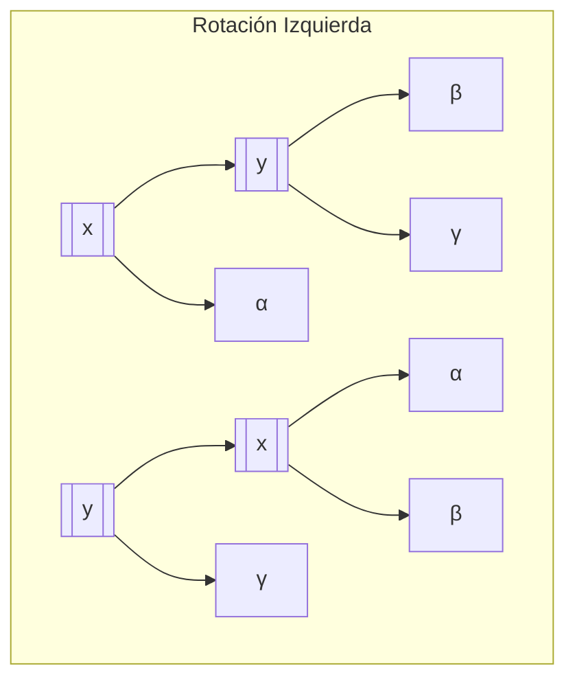
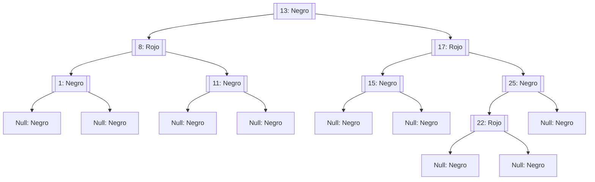
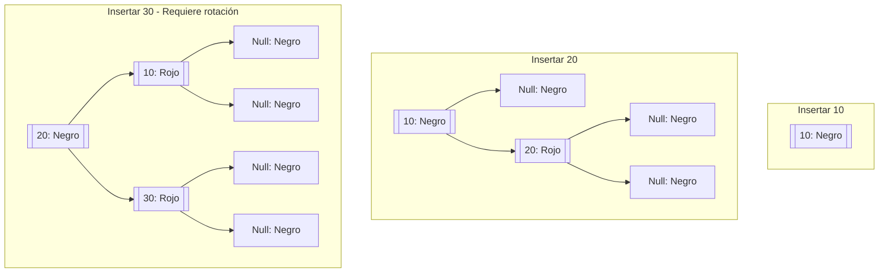
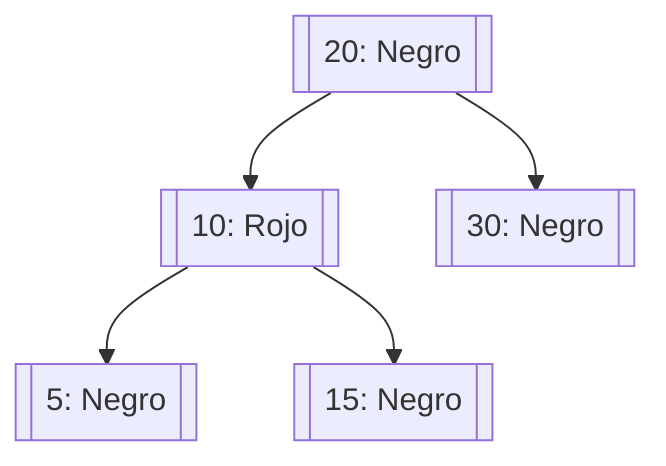

# Modelado y Programación - Estructuras de datos avanzadas

## 2.3 Árboles black/red.

---

Los **Árboles Rojo-Negro** son un tipo de árbol binario de búsqueda auto-balanceado que garantiza un rendimiento eficiente en las operaciones básicas. Fueron inventados por Rudolf Bayer en 1972 bajo el nombre "árboles binarios B simétricos" y luego renombrados por Leonidas J. Guibas y Robert Sedgewick.

#### Definición Formal

Un Árbol Rojo-Negro es un árbol binario de búsqueda que satisface las siguientes propiedades:

1. **Propiedad del color**: Cada nodo es either **rojo** o **negro**
2. **Propiedad de la raíz**: La raíz siempre es negra
3. **Propiedad de las hojas**: Todas las hojas (nodos nulos) son negras
4. **Propiedad roja**: Si un nodo es rojo, ambos hijos son negros
5. **Propiedad del camino negro**: Para cada nodo, todos los caminos hacia las hojas contienen el mismo número de nodos negros

### Propiedades y Características

#### Altura del Árbol

Para un Árbol Rojo-Negro con $n$ nodos internos:

- Altura mínima: $h \geq \log_2(n+1)$
- Altura máxima: $h \leq 2\log_2(n+1)$

Esto garantiza que las operaciones sean $O(\log n)$ en el peor caso.

#### Ventajas de los Árboles Rojo-Negro

- **Balance eficiente**: Menos rotaciones que los árboles AVL
- **Operaciones rápidas**: Búsqueda, inserción y eliminación en $O(\log n)$
- **Memoria eficiente**: Solo necesitan 1 bit adicional por nodo para el color
- **Estabilidad**: Buen desempeño en inserciones y eliminaciones frecuentes

### Operaciones Básicas

#### Rotaciones



#### Inserción

```python
def insertar(rn_arbol, clave):
    # Insertar como en BST normal
    nuevo_nodo = insertar_bst(rn_arbol, clave)
    nuevo_nodo.color = ROJO

    # Arreglar violaciones de propiedades
    arreglar_insercion(rn_arbol, nuevo_nodo)
```

#### Eliminación

```python
def eliminar(rn_arbol, clave):
    # Encontrar nodo a eliminar
    nodo = buscar(rn_arbol, clave)

    if nodo is None:
        return

    # Realizar eliminación BST
    nodo_eliminado = eliminar_bst(rn_arbol, nodo)

    # Arreglar violaciones de propiedades
    if nodo_eliminado.color == NEGRO:
        arreglar_eliminacion(rn_arbol, nodo_eliminado)
```

### Fórmulas Importantes

#### Límite de Altura

Para un Árbol Rojo-Negro con $n$ nodos internos:

$$ h \leq 2\log_2(n+1) $$

#### Número Negro (Black Height)

El número negro $bh(x)$ de un nodo $x$ es el número de nodos negros desde $x$ hasta cualquier hoja ( excluyendo $x$ ). Para un árbol con $n$ nodos internos:

$$ bh(\text{raíz}) \geq \frac{h}{2} $$

### Implementación en Python

```python
class Color:
    ROJO = 0
    NEGRO = 1

class NodoRN:
    def __init__(self, clave, color=Color.ROJO):
        self.clave = clave
        self.color = color
        self.izquierdo = None
        self.derecho = None
        self.padre = None

class ArbolRojoNegro:
    def __init__(self):
        self.nulo = NodoRN(0, Color.NEGRO)
        self.raiz = self.nulo

    def insertar(self, clave):
        nuevo_nodo = NodoRN(clave)
        nuevo_nodo.izquierdo = self.nulo
        nuevo_nodo.derecho = self.nulo

        # Insertar como en BST normal
        padre = None
        actual = self.raiz

        while actual != self.nulo:
            padre = actual
            if nuevo_nodo.clave < actual.clave:
                actual = actual.izquierdo
            else:
                actual = actual.derecho

        nuevo_nodo.padre = padre

        if padre is None:
            self.raiz = nuevo_nodo
        elif nuevo_nodo.clave < padre.clave:
            padre.izquierdo = nuevo_nodo
        else:
            padre.derecho = nuevo_nodo

        # Si el padre es None, es la raíz
        if nuevo_nodo.padre is None:
            nuevo_nodo.color = Color.NEGRO
            return

        # Si el abuelo es None, no hay necesidad de arreglar
        if nuevo_nodo.padre.padre is None:
            return

        # Arreglar el árbol
        self._arreglar_insercion(nuevo_nodo)

    def _arreglar_insercion(self, nodo):
        while nodo.padre.color == Color.ROJO:
            if nodo.padre == nodo.padre.padre.derecho:
                tio = nodo.padre.padre.izquierdo
                if tio.color == Color.ROJO:
                    tio.color = Color.NEGRO
                    nodo.padre.color = Color.NEGRO
                    nodo.padre.padre.color = Color.ROJO
                    nodo = nodo.padre.padre
                else:
                    if nodo == nodo.padre.izquierdo:
                        nodo = nodo.padre
                        self._rotar_derecha(nodo)
                    nodo.padre.color = Color.NEGRO
                    nodo.padre.padre.color = Color.ROJO
                    self._rotar_izquierda(nodo.padre.padre)
            else:
                tio = nodo.padre.padre.derecho
                if tio.color == Color.ROJO:
                    tio.color = Color.NEGRO
                    nodo.padre.color = Color.NEGRO
                    nodo.padre.padre.color = Color.ROJO
                    nodo = nodo.padre.padre
                else:
                    if nodo == nodo.padre.derecho:
                        nodo = nodo.padre
                        self._rotar_izquierda(nodo)
                    nodo.padre.color = Color.NEGRO
                    nodo.padre.padre.color = Color.ROJO
                    self._rotar_derecha(nodo.padre.padre)

            if nodo == self.raiz:
                break

        self.raiz.color = Color.NEGRO

    def _rotar_izquierda(self, x):
        y = x.derecho
        x.derecho = y.izquierdo
        if y.izquierdo != self.nulo:
            y.izquierdo.padre = x

        y.padre = x.padre
        if x.padre is None:
            self.raiz = y
        elif x == x.padre.izquierdo:
            x.padre.izquierdo = y
        else:
            x.padre.derecho = y

        y.izquierdo = x
        x.padre = y

    def _rotar_derecha(self, x):
        y = x.izquierdo
        x.izquierdo = y.derecho
        if y.derecho != self.nulo:
            y.derecho.padre = x

        y.padre = x.padre
        if x.padre is None:
            self.raiz = y
        elif x == x.padre.derecho:
            x.padre.derecho = y
        else:
            x.padre.izquierdo = y

        y.derecho = x
        x.padre = y
```

### Visualización de un Árbol Rojo-Negro



### Ejemplos Prácticos

#### Ejemplo 1: Inserción Secuencial

Insertar claves: 10, 20, 30, 15, 25 en un Árbol Rojo-Negro



#### Ejemplo 2: Implementación de Diccionario

```python
class DiccionarioRN:
    def __init__(self):
        self.arbol = ArbolRojoNegro()

    def insertar(self, clave, valor):
        # Implementación simplificada
        self.arbol.insertar(clave)
        # Aquí se almacenaría el valor asociado a la clave

    def buscar(self, clave):
        return self._buscar(self.arbol.raiz, clave)

    def _buscar(self, nodo, clave):
        if nodo == self.arbol.nulo:
            return None

        if clave == nodo.clave:
            return nodo  # Devolvería el valor asociado

        if clave < nodo.clave:
            return self._buscar(nodo.izquierdo, clave)
        else:
            return self._buscar(nodo.derecho, clave)

# Uso
diccionario = DiccionarioRN()
diccionario.insertar("clave1", "valor1")
diccionario.insertar("clave2", "valor2")

resultado = diccionario.buscar("clave1")
print(resultado)  # Encuentra el valor
```

### Ejercicios Propuestos

#### Ejercicio 1: Implementación Completa de Eliminación

Completa la implementación del Árbol Rojo-Negro con la operación de eliminación, considerando todos los casos posibles y las operaciones de arreglo necesarias.

#### Ejercicio 2: Verificador de Propiedades

Implementa una función que verifique si un árbol binario cumple con todas las propiedades de un Árbol Rojo-Negro:

- Raíz negra
- No dos rojos consecutivos
- Mismo número negro en todos los caminos

#### Ejercicio 3: Comparación de Rendimiento

Compara el rendimiento de Árboles Rojo-Negro vs. Árboles AVL en:

- Inserciones secuenciales
- Búsquedas aleatorias
- Eliminaciones alternadas

#### Ejercicio 4: Visualización Gráfica

Crea una herramienta que visualice Árboles Rojo-Negro, mostrando:

- Colores de nodos
- Rotaciones durante operaciones
- Número negro de cada camino

### Aplicaciones en el Mundo Real

1. **Sistemas de bases de datos**: Implementación de índices
2. **Lenguajes de programación**: Java TreeMap, C++ map
3. **Sistemas de archivos**: Algunas implementaciones de sistemas de archivos
4. **Algoritmos de routing**: Tablas de routing en redes
5. **Procesamiento de gráficos**: Algoritmos computacionales

### Optimizaciones y Variantes

#### Árboles Left-Leaning Red-Black

Variante que simplifica la implementación asegurando que todos los nodos rojos sean hijos izquierdos.



#### Árboles AA

Otra variante que simplifica las operaciones usando conceptos adicionales de "nivel" en lugar de color.

### Referencias y Recursos

1. **Libros Fundamentales**:
   - "Introduction to Algorithms" (Cormen et al.) - Capítulo 13
   - "Algorithms" (Sedgewick & Wayne) - Capítulo 3.3

2. **Artículos de Investigación**:
   - Guibas, L. J., & Sedgewick, R. (1978). "A dichromatic framework for balanced trees"
   - Sedgewick, R. (2008). "Left-leaning Red-Black Trees"

3. **Recursos Online**:
   - [Visualización de Árboles Rojo-Negro - USFCA](https://www.cs.usfca.edu/~galles/visualization/RedBlack.html)
   - [Tutorial de Árboles Rojo-Negro - GeeksforGeeks](https://www.geeksforgeeks.org/red-black-tree-set-1-introduction-2/)

### Prueba tu Comprensión

1. ¿Por qué los Árboles Rojo-Negro garantizan un balance eficiente?
2. Explica el propósito de las rotaciones durante la inserción
3. ¿Cómo se mantiene la propiedad del camino negro después de una eliminación?
4. Compara Árboles Rojo-Negro con Árboles AVL
5. Describe una situación donde los Árboles Rojo-Negro serían preferibles sobre otras estructuras

### Consejos para el Examen

- Entiende bien los casos de inserción y sus soluciones
- Practica dibujando Árboles Rojo-Negro en papel
- Memoriza las propiedades fundamentales
- Comprende las diferencias entre las variantes
- Familiarízate con las complejidades de las operaciones
