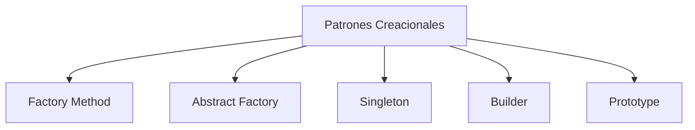
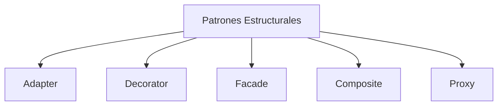
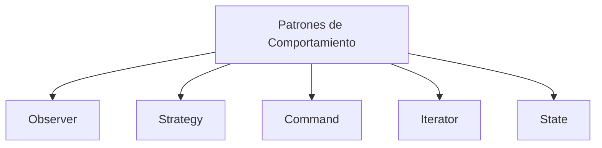
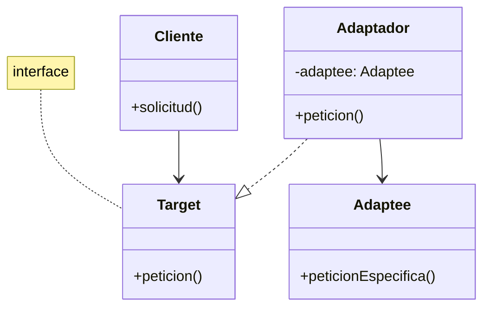

# Modelado y Programación - Buenas prácticas de programación

## 3.1 Definición de patrones de diseño.

---

#### Definición

Los **patrones de diseño** son soluciones reutilizables a problemas comunes en el diseño de software. Representan mejores prácticas desarrolladas por programadores experimentados a lo largo del tiempo.

#### Función Principal

Los patrones de diseño proporcionan:

- Soluciones probadas a problemas recurrentes
- Vocabulario común para desarrolladores
- Mejor mantenibilidad del código
- Reducción de la complejidad del diseño

Un patrón no es código que se copia, sino una **descripción** de una solución que se adapta a cada caso. La idea proviene del arquitecto Christopher Alexander, que catalogó patrones para diseñar edificios y ciudades, y se popularizó en software con el libro de Gamma, Helm, Johnson y Vlissides (1994), conocidos como la *Gang of Four* (GoF), que describe 23 patrones.

#### Elementos de un Patrón

Según el libro de la GoF, todo patrón tiene cuatro elementos esenciales:

1. **Nombre**: una o dos palabras que forman parte del vocabulario del equipo, como *Observer* o *Singleton*.
2. **Problema**: cuándo aplicarlo, qué situación o qué síntomas de un mal diseño resuelve.
3. **Solución**: los elementos del diseño, sus responsabilidades y cómo colaboran, descritos de forma abstracta, a menudo con un diagrama de clases.
4. **Consecuencias**: las ventajas y los costos de aplicarlo, como la flexibilidad que se gana o el número de clases que se agrega.

### Clasificación de Patrones de Diseño

#### Patrones Creacionales



#### Patrones Estructurales



#### Patrones de Comportamiento



### Patrones Creacionales en Detalle

#### Singleton Pattern

**Propósito**: Garantizar que una clase tenga una sola instancia y proporcionar un punto de acceso global a ella. Se usa, por ejemplo, para la configuración de una aplicación o un registro de eventos compartido.

**Implementación en Java**:
```java
public class Singleton {
    private static Singleton instance;

    // Constructor privado para evitar instanciación
    private Singleton() {}

    public static Singleton getInstance() {
        if (instance == null) {
            instance = new Singleton();
        }
        return instance;
    }
}
```

Esta versión es **perezosa** (crea la instancia la primera vez que se pide), pero no es segura con hilos: si dos hilos ejecutan `getInstance` a la vez, ambos pueden ver `instance == null` y crear dos objetos. El ejercicio 1 pide corregirlo.

**Consecuencias**: el Singleton introduce un estado global, que dificulta las pruebas unitarias y oculta dependencias. Muchas veces es preferible crear un solo objeto y pasarlo como parámetro a quien lo necesite.

#### Factory Method Pattern
**Propósito**: Definir una interfaz para crear un objeto, pero permitir que las subclases decidan qué clase instanciar.

**Ejemplo en Python**:
```python
from abc import ABC, abstractmethod

class Vehiculo(ABC):
    @abstractmethod
    def tipo_vehiculo(self):
        pass

class Coche(Vehiculo):
    def tipo_vehiculo(self):
        return "Coche"

class Moto(Vehiculo):
    def tipo_vehiculo(self):
        return "Moto"

# Creador: usa el método de fabricación sin saber qué clase concreta se crea
class Concesionaria(ABC):
    @abstractmethod
    def crear_vehiculo(self) -> Vehiculo:      # el "factory method"
        pass

    def entregar(self):
        vehiculo = self.crear_vehiculo()
        return f"Entregando un {vehiculo.tipo_vehiculo()}"

# Las subclases deciden qué clase instanciar
class ConcesionariaCoches(Concesionaria):
    def crear_vehiculo(self):
        return Coche()

class ConcesionariaMotos(Concesionaria):
    def crear_vehiculo(self):
        return Moto()

for c in [ConcesionariaCoches(), ConcesionariaMotos()]:
    print(c.entregar())   # Entregando un Coche / Entregando un Moto
```

El código de `entregar` no menciona `Coche` ni `Moto`: para agregar un nuevo tipo de vehículo basta crear otra subclase, sin modificar el código existente (principio abierto/cerrado). Una **fábrica simple**, una función con un `if` por tipo, es más sencilla pero hay que modificarla cada vez que aparece un tipo nuevo.

### Patrones Estructurales en Detalle

#### Adapter Pattern
**Propósito**: Convertir la interfaz de una clase en otra interfaz que el cliente espera.

**Diagrama**:


**Implementación en C#**:
```csharp
// Interfaz objetivo
public interface ITarget
{
    string GetRequest();
}

// Clase a adaptar
public class Adaptee
{
    public string GetSpecificRequest()
    {
        return "Solicitud específica";
    }
}

// Adaptador
public class Adapter : ITarget
{
    private readonly Adaptee _adaptee;

    public Adapter(Adaptee adaptee)
    {
        _adaptee = adaptee;
    }

    public string GetRequest()
    {
        return $"Adaptado: '{_adaptee.GetSpecificRequest()}'";
    }
}
```

#### Decorator Pattern
**Propósito**: Añadir responsabilidades adicionales a un objeto de forma dinámica.

Cada decorador **envuelve** a otro objeto con la misma interfaz y agrega algo antes o después de delegarle la llamada. Por eso se pueden apilar en cualquier orden y número, como una composición de funciones:

$$F(x) = f_n(f_{n-1}(...f_1(x)...))$$

La alternativa con herencia necesitaría una subclase por cada combinación (café con leche, café con chocolate, café con leche y chocolate...), y su número crece exponencialmente con los ingredientes.

**Ejemplo en JavaScript**:
```javascript
class Cafe {
    costo() {
        return 5;
    }
}

class CafeConLeche {
    constructor(cafe) {
        this.cafe = cafe;
    }

    costo() {
        return this.cafe.costo() + 2;
    }
}

class CafeConChocolate {
    constructor(cafe) {
        this.cafe = cafe;
    }

    costo() {
        return this.cafe.costo() + 3;
    }
}

// Uso
let miCafe = new Cafe();
miCafe = new CafeConLeche(miCafe);
miCafe = new CafeConChocolate(miCafe);
console.log(miCafe.costo()); // 10
```

### Patrones de Comportamiento en Detalle

#### Observer Pattern
**Propósito**: Definir una dependencia uno-a-muchos entre objetos, de modo que cuando un objeto cambie de estado, todos sus dependientes sean notificados y actualizados automáticamente.

El sujeto solo conoce la **interfaz** `Observador`, no las clases concretas: se pueden agregar nuevos tipos de observadores sin modificarlo. Es la base de los sistemas de eventos de las interfaces gráficas (tema 4.1) y del modelo publicador-suscriptor.

**Implementación en Java**:
```java
import java.util.ArrayList;
import java.util.List;

interface Observador {
    void actualizar(String mensaje);
}

class SujetoObservable {
    private List<Observador> observadores = new ArrayList<>();
    private String estado;

    public void agregarObservador(Observador observador) {
        observadores.add(observador);
    }

    public void setEstado(String estado) {
        this.estado = estado;
        notificarObservadores();
    }

    private void notificarObservadores() {
        for (Observador observador : observadores) {
            observador.actualizar(estado);
        }
    }
}

class ObservadorConcreto implements Observador {
    private String nombre;

    public ObservadorConcreto(String nombre) {
        this.nombre = nombre;
    }

    @Override
    public void actualizar(String mensaje) {
        System.out.println(nombre + " recibió: " + mensaje);
    }
}

public class DemoObserver {
    public static void main(String[] args) {
        SujetoObservable sujeto = new SujetoObservable();
        sujeto.agregarObservador(new ObservadorConcreto("Pantalla"));
        sujeto.agregarObservador(new ObservadorConcreto("Registro"));
        sujeto.setEstado("temperatura = 25");
        // Pantalla recibió: temperatura = 25
        // Registro recibió: temperatura = 25
    }
}
```

#### Strategy Pattern
**Propósito**: Definir una familia de algoritmos, encapsular cada uno de ellos y hacerlos intercambiables.

**Ejemplo en Python**:
```python
from abc import ABC, abstractmethod

class EstrategiaPago(ABC):
    @abstractmethod
    def pagar(self, cantidad):
        pass

class PagoTarjeta(EstrategiaPago):
    def pagar(self, cantidad):
        return f"Pagado ${cantidad} con tarjeta"

class PagoPaypal(EstrategiaPago):
    def pagar(self, cantidad):
        return f"Pagado ${cantidad} con PayPal"

class CarritoCompra:
    def __init__(self, estrategia):
        self.estrategia = estrategia
        self.total = 0

    def agregar_producto(self, precio):
        self.total += precio

    def realizar_pago(self):
        return self.estrategia.pagar(self.total)

# Uso
carrito = CarritoCompra(PagoTarjeta())
carrito.agregar_producto(100)
carrito.agregar_producto(50)
print(carrito.realizar_pago())  # Pagado $150 con tarjeta

carrito.estrategia = PagoPaypal()   # se cambia el algoritmo en tiempo de ejecución
print(carrito.realizar_pago())  # Pagado $150 con PayPal
```

En lugar de un `if` sobre el método de pago dentro del carrito, cada algoritmo vive en su propia clase. En lenguajes con funciones de primera clase, una estrategia puede ser simplemente una función que se pasa como parámetro.

### Ejercicios Propuestos

#### Ejercicio 1: Implementar Singleton Thread-Safe
```java
// Modifica la implementación de Singleton para que sea thread-safe
// utilizando double-checked locking o synchronized blocks
public class SingletonThreadSafe {
    // Tu implementación aquí
}
```

#### Ejercicio 2: Diseñar un Sistema con Factory Method
Diseña un sistema para una fábrica de muebles que pueda producir:
- Sillas (madera, plástico, metal)
- Mesas (redondas, cuadradas)
- Sofás (2 plazas, 3 plazas)

Implementa usando Factory Method pattern.

#### Ejercicio 3: Implementar Observer Pattern
Crea un sistema de notificaciones donde:
- Un servidor de noticias es el sujeto observable
- Múltiples clientes (email, SMS, app) son observadores
- Cuando se publica una noticia, todos los clientes son notificados

#### Ejercicio 4: Refactorizar con Decorator Pattern
Refactoriza el siguiente código usando Decorator pattern:
```java
class CafeBasico {
    public double costo() {
        return 5.0;
    }
}

class CafeConLeche {
    public double costo() {
        return 7.0;
    }
}

class CafeConLecheYChocolate {
    public double costo() {
        return 10.0;
    }
}
```

### Buenas Prácticas en el Uso de Patrones

#### Cuándo Usar Patrones
- Cuando el problema se ajusta perfectamente a un patrón conocido
- Cuando necesitas mejorar la mantenibilidad del código
- Cuando quieres establecer un vocabulario común en el equipo

#### Cuándo Evitar Patrones
- Cuando agrega complejidad innecesaria
- Cuando el patrón no se ajusta perfectamente al problema
- En proyectos muy pequeños o simples

#### Principio KISS (Keep It Simple, Stupid)

La solución más simple que resuelve el problema suele ser la mejor. Un patrón agrega clases e indirecciones; vale la pena cuando la flexibilidad que aporta se va a usar. Un síntoma de abuso es aplicar patrones "por si acaso" a código que nunca va a cambiar en esa dirección.

### Soluciones

**Ejercicio 1.** Dos opciones seguras con hilos:

```java
// Opción 1: doble verificación con volatile
public class SingletonSeguro {
    private static volatile SingletonSeguro instance;

    private SingletonSeguro() {}

    public static SingletonSeguro getInstance() {
        if (instance == null) {                         // primera verificación, sin bloquear
            synchronized (SingletonSeguro.class) {
                if (instance == null) {                 // segunda verificación, con el candado
                    instance = new SingletonSeguro();
                }
            }
        }
        return instance;
    }
}

// Opción 2: clase interna; la JVM garantiza que se inicializa una sola vez y de forma perezosa
class SingletonHolder {
    private SingletonHolder() {}

    private static class Holder {
        static final SingletonHolder INSTANCE = new SingletonHolder();
    }

    public static SingletonHolder getInstance() {
        return Holder.INSTANCE;
    }
}
```

`volatile` es indispensable en la opción 1: sin él, otro hilo podría ver la referencia asignada antes de que el constructor termine.

**Ejercicio 4.**

```java
interface Bebida {
    double costo();
}

class CafeSimple implements Bebida {
    public double costo() { return 5.0; }
}

abstract class Complemento implements Bebida {
    protected final Bebida bebida;
    Complemento(Bebida bebida) { this.bebida = bebida; }
}

class ConLeche extends Complemento {
    ConLeche(Bebida b) { super(b); }
    public double costo() { return bebida.costo() + 2.0; }
}

class ConChocolate extends Complemento {
    ConChocolate(Bebida b) { super(b); }
    public double costo() { return bebida.costo() + 3.0; }
}

public class DemoDecorator {
    public static void main(String[] args) {
        Bebida cafe = new ConChocolate(new ConLeche(new CafeSimple()));
        System.out.println(cafe.costo());   // 10.0
    }
}
```

### Referencias y Recursos Adicionales

#### Libros Recomendados
1. **"Design Patterns: Elements of Reusable Object-Oriented Software"** - Gamma, Helm, Johnson, Vlissides (Gang of Four)
2. **"Head First Design Patterns"** - Eric Freeman, Elisabeth Robson
3. **"Patterns of Enterprise Application Architecture"** - Martin Fowler

#### Recursos Online
- Refactoring Guru: https://refactoring.guru/design-patterns
- SourceMaking: https://sourcemaking.com/design_patterns
- TutorialsPoint: https://www.tutorialspoint.com/design_pattern/

#### Herramientas para Diagramas
- PlantUML: Para diagramas UML
- Draw.io: Diagramas online gratuitos
- Lucidchart: Herramienta colaborativa

### Conclusión

Los patrones de diseño son herramientas poderosas que, cuando se usan apropiadamente, pueden mejorar significativamente la calidad, mantenibilidad y escalabilidad del software. Sin embargo, es crucial entender que no son soluciones universales y deben aplicarse juiciosamente según el contexto específico del problema.

**Recuerda**: Los patrones deben servir al código, no el código a los patrones. La simplicidad y claridad siempre deben ser prioritarias sobre la aplicación dogmática de patrones.
