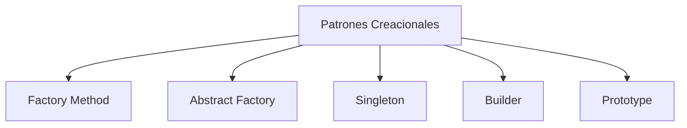
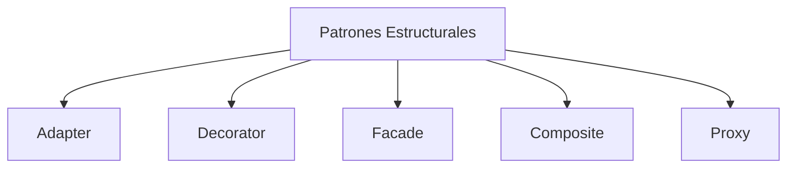
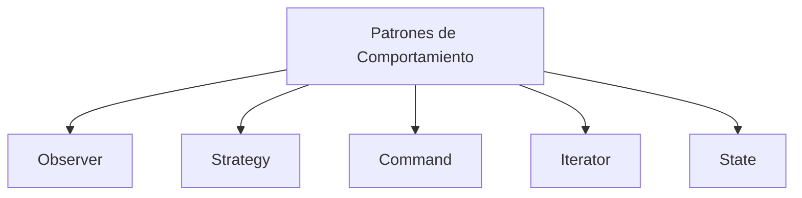
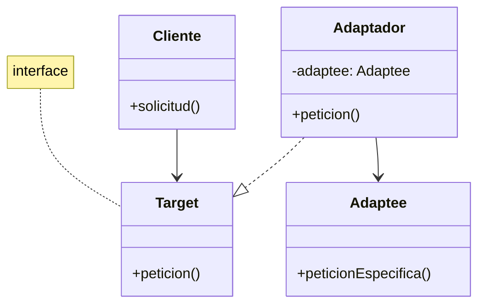

# Modelado y Programación - Buenas prácticas de programación

## 3.1 Definición de patrones de diseño.

---

#### Definición

Los **patrones de diseño** son soluciones reutilizables a problemas comunes en el diseño de software. Representan mejores prácticas desarrolladas por programadores experimentados a lo largo del tiempo.

#### Función Principal

Los patrones de diseño proporcionan:

- Soluciones probadas a problemas recurrentes
- Vocabulario común para desarrolladores
- Mejor mantenibilidad del código
- Reducción de la complejidad del diseño

### Clasificación de Patrones de Diseño

#### Patrones Creacionales



#### Patrones Estructurales



#### Patrones de Comportamiento



### Patrones Creacionales en Detalle

#### Singleton Pattern

**Propósito**: Garantizar que una clase tenga una sola instancia y proporcionar un punto de acceso global a ella.

**Fórmula matemática**:

$$ P(S) = \begin{cases} 1 & \text{si } S \text{ es única instancia} \\\ 0 & \text{en otro caso} \end{cases} $$

**Implementación en Java**:
```java
public class Singleton {
    private static Singleton instance;

    // Constructor privado para evitar instanciación
    private Singleton() {}

    public static Singleton getInstance() {
        if (instance == null) {
            instance = new Singleton();
        }
        return instance;
    }
}
```

#### Factory Method Pattern
**Propósito**: Definir una interfaz para crear un objeto, pero permitir que las subclases decidan qué clase instanciar.

**Ejemplo en Python**:
```python
from abc import ABC, abstractmethod

class Vehiculo(ABC):
    @abstractmethod
    def tipo_vehiculo(self):
        pass

class Coche(Vehiculo):
    def tipo_vehiculo(self):
        return "Coche"

class Moto(Vehiculo):
    def tipo_vehiculo(self):
        return "Moto"

class FabricaVehiculos:
    def crear_vehiculo(self, tipo):
        if tipo == "coche":
            return Coche()
        elif tipo == "moto":
            return Moto()
        else:
            raise ValueError("Tipo de vehículo no válido")
```

### Patrones Estructurales en Detalle

#### Adapter Pattern
**Propósito**: Convertir la interfaz de una clase en otra interfaz que el cliente espera.

**Diagrama**:


**Implementación en C#**:
```csharp
// Interfaz objetivo
public interface ITarget
{
    string GetRequest();
}

// Clase a adaptar
public class Adaptee
{
    public string GetSpecificRequest()
    {
        return "Solicitud específica";
    }
}

// Adaptador
public class Adapter : ITarget
{
    private readonly Adaptee _adaptee;

    public Adapter(Adaptee adaptee)
    {
        _adaptee = adaptee;
    }

    public string GetRequest()
    {
        return $"This is '{_adaptee.GetSpecificRequest()}'";
    }
}
```

#### Decorator Pattern
**Propósito**: Añadir responsabilidades adicionales a un objeto de forma dinámica.

**Fórmula de composición**:

$$F(x) = f_n(f_{n-1}(...f_1(x)...))$$

**Ejemplo en JavaScript**:
```javascript
class Cafe {
    costo() {
        return 5;
    }
}

class CafeConLeche {
    constructor(cafe) {
        this.cafe = cafe;
    }

    costo() {
        return this.cafe.costo() + 2;
    }
}

class CafeConChocolate {
    constructor(cafe) {
        this.cafe = cafe;
    }

    costo() {
        return this.cafe.costo() + 3;
    }
}

// Uso
let miCafe = new Cafe();
miCafe = new CafeConLeche(miCafe);
miCafe = new CafeConChocolate(miCafe);
console.log(miCafe.costo()); // 10
```

### Patrones de Comportamiento en Detalle

#### Observer Pattern
**Propósito**: Definir una dependencia uno-a-muchos entre objetos, de modo que cuando un objeto cambie de estado, todos sus dependientes sean notificados y actualizados automáticamente.

**Modelo matemático**:

$$\frac{dO}{dt} = k \cdot \frac{dS}{dt}$$

Donde $O$ representa a los observadores y $S$ al sujeto observado.

**Implementación en Java**:
```java
import java.util.ArrayList;
import java.util.List;

interface Observador {
    void actualizar(String mensaje);
}

class SujetoObservable {
    private List<Observador> observadores = new ArrayList<>();
    private String estado;

    public void agregarObservador(Observador observador) {
        observadores.add(observador);
    }

    public void setEstado(String estado) {
        this.estado = estado;
        notificarObservadores();
    }

    private void notificarObservadores() {
        for (Observador observador : observadores) {
            observador.actualizar(estado);
        }
    }
}

class ObservadorConcreto implements Observador {
    private String nombre;

    public ObservadorConcreto(String nombre) {
        this.nombre = nombre;
    }

    @Override
    public void actualizar(String mensaje) {
        System.out.println(nombre + " recibió: " + mensaje);
    }
}
```

#### Strategy Pattern
**Propósito**: Definir una familia de algoritmos, encapsular cada uno de ellos y hacerlos intercambiables.

**Ejemplo en Python**:
```python
from abc import ABC, abstractmethod

class EstrategiaPago(ABC):
    @abstractmethod
    def pagar(self, cantidad):
        pass

class PagoTarjeta(EstrategiaPago):
    def pagar(self, cantidad):
        return f"Pagado ${cantidad} con tarjeta"

class PagoPaypal(EstrategiaPago):
    def pagar(self, cantidad):
        return f"Pagado ${cantidad} con PayPal"

class CarritoCompra:
    def __init__(self, estrategia):
        self.estrategia = estrategia
        self.total = 0

    def agregar_producto(self, precio):
        self.total += precio

    def realizar_pago(self):
        return self.estrategia.pagar(self.total)

# Uso
carrito = CarritoCompra(PagoTarjeta())
carrito.agregar_producto(100)
carrito.agregar_producto(50)
print(carrito.realizar_pago())  # Pagado $150 con tarjeta
```

### Ejercicios Propuestos

#### Ejercicio 1: Implementar Singleton Thread-Safe
```java
// Modifica la implementación de Singleton para que sea thread-safe
// utilizando double-checked locking o synchronized blocks
public class SingletonThreadSafe {
    // Tu implementación aquí
}
```

#### Ejercicio 2: Diseñar un Sistema con Factory Method
Diseña un sistema para una fábrica de muebles que pueda producir:
- Sillas (madera, plástico, metal)
- Mesas (redondas, cuadradas)
- Sofás (2 plazas, 3 plazas)

Implementa usando Factory Method pattern.

#### Ejercicio 3: Implementar Observer Pattern
Crea un sistema de notificaciones donde:
- Un servidor de noticias es el sujeto observable
- Múltiples clientes (email, SMS, app) son observadores
- Cuando se publica una noticia, todos los clientes son notificados

#### Ejercicio 4: Refactorizar con Decorator Pattern
Refactoriza el siguiente código usando Decorator pattern:
```java
class CafeBasico {
    public double costo() {
        return 5.0;
    }
}

class CafeConLeche {
    public double costo() {
        return 7.0;
    }
}

class CafeConLecheYChocolate {
    public double costo() {
        return 10.0;
    }
}
```

### Buenas Prácticas en el Uso de Patrones

#### Cuándo Usar Patrones
- Cuando el problema se ajusta perfectamente a un patrón conocido
- Cuando necesitas mejorar la mantenibilidad del código
- Cuando quieres establecer un vocabulario común en el equipo

#### Cuándo Evitar Patrones
- Cuando adds complejidad innecesaria
- Cuando el patrón no se ajusta perfectamente al problema
- En proyectos muy pequeños o simples

#### Principio KISS (Keep It Simple, Stupid)
$$Complexity = \sum_{i=1}^{n} (w_i \cdot c_i)$$
Donde $w_i$ es el peso de cada componente y $c_i$ es su complejidad.

### Referencias y Recursos Adicionales

#### Libros Recomendados
1. **"Design Patterns: Elements of Reusable Object-Oriented Software"** - Gamma, Helm, Johnson, Vlissides (Gang of Four)
2. **"Head First Design Patterns"** - Eric Freeman, Elisabeth Robson
3. **"Patterns of Enterprise Application Architecture"** - Martin Fowler

#### Recursos Online
- Refactoring Guru: https://refactoring.guru/design-patterns
- SourceMaking: https://sourcemaking.com/design_patterns
- TutorialsPoint: https://www.tutorialspoint.com/design_pattern/

#### Herramientas para Diagramas
- PlantUML: Para diagramas UML
- Draw.io: Diagramas online gratuitos
- Lucidchart: Herramienta colaborativa

### Conclusión

Los patrones de diseño son herramientas poderosas que, cuando se usan apropiadamente, pueden mejorar significativamente la calidad, mantenibilidad y escalabilidad del software. Sin embargo, es crucial entender que no son soluciones universales y deben aplicarse juiciosamente según el contexto específico del problema.

**Recuerda**: Los patrones deben servir al código, no el código a los patrones. La simplicidad y claridad siempre deben ser prioritarias sobre la aplicación dogmática de patrones.
