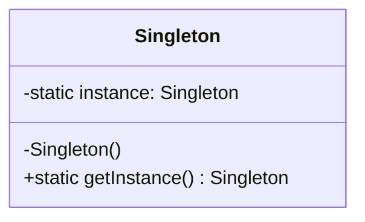
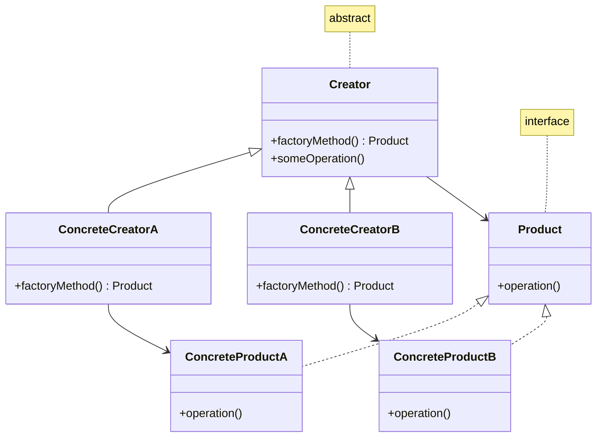
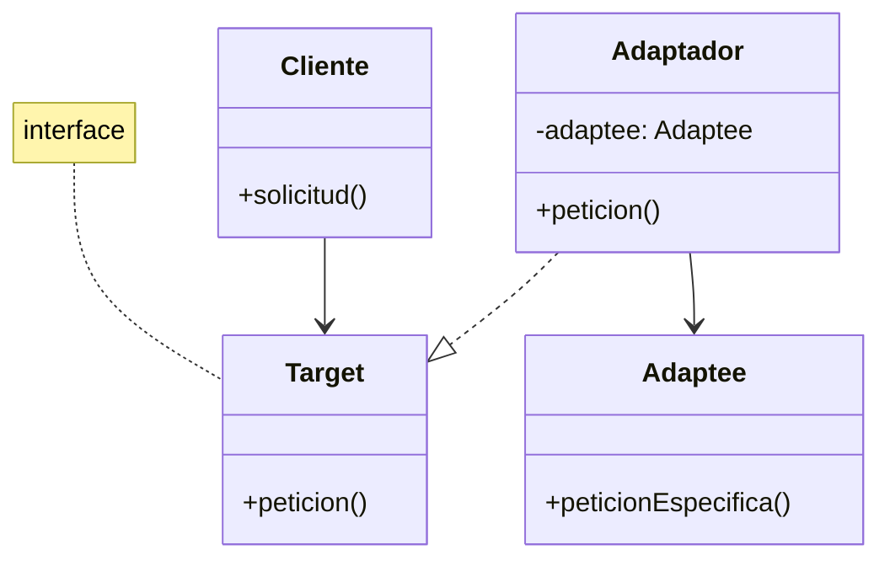
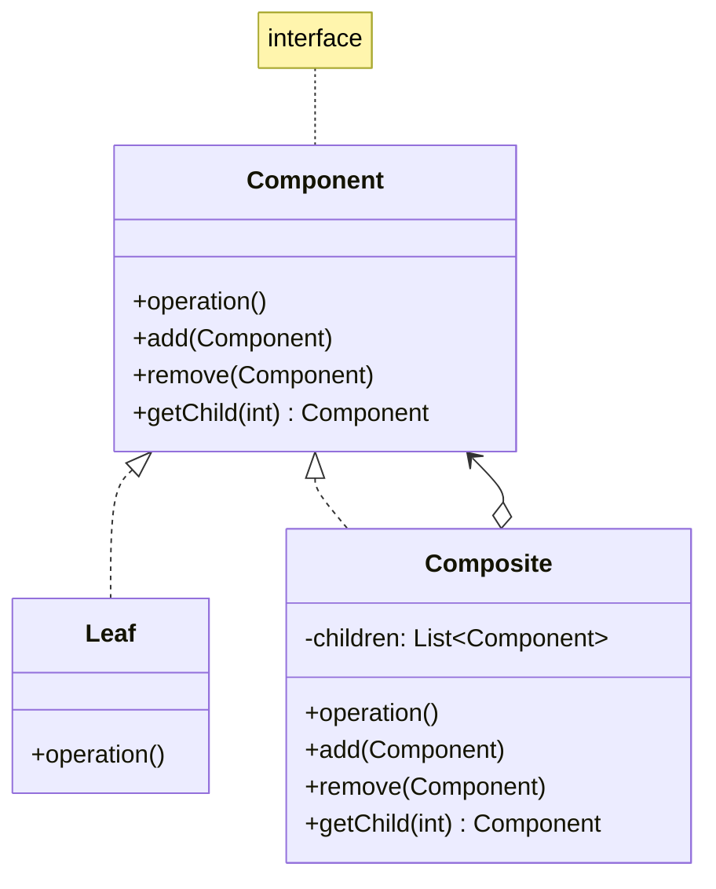

# Modelado y Programación - Buenas prácticas de programación

## 3.2 Patrones de diseño de uso común: Factory method, Singleton, Adapter, Composite.

---

Los **patrones de diseño** son soluciones reutilizables a problemas comunes en el diseño de software. Representan las mejores prácticas desarrolladas por programadores experimentados a lo largo del tiempo.

#### Beneficios de los patrones de diseño

- Proporcionan soluciones probadas a problemas recurrentes
- Establecen un vocabulario común entre desarrolladores
- Mejoran la mantenibilidad y escalabilidad del código
- Facilitan la comunicación de diseños complejos

### Patrón Singleton

#### Definición

El patrón **Singleton** garantiza que una clase tenga una sola instancia y proporciona un punto de acceso global a ella.

#### Diagrama UML



#### Implementación en Java

```java
public class Singleton {
    // Instancia única privada y estática
    private static Singleton instance;

    // Constructor privado para evitar instanciación externa
    private Singleton() {
        // Inicialización
    }

    // Método público para obtener la instancia
    public static Singleton getInstance() {
        if (instance == null) {
            instance = new Singleton();
        }
        return instance;
    }

    // Métodos de la clase
    public void businessMethod() {
        System.out.println("Método de negocio del Singleton");
    }
}
```

#### Implementación Thread-Safe

```java
public class ThreadSafeSingleton {
    private static volatile ThreadSafeSingleton instance;

    private ThreadSafeSingleton() {}

    public static ThreadSafeSingleton getInstance() {
        if (instance == null) {
            synchronized (ThreadSafeSingleton.class) {
                if (instance == null) {
                    instance = new ThreadSafeSingleton();
                }
            }
        }
        return instance;
    }
}
```

#### Casos de uso

- Conexiones a bases de datos
- Loggers
- Configuraciones de aplicación
- Gestores de caché

### Patrón Factory Method

#### Definición

El patrón **Factory Method** define una interfaz para crear objetos, pero permite a las subclases decidir qué clase instanciar.

#### Diagrama UML



#### Implementación en Python

```python
from abc import ABC, abstractmethod

# Producto abstracto
class Transporte(ABC):
    @abstractmethod
    def entregar(self):
        pass

# Productos concretos
class Camion(Transporte):
    def entregar(self):
        return "Entrega por tierra en camión"

class Barco(Transporte):
    def entregar(self):
        return "Entrega por mar en barco"

# Creador abstracto
class Logistica(ABC):
    @abstractmethod
    def crear_transporte(self) -> Transporte:
        pass

    def planificar_entrega(self):
        transporte = self.crear_transporte()
        return f"Planificando {transporte.entregar()}"

# Creadores concretos
class LogisticaTerrestre(Logistica):
    def crear_transporte(self) -> Transporte:
        return Camion()

class LogisticaMaritima(Logistica):
    def crear_transporte(self) -> Transporte:
        return Barco()

# Uso
logistica = LogisticaTerrestre()
print(logistica.planificar_entrega())  # Planificando Entrega por tierra en camión
```

#### Ventajas

- Elimina acoplamiento entre creador y productos concretos
- Facilita la extensión para nuevos productos
- Centraliza la lógica de creación de objetos

### Patrón Adapter

#### Definición

El patrón **Adapter** permite que interfaces incompatibles trabajen juntas, convirtiendo la interfaz de una clase en otra interfaz que el cliente espera.

#### Diagrama UML



#### Implementación en C#

```csharp
// Interfaz objetivo que el cliente espera
public interface ITarget
{
    string GetRequest();
}

// Clase existente con interfaz incompatible
public class Adaptee
{
    public string GetSpecificRequest()
    {
        return "Solicitud específica del Adaptee";
    }
}

// Adaptador que convierte la interfaz de Adaptee a ITarget
public class Adapter : ITarget
{
    private readonly Adaptee _adaptee;

    public Adapter(Adaptee adaptee)
    {
        _adaptee = adaptee;
    }

    public string GetRequest()
    {
        return $"This is '{_adaptee.GetSpecificRequest()}'";
    }
}

// Cliente que usa la interfaz ITarget
public class Client
{
    public void Main()
    {
        Adaptee adaptee = new Adaptee();
        ITarget target = new Adapter(adaptee);

        Console.WriteLine(target.GetRequest());
    }
}
```

#### Tipos de Adapters

- **Adapter de clase**: usa herencia
- **Adapter de objeto**: usa composición (más flexible)

### Patrón Composite

#### Definición

El patrón **Composite** permite componer objetos en estructuras de árbol para representar jerarquías parte-todo, permitiendo a los clientes tratar objetos individuales y composiciones de manera uniforme.

#### Diagrama UML



#### Implementación en Java

```java
import java.util.ArrayList;
import java.util.List;

// Componente
interface Component {
    void operation();
    default void add(Component component) {
        throw new UnsupportedOperationException();
    }
    default void remove(Component component) {
        throw new UnsupportedOperationException();
    }
    default Component getChild(int i) {
        throw new UnsupportedOperationException();
    }
}

// Hoja
class Leaf implements Component {
    private String name;

    public Leaf(String name) {
        this.name = name;
    }

    @Override
    public void operation() {
        System.out.println("Operación en hoja: " + name);
    }
}

// Composite
class Composite implements Component {
    private List<Component> children = new ArrayList<>();
    private String name;

    public Composite(String name) {
        this.name = name;
    }

    @Override
    public void operation() {
        System.out.println("Operación en composite: " + name);
        for (Component child : children) {
            child.operation();
        }
    }

    @Override
    public void add(Component component) {
        children.add(component);
    }

    @Override
    public void remove(Component component) {
        children.remove(component);
    }

    @Override
    public Component getChild(int i) {
        return children.get(i);
    }
}

// Uso
public class CompositeDemo {
    public static void main(String[] args) {
        Composite root = new Composite("Root");
        root.add(new Leaf("Hoja A"));
        root.add(new Leaf("Hoja B"));

        Composite comp = new Composite("Composite X");
        comp.add(new Leaf("Hoja XA"));
        comp.add(new Leaf("Hoja XB"));

        root.add(comp);
        root.add(new Leaf("Hoja C"));

        root.operation();
    }
}
```

#### Aplicaciones comunes

- Sistemas de archivos (directorios y archivos)
- Interfaces gráficas de usuario (contenedores y componentes)
- Estructuras organizacionales (departamentos y empleados)

### Comparativa de Patrones

| Patrón         | Propósito                    | Ventajas                                 |
| -------------- | ---------------------------- | ---------------------------------------- |
| Singleton      | Una única instancia          | Acceso global, control de recursos       |
| Factory Method | Creación delegada            | Bajo acoplamiento, extensible            |
| Adapter        | Compatibilidad de interfaces | Reutilización, interoperabilidad         |
| Composite      | Jerarquías parte-todo        | Tratamiento uniforme, facilita recursión |

### Ejercicios Propuestos

#### Ejercicio 1: Singleton Mejorado

Crea un Singleton para un sistema de logging que:

- Sea thread-safe
- Permita diferentes niveles de log (DEBUG, INFO, ERROR)
- Escriba logs tanto en consola como en archivo

#### Ejercicio 2: Factory Method para Formas Geométricas

Implementa un Factory Method que cree diferentes formas geométricas (círculo, rectángulo, triángulo). Cada forma debe tener métodos para calcular área y perímetro.

#### Ejercicio 3: Adapter para APIs de Pago

Crea un adapter que unifique diferentes APIs de pago (PayPal, Stripe, MercadoPago) bajo una interfaz común con métodos como `realizarPago()` y `reembolsar()`.

#### Ejercicio 4: Composite para Menús

Diseña un sistema de menús usando Composite donde un menú puede contener tanto items individuales como submenús. Implementa métodos para calcular el precio total y mostrar la estructura.

### Buenas Prácticas y Consideraciones

#### Singleton

- Considera si realmente necesitas una única instancia
- Evalúa el uso de inyección de dependencias como alternativa
- Ten cuidado con los tests unitarios (pueden ser difíciles de aislar)

#### Factory Method

- Usa cuando la creación de objetos es compleja
- Aplica cuando quieres desacoplar el código de las clases concretas
- Considera usar métodos factory estáticos para simplificar

#### Adapter

- Úsalo para integrar código legacy o de terceros
- Considera el overhead de performance
- Documenta claramente el propósito del adapter

#### Composite

- Aplica cuando existe una relación jerárquica claro
- Considera la sobrecarga de memoria por la recursividad
- Diseña interfaces cuidadosamente para hojas y composites

### Referencias y Recursos

#### Libros Recomendados

1. **"Design Patterns: Elements of Reusable Object-Oriented Software"** - Gamma, Helm, Johnson, Vlissides (Gang of Four)
2. **"Head First Design Patterns"** - Eric Freeman, Elisabeth Robson
3. **"Patterns of Enterprise Application Architecture"** - Martin Fowler

#### Recursos Online

- Refactoring Guru: https://refactoring.guru/design-patterns
- SourceMaking: https://sourcemaking.com/design_patterns
- TutorialsPoint: https://www.tutorialspoint.com/design_pattern/

#### Herramientas para Diagramas

- PlantUML: Para diagramas UML
- Draw.io: Diagramas online gratuitos
- Lucidchart: Herramienta colaborativa

### Conclusión

Los patrones de diseño son herramientas fundamentales en el desarrollo de software que permiten crear código más mantenible, escalable y reutilizable. Los cuatro patrones estudiados (Singleton, Factory Method, Adapter y Composite) resuelven problemas comunes de diseño y proporcionan soluciones elegantes y probadas.

La clave para aplicar correctamente estos patrones es entender profundamente el problema que se quiere resolver y seleccionar el patrón que mejor se adapte al contexto específico. Recuerda que los patrones deben servir para simplificar y clarificar el diseño, no para complicarlo innecesariamente.
