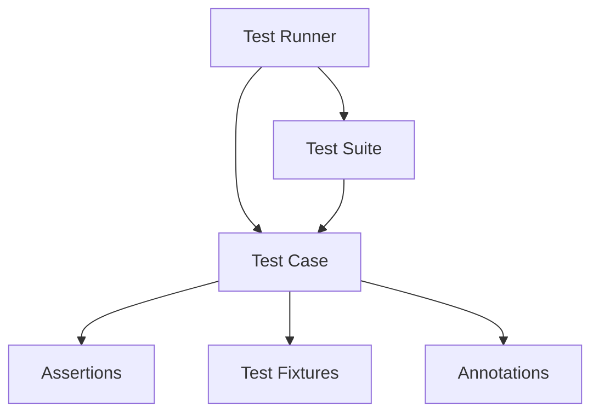

# Modelado y Programación - Buenas prácticas de programación

## 3.3 Pruebas unitarias (Junit).

---

Las **pruebas unitarias** son un tipo de prueba de software donde se verifican individualmente las unidades más pequeñas de código (normalmente métodos o funciones) para asegurar que funcionan correctamente.

#### Propósito y Beneficios
- **Detección temprana de errores**
- **Facilitar refactorización** con confianza
- **Documentación viva** del comportamiento esperado
- **Mejor diseño** de código (el código testeable suele estar mejor estructurado)

Una prueba **unitaria** aísla una sola unidad: no usa la red, archivos ni bases de datos reales, y reemplaza esas dependencias por dobles de prueba (sección de mocks). Las pruebas que combinan varias piezas reales son **de integración**, y las que recorren el sistema completo como lo haría un usuario son **de extremo a extremo**. Se recomienda tener muchas pruebas unitarias, rápidas y baratas, y menos de los otros tipos: la llamada **pirámide de pruebas**.

#### Fórmula de Cobertura de Código

$$ \text{Cobertura} = \frac{\text{Líneas de código ejecutadas}}{\text{Líneas de código totales}} \times 100\% $$

Se calcula ejecutando las pruebas con una herramienta como JaCoCo. Una cobertura alta no garantiza que el código sea correcto: indica qué líneas se ejecutaron, no si las aserciones comprobaron lo importante.

### Fundamentos de JUnit

#### Arquitectura de JUnit


#### Anotaciones Principales de JUnit

| Anotación | Descripción |
|-----------|-------------|
| `@Test` | Define un método como caso de prueba |
| `@BeforeEach` | Ejecuta antes de cada test |
| `@AfterEach` | Ejecuta después de cada test |
| `@BeforeAll` | Ejecuta una vez antes de todos los tests |
| `@AfterAll` | Ejecuta una vez después de todos los tests |
| `@DisplayName` | Nombre personalizado para el test |
| `@Disabled` | Deshabilita un test temporalmente |

Los métodos con `@BeforeAll` y `@AfterAll` deben ser `static`. JUnit crea una **instancia nueva de la clase de prueba para cada test**, de modo que los atributos no se comparten entre pruebas; eso ayuda a que sean independientes.

Estas anotaciones son de **JUnit 5** (Jupiter). En JUnit 4 se llamaban `@Before`, `@After`, `@BeforeClass`, `@AfterClass` e `@Ignore`.

### Configuración de JUnit

#### Dependencias Maven
```xml
<dependencies>
    <dependency>
        <groupId>org.junit.jupiter</groupId>
        <artifactId>junit-jupiter</artifactId>
        <version>5.9.2</version>
        <scope>test</scope>
    </dependency>
    
    <dependency>
        <groupId>org.junit.jupiter</groupId>
        <artifactId>junit-jupiter-params</artifactId>
        <version>5.9.2</version>
        <scope>test</scope>
    </dependency>
</dependencies>
```

El primer artefacto, `junit-jupiter`, ya incluye el soporte de pruebas parametrizadas; el segundo solo se necesita si se declaran los módulos por separado. Para usar mocks se agrega `org.mockito:mockito-core`, y para la base de datos en memoria de la sección de integración, `com.h2database:h2`, ambos con `<scope>test</scope>`.

#### Estructura de Directorios
```text
src/
├── main/
│   └── java/
│       └── com/
│           └── ejemplo/
│               └── Calculadora.java
└── test/
    └── java/
        └── com/
            └── ejemplo/
                └── CalculadoraTest.java
```

### Escribiendo Tests con JUnit

#### Clase bajo prueba
```java
public class Calculadora {
    
    public int sumar(int a, int b) {
        return a + b;
    }
    
    public int restar(int a, int b) {
        return a - b;
    }
    
    public int multiplicar(int a, int b) {
        return a * b;
    }
    
    public double dividir(int a, int b) {
        if (b == 0) {
            throw new ArithmeticException("División por cero");
        }
        return (double) a / b;
    }
    
    public boolean esPar(int numero) {
        return numero % 2 == 0;
    }
}
```

#### Test básico
```java
import org.junit.jupiter.api.*;
import static org.junit.jupiter.api.Assertions.*;

class CalculadoraTest {
    
    private Calculadora calculadora;
    
    @BeforeEach
    void setUp() {
        calculadora = new Calculadora();
        System.out.println("Configurando antes de cada test");
    }
    
    @AfterEach
    void tearDown() {
        System.out.println("Limpiando después de cada test");
    }
    
    @Test
    @DisplayName("Test de suma de números positivos")
    void testSumarPositivos() {
        // Arrange (Preparar)
        int a = 5;
        int b = 3;
        
        // Act (Actuar)
        int resultado = calculadora.sumar(a, b);
        
        // Assert (Afirmar)
        assertEquals(8, resultado, "5 + 3 debería ser 8");
    }
    
    @Test
    @DisplayName("Test de suma con cero")
    void testSumarConCero() {
        assertEquals(5, calculadora.sumar(5, 0));
        assertEquals(5, calculadora.sumar(0, 5));
    }
}
```

El patrón **Arrange-Act-Assert** (preparar, actuar, afirmar) da a cada prueba la misma estructura. En `assertEquals` el primer argumento es el valor **esperado** y el segundo el **obtenido**; si se invierten, los mensajes de error confunden. Para comparar números de punto flotante se agrega una tolerancia: `assertEquals(0.333, calculadora.dividir(1, 3), 0.001)`.

### Assertions en JUnit

#### Assertions Comunes

Los siguientes fragmentos son métodos de la clase `CalculadoraTest`; requieren además `import java.time.Duration;`.

```java
@Test
void testAssertions() {
    // Igualdad
    assertEquals(4, calculadora.sumar(2, 2));
    
    // Verdadero/Falso
    assertTrue(calculadora.esPar(4));
    assertFalse(calculadora.esPar(3));
    
    // Nulos
    String texto = null;
    assertNull(texto);
    assertNotNull("Hola", "No debería ser nulo");
    
    // Excepciones
    Exception exception = assertThrows(ArithmeticException.class, () -> {
        calculadora.dividir(10, 0);
    });
    assertEquals("División por cero", exception.getMessage());
    
    // Arrays
    int[] arrayEsperado = {1, 2, 3};
    int[] arrayActual = {1, 2, 3};
    assertArrayEquals(arrayEsperado, arrayActual);
    
    // Timeouts
    assertTimeout(Duration.ofMillis(100), () -> {
        Thread.sleep(50); // Operación que debe completarse en menos de 100ms
    });
}
```

### Pruebas Parametrizadas

#### Usando @ParameterizedTest
```java
import org.junit.jupiter.params.ParameterizedTest;
import org.junit.jupiter.params.provider.*;
import java.util.stream.Stream;

@ParameterizedTest
@ValueSource(ints = {2, 4, 6, 8, 10})
void testNumerosPares(int numero) {
    assertTrue(calculadora.esPar(numero));
}

@ParameterizedTest
@CsvSource({
    "1, 1, 2",
    "2, 3, 5",
    "10, 20, 30"
})
void testSumaConMultiplesValores(int a, int b, int expected) {
    assertEquals(expected, calculadora.sumar(a, b));
}

@ParameterizedTest
@MethodSource("proveedorDatosMultiplicacion")
void testMultiplicacionConMetodo(int a, int b, int expected) {
    assertEquals(expected, calculadora.multiplicar(a, b));
}

private static Stream<Arguments> proveedorDatosMultiplicacion() {
    return Stream.of(
        Arguments.of(2, 3, 6),
        Arguments.of(4, 5, 20),
        Arguments.of(0, 100, 0)
    );
}
```

Cada fila de datos produce una ejecución independiente del test, que JUnit reporta por separado. Así se prueban muchos casos, incluidos los **casos límite** (cero, negativos, valores máximos), sin copiar el mismo método.

### Test Doubles (Mocks y Stubs)

Un **doble de prueba** sustituye a una dependencia real durante la prueba:

- Un **stub** devuelve respuestas predefinidas.
- Un **mock** además registra cómo se usó, para verificar las interacciones.

Para poder reemplazar la dependencia, la clase debe recibirla desde afuera, por ejemplo en su constructor (**inyección de dependencias**), en lugar de crearla ella misma con `new`.

#### Usando Mockito
```java
import static org.mockito.Mockito.*;

// Dependencia
interface ServicioEmail {
    boolean enviarEmail(String destinatario, String mensaje);
}

// Clase que usa la dependencia
class ServicioNotificaciones {
    private ServicioEmail servicioEmail;
    
    public ServicioNotificaciones(ServicioEmail servicioEmail) {
        this.servicioEmail = servicioEmail;
    }
    
    public boolean notificarUsuario(String usuario, String mensaje) {
        return servicioEmail.enviarEmail(usuario + "@ejemplo.com", mensaje);
    }
}

// Test con Mock
@Test
void testServicioNotificaciones() {
    // Crear mock
    ServicioEmail mockServicio = mock(ServicioEmail.class);
    
    // Configurar comportamiento
    when(mockServicio.enviarEmail("usuario@ejemplo.com", "Hola"))
        .thenReturn(true);
    
    // Inyectar mock
    ServicioNotificaciones servicio = new ServicioNotificaciones(mockServicio);
    
    // Ejecutar y verificar
    boolean resultado = servicio.notificarUsuario("usuario", "Hola");
    assertTrue(resultado);
    
    // Verificar interacción
    verify(mockServicio).enviarEmail("usuario@ejemplo.com", "Hola");
}
```

### Pruebas de Integración

#### Configuración de Base de Datos para Tests
```java
// Requiere import java.sql.*; y la dependencia de H2
@Test
@DisplayName("Test de integración con base de datos")
void testIntegracionBaseDatos() throws SQLException {
    // Base de datos en memoria: se crea al conectarse y desaparece al terminar
    String url = "jdbc:h2:mem:test;DB_CLOSE_DELAY=-1";

    try (Connection conn = DriverManager.getConnection(url);
         Statement stmt = conn.createStatement()) {

        // Crear tabla de prueba
        stmt.execute("CREATE TABLE usuarios (id INT, nombre VARCHAR(50))");
        stmt.execute("INSERT INTO usuarios VALUES (1, 'Juan')");

        // Ejecutar consulta y verificar resultados
        try (ResultSet rs = stmt.executeQuery("SELECT * FROM usuarios WHERE id = 1")) {
            assertTrue(rs.next());
            assertEquals("Juan", rs.getString("nombre"));
        }
    }
}
```

Declarar `throws SQLException` es más simple que capturar la excepción y llamar a `fail`: si se lanza, JUnit marca la prueba como fallida y muestra la traza completa. Todos los ejemplos de este tema se verificaron con JUnit 5.10, Mockito y H2.

### Medición de Cobertura

#### Fórmulas de Métricas de Cobertura

**Cobertura de líneas:**

$$ C_L = \frac{L_{ejecutadas}}{L_{totales}} \times 100\% $$

**Cobertura de ramas (*branches*):**

$$ C_B = \frac{B_{cubiertos}}{B_{totales}} \times 100\% $$

Es más exigente que la de líneas: en `if (x > 0) y = 1;` una sola prueba con $x > 0$ cubre el 100% de las líneas, pero solo la mitad de las ramas, porque nunca se probó el caso en que la condición es falsa.

**Cobertura de métodos:**

$$ C_M = \frac{M_{ejecutados}}{M_{totales}} \times 100\% $$

### Buenas Prácticas

#### Principios FIRST
- **F**ast: Los tests deben ejecutarse rápidamente
- **I**ndependent: Los tests no deben depender entre sí
- **R**epeatable: Deben dar el mismo resultado en cualquier entorno
- **S**elf-Validating: Deben pasar o fallar claramente
- **T**imely: Deben escribirse en el momento adecuado

#### Convenciones de Nombrado
```java
// Estilo recomendado
@Test
void sumar_DosNumerosPositivos_DevuelveSumaCorrecta() {
    // Test implementation
}

@Test
void dividir_DivisorCero_LanzaExcepcion() {
    // Test implementation
}
```

### Ejercicios Propuestos

#### Ejercicio 1: Test de una Clase StringUtils
Crea una clase `StringUtils` con métodos:
- `invertir(String texto)`
- `esPalindromo(String texto)`
- `contarVocales(String texto)`

Escribe tests unitarios completos para cada método.

#### Ejercicio 2: Test con Dependencias Mock
Crea una clase `ServicioWeather` que dependa de una interfaz `WeatherAPI`. 
Escribe tests usando mocks para simular diferentes respuestas de la API.

#### Ejercicio 3: Test Parametrizado
Crea tests parametrizados para una clase `MathUtils` que incluya operaciones matemáticas complejas con múltiples casos de prueba.

#### Ejercicio 4: Test de Excepciones
Escribe tests que verifiquen el lanzamiento correcto de excepciones en casos de error.

#### Ejercicio 5: Test de Integración
Crea tests de integración para una clase `UserRepository` que interactúe con una base de datos H2 en memoria.

### Solución del Ejercicio 1

```java
public class StringUtils {
    public static String invertir(String texto) {
        if (texto == null) throw new IllegalArgumentException("texto nulo");
        return new StringBuilder(texto).reverse().toString();
    }

    public static boolean esPalindromo(String texto) {
        String limpio = texto.toLowerCase().replaceAll("[^a-záéíóúüñ0-9]", "");
        return limpio.equals(invertir(limpio));
    }

    public static int contarVocales(String texto) {
        int n = 0;
        for (char c : texto.toLowerCase().toCharArray()) {
            if ("aeiouáéíóúü".indexOf(c) >= 0) n++;
        }
        return n;
    }
}
```

```java
import org.junit.jupiter.api.Test;
import org.junit.jupiter.params.ParameterizedTest;
import org.junit.jupiter.params.provider.ValueSource;
import static org.junit.jupiter.api.Assertions.*;

class StringUtilsTest {
    @Test
    void invertir_PalabraNormal_DevuelveAlReves() {
        assertEquals("aloh", StringUtils.invertir("hola"));
    }

    @Test
    void invertir_CadenaVacia_DevuelveVacia() {
        assertEquals("", StringUtils.invertir(""));
    }

    @Test
    void invertir_Nulo_LanzaExcepcion() {
        assertThrows(IllegalArgumentException.class, () -> StringUtils.invertir(null));
    }

    @ParameterizedTest
    @ValueSource(strings = {"oso", "Anita lava la tina", "reconocer", ""})
    void esPalindromo_Palindromos_DevuelveVerdadero(String texto) {
        assertTrue(StringUtils.esPalindromo(texto));
    }

    @Test
    void esPalindromo_NoPalindromo_DevuelveFalso() {
        assertFalse(StringUtils.esPalindromo("programación"));
    }

    @Test
    void contarVocales_ConMayusculasYAcentos_CuentaTodas() {
        assertEquals(5, StringUtils.contarVocales("Murciélago"));
        assertEquals(0, StringUtils.contarVocales("xyz"));
    }
}
```

Cada nombre de prueba sigue la convención `metodo_Escenario_ResultadoEsperado`, y además de los casos típicos se prueban los límites: la cadena vacía, `null`, mayúsculas, espacios y acentos.

### Herramientas y Recursos

#### Plugins útiles para IDEs
- **Eclipse**: JUnit Plugin
- **IntelliJ**: Built-in JUnit support
- **VS Code**: Java Test Runner

#### Librerías Complementarias
- **Mockito**: Para mocking
- **AssertJ**: Para assertions más fluidas
- **TestContainers**: Para tests con containers Docker

#### Recursos de Referencia
- [Documentación oficial de JUnit 5](https://junit.org/junit5/)
- [JUnit 5 User Guide](https://junit.org/junit5/docs/current/user-guide/)
- [Mockito Documentation](https://site.mockito.org/)

### Conclusión

Las pruebas unitarias con JUnit son una parte fundamental del desarrollo de software robusto y mantenible. Al dominar estas técnicas, los desarrolladores pueden:

1. **Detectar errores temprano** en el ciclo de desarrollo
2. **Facilitar la refactorización** con confianza
3. **Crear documentación ejecutable** del comportamiento del sistema
4. **Mejorar el diseño** del código mediante la testabilidad

La inversión en pruebas unitarias de calidad se traduce directamente en software más confiable y procesos de desarrollo más eficientes.
