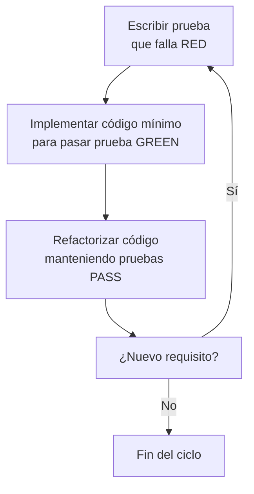
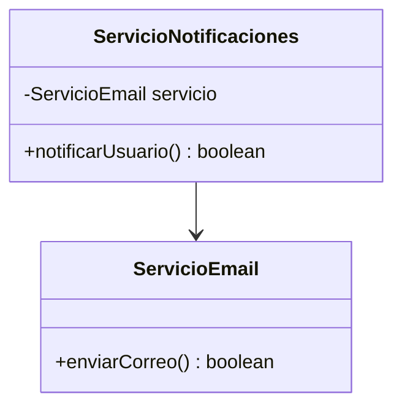
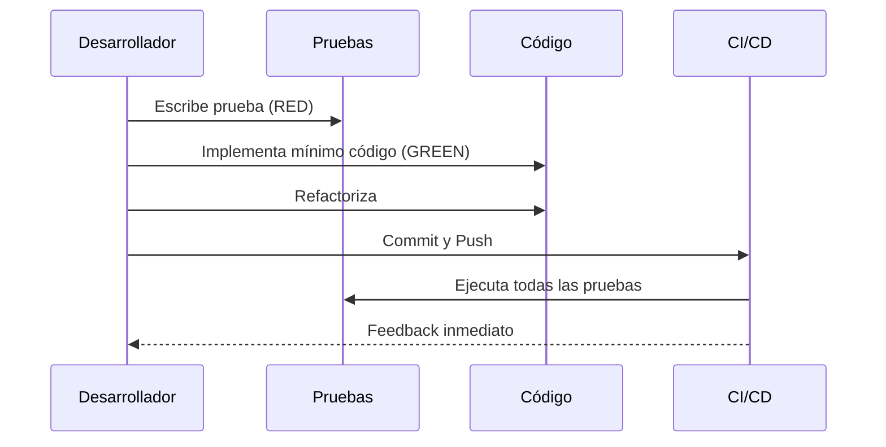

# Modelado y Programación - Buenas prácticas de programación

## 3.4 Estrategia de desarrollo: desarrollo guiado por pruebas.

---

### Introducción al TDD

#### Definición

El **Desarrollo Guiado por Pruebas (TDD - Test-Driven Development)** es una estrategia de desarrollo de software que sigue un ciclo repetitivo de tres fases: **Escribir una prueba fallida**, **Escribir el código mínimo para pasar la prueba** y **Refactorizar**.

#### Principio Fundamental

El ciclo se repite muchas veces, en pasos muy pequeños (de segundos a pocos minutos):

$$ \text{TDD} = (\text{Prueba} \rightarrow \text{Código} \rightarrow \text{Refactor})^n $$

La idea central es que la prueba se escribe **antes** que el código: primero se especifica qué debe hacer una unidad y solo después cómo lo hace. Fue popularizado por Kent Beck a finales de los años noventa como parte de la Programación Extrema (XP).

#### Beneficios del TDD

- **Calidad del código**: Detección temprana de errores
- **Diseño emergente**: Arquitectura más limpia y mantenible
- **Documentación viviente**: Las pruebas documentan el comportamiento
- **Reducción de deuda técnica**: Menos bugs en producción

### El Ciclo de TDD (Red-Green-Refactor)



- **Rojo**: la prueba nueva falla, lo que demuestra que comprueba algo que el código aún no hace. Si pasara desde el principio, no estaría probando nada nuevo.
- **Verde**: se escribe el código más simple que hace pasar **todas** las pruebas, aunque sea poco elegante.
- **Refactorizar**: con las pruebas en verde como red de seguridad, se mejora el diseño (nombres, duplicación, estructura) sin cambiar el comportamiento.

### Fundamentos del Proceso TDD

#### Las Tres Leyes del TDD (por Robert C. Martin)

1. No escribirás código de producción hasta escribir una prueba unitaria que falle
2. No escribirás más de una prueba unitaria que lo suficiente para fallar; no compilar también cuenta como fallar
3. No escribirás más código de producción del necesario para pasar la prueba que está fallando

#### Regla del Boy Scout

Dejar el código más limpio de lo que se encontró. En TDD esta regla se aplica en cada fase de refactorización.

### Ejemplo Práctico: Calculadora con TDD

#### Paso 1: Escribir prueba que falla (RED)

```java
// CalculadoraTest.java
import org.junit.jupiter.api.Test;
import static org.junit.jupiter.api.Assertions.*;

public class CalculadoraTest {

    @Test
    void testSumarDosNumerosPositivos() {
        Calculadora calc = new Calculadora();
        int resultado = calc.sumar(2, 3);
        assertEquals(5, resultado);
    }
}
```

#### Paso 2: Implementación mínima (GREEN)

Antes de llegar al verde, la prueba ni siquiera compila, porque `Calculadora` no existe. Se crea lo mínimo para que compile; la prueba se ejecuta y **falla**, que es lo esperado en la fase roja:

```java
// Calculadora.java: compila, pero la prueba falla (esperado 5, obtenido 0)
public class Calculadora {
    public int sumar(int a, int b) {
        return 0;
    }
}
```

Ahora sí, el código mínimo para pasar. Kent Beck propone empezar incluso con la respuesta fija (*fake it*), `return 5;`, y generalizar solo cuando una segunda prueba, como `sumar(4, 6) == 10`, lo obligue (**triangulación**). La implementación general pasa ambas:

```java
public class Calculadora {
    public int sumar(int a, int b) {
        return a + b;
    }
}
```

#### Paso 3: Refactorizar

```java
// Refactorizado para mejor legibilidad
public class Calculadora {
    public int sumar(int primerSumando, int segundoSumando) {
        return primerSumando + segundoSumando;
    }
}
```

### TDD Avanzado: Ejemplo Completo

#### Desarrollo de una Clase Stack

```java
// StackTest.java
import org.junit.jupiter.api.BeforeEach;
import org.junit.jupiter.api.Test;
import static org.junit.jupiter.api.Assertions.*;

public class StackTest {
    private Stack stack;

    @BeforeEach
    void setUp() {
        stack = new Stack();
    }

    @Test
    void testStackVacioAlCrear() {
        assertTrue(stack.isEmpty());
    }

    @Test
    void testPushHaceStackNoVacio() {
        stack.push(1);
        assertFalse(stack.isEmpty());
    }

    @Test
    void testPushYPop() {
        stack.push(1);
        assertEquals(1, stack.pop());
    }

    @Test
    void testPushPopMultiple() {
        stack.push(1);
        stack.push(2);
        assertEquals(2, stack.pop());
        assertEquals(1, stack.pop());
    }

    @Test
    void testPopStackVacioLanzaExcepcion() {
        assertThrows(IllegalStateException.class, () -> stack.pop());
    }
}
```

#### Implementación Gradual del Stack

Las pruebas se escriben y se hacen pasar **una por una**, en el orden en que aparecen: la primera solo obliga a crear `isEmpty` que devuelva `true`; la segunda obliga a recordar que se hizo `push`; la cuarta obliga a respetar el orden LIFO, y la última, a manejar la pila vacía. El resultado final es:

```java
import java.util.ArrayList;
import java.util.List;

public class Stack {
    private final List<Integer> elementos = new ArrayList<>();

    public boolean isEmpty() {
        return elementos.isEmpty();
    }

    public void push(int elemento) {
        elementos.add(elemento);
    }

    public int pop() {
        if (isEmpty()) {
            throw new IllegalStateException("Stack vacío");
        }
        return elementos.remove(elementos.size() - 1);
    }
}
```

Las clases de esta sección y del ejemplo de FizzBuzz se verificaron con JUnit 5.

### Patrones y Técnicas de TDD

#### Test Doubles y Mocks



```java
// Test con Mock (ServicioEmail es una interfaz con boolean enviarCorreo(String destinatario))
@Test
void testNotificacionConMock() {
    ServicioEmail mockServicio = mock(ServicioEmail.class);
    when(mockServicio.enviarCorreo(anyString())).thenReturn(true);

    ServicioNotificaciones servicio = new ServicioNotificaciones(mockServicio);
    assertTrue(servicio.notificarUsuario("usuario@ejemplo.com"));
    verify(mockServicio).enviarCorreo("usuario@ejemplo.com");
}
```

En TDD los mocks permiten escribir la prueba de `ServicioNotificaciones` **antes** de que exista un servicio de correo real: la prueba define qué necesita la clase de sus colaboradores.

#### Pruebas Parametrizadas en TDD

```java
@ParameterizedTest
@CsvSource({
    "0, 0, 0",
    "1, 1, 2",
    "2, 3, 5",
    "-1, 1, 0"
})
void testSumaConMultiplesValores(int a, int b, int expected) {
    Calculadora calc = new Calculadora();
    assertEquals(expected, calc.sumar(a, b));
}
```

#### Ejemplo Completo: FizzBuzz

Requisito: para un entero $n,$ devolver `"Fizz"` si es múltiplo de 3, `"Buzz"` si es múltiplo de 5, `"FizzBuzz"` si es múltiplo de ambos y el número como texto en otro caso. Con TDD se agrega una fila de prueba a la vez:

1. `1 -> "1"`: rojo; se implementa `return String.valueOf(n);` y pasa a verde.
2. `3 -> "Fizz"`: rojo; se agrega `if (n % 3 == 0) return "Fizz";`.
3. `5 -> "Buzz"`: rojo; se agrega la condición del 5.
4. `15 -> "FizzBuzz"`: rojo, porque devuelve `"Fizz"`. Se agrega la condición del 15 **antes** de las otras.
5. Refactorización: las pruebas parametrizadas cubren todos los casos sin duplicar código de prueba.

```java
import org.junit.jupiter.params.ParameterizedTest;
import org.junit.jupiter.params.provider.CsvSource;
import static org.junit.jupiter.api.Assertions.assertEquals;

class FizzBuzzTest {
    @ParameterizedTest
    @CsvSource({"1, 1", "2, 2", "3, Fizz", "6, Fizz", "5, Buzz", "10, Buzz", "15, FizzBuzz", "30, FizzBuzz"})
    void convertir(int n, String esperado) {
        assertEquals(esperado, FizzBuzz.convertir(n));
    }
}
```

```java
public class FizzBuzz {
    public static String convertir(int n) {
        if (n % 15 == 0) return "FizzBuzz";
        if (n % 3 == 0) return "Fizz";
        if (n % 5 == 0) return "Buzz";
        return String.valueOf(n);
    }
}
```

### Métricas y Calidad en TDD

#### Fórmulas de Métricas Clave

**Cobertura de Código:**

$$ C = \frac{\text{Líneas cubiertas por pruebas}}{\text{Líneas totales}} \times 100\% $$

**Densidad de Pruebas:**

$$ D_p = \frac{\text{Líneas de prueba}}{\text{Líneas de producción}} \times 100\% $$

**Tasa de Éxito:**

$$ E = \frac{\text{Pruebas exitosas}}{\text{Pruebas totales}} \times 100\% $$

En TDD la tasa de éxito debe ser 100% al terminar cada ciclo: solo una prueba, la nueva, está en rojo a la vez. Las **pruebas de mutación** (Pitest) miden algo más fino que la cobertura: introducen pequeños cambios en el código, como `<` por `<=`, y comprueban que alguna prueba falle.

### Flujo de Trabajo TDD en Equipo



### Ejercicios Propuestos

#### Ejercicio 1: Calculadora Científica

Implementa mediante TDD una calculadora científica con:

- Operaciones básicas (suma, resta, multiplicación, división)
- Potenciación y raíz cuadrada
- Funciones trigonométricas (seno, coseno, tangente)
- Logaritmos naturales y decimales

#### Ejercicio 2: Sistema de Reservas

Desarrolla con TDD un sistema de reservas que:

- Permita crear, modificar y cancelar reservas
- Valide fechas y disponibilidad
- Calcule costos automáticamente
- Genere confirmaciones por email (usar mocks)

#### Ejercicio 3: Juego de Tres en Raya

Implementa el juego completo usando TDD:

- Tablero 3x3
- Lógica de turnos
- Detección de victoria/empate
- Interfaz de consola

#### Ejercicio 4: API REST con TDD

Crea una API REST para gestión de usuarios:

- CRUD completo
- Validación de datos
- Autenticación básica
- Pruebas de integración

### Buenas Prácticas y Anti-patrones

#### Buenas Pruebas (FIRST) ✓

- **F**ast: Ejecución rápida
- **I**ndependent: Independientes entre sí
- **R**epeatable: Reproducibles en cualquier entorno
- **S**elf-validating: Resultado claro (pass/fail)
- **T**imely: Escritas en el momento adecuado

#### Anti-patrones Comunes X

- Pruebas frágiles que se rompen con cambios mínimos
- Pruebas que dependen de orden de ejecución
- Pruebas que requieren configuración manual compleja
- Pruebas que no verifican comportamiento real

### Herramientas y Tecnologías

#### Frameworks de Testing

- **JUnit 5**: Framework principal para Java
- **Mockito**: Para creación de mocks
- **TestContainers**: Para pruebas de integración
- **Cucumber**: Para BDD (Behavior-Driven Development)

#### Integración Continua

```yaml
# Ejemplo de GitHub Actions para TDD
name: TDD Pipeline
on: [push, pull_request]

jobs:
  test:
    runs-on: ubuntu-latest
    steps:
      - uses: actions/checkout@v3
      - name: Set up JDK
        uses: actions/setup-java@v3
        with:
          java-version: '17'
      - name: Run Tests
        run: mvn test
      - name: Code Coverage
        run: mvn jacoco:report
```

### Referencias y Recursos

#### Libros Recomendados

1. **"Test-Driven Development: By Example"** - Kent Beck
2. **"Growing Object-Oriented Software, Guided by Tests"** - Steve Freeman, Nat Pryce
3. **"Clean Code"** - Robert C. Martin (Capítulos sobre testing)

#### Recursos Online

- [JUnit 5 Documentation](https://junit.org/junit5/)
- [Martin Fowler on TDD](https://martinfowler.com/bliki/TestDrivenDevelopment.html)
- [Test-Driven Development (TDD) Tutorial](https://www.agilealliance.org/glossary/tdd/)

#### Herramientas de Medición

- **JaCoCo**: Cobertura de código
- **SonarQube**: Calidad del código
- **Pitest**: Pruebas de mutación

### Conclusión

El Desarrollo Guiado por Pruebas es más que una técnica de testing; es una **disciplina de diseño** que transforma la forma en que pensamos sobre el software. Al adoptar TDD:

1. **Mejora la calidad** del código significativamente
2. **Reduce los bugs** en producción
3. **Facilita el mantenimiento** y evolución del sistema
4. **Crea documentación ejecutable** del comportamiento esperado
5. **Aumenta la confianza** en los cambios y refactorizaciones

La curva de aprendizaje de TDD se ve recompensada con creces en la calidad final del software y la eficiencia del proceso de desarrollo a largo plazo.
