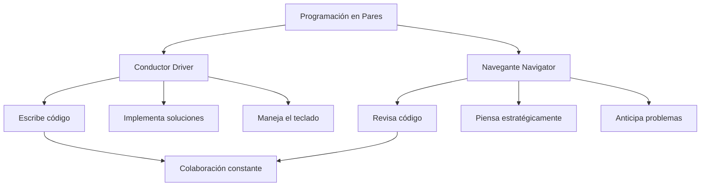
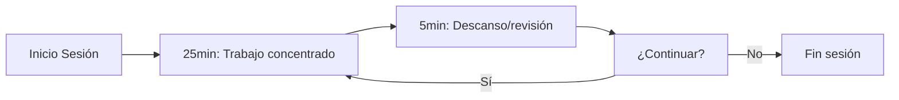
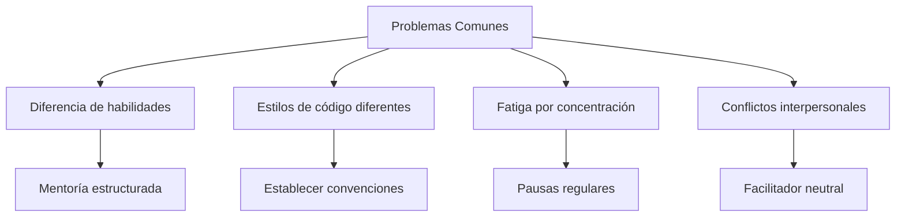

# Modelado y Programación - Buenas prácticas de programación

## 3.5 Programación en pares.

---

La **Programación en Pares** (Pair Programming) es una práctica ágil donde dos programadores trabajan juntos en una misma estación de trabajo. Una persona es el **"conductor"** (driver) que escribe el código, mientras la otra es el **"navegante"** (navigator) que revisa cada línea de código y piensa estratégicamente.

Es una de las prácticas centrales de la **Programación Extrema** (XP) de Kent Beck. Los roles se intercambian con frecuencia, cada 15 a 30 minutos o en cada ciclo de TDD, para que ambos se mantengan activos y conozcan todo el código.

La idea no es que dos personas hagan el trabajo de una, sino que el navegante haga en tiempo real la revisión de código, el diseño y la búsqueda de casos límite, mientras el conductor se concentra en los detalles de la escritura.

### Modelos de Programación en Pares

#### Roles y Responsabilidades

#### Estilos de Pair Programming

| Estilo              | Descripción                              | Mejor uso          |
| ------------------- | ---------------------------------------- | ------------------ |
| **Piloto-Copiloto** | Un conduce, otro navega                  | Desarrollo general |
| **Ping-Pong**       | Uno escribe una prueba, el otro la hace pasar y escribe la siguiente | TDD                |
| **Experto-Novato**  | El novato conduce y el experto navega    | Mentoría           |
| **Mob programming** | Todo el equipo en una pantalla, con un conductor que rota | Problemas difíciles |

### Beneficios y Ventajas

#### Qué dice la evidencia

Los estudios empíricos muestran beneficios reales, pero más modestos y dependientes del contexto que lo que a veces se afirma:

- En el experimento de Williams, Kessler, Cunningham y Jeffries (2000) con estudiantes, los pares produjeron código con alrededor de **15% menos defectos** a cambio de alrededor de **15% más de esfuerzo total** (horas-persona), aunque terminaron antes en tiempo de calendario.
- El metaanálisis de Hannay, Dybå, Arisholm y Sjøberg (2009) encontró un efecto **pequeño y positivo** en la calidad, una reducción **moderada** del tiempo de entrega y un **aumento** del esfuerzo total. El beneficio es mayor en tareas complejas y entre programadores con menos experiencia, y puede desaparecer en tareas sencillas hechas por expertos.

Beneficios menos fáciles de medir, pero ampliamente reportados:

- **Transferencia de conocimiento**: menos dependencia de una sola persona para cada módulo.
- **Mejor diseño**: las decisiones se discuten antes de escribirlas.
- **Menos distracciones**: es más difícil perder el foco cuando otra persona trabaja contigo.

#### Costos

- Más horas-persona por tarea, sobre todo en trabajo rutinario.
- Cansancio: la concentración sostenida y la comunicación constante agotan; por eso se recomiendan pausas.
- Requiere habilidades interpersonales y puede ser incómodo para algunas personas.

La decisión razonable es usarla de forma **selectiva**: en código crítico o complejo, al integrar a personas nuevas y al resolver errores difíciles.

### Técnicas y Mejores Prácticas

#### Protocolo de Comunicación Efectiva

| Comunicación poco útil | Comunicación efectiva |
| --- | --- |
| "Eso está mal." | "Veo un posible problema aquí; ¿qué pasa si la lista está vacía?" |
| "Déjame hacerlo." (tomar el teclado) | "¿Te parece si cambiamos de rol para probar una idea?" |
| Escribir en silencio | Pensar en voz alta: "Voy a extraer este cálculo en un método" |
| Corregir cada detalle de inmediato | Anotar detalles menores y comentarlos en una pausa natural |

#### Técnica del Pomodoro para Pair Programming

Se trabaja 25 minutos concentrados y se descansa 5; tras cuatro ciclos se toma un descanso más largo. El cambio de rol puede coincidir con cada pomodoro.

### Implementación Práctica

#### Configuración del Entorno

- **Presencial**: una sola computadora, pantalla grande o dos monitores que muestren lo mismo, y espacio para que ambos vean y alcancen el teclado. Un segundo teclado y ratón facilitan el cambio de rol.
- **Remoto**: un editor colaborativo (VS Code Live Share, JetBrains Code With Me), audio de buena calidad y, de preferencia, video.
- **Común**: control de versiones, pruebas automáticas que se ejecuten rápido y un formato de código acordado.

#### Ejemplo de Sesión de Pair Programming

Una sesión en estilo **ping-pong** combina pares con TDD (tema 3.4). Ana y Beto implementan `FizzBuzz.convertir(int n)`:

1. **Ana** escribe la prueba `convertir(1) == "1"`, que falla. Pasa el teclado.
2. **Beto** escribe `return String.valueOf(n);`, la prueba pasa, y escribe la siguiente: `convertir(3) == "Fizz"`, que falla. Pasa el teclado.
3. **Ana** agrega `if (n % 3 == 0) return "Fizz";` y escribe la prueba del 5.
4. **Beto** la hace pasar y escribe la prueba del 15, que falla porque devuelve `"Fizz"`.
5. **Ana** agrega la condición del 15 al inicio. Juntos refactorizan las pruebas a una prueba parametrizada.

Cada uno escribe la prueba que el otro debe satisfacer, así que ambos alternan entre especificar e implementar y ninguno se queda solo mirando. El código resultante es el del ejemplo de FizzBuzz del tema 3.4.

### Métricas y Evaluación

No hay una fórmula única para medir el éxito de la práctica; se combinan indicadores de calidad, de flujo de trabajo y de las personas, comparándolos con el mismo equipo antes de adoptarla.

#### Tabla de Métricas Recomendadas

| Métrica                     | Fórmula                                               | Objetivo       |
| --------------------------- | ----------------------------------------------------- | -------------- |
| **Densidad de defectos**    | Defectos por cada mil líneas de código (KLOC)         | Tendencia a la baja |
| **Velocidad**               | Puntos de historia por iteración                      | Estable        |
| **Satisfacción**            | Encuesta anónima (1-10)                               | > 8/10         |
| **Conocimiento compartido** | % del equipo que conoce cada módulo                   | > 80%          |

### Ejercicios Prácticos Propuestos

#### Ejercicio 1: Sesión de Ping-Pong Programming

**Objetivo**: Implementar una calculadora científica usando TDD con el estilo ping-pong.

**Instrucciones**:

1. Desarrollador A escribe test para suma
2. Desarrollador B implementa suma
3. Desarrollador B escribe test para resta
4. Desarrollador A implementa resta
5. Continuar con multiplicación, división, potencias, etc.

#### Ejercicio 2: Rotación de Roles

**Objetivo**: Experimentar con cambios de rol cada 25 minutos.

**Tarea**: Implementar un sistema de gestión de tareas:

- 0-25min: A conduce, B navega
- 25-30min: discusión y descanso
- 30-55min: B conduce, A navega
- 55-60min: retrospectiva de la sesión

#### Ejercicio 3: Resolución de Problemas Complejos

**Problema**: Implementar un algoritmo de pathfinding (A* o Dijkstra).

**Dinámica**:

- 15min: Discusión inicial y diseño
- 45min: Implementación en pares
- 15min: Revisión y refactorización
- 15min: Retrospectiva y lecciones aprendidas

#### Ejercicio 4: Pair Programming Remoto

**Herramientas**: Configurar VS Code Live Share o JetBrains Code With Me.

**Tarea**: Colaborar remoto implementando:

- Sistema de autenticación básico
- CRUD completo para una entidad
- Tests unitarios y de integración

### Retos y Soluciones Comunes

#### Problemas Frecuentes y Soluciones

#### Acuerdo de Trabajo en Pareja

Antes de empezar conviene acordar explícitamente:

- **Rotación**: cambiar de rol cada 25 a 30 minutos o en cada ciclo de TDD.
- **Comunicación**: crítica dirigida al código y no a la persona; pensar en voz alta.
- **Señales**: "pausa, necesito explicar algo", "¿puedo tomar el teclado para probar una idea?", "necesito un descanso", "no entiendo este enfoque".
- **Desacuerdos**: si una discusión se alarga, probar ambas ideas rápidamente o dejar una nota y seguir.

### Herramientas y Tecnologías

#### Herramientas para Pair Programming

| Tipo                    | Herramientas                             | Uso recomendado       |
| ----------------------- | ---------------------------------------- | --------------------- |
| **Colaboración local**  | Single workstation, dos teclados/ratones | Entornos presenciales |
| **Colaboración remota** | VS Live Share, JetBrains Code With Me    | equipos distribuidos  |
| **Comunicación**        | Zoom, Teams, Discord                     | Comunicación vocal    |
| **Control versiones**   | Git, GitHub, GitLab                      | Gestión de código     |

#### Configuración IDE para Pair Programming

En VS Code, Live Share permite que el invitado edite, depure y use la terminal del anfitrión; conviene revisar qué permisos se conceden antes de compartir una sesión. En el modo *seguir* (*follow*), el editor del navegante sigue automáticamente al del conductor.

### Referencias y Recursos Adicionales

#### Libros Recomendados

1. **"Pair Programming Illuminated"** - Laurie Williams
2. **"The Pragmatic Programmer"** - Andrew Hunt, David Thomas
3. **"Extreme Programming Explained"** - Kent Beck

#### Estudios e Investigación

- Williams, L., Kessler, R. R., Cunningham, W., & Jeffries, R. (2000). Strengthening the case for pair programming. *IEEE Software*, 17(4), 19-25.
- Cockburn, A., & Williams, L. (2001). The costs and benefits of pair programming. En *Extreme Programming Examined*. Addison-Wesley.
- Hannay, J. E., Dybå, T., Arisholm, E., & Sjøberg, D. I. K. (2009). The effectiveness of pair programming: A meta-analysis. *Information and Software Technology*, 51(7), 1110-1122.

#### Recursos Online

- [Pair Programming Guide](https://www.agilealliance.org/glossary/pairing/)
- [Martin Fowler on Pair Programming](https://martinfowler.com/articles/on-pair-programming.html)
- [Pair Programming Patterns](https://wiki.c2.com/?PairProgrammingPatterns)

### Conclusión

La Programación en Pares es una práctica poderosa que, cuando se implementa correctamente, ofrece beneficios significativos en calidad de código, transferencia de conocimiento y satisfacción del equipo. La clave del éxito está en:

1. **Establecer expectativas claras** y acuerdos de colaboración
2. **Rotar roles regularmente** para mantener el engagement
3. **Usar las herramientas adecuadas** para la colaboración
4. **Mantener comunicación abierta** y respetuosa
5. **Evaluar y ajustar** continuamente el proceso

La inversión en pair programming se traduce en software de mayor calidad, equipos más cohesionados y una base de código más mantenible a largo plazo.
