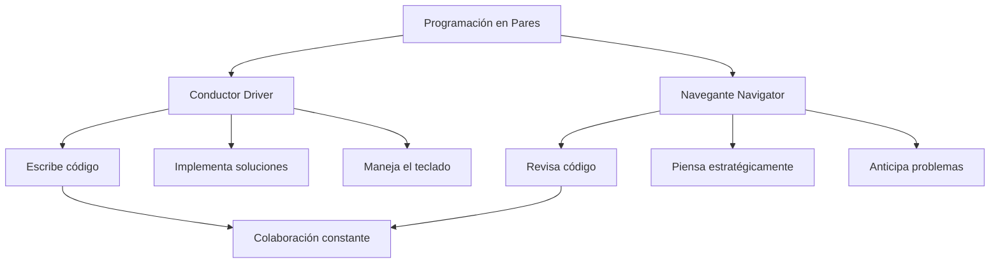
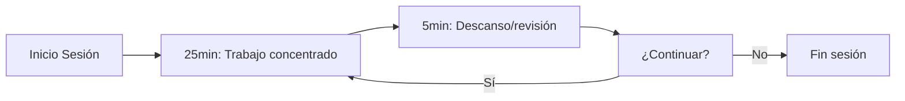
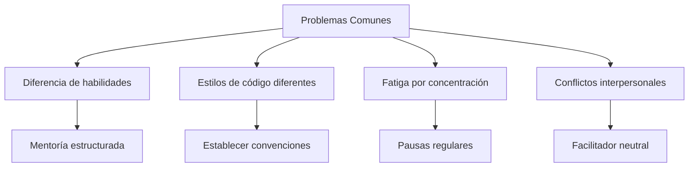

# Modelado y Programación - Buenas prácticas de programación

## 3.5 Programación en pares.

---

La **Programación en Pares** (Pair Programming) es una práctica ágil donde dos programadores trabajan juntos en una misma estación de trabajo. Una persona es el **"conductor"** (driver) que escribe el código, mientras la otra es el **"navegante"** (navigator) que revisa cada línea de código y piensa estratégicamente.

#### Fórmula de Productividad

$$
P_{pair} = \frac{{C_{calidad} \times V_{velocidad}}}{{E_{errores}}}
$$

Donde:

- $P_{pair}$ = Productividad en pair programming
- $C_{calidad}$ = Coeficiente de calidad (1.0-2.0)
- $V_{velocidad}$ = Velocidad de desarrollo
- $E_{errores}$ = Tasa de errores

### Modelos de Programación en Pares

#### Roles y Responsabilidades



#### Estilos de Pair Programming

| Estilo              | Descripción                              | Mejor uso          |
| ------------------- | ---------------------------------------- | ------------------ |
| **Piloto-Copiloto** | Un conduce, otro navega                  | Desarrollo general |
| **Ping-Pong**       | Alternan escribir tests e implementación | TDD                |
| **Expert-Novato**   | Experto guía a principiante              | Mentoría           |
| **Tournament**      | Múltiples pares rotando                  | Hackathons         |

### Beneficios y Ventajas

#### Beneficios Cuantificables

- **Reducción de errores**: 15-50% menos defects
- **Mejor calidad de código**: 20-40% más mantenible
- **Transferencia de conocimiento**: 70% más efectiva que documentación
- **Satisfacción del equipo**: 30% mayor engagement

#### Fórmula de Retorno de Inversión (ROI)

$$
ROI = \frac{{(B_{beneficios} - C_{costos})}}{{C_{costos}}} \times 100\%
$$

Donde $B_{beneficios}$ incluye:

- Reducción de bugs en producción
- Menor tiempo de debugging
- Mejor diseño de software
- Mayor satisfacción del equipo

### Técnicas y Mejores Prácticas

#### Protocolo de Comunicación Efectiva

```java
// Ejemplo de diálogo efectivo durante pair programming
public class EffectiveDialogue {

    // Comunicación pobre [X]
    public void poorCommunication() {
        // "Eso está mal" → Crítica sin constructiva
        // "Déjame hacerlo" → Tomar control
        // Sin explicaciones
    }

    // Comunicación efectiva (✓)
    public void effectiveCommunication() {
        // "¿Qué te parece si probamos este enfoque?"
        // "Veo un potencial issue aquí, ¿cómo lo resolveríamos?"
        // "Explícame tu razonamiento para entender mejor"
        // "Genial idea, implementémosla y veamos los resultados"
    }
}
```

#### Técnica del Pomodoro para Pair Programming

$$
T_{\text{sesión}} = 25\text{min trabajo} + 5\text{min descanso}
$$



### Implementación Práctica

#### Configuración del Entorno

```java
// Configuración recomendada para pair programming
public class PairProgrammingSetup {

    // Hardware esencial
    private String[] hardware = {
        "2 pantallas",
        "2 teclados (opcional)",
        "2 ratones (opcional)",
        "Silla cómoda para ambos"
    };

    // Software y herramientas
    private String[] softwareTools = {
        "IDE con soporte para pair programming",
        "Herramientas de colaboración en tiempo real",
        "Control de versiones (Git)",
        "Plataforma de comunicación"
    };

    // Configuración del espacio físico
    private String environmentSetup() {
        return "Espacio que permita a ambos programadores " +
               "ver la pantalla cómodamente y colaborar " +
               "sin restricciones físicas";
    }
}
```

#### Ejemplo de Sesión de Pair Programming

```java
// Ejemplo de implementación con TDD y pair programming
public class CalculatorPairProgramming {

    // Navegante sugiere test primero
    @Test
    public void testAddition() {
        Calculator calc = new Calculator();
        assertEquals(5, calc.add(2, 3));
    }

    // Conductor implementa
    public class Calculator {
        public int add(int a, int b) {
            return a + b; // Implementación inicial
        }
    }

    // Navegante sugiere edge case
    @Test
    public void testAdditionWithNegativeNumbers() {
        Calculator calc = new Calculator();
        assertEquals(-1, calc.add(2, -3));
    }

    // Conductor ajusta implementación
    public int add(int a, int b) {
        // Discusión sobre la mejor implementación
        return a + b; // Funciona para negativos también
    }
}
```

### Métricas y Evaluación

#### Indicadores de Éxito

$$
S_{\text{éxito}} = w_1 \times C_{calidad} + w_2 \times V_{velocidad} + w_3 \times S_{\text{satisfacción}}
$$

Donde:

- $w_1, w_2, w_3$ = pesos según prioridades del proyecto
- $C_{calidad}$ = Métricas de calidad de código
- $V_{velocidad}$ = Velocidad de entrega
- $S_{\text{satisfacción}}$ = Satisfacción del equipo (1-10)

#### Tabla de Métricas Recomendadas

| Métrica                     | Fórmula                                               | Objetivo       |
| --------------------------- | ----------------------------------------------------- | -------------- |
| **Tasa de errores**         | $ \frac{Errores}{\text{LíneasDeCódigo}} \times 1000 $ | < 1 error/KLOC |
| **Velocidad**               | $\frac{Story Points}{Sprint}$                         | Consistente    |
| **Satisfacción**            | Encuesta anónima (1-10)                               | > 8/10         |
| **Conocimiento compartido** | % del equipo que conoce cada módulo                   | > 80%          |

### Ejercicios Prácticos Propuestos

#### Ejercicio 1: Sesión de Ping-Pong Programming

**Objetivo**: Implementar una calculadora científica usando TDD con el estilo ping-pong.

**Instrucciones**:

1. Desarrollador A escribe test para suma
2. Desarrollador B implementa suma
3. Desarrollador B escribe test para resta
4. Desarrollador A implementa resta
5. Continuar con multiplicación, división, potencias, etc.

#### Ejercicio 2: Rotación de Roles

**Objetivo**: Experimentar con cambios de rol cada 25 minutos.

**Tarea**: Implementar un sistema de gestión de tareas:

- 0-25min: A conduce, B navega
- 25-30min: discusión y descanso
- 30-55min: B conduce, A navega
- 55-60min: retrospectiva de la sesión

#### Ejercicio 3: Resolución de Problemas Complejos

**Problema**: Implementar un algoritmo de pathfinding (A* o Dijkstra).

**Dinámica**:

- 15min: Discusión inicial y diseño
- 45min: Implementación en pares
- 15min: Revisión y refactorización
- 15min: Retrospectiva y lecciones aprendidas

#### Ejercicio 4: Pair Programming Remoto

**Herramientas**: Configurar VS Code Live Share o JetBrains Code With Me.

**Tarea**: Colaborar remoto implementando:

- Sistema de autenticación básico
- CRUD completo para una entidad
- Tests unitarios y de integración

### Challenges y Soluciones Comunes

#### Problemas Frecuentes y Soluciones



#### Plantilla de Acuerdo de Pair Programming

```java
public class PairProgrammingAgreement {
    // Normas de colaboración
    private String[] norms = {
        "Rotación de roles cada 25-30 minutos",
        "Respetar turnos para hablar",
        "Crítica constructiva siempre",
        "Celebrar éxitos conjuntos",
        "Tolerancia a diferentes enfoques"
    };

    // Señales para comunicación
    private String[] communicationSignals = {
        "Pausa: necesito explicar algo",
        "Toma el control: quiero probar algo",
        "Necesito un descanso",
        "No entiendo este approach"
    };
}
```

### Herramientas y Tecnologías

#### Herramientas para Pair Programming

| Tipo                    | Herramientas                             | Uso recomendado       |
| ----------------------- | ---------------------------------------- | --------------------- |
| **Colaboración local**  | Single workstation, dos teclados/ratones | Entornos presenciales |
| **Colaboración remota** | VS Live Share, JetBrains Code With Me    | equipos distribuidos  |
| **Comunicación**        | Zoom, Teams, Discord                     | Comunicación vocal    |
| **Control versiones**   | Git, GitHub, GitLab                      | Gestión de código     |

#### Configuración IDE para Pair Programming

```json
// settings.json para VS Code (Live Share)
{
  "liveshare.featureSet": "experimental",
  "liveshare.allowGuestTaskControl": true,
  "liveshare.allowGuestDebugControl": true,
  "editor.cursorBlinking": "phase",
  "editor.cursorSmoothCaretAnimation": "on"
}
```

### Referencias y Recursos Adicionales

#### Libros Recomendados

1. **"Pair Programming Illuminated"** - Laurie Williams
2. **"The Pragmatic Programmer"** - Andrew Hunt, David Thomas
3. **"Extreme Programming Explained"** - Kent Beck

#### Estudios e Investigación

- [NASA Study on Pair Programming](https://doi.org/10.1109/52.976940)
- [University of Utah Research](https://dl.acm.org/doi/10.1145/358710.358732)
- [IEEE Pair Programming Benefits](https://ieeexplore.ieee.org/document/854064)

#### Recursos Online

- [Pair Programming Guide](https://www.agilealliance.org/glossary/pairing/)
- [Martin Fowler on Pair Programming](https://martinfowler.com/articles/on-pair-programming.html)
- [Pair Programming Patterns](https://wiki.c2.com/?PairProgrammingPatterns)

### Conclusión

La Programación en Pares es una práctica poderosa que, cuando se implementa correctamente, ofrece beneficios significativos en calidad de código, transferencia de conocimiento y satisfacción del equipo. La clave del éxito está en:

1. **Establecer expectativas claras** y acuerdos de colaboración
2. **Rotar roles regularmente** para mantener el engagement
3. **Usar las herramientas adecuadas** para la colaboración
4. **Mantener comunicación abierta** y respetuosa
5. **Evaluar y ajustar** continuamente el proceso

La inversión en pair programming se traduce en software de mayor calidad, equipos más cohesionados y una base de código más mantenible a largo plazo.
