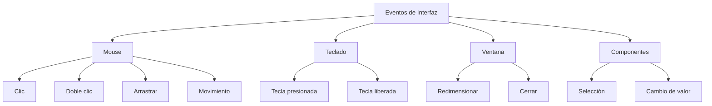
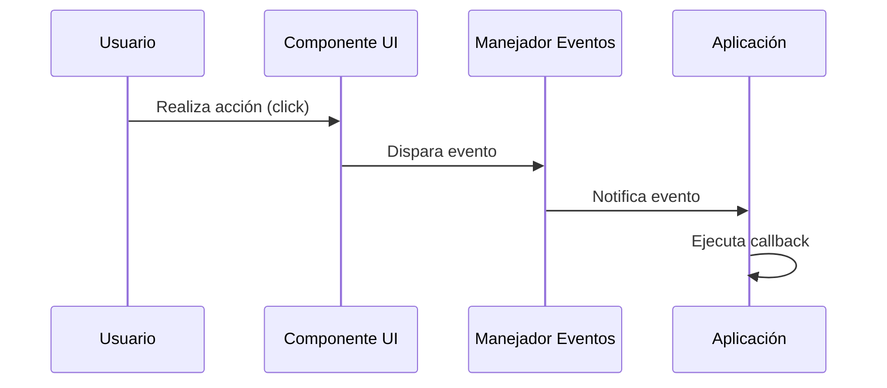
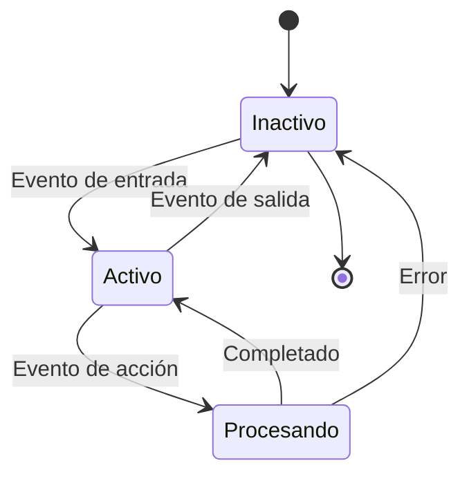

# Modelado y Programación - Interfaces hombre/máquina

## 4.1 Eventos

---

Los **eventos** son acciones o sucesos que ocurren en el sistema, generalmente iniciados por el usuario o por el propio sistema, que pueden ser detectados y manejados por el programa.

#### Definición Formal

Un **evento** es una representación de una acción significativa que puede ser detectada por un programa, típicamente resultante de la interacción del usuario con los componentes de la interfaz.

### Tipos de Eventos

#### 1. Eventos de Interfaz Gráfica



#### 2. Eventos de Modelo de Datos

- Cambios en estructuras de datos
- Actualizaciones de base de datos
- Modificaciones de estado

### Arquitectura de Manejo de Eventos

#### Modelo de Publicador-Suscriptor (Observer Pattern)



### Implementación en Diferentes Lenguajes

#### JavaScript (Web)

```javascript
// Método 1: addEventListener
const button = document.getElementById('myButton');
button.addEventListener('click', function (event) {
  console.log('Botón clickeado', event.target);
  event.preventDefault(); // Prevenir comportamiento por defecto
});

// Método 2: Propiedades de evento
button.onclick = function (e) {
  console.log('Manejador onclick');
};

// Evento personalizado
const customEvent = new CustomEvent('miEvento', {
  detail: { mensaje: 'Evento personalizado' },
});
button.dispatchEvent(customEvent);
```

#### Java (Swing)

```java
import javax.swing.*;
import java.awt.event.*;

public class EventExample {
    public static void main(String[] args) {
        JFrame frame = new JFrame("Ejemplo Eventos");
        JButton button = new JButton("Haz clic");

        button.addActionListener(new ActionListener() {
            @Override
            public void actionPerformed(ActionEvent e) {
                System.out.println("Botón presionado");
            }
        });

        frame.add(button);
        frame.setSize(300, 200);
        frame.setVisible(true);
    }
}
```

#### Python (Tkinter)

```python
import tkinter as tk

def manejar_click(evento):
    print(f"Clic en posición: {evento.x}, {evento.y}")

ventana = tk.Tk()
boton = tk.Button(ventana, text="Haz clic")
boton.bind("<Button-1>", manejar_click)  # Button-1 = clic izquierdo
boton.pack()

ventana.mainloop()
```

### Modelado Matemático de Eventos

#### Probabilidad de Eventos

La probabilidad de que ocurra un evento $E$ en un sistema interactivo se puede modelar como:

$$P(E) = \frac{N(E)}{N(T)}$$

Donde:

- $P(E)$ = Probabilidad del evento
- $N(E)$ = Número de veces que ocurre el evento
- $N(T)$ = Número total de interacciones

#### Tasa de Eventos

La frecuencia de eventos por unidad de tiempo:

$$\lambda = \frac{\Delta N}{\Delta t}$$

Donde $\lambda$ es la tasa de eventos.

### Patrones de Diseño para Manejo de Eventos

#### 1. Observer Pattern

```java
// Interface Observador
public interface EventListener {
    void update(String eventType, Object data);
}

// Sujeto Observable
public class EventManager {
    private Map<String, List<EventListener>> listeners = new HashMap<>();

    public void subscribe(String eventType, EventListener listener) {
        listeners.computeIfAbsent(eventType, k -> new ArrayList<>()).add(listener);
    }

    public void notify(String eventType, Object data) {
        for (EventListener listener : listeners.getOrDefault(eventType, new ArrayList<>())) {
            listener.update(eventType, data);
        }
    }
}
```

#### 2. Command Pattern para Manejo de Eventos

```javascript
class Command {
  execute() {}
  undo() {}
}

class ClickCommand extends Command {
  constructor(element) {
    super();
    this.element = element;
    this.previousState = element.style.backgroundColor;
  }

  execute() {
    this.element.style.backgroundColor = 'blue';
  }

  undo() {
    this.element.style.backgroundColor = this.previousState;
  }
}

// Uso
const command = new ClickCommand(button);
command.execute();
// Para deshacer: command.undo();
```

### Diagrama de Estados para Manejo de Eventos



### Ejercicios Propuestos

#### Ejercicio 1: Sistema de Eventos Básico

Crea un sistema que maneje los siguientes eventos:

- `click`: Cambia el color de fondo
- `dblclick`: Cambia el color del texto
- `mouseover`: Muestra información en tooltip

**Requisitos:**

- Usar el patrón Observer
- Permitir múltiples suscriptores por evento
- Implementar remoción de listeners

#### Ejercicio 2: Calculadora de Probabilidades

Desarrolla una aplicación que:

1. Registre la frecuencia de diferentes eventos de UI
2. Calcule probabilidades usando $P(E) = \frac{N(E)}{N(T)}$
3. Muestre estadísticas en tiempo real

#### Ejercicio 3: Sistema de Gestión de Eventos

Implementa un sistema que:

- Permita crear eventos personalizados
- Gestione prioridades de eventos
- Implemente colas de eventos para procesamiento asíncrono

### Ejemplo Avanzado: Sistema de Eventos con Prioridades

```javascript
class PriorityEventSystem {
  constructor() {
    this.events = new Map();
    this.priorityQueue = new MaxPriorityQueue();
  }

  addEvent(eventName, callback, priority = 0) {
    if (!this.events.has(eventName)) {
      this.events.set(eventName, []);
    }
    this.events.get(eventName).push({ callback, priority });
    this.priorityQueue.enqueue(eventName, priority);
  }

  triggerEvent(eventName, data) {
    if (this.events.has(eventName)) {
      const handlers = this.events.get(eventName).sort((a, b) => b.priority - a.priority);

      handlers.forEach((handler) => {
        try {
          handler.callback(data);
        } catch (error) {
          console.error(`Error en manejador de ${eventName}:`, error);
        }
      });
    }
  }
}

// Uso
const eventSystem = new PriorityEventSystem();
eventSystem.addEvent('userLogin', handleLogin, 10);
eventSystem.addEvent('userLogin', logLogin, 5);
```

### Referencias y Buenas Prácticas

#### Mejores Prácticas

1. **Desacoplamiento**: Mantener los manejadores de eventos independientes de la lógica de UI
2. **Rendimiento**: Usar delegación de eventos para múltiples elementos similares
3. **Mantenibilidad**: Un manejador por evento, que delegue a funciones especializadas

#### Anti-patrones a Evitar

```javascript
// Mala práctica: lógica compleja en manejador [X]
button.onclick = function () {
  // 100 líneas de código...
  // Mezcla de lógica de UI, negocio y persistencia
};

// Buena práctica: manejador delgado (✓)
button.onclick = function () {
  handleButtonClick();
};

function handleButtonClick() {
  updateUI();
  processBusinessLogic();
  saveData();
}
```

### Ejercicio de Evaluación

**Problema:** Diseña un sistema de eventos para una aplicación de dibujo que debe manejar:

- Eventos de mouse (click, drag, move)
- Eventos de teclado (atajos)
- Eventos táctiles (para dispositivos móviles)
- Eventos personalizados (guardado automático, cambio de herramienta)

**Entrega:**

1. Diagrama de arquitectura (Mermaid)
2. Implementación en el lenguaje de tu preferencia
3. Tests que verifiquen el funcionamiento correcto

### Recursos Adicionales

#### Lecturas Recomendadas

1. "Design Patterns: Elements of Reusable Object-Oriented Software" - Gamma et al.
2. "Human-Computer Interaction" - Dix, Finlay, Abowd, Beale
3. "JavaScript: The Good Parts" - Douglas Crockford

#### Herramientas

- **Debugging**: Herramientas de desarrollador del navegador
- **Profiling**: Chrome DevTools Performance tab
- **Testing**: Jest, Mocha, Jasmine para pruebas de eventos
